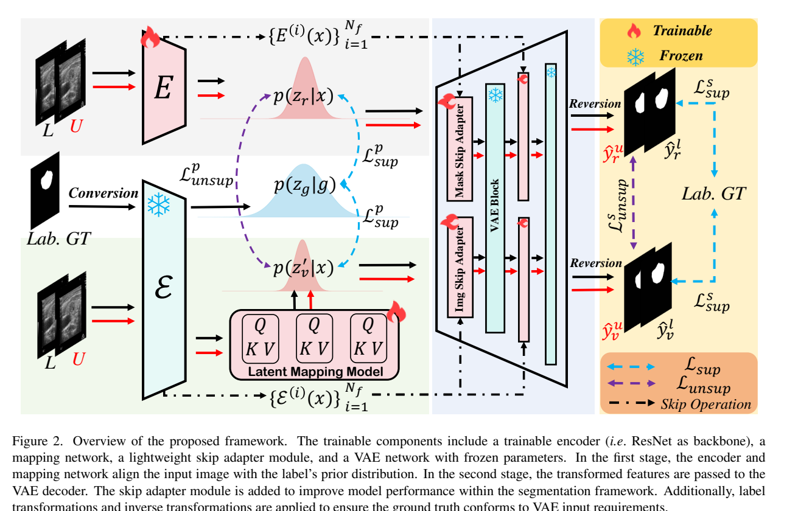
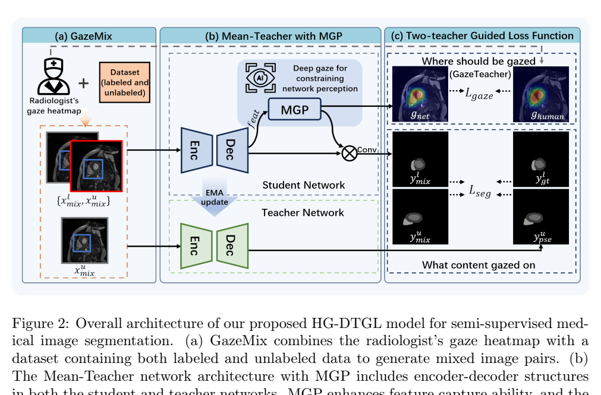
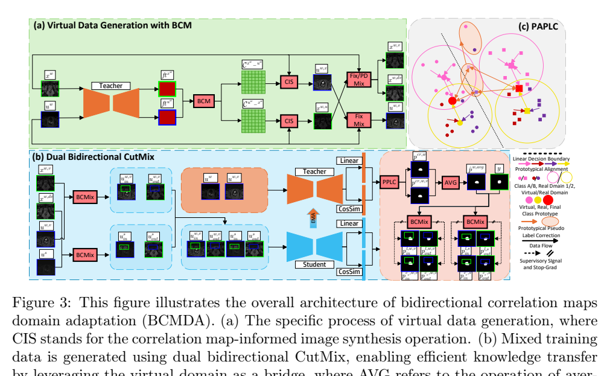
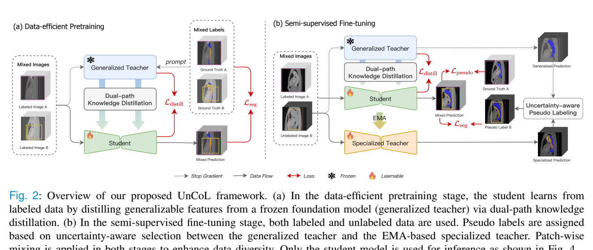

# arXiv 检索结果 / Results

## 1. SemiGDA: Generative Dual-distribution Alignment for Semi-Supervised Medical Image Segmentation
- Authors：Kaiwen Huang, Yi Zhou, Yizhe Zhang, Jingxiong Li, Tao Zhou
- Venue：CVPR 2026
- Comments：This paper have been accepted by CVPR 2026
- First：2026-04-25T12:37:01+00:00；Latest：2026-04-25T12:37:01+00:00
- Abs：https://arxiv.org/abs/2604.23274v1
- PDF：https://arxiv.org/pdf/2604.23274v1
- Code：https://github.com/taozh2017/SemiGDA, https://huggingface.co/huggingface, https://huggingface.co/docs/hub/spaces
- 解读来源：PDF 全文，共 11 页，11 页可提取文字
### [中文]
**中文翻译**
- 标题：SemiGDA：用于半监督医学图像分割的生成式双分布对齐
- 摘要：半监督学习通过利用无标签数据中的潜在信息来提升模型性能，从而解决医学图像分割中的标签稀缺和标注成本高昂问题。传统的判别式分割依赖分割掩码，忽略了特征层面的分布约束。这在标签较少的场景下限制了鲁棒的语义表示学习以及对无标签数据的自适应建模。为解决这些局限，我们提出了SemiGDA，一种用于半监督医学图像分割的新型生成式双分布对齐框架。我们的SemiGDA通过对齐特征分布和语义分布来提升语义学习和场景适应性，从而克服判别式方法对大规模标注数据集的依赖。具体而言，我们提出了双分布对齐模块（DAM），该模块采用两个结构不同的编码器对图像和掩码的特征分布进行建模，并通过分布约束在潜在空间中强制二者对齐，从而建立结构化的特征一致性。此外，我们设计了一致性驱动的跳跃适配器（CDSA）策略，引入双跳跃适配器（图像和掩码），通过跳跃连接融合多尺度特征。利用一致性损失，CDSA增强了跨分支的语义对齐，并强化了细粒度的语义一致性。在多种医学数据集上的实验结果表明，我们的方法优于其他最先进的半监督分割方法。代码发布于：https://github.com/taozh2017/SemiGDA。

SemiGDA 提出一种生成式半监督医学图像分割框架：用冻结的 Stable Diffusion VAE 编码图像与掩码，通过可学习映射网络对齐二者潜分布（DAM），并在解码器跳连处加入图像/掩码双适配器与一致性损失（CDSA），另用可逆的标注转换/反转换（ACR）解决 VAE 输入范围问题。在结肠镜、ISIC-2018、BCSS、BUSI 四个数据集、10%/30% 标签设置下，Dice 与 95HD 多数优于 11 个对比方法；消融显示 DAM、CDSA 与无监督损失均有增益。

# SemiGDA 详细阅读笔记

## 1. 问题与动机

论文针对半监督医学图像分割（SMIS）中标注稀缺的问题。作者认为现有方法主要分两类：伪标签方法依赖初始预测质量，易受噪声影响；一致性学习方法（如 Mean Teacher 及双流网络）在输入或特征上加扰动约束输出不变，但本质仍是判别式逐像素分类，缺少特征级分布约束，在标签很少时鲁棒性和对图像结构、上下文语义的建模不足 [p. 1–2]。生成式方法（GAN、VAE、扩散模型）虽被用于数据增广或对抗式分布对齐，但对抗训练存在收敛困难，扩散模型迭代训练复杂耗时；直接将生成模型用于分割的研究仍有限（如 GMS、GSS、GMMSeg）[p. 2–3]。因此作者希望把图像与掩码映射到潜空间并对齐其先验分布，用生成范式缓解判别模型在少标签下的过拟合与泛化差问题 [p. 2]。

## 2. 方法

**总体流程。** 训练集含 N_l 个有标签样本和 N_u 个无标签样本（N_l ≪ N_u），图像 x∈R^{H×W×3}，标签 y∈{0,1}^{K×H×W} [p. 3]。如图 2（p. 3）所示，图像同时进入两条分支：一条是冻结的 Stable Diffusion VAE 编码器 E(·)，输出经可学习潜映射网络 M(·)（自注意力结构）得到对齐后的图像潜变量；另一条是可训练编码器（ResNet 骨干）提取细粒度判别特征。两路特征送入含 Image Adapter 与 Mask Adapter 的解码器，最终经反转换得到分割图。可训练部分为编码器、映射网络、轻量跳连适配器；VAE 参数冻结 [p. 3, Fig. 2]。

**DAM（双分布对齐模块）。** 冻结 VAE 编码器对图像建模 p(z_v|x)=N(z_v; μ_{z_v}(x;θ_v), σ_{z_v}(x;θ_v))（式 1），映射网络得到 p(z̃_v|z_v)=N(z̃_v; μ_{z̃_v}(z_v;θ_m), σ_{z̃_v}(z_v;θ_m))（式 2）；可训练编码器给出 p(z_r|x)=N(z_r; μ_{z_r}(x;θ_r), σ_{z_r}(x;θ_r))（式 3）；对仅有标签可得的掩码 g，用同一冻结 VAE 编码器建模 p(z_g|g)（式 4）[p. 3–4]。对齐损失用 MSE：有标签时 L_p^sup=‖z̃_v^l−z_g‖²+‖z_r^l−z_g‖²（式 5）；无标签时约束两图像分支一致 L_p^unsup=‖z̃_v^u−z_r^u‖²（式 6）[p. 4]。注意式 6 下方文字把两个符号都写成 z̃_v^u，应为笔误，按上下文应分别为两分支特征。

**CDSA（一致性驱动跳连适配器）。** 从两编码器各取多尺度特征库 S_v、S_r（式 7），分别经 Image Skip Adapter 与 Mask Skip Adapter（轻量卷积）融合到 VAE 解码块的跳连处（图 3，p. 5）[p. 4–5]。有标签时各适配器输出受 Dice 监督：L_s^sup=L_dice(ŷ_v^l,y)+L_dice(ŷ_r^l,y)（式 9）；无标签时两分支互相约束：L_s^unsup=L_dice(ŷ_v^u,ŷ_r^u)+L_dice(ŷ_r^u,ŷ_v^u)（式 10，原文写作“ŷ_r^u.ŷ_v^u”，符号略含混）[p. 5]。Dice 定义见式 8。

**ACR（标注转换与反转换）。** 将原始掩码像素值 0…K−1 先除以 K 归一化到 [0,1]，再映射到 [−1,1]：G′=2·G/K−1（式 11），以匹配 VAE 输入；反转换为端到端逆运算，保证语义完整 [p. 5]。

**总损失。** L_sup=L_p^sup+L_s^sup（式 12），L_unsup=L_p^unsup+L_s^unsup（式 13），L_total=L_sup+λ_u L_unsup（式 14），其中 λ_u(t)=β·e^{−5(1−t/t_max)²}，β=0.1，t_max 为总迭代数 [p. 5–6]。

## 3. 贡献

作者声称的贡献有四点：首次用生成式双分布对齐直接应对少标签下判别模型的过拟合与泛化差；提出 DAM 在潜空间对齐图像与掩码特征分布；提出 CDSA 增强解码器细节捕捉与鲁棒性；在四个医学基准上优于现有 SMIS 方法 [p. 2]。我的理解：核心新颖点是把冻结 SD-VAE 的潜先验作为“掩码分布锚点”，用 MSE 做特征级监督，并以双适配器跳连弥补生成解码器对多尺度细节的不足；ACR 属于工程性兼容处理，而非方法学创新。作者“首个”的表述属于主张，论文未给出系统性文献检索证据。

## 4. 实验与结果

**数据集与划分。** 结肠镜：CVC-ClinicDB、Kvasir、CVC-300，按 [12] 用 ClinicDB+Kvasir 共 1,450 张训练（10% 作验证），其余与 CVC-300 全部测试 [p. 6]。ISIC-2018：2,075 训练 / 519 验证 / 1,000 测试 [p. 6]。BCSS：151 张病理图裁成 3,888 个 1024×1024 patch，仅肿瘤为前景，70%/10%/20% 划分 [p. 6]。BUSI：780 张中取 647 张异常样本，80%/20% 训练/测试 [p. 6]。标签比例主要为 10% 与 30%，图 6 另报告 1% 等更低比例（具体数值仅见于图，正文未列全）[p. 6–8]。

**训练设置。** 2×NVIDIA 4090，PyTorch 2.4.1、CUDA 11.2；SD VAE 预训练权重作编码器与解码器；两阶段训练：先预训练映射网络与编码器 200 epochs，再全模型微调 350 epochs；batch size 4（2 有标签 + 2 无标签）；输入 224×224；推理取两分支预测平均 [p. 6]。

**对比与指标。** 与 11 个 SOTA 方法比较，指标为 Dice、IoU、95HD [p. 6]。表 1（p. 6）结肠镜 10%：本文 Dice 84.34 / IoU 76.28 / 95HD 3.19，30% 为 86.75 / 79.26 / 3.07；ISIC-2018 10% 为 79.37 / 72.10 / 3.88，30% 为 83.88 / 77.22 / 3.56。表 2（p. 7）BCSS 10% 为 74.05 / 62.68 / 7.05，30% 为 75.65 / 64.59 / 6.90；BUSI 10% 为 75.57 / 65.72 / 4.70，30% 为 78.74 / 69.49 / 4.52。正文举例：Kvasir 10% 下 Dice 比 UnCo 高 1.84%、比 SKCDF 高 8.89%；ISIC 10% 下相对 CSCPA 从 85.75% 提到 86.28%，95HD 从 4.81 降到 4.70 [p. 7]。需注意表 1 中部分基线数字（如 ISIC 10% 的 CSCPA 85.75）与正文一致，但表中个别单元格排版拥挤（如 VCLIPSeg 的 95HD 与 IoU 相邻），阅读时需谨慎。

**消融。** 表 3（p. 8）：基线（仅最终掩码监督）在 ClinicDB 10% 为 74.23/4.47，加 DAM 为 75.92/4.21，加 CDSA 为 76.83/4.07，两者同加为 79.37/3.88；Kvasir 10% 对应 77.01→80.02→81.84→83.03；BUSI 10% 对应 70.48→73.07→75.25→75.57 [p. 8]。表 4（p. 8）双适配器：仅 Image 在 ClinicDB 为 76.98/4.25，仅 Mask 为 77.14/4.11，两者为 79.37/3.88；BUSI 上仅 Image 74.92/4.75、仅 Mask 73.91/4.88、两者 75.57/4.70 [p. 8]。表 5（p. 8）损失消融：Kvasir 10% 从 L_s^sup+L_p^sup 的 79.34/4.63 提升到四项全用的 83.03/4.39；ClinicDB 从 78.61/4.97 到 79.37/3.88；BUSI 从 75.08/4.89 到 75.57/4.70 [p. 8]。图 5（p. 8）展示潜特征与分割可视化，作者称 DAM 使分布聚焦病灶、CDSA 锐化边界；该图仅凭正文与图注描述，未逐像素核验。

## 5. 评估

支持的结论：在四个数据集、10%/30% 设置下，完整模型多数指标优于所列基线，消融中 DAM、CDSA 与无监督损失均带来一致增益，尤其 Kvasir 10% 的无监督损失增益较大（79.34→83.03）[p. 8]。局限与缺失证据：论文未报告参数量、推理时间、显存开销，也未说明 SD VAE 冻结带来的计算成本；未给出多次运行的均值/方差或显著性检验；1% 等低标签结果仅以图 6 呈现，正文无具体数字 [p. 8]；式 6 与式 10 的符号存在笔误/含混，影响精确复现；表 1 部分单元格排版拥挤，个别数字的可读性有限；对比方法虽多，但未讨论与 GMS/GSS 等生成式分割方法的直接比较（仅在相关工作提及）[p. 2–3]。

## 6. 复现

已报告：SD VAE 预训练权重；ResNet 编码器；两阶段 200+350 epochs；batch 4（2+2）；224×224；β=0.1 的高斯 warm-up；推理取双分支平均；优化器、学习率、权重衰减、数据增强、λ_u 之外的其他损失权重均未报告 [p. 6]。复现步骤：①按 ACR 式 11 预处理掩码；②冻结 VAE，预训练映射网络与编码器；③加入双跳连适配器全模型微调；④按式 14 联合优化；⑤推理平均两分支输出。未报告细节需自行调参，不能从论文推断。

#### 原论文流程图 · Figure 2 · PDF 第 3 页

Figure 2. Overview of the proposed framework. The trainable components include a trainable encoder (i.e. ResNet as backbone), a mapping network, a lightweight skip adapter module, and a VAE network with frozen parameters. In the first stage, the encoder and mappingnetworkaligntheinputimagewiththelabel’spriordistribution. Inthesecondstage,thetransformedfeaturesarepassedtothe VAEdecoder. Theskipadaptermoduleisaddedtoimprovemodelperformancewithinthesegmentationframework. Additionally,la𝑝be(l𝑧|𝑥)

[原文来源](https://arxiv.org/pdf/2604.23274v1#page=3)

## 2. Human Gaze-based Dual Teacher Guidance Learning for Semi-Supervised Medical Image Segmentation
- Authors：Rongjun Ge, Chong Wang, Yuxin Liu, Chunqiang Lu, Cong Xia, Yehui Jiang, Fangyi Xu, Yinsu Zhu, Daoqiang Zhang, Chengyu Liu, Yang Chen, Shuo Li, Yuting He
- First：2026-04-12T17:51:36+00:00；Latest：2026-04-12T17:51:36+00:00
- Abs：https://arxiv.org/abs/2604.10754v1
- PDF：https://arxiv.org/pdf/2604.10754v1
- Code：https://huggingface.co/huggingface, https://huggingface.co/docs/hub/spaces
- 解读来源：PDF 全文，共 31 页，31 页可提取文字
### [中文]
**中文翻译**
- 标题：基于人类注视的双教师引导学习用于半监督医学图像分割
- 摘要：在医学图像分割领域，标注数据的稀缺对现有模型准确感知目标区域构成了重大挑战。与人工标注相比，注视数据更易获取且成本更低。作为经典的半监督学习框架，均值教师可通过自教学与协同优化有效利用大量无标注医学图像进行稳定训练。本研究基于均值教师框架，通过结合注视数据，旨在解决半监督医学图像分割中的两个关键问题：1）在有限标注数据下扩展数据集的规模与多样性；2）增强网络的感知能力。我们提出了基于人类注视的双教师引导学习模型（HG-DTGL）。在该模型中，人类注视作为均值教师架构中的额外隐藏“教师”。我们引入GazeMix生成可靠的混合数据以扩展数据集的多样性与规模，并采用多尺度注视感知（MGP）模块提取网络的多尺度感知。设计了注视损失以使模型的感知与人类注视对齐。我们在多种不同模态的数据集上验证了HG-DTGL，并通过大量实验在共十种不同器官/组织上取得了优越性能。这表明我们的方法对不同模态的医学图像具有较强的泛化能力，并显示出注视数据在半监督医学图像分割中的巨大应用潜力。

论文提出HG-DTGL，在mean-teacher半监督分割框架中把放射科医生的注视热图作为额外“隐藏教师”。核心组件包括：基于注视点矩形区域裁剪粘贴的GazeMix数据增强、提取多尺度网络感知的MGP模块，以及用MSE对齐网络感知与人类注视的Gaze Loss。在ACDC、CAMUS、Synapse、SCR四个数据集、5%与10%标注比例下，Dice分别达到89.37/90.87、86.41/88.05、80.72/83.56、88.31/90.75，均优于UA-MT、DTC、SS-Net、MC-Net、BCP。消融显示GazeMix贡献最大；注视点优于快速扫视；λ=0.5最优；在nnUNet全监督下加入注视也有小幅提升。局限是注视数据采集细节、部分表格排版混乱、缺少统计显著性与跨中心验证。

# 论文阅读笔记：Human Gaze-based Dual Teacher Guidance Learning for Semi-Supervised Medical Image Segmentation

## 1. 问题与动机

半监督医学图像分割的核心困难是标注数据稀缺，模型难以从少量标注中准确估计目标分布[p. 2]。现有方法主要通过改网络结构或一致性正则来提升性能，数据扩充则常用旋转、翻转、MixUp、CutMix 等弱增强或强混合策略[p. 2]。作者指出，CutMix 类方法多在无标注数据间随机裁剪，或把标注数据的前景随机贴到其他图像上，裁剪位置随机或居中，可能丢失分割目标，导致混合图像不可用[p. 2]。

作者的出发点是：人类放射科医生即使背景变化也能准确注视正确的前景器官，而网络因医学图像前景/背景相似、无关结构干扰而难以聚焦同一目标（图1，[p. 3]）。眼动数据在阅片过程中可无感采集，几乎不增加诊断时间成本，且能反映目标的空间方位[p. 3]。因此作者希望用注视热图同时解决两件事：扩大有限标注下的数据规模与多样性；增强网络对关键区域的感知能力[p. 1-2]。

## 2. 方法

### 2.1 总体框架

HG-DTGL 建立在 mean-teacher 架构上，包含学生网络 S(Θs) 与教师网络 T(Θt)，二者均为编码器-解码器结构（图2(b)，[p. 4]）。教师通过 EMA 更新并向学生提供伪标签。作者把人类注视视为额外的“隐藏教师”：注视教师通过 MGP + Gaze Loss 教学生“该看哪里”（where），网络教师通过伪标签教学生“看的内容是什么”（what）[p. 6-7]。

### 2.2 注视数据与热图生成

作者设计了眼动采集系统，约束为：采样频率 60 个注视点/秒，单样本采集上限 20 秒，使每样本注视点控制在 800–1200 个[p. 7]。随后用时间戳计算眼动速度，以速度阈值 v_th 区分注视点 P_fix 与扫视点 P_sac，公式(1)将速度超过阈值的点判为扫视并剔除[p. 8]。过滤后的注视点密度生成人类注视热图（图3，[p. 8]）。

### 2.3 GazeMix

GazeMix 是本文的数据增强核心（图4，[p. 9]）。设图像 x∈R^{W×H}，逐像素标签 y∈{0,…,K−1}^{W×H}，数据分为标注集 D_l 与无标注集 D_u，另有注视数据 D_g。每次随机取无标注背景图 x_ub、无标注前景图 x_uf、标注前景图 x_lf 及对应注视 g_lf、g_uf、g_ub。根据注视点位置确定一个包含所有注视点的二值矩形掩码 M，裁剪出注视区域，再缩放粘贴到背景图注视区域的原始位置，得到两个混合样本：

- x_lmix = M(R(x_lf⊙M_lf), x_ub⊙(1−M_ub))，公式(2)
- x_umix = M(R(x_uf⊙M_uf), x_ub⊙(1−M_ub))，公式(3)

其中 R(·) 为缩放，M(·) 为放置操作，⊙ 为逐元素乘[p. 9]。与随机 CutMix 不同，裁剪区域由注视点决定，因此包含完整目标与边界，可缓解边缘裁剪问题[p. 6]。混合后的标注图像由真实标签 y_lgt 监督，无标注混合图像由教师伪标签 y_upse 监督[p. 10]。

### 2.4 MGP 模块

MGP 作用于分割头之前的特征 feat。先做全局平均池化，再经两个全连接层、ReLU 与 Sigmoid 得到通道注意力 α（公式4），并用 α 对 feat 做通道加权得到 feat_c（公式5）[p. 10]。随后对 feat_c 并行执行 1×1、3×3、7×7 空间卷积加 ReLU 与 Sigmoid，得到多尺度空间注意力 β1、β3、β7（公式6）；再拼接三者并经 1×1 卷积与 Sigmoid 融合为网络感知 g_net（公式7）[p. 11]。

### 2.5 损失函数

总损失为 L_all = L_seg + λ·L_gaze（公式10）[p. 12]。

- Gaze Loss：L_gaze = MSE(g_net, g_human)（公式8），用于对齐网络感知与人类注视，纠正模型忽略但医生关注的前景、以及模型误判但医生能区分的背景干扰[p. 11]。
- Segmentation Loss：L_seg = (L_gt(y_lmix, y_lgt) + L_pse(y_umix, y_upse))/2（公式9），其中 L_gt 与 L_pse 均为 Dice 损失与交叉熵损失的组合[p. 12]。

训练流程见算法1：GazeMix 生成混合样本 → 学生网络输出分割结果与网络感知 → 教师网络对无标注混合样本生成伪标签 → 计算总损失 → 梯度下降更新学生 → EMA 更新教师[p. 12]。

## 3. 贡献

作者声称的贡献有四点[p. 6-7]：首次提出由人类注视驱动的双教师半监督分割架构；设计基于注视的 GazeMix 增强；提出 MGP 与 Gaze Loss 实现人机认知对齐；在 ACDC、CAMUS、Synapse、SCR 四个公开数据集上系统评估。

我的解读：真正有区分度的设计是“用注视点决定裁剪位置”这一约束，它把数据增强从随机操作变成解剖位置感知操作；MGP 本身是通道注意力加多尺度空间注意力的组合，结构上并不新颖，其价值主要在于为 Gaze Loss 提供可对齐的感知图。所谓“双教师”中，注视教师只提供空间注意力监督，不直接产生分割标签，因此其贡献更偏正则化而非知识蒸馏。

## 4. 实验与结果

### 4.1 设置

数据集与划分：ACDC（MRI，100 例，70/10/20）[p. 13]；CAMUS（超声，500 例，400/50/50）[p. 13]；Synapse（腹部 CT，3779 张 512×512，2645/369/756）[p. 13]；SCR（胸片，347 例，100/47/100）[p. 13-14]。标注比例设为 5% 与 10%。注视数据由四名放射科医生采集，其中三名初级医生分别负责超声、MRI、CT/X 光，一名 15 年以上经验的资深医生做质量控制并剔除不合格数据[p. 14]。

训练设置：PyTorch，NVIDIA 3090，2D U-Net 骨干，batch size 24，训练 30k 迭代，λ=0.5[p. 14]。评价指标为 Dice、Jaccard、95% Hausdorff Distance（95HD）、Average Surface Distance（ASD）[p. 14]。

### 4.2 与 SOTA 比较

表1[p. 13]对比 UA-MT、DTC、SS-Net、MC-Net、BCP。本文模型在 5%/10% 标注下：

- ACDC：Dice 89.37/90.87，Jaccard 81.26/83.67，95HD 1.45/2.07，ASD 0.39/0.69[p. 14]。
- CAMUS：Dice 86.41/88.05，Jaccard 77.19/79.51，95HD 9.27/8.22，ASD 9.87/7.32[p. 14]。
- Synapse：Dice 80.72/83.56，Jaccard 70.76/72.41，95HD 21.22/19.39，ASD 23.49/20.78[p. 14]。
- SCR：Dice 88.31/90.75，Jaccard 77.36/78.76，95HD 16.25/15.44，ASD 22.29/20.41[p. 14]。

作者报告相对最强基线 BCP 的提升：ACDC 5% 下 Dice +25.53%、10% 下 +5.27%；CAMUS +3.55%/+2.63%；Synapse +7.07%/+4.06%；SCR +8.46%/+5.61%[p. 15]。需要注意，表1 排版在 PDF 文本中较混乱，部分行标签与数值的对应关系无法完全辨认，上述数字取自正文叙述与可读表格行。

### 4.3 消融

表2[p. 15]在 ACDC 与 CAMUS、5% 与 10% 下逐项加入组件。以 5% ACDC 为例：基线 Dice 70.34；+GazeMix 88.27；+MGP 86.52；+MGP+L_gaze 88.16；+GazeMix+MGP 88.63；全模型 89.37。CAMUS 5% 对应为 71.53→85.34→82.29→83.08→85.93→86.41。作者总结：GazeMix 平均带来 Dice +15.87%/+7.16%（两数据集、两比例平均），MGP 为 +13.47%/+6.25%，二者合用 +16.35%/+7.96%[p. 21]。这说明 GazeMix 是主要增益来源，MGP 与 Gaze Loss 提供额外但较小的提升。

表3[p. 16]比较 GazeMix 与 Mixup、CutMix、GCA：5% 下 GazeMix 相对三者平均 Dice 提升 2.38%/1.48%，95HD 降低 5.61/4.60（ACDC/CAMUS）；10% 下为 2.59%/1.85% 与 3.12/4.32[p. 22]。表4[p. 16]比较 MGP 与 Spatial Attention、CBAM，MGP 在两个数据集两个比例上均最优。

其他分析：λ 取 0.1、0.3、0.5、0.7、1，λ=0.5 最优（图10，[p. 23]）；注视点优于快速扫视，平均 Dice 高约 2.77%、95HD 低约 2.69（表5，[p. 22-24]）；在 nnUNet 全监督下引入 GazeMix，ACDC Dice +0.92%、95HD −1.15，CAMUS Dice +2.21%、95HD −0.75（表6，[p. 23-24]）；使用未过滤原始注视数据时性能略降但仍可接受，过滤后 ACDC Dice +1.45%、CAMUS +1.02%（表7，[p. 24-25]）。

## 5. 评估

支持的结论：在四个模态、十个器官/组织上，HG-DTGL 在 5% 与 10% 标注下均取得表1 中最佳指标；消融一致显示 GazeMix 贡献最大；注视点过滤、λ 选择、nnUNet 泛化实验均提供了方向一致的证据。

局限与缺失证据：作者在结论中承认原始注视数据含大量与分割无关的瞬态轨迹，噪声可能削弱注视数据有效性，未来需进一步处理[p. 25]。此外，论文未报告：注视采集的具体设备型号与校准流程（称在补充材料中，正文未给）；各数据集标注子集的随机种子或多次重复实验的均值/方差；与基线差异的统计显著性检验；跨中心或跨设备的外部验证；GazeMix 中矩形掩码的填充/缩放细节对边界的影响。表1、表3、表4 在 PDF 文本中排版错位，部分数值无法可靠对应，阅读时需以正文叙述为准。

## 6. 复现

已报告的可复现要点：2D U-Net 骨干；batch size 24；30k 迭代；λ=0.5；PyTorch + NVIDIA 3090；四个数据集的划分如 4.1 节；评价指标为 Dice、Jaccard、95HD、ASD；GazeMix 使用注视点矩形掩码裁剪并缩放粘贴；MGP 使用 GAP + 两层 FC 通道注意力 + 1×1/3×3/7×7 并行空间注意力；L_gaze 为 MSE；L_seg 为 Dice+CE 的组合并按公式(9)取平均；教师 EMA 更新[p. 12-14]。

未报告或无法从正文确认的细节：EMA 衰减系数 γ 的具体取值；学习率、优化器具体参数、权重衰减；数据预处理的归一化与增强管线；注视热图生成时的高斯核带宽或密度估计参数；伪标签是否经过置信度过滤或阈值；GazeMix 中矩形掩码的边界处理与前景缩放插值方式；随机种子与重复次数。复现时这些均需自行设定并明确标注为假设。

#### 原论文流程图 · Figure 2 · PDF 第 4 页

Figure2: OverallarchitectureofourproposedHG-DTGLmodelforsemi-supervisedmed- ical image segmentation. (a) GazeMix combines the radiologist’s gaze heatmap with a dataset containing both labeled and unlabeled data to generate mixed image pairs. (b) The Mean-Teacher network architecture with MGP includes encoder-decoder structures

[原文来源](https://arxiv.org/pdf/2604.10754v1#page=4)

## 3. BCMDA: Bidirectional Correlation Maps Domain Adaptation for Mixed Domain Semi-Supervised Medical Image Segmentation
- Authors：Bentao Song, Jun Huang, Qingfeng Wang
- Comments：Accepted at Neural Networks
- First：2026-03-25T18:10:20+00:00；Latest：2026-03-29T08:57:31+00:00
- Abs：https://arxiv.org/abs/2603.24691v2
- PDF：https://arxiv.org/pdf/2603.24691v2
- Code：https://github.com/pascalcpp/BCMDA, https://huggingface.co/huggingface, https://huggingface.co/docs/hub/spaces
- 解读来源：PDF 全文，共 38 页，38 页可提取文字
### [中文]
**中文翻译**
- 标题：BCMDA：用于混合域半监督医学图像分割的双向相关图域适应
- 摘要：在混合域半监督医学图像分割（MiDSS）中，在域偏移和有限标注下取得优异性能具有挑战性。该场景呈现两个主要问题：（1）有标注数据与无标注数据之间的分布差异阻碍了有效的知识迁移；（2）对无标注数据的学习效率低下导致严重的确认偏差。本文提出双向相关图域适应（BCMDA）框架以克服这些问题。一方面，我们采用虚拟域桥接知识迁移（KTVDB）来促进跨域学习。首先，为构建分布对齐的虚拟域，我们利用有标注数据与无标注数据之间的双向相关图合成有标注和无标注图像，然后采用固定比例和渐进动态MixUp两种策略将其与原始图像混合以生成虚拟图像。接着，使用双重双向CutMix，以在固定虚拟域内实现初始知识迁移，并实现从动态过渡的有标注域到真实无标注域的渐进知识迁移。另一方面，为缓解确认偏差，我们采用原型对齐与伪标签校正（PAPLC），其利用可学习原型余弦相似度分类器在虚拟域与真实域之间进行双向原型对齐，从而产生更平滑、更紧凑的特征表示。最后，我们使用原型伪标签校正来生成更可靠的伪标签。在三个公开多域数据集上的实证评估证明了我们方法的优越性，尤其在标注样本非常有限时仍表现出色。代码见 https://github.com/pascalcpp/BCMDA。

BCMDA 针对混合域半监督分割（MiDSS）中的域偏移与确认偏差，提出双向相关图（BCM）驱动的虚拟域桥接：用教师特征计算标记/未标记像素间双向相关图，合成跨域图像并经 FixMix/PDMix 生成固定与动态虚拟域，再用双重双向 CutMix 完成知识迁移；同时用可学习原型余弦相似度分类器做双向原型对齐（BPA）与原型伪标签校正（PPLC）。在 Fundus、Prostate、M&Ms 三个多域数据集上，20 个标记样本时平均 Dice 分别为 88.95%、86.88%、85.78%（M&Ms 为 20 标签），均优于 SymGD；Synapse 3D 20% 标签下平均 Dice 71.20%。消融显示 FixMix、PDMix、BPA、PPLC 各有增益，但部分表格数字与文字描述存在不一致，需谨慎对待。

## 1. 问题与动机

论文研究混合域半监督医学图像分割（MiDSS）：标记数据只来自单一域，未标记数据来自全部域（含多个目标域），且标记量很少 [p. 9]。作者指出传统半监督分割（SSMS）默认标记与未标记同分布，而现实中标记数据来自少数机构、未标记数据来自多中心/多设备，存在显著域偏移 [p. 2]。UDA 方法通常假设源域有充足标记，不适用；LE-UDA 只处理单一未标记目标域，不覆盖多目标域 [p. 3]。最接近的 SymGD 用单向 Fourier 变换加统一 copy-paste 构造中间域，但变换后的标记数据与未标记数据仍可能差异大，且未处理伪标签确认偏差 [p. 3][p. 8]。作者用图 2 示意：单向变换后分布仍分离，而双向变换可形成对齐的虚拟域 [p. 4]。

## 2. 方法

整体为 Mean Teacher 架构：学生网络 f_s/g_s，教师 f_t/g_t 由学生参数的 EMA 更新 [p. 9]。弱增强记为 A_w，强增强 A_s；教师对弱增强未标记图像输出概率 p_w 并取 argmax 得伪标签 p̂ [p. 10, Eq.1]。

**KTVDB（虚拟域桥接的知识迁移）**：先从教师骨干取标记与未标记特征 f_t^xw、f_t^uw，下采样并 reshape 为 D′×W′W′，按 Eq.2 计算双向相关图 C_xw_uw = Softmax((f_xw^down)^T·f_uw^down/√D′)，反向 C_uw_xw 同理；C 的每列/每行表示跨图像像素对相似度 [p. 11, Fig.4]。再用 CIS 合成：u_w,x = x_w,down·C_xw_uw，x_w,u = u_w,down·C_uw_xw，即用对方像素合成图像，实现分布交换 [p. 12, Eq.3]。为对齐分布并补纹理，做固定比例 FixMix：x_w,v=(1−λ_fix)x_w+λ_fix x_w,u，u_w,v 同理 [p. 12, Eq.4]。另用渐进动态 MixUp（PDMix）生成动态虚拟标记数据 x_w,dv=(1−λ_dyn)x_w+λ_dyn x_w,u，其中 λ_dyn=γλ′_dyn，λ′_dyn~Beta(α,α)，γ=min(λ_fix, t/t_max) [p. 12-13, Eq.5]。随后双重双向 CutMix（DBCMix）：在固定虚拟域内对 x_w,v 与 u_w,v 做双向 CutMix 得 u_w,v^in/out；在动态虚拟标记 x_w,dv 与强增强真实未标记 u_s 间做双向 CutMix 得 u_s^in/out，掩码 M1、M2 随机生成 [p. 14, Eq.6, Alg.1]。图 3 给出整体架构，图 5 对比显示在虚拟域上 CutMix 的拼接更平滑 [p. 10, p. 13]。

**PAPLC**：用可学习原型余弦相似度分类器 g_c(z)=sim(z,W)/τ_temp，分割时 p_c=Softmax(sim(f_t,W)/τ_temp)，W 的每列 w_c 为类原型 [p. 15, Eq.7-8]。构造两个 CosSim 分类器 g_c1、g_c2（参数 W1、W2），虚拟域分类器参数 W_v=(2W1+(1+λ_sim)W2)/(3+λ_sim)，真实域 W_r=(2W2+(1+λ_sim)W1)/(3+λ_sim)，λ_sim=e^{−5(1−t/t_max)} 随训练从约 e^-5 增至 1，实现双向原型对齐（BPA）[p. 15]。PPLC 用 p_c 校正线性分类器 p_l：校正掩码 M_cr=1(max(p_c,fore)>τ)，p_cr=p_c⊙M_cr+p_l⊙(1−M_cr) [p. 16, Eq.9]。

**损失**：教师用平均参数 W_avg=(W1+W2)/2 的 g_cavg 生成更稳定伪标签；平均概率 p_w,avg=½(p_cr,w,v+p_cr,w)（同域时退化为 p_cr,w）[p. 16, Eq.10]。过滤掩码 m_i=1(max(p_w,avg_i)>τ) [p. 16, Eq.11]。分割损失 L_seg=L_ce+L_dice，均带掩码 m [p. 17, Eq.12]。对 Eq.6 的四组混合数据分别计算线性与 CosSim 分类器损失并取平均，总损失 L_total=½(L_seg,in1+L_seg,out1)+½(L_seg,in2+L_seg,out2) [p. 17, Eq.13-14]。推理仅用学生线性分类器 g_l,s 的 argmax [p. 17-18]。

## 3. 贡献

作者声称的贡献：①用 BCM 做双向数据分布对齐的域适应框架；②KTVDB 结合 FixMix、PDMix 与 DBCMix 实现虚拟域桥接知识迁移；③PAPLC 用 CosSim 分类器同时完成原型获取与特征对齐，并用 PPLC 缓解确认偏差；④三个多域数据集上全面超越 SOTA [p. 5-6]。我的解读：核心新意在于把 CorrMatch 式相关图从输出空间搬到输入空间做图像合成，并用两个 CosSim 分类器的参数插值实现“双向”原型对齐；FixMix/PDMix/CutMix 本身是已有组件的组合。

## 4. 实验与结果

**数据集与划分**：Fundus 四中心，训练/测试 789/271 张 2D 切片，裁剪 800×800 后缩放随机裁剪至 256×256；Prostate 六机构 T2 MRI，1510/357，384×384；M&Ms 四厂商，3447/863，288×288，分割 LV/MYO/RV；均归一化到 [−1,1]，划分沿用 SymGD [p. 18, Table 1]。Synapse 为 30 例腹部 CT，20 训练/4 验证/6 测试，13 类前景 [p. 19]。

**训练设置**：PyTorch，RTX 4090；2D 用 U-Net，τ=0.95；Fundus λ_fix=0.75、α=0.70、τ_temp=0.05；Prostate λ_fix=0.65、α=1.0、τ_temp=0.05；M&Ms λ_fix=0.65、α=1.0、τ_temp=0.30；W′=W/4；SGD，lr=0.03，momentum=0.9，weight decay=1e-4；batch=8（标记/未标记各半），M&Ms 5 标签时 batch=4；迭代 30k（Fundus）/60k（Prostate、M&Ms）[p. 20]。Synapse 用 V-Net，λ_fix=0.65、α=1.0、τ_temp=0.05，3000 迭代，batch=4，滑窗 stride 32×32×16 [p. 20]。指标 Dice、Jaccard、95HD、ASD。

**Fundus（20 标签）**：BCMDA 平均 Dice 88.95±0.15、Jaccard 81.03±0.22、95HD 7.21±0.11、ASD 3.45±0.03；SymGD 为 87.20±0.66、78.46±0.91、8.09±0.18、3.92±0.04；作者称 Dice 超 SymGD 1.75%，且比 upper bound（88.45）高 0.5%；各域 Dice 为 84.25/93.68、83.35/92.46、84.67/93.51、85.53/94.12（杯/盘）[p. 19 Table 2, p. 22]。

**Prostate**：20 标签时 BCMDA 平均 Dice 86.88±0.15、ASD 5.12±0.27，SymGD 75.89±1.36、21.95±1.22，作者称提升 10.99%；40 标签时 88.36±0.28、ASD 4.09±0.36，略超 upper bound 88.28/4.13 [p. 21 Table 3, p. 22]。

**M&Ms**：20 标签时平均 Dice 85.78±0.23、95HD 4.12±0.19、ASD 1.75±0.14，SymGD 84.66±0.50、4.89±0.37、2.37±0.07；5 标签时 BCMDA 82.30±0.16，SymGD 77.78±1.30，作者称提升 4.52% [p. 23 Table 4, p. 24]。

**Synapse（20% 标签）**：BCMDA 平均 Dice 71.20±0.4、ASD 1.65±0.5；S&D-Messenger 68.38±0.6/2.16±0.6，GenericSSL 60.88/2.52，DHC 48.61/10.71；脾 92.8、胆囊 67.1，作者称胆囊比 S&D-Messenger 的 45.1 高 22% [p. 25 Table 5, p. 24-25]。

**消融（Fundus，20 标签）**：Table 6 中 #1 仅 BCMix 平均 Dice 85.98；#2 加 FixMix 87.79；#3 加 PDMix 87.51；#4 两者同用 88.37；#5 用 FDA 替代合成仅 87.48；#6 加 AVG 88.44；#7 加 PA 88.46；#8 加 BPA 88.63；#9 全模型 88.95 [p. 26 Table 6, p. 27]。超参：W′ 取 1/2、1/4、1/8 时 Dice 88.84/88.95/88.90，影响很小；λ_fix 过大过小均下降；τ_temp 对较难的 Prostate 影响显著 [p. 27-28, Table 7, Fig.11]。PPLC 伪标签质量曲线优于仅线性或仅 CosSim 监督 [p. 28, Fig.12]。t-SNE 显示特征类内更紧凑 [p. 28-29, Fig.13]。复杂度：BCMDA 每 epoch 70.88 s、每迭代 0.14 s、显存 4.79 GB；SymGD 为 101.31 s、0.20 s、4.07 GB [p. 29, Table 8]。

## 5. 评估

支持的结论：三个 2D 多域数据集上平均指标一致优于所列基线，且标准差普遍更小；5/20 标签的对比支持“极少标签下仍有效”；Synapse 支持可扩展到 3D。消融支持 FixMix+PDMix 组合、BPA、PPLC 各自有增益，FDA 替代方案增益有限。

需注意的问题：①Table 3 中 20 标签部分行（如 SDCL、SymGD）数字排版错位，无法可靠辨认，本文不据此下结论；②Table 4 中 5 标签与 20 标签两段重复出现 U-Net/Upper bound 行，且部分单元格粘连，个别数字可读性差；③正文称 Fundus 比 upper bound 高 0.5%，但表中 upper bound 为 88.45、BCMDA 为 88.95，差值 0.50 与文字一致，但“超过上界”本身需注意上界定义（FixMatch+UCP 且用该域全部标签）[p. 20]；④消融 #5 用 FDA 替代后仍高于 #1，作者称“仅边际提升”，与表中 87.48 vs 85.98 的差距表述略强；⑤未报告多次随机种子外的统计细节、未给出相关图计算的具体下采样实现与显存峰值来源仅为作者归因于 Softmax [p. 29]；⑥作者自述局限：虚拟未标记图像在困难样本上前景结构不一致、纹理模糊，源于像素语义误读 [p. 29-30, Fig.14]。

## 6. 复现

按文中可执行步骤：①按 SymGD 划分准备 Fundus/Prostate/M&Ms，归一化 [−1,1]；②U-Net + Mean Teacher，EMA 更新教师；③每步取标记/未标记 batch，弱增强后教师提特征，按 Eq.2 计算双向相关图（下采样 W′=W/4），Eq.3 合成，Eq.4/5 得虚拟图像，Eq.6 做两组双向 CutMix；④维护两个 CosSim 分类器与一个线性分类器，按 Eq.7-9 得校正预测，按 Eq.10-14 计算损失；⑤推理用学生线性分类器。超参见第 4 节所列。未报告项：相关图 Softmax 的温度/维度细节之外的下采样方式、Beta 采样每步次数、EMA 衰减系数、优化器具体实现、随机种子与重复次数、PPLC 阈值 τ 在 Eq.9 与 Eq.11 是否同一取值（文中仅给 τ=0.95）[p. 20]，以及 Table 1 中 Fundus 各域训练/测试数之和与正文 789/271 的对应关系需自行核对。

#### 原论文流程图 · Figure 3 · PDF 第 10 页

Figure 3: This figure illustrates the overall architecture of bidirectional correlation maps domain adaptation (BCMDA). (a) The specific process of virtual data generation, where CISstandsforthecorrelationmap-informedimagesynthesisoperation. (b)Mixedtraining data is generated using dual bidirectional CutMix, enabling efficient knowledge transfer

[原文来源](https://arxiv.org/pdf/2603.24691v2#page=10)

## 4. A Semi-Supervised Framework for Breast Ultrasound Segmentation with Training-Free Pseudo-Label Generation and Label Refinement
- Authors：Ruili Li, Jiayi Ding, Ruiyu Li, Yilun Jin, Shiwen Ge, Yuwen Zeng, Xiaoyong Zhang, Eichi Takaya, Jan Vrba, Noriyasu Homma
- First：2026-03-06T11:21:26+00:00；Latest：2026-03-06T11:21:26+00:00
- Abs：https://arxiv.org/abs/2603.06167v1
- PDF：https://arxiv.org/pdf/2603.06167v1
- Code：https://huggingface.co/huggingface, https://huggingface.co/docs/hub/spaces
- 解读来源：PDF 全文，共 10 页，10 页可提取文字
### [中文]
**中文翻译**
- 标题：一种用于乳腺超声分割的半监督框架：无需训练的伪标签生成与标签精炼
- 摘要：半监督学习（SSL）已成为乳腺超声（BUS）图像分割的一种有前景的范式，但在标注极其有限的情况下，其伪标签往往不稳定，导致监督不准确和性能下降。近期的视觉-语言模型（VLMs）为伪标签生成提供了新机遇，但其在BUS图像上的有效性仍然有限，因为领域特定的提示难以迁移。
为解决这一问题，我们提出了一种具有无需训练的伪标签生成与标签精炼的半监督框架。通过利用简单的基于外观的描述（例如，暗色椭圆形），我们的方法实现了自然图像与医学图像之间的跨域结构迁移，使VLMs能够生成结构一致的伪标签。这些伪标签用于预热一个静态教师模型，以捕获乳腺病灶的全局结构先验。结合指数移动平均教师模型，我们进一步引入了不确定性熵加权融合和自适应不确定性引导的逆向对比学习，以提升边界判别能力。
在四个BUS数据集上的实验表明，即使仅使用2.5%的标注数据，我们的方法也能达到与全监督模型相当的性能，显著优于现有的SSL方法。此外，所提出的范式易于扩展：对于其他成像模态或疾病，仅需一个全局外观描述即可获得可靠的伪监督，从而在有限标注下实现可扩展的半监督医学图像分割。

论文提出面向乳腺超声（BUS）分割的半监督框架：先用LLM把通用影像/医学特征转成“dark oval”等外观提示，驱动Grounding DINO+SAM在无训练条件下生成伪标签；再以面积>1%过滤后预训练并冻结静态教师，与EMA动态教师组成双教师，通过不确定性-熵加权融合（UEWF）和自适应不确定性引导反向对比学习（AURCL）精炼伪标签。在BUSI与UBB（UDIAT+BREASTUSG+BUSUCLM）上，2.5%/10%/20%标签比例下均报告最优；2.5%时BUSI Dice 72.72%、UBB Dice 75.75%，UBB超过100%监督U-Net的74.81%。消融显示APPG贡献最大（+14.09 Dice），但缺少跨数据集外部验证、统计显著性与完整复现细节。

## 1. 问题与动机

论文针对乳腺超声（BUS）图像中病灶分割的标注瓶颈：像素级标注需专家且耗时，而半监督学习（SSL）在极低标签比例下常因教师模型欠训练产生不稳定伪标签，并受确认偏差影响 [p. 1]。作者指出三类不足：(i) 依赖模型自身伪标签的SSL易积累早期错误；(ii) 少标签下教师噪声大；(iii) 面向RGB自然图像的强-弱增强一致性正则不适配灰度、散斑噪声强、边界弱的BUS [p. 1]。

作者进一步分析视觉-语言模型（VLM）直接迁移的困难：基于训练的适配通常需要框/区域标注、较多标注数据和实例级文本对；零样本提示又因通用VLM缺乏医学语义而不稳定 [p. 2]。作者观察到BUS病灶仍有较一致的外观特征（如暗、椭圆/圆形、边界清晰度、亮度对比），因此可用简单外观描述作为跨域结构先验 [p. 2–3]。

## 2. 方法

### 2.1 总体框架

训练集由小规模有标注集 x_l 与大规模无标注集 x_u 构成。整体目标为

L = L_s + λ_u L_u + λ_c L_c，

其中 L_s 为有标注数据的BCE+Dice监督损失，L_u 为无标注数据上以教师伪标签计算的同形式损失，L_c 为对比损失；λ_u、λ_c 分别控制无监督与对比项 [p. 3]。学生网络用静态教师 T_A 的预训练权重初始化；动态教师 T_B 由学生参数做指数滑动平均（EMA）更新 [p. 3]。

### 2.2 步骤1：外观提示的无训练伪标签生成（APPG）

先用LLM（文中写GPT-5）把领域级医学/影像特征（如“high density”“tumor”“heterogeneous hypoechoic texture”“spiculated margins”）转成一组通用外观描述 a_prompt，例如“dark oval”“dark round”“dark lobulated”，而非逐图生成描述 [p. 3]。形式化为 a_prompt = LLM(med_common_traits) [p. 3, Eq. 2]。

对无标注图像 x_u^i，Grounding DINO 依据外观提示输出候选框 b_u^i = VLM_DINO(x_u^i, a_prompt) [p. 4, Eq. 4]；再把原图与框送入SAM得到初始伪掩码 ŷ_0^i = SAM(x_u^i, b_u^i) [p. 4, Eq. 5]。该流程无需训练，图2给出整体管线 [p. 4, Fig. 2]。

### 2.3 步骤2：静态教师预热（STWP）

为剔除空/无效掩码，按前景面积比例过滤：x_u^valid = {(x_u^i, ŷ_0^i) | area(ŷ_0^i) > τ}，τ经验设为图像面积的1% [p. 4, Eq. 6]。在有效子集上以BCE+Dice训练静态教师 T_A，随后冻结，作为后续结构先验 [p. 4–5]。

### 2.4 步骤3：不确定性半监督精炼

**UEWF（不确定性-熵加权融合）**：静态教师 T_A 与动态教师 T_B 对同一无标注图分别输出软伪标签 ŷ_A^i、ŷ_B^i。对每个像素的类别后验计算Shannon熵 H(ŷ(p)) = −Σ_c ŷ_c(p) log(ŷ_c(p)+ε) [p. 5, Eq. 7]；熵图经 k=14 的patch平均池化并上采样平滑，得到 E_A^smooth、E_B^smooth [p. 5, Eq. 8]；置信权重取平滑熵的倒数 w_{A,B}=1/(E_{A,B}^smooth+ε) [p. 5, Eq. 9]；融合伪标签为 ŷ_F^i=(w_A·ŷ_A^i+w_B·ŷ_B^i)/(w_A+w_B+ε) [p. 5, Eq. 10]。其设计动机是静态教师结构可靠但适应性弱、动态教师时序一致但可能噪声大 [p. 5]。

**AURCL（自适应不确定性引导反向对比学习）**：学生输出概率图 p_i=σ(S_θ(x_u^i))，置信图 C_i=1−p_i。动态top-K阈值 τ_i=max(top-K(C_i,K), τ_fix)，K=rHW，τ_fix=0.2 [p. 5, Eq. 11]。低置信掩码 M_i^low(u,v)=I(C_i(u,v)≥τ_i) [p. 5, Eq. 12]；在这些像素上做概率反转：p̃_i=(1−M_i^low)⊙p_i+M_i^low⊙(1−p_i) [p. 5, Eq. 13]。随后对原视图与反转视图做patch级平均池化特征 f_{i,j}、f̃_{i,j} [p. 6, Eq. 14]，并以对比损失拉近同一空间patch的原/反转特征、推远其他patch特征：L_AURCL=−(1/N)Σ_j log[exp(sim(f_{i,j},f̃_{i,j})/τ)/Σ_k exp(sim(f_{i,j},f̃_{i,k})/τ)] [p. 6, Eq. 8（原文编号如此）]。图3展示该模块 [p. 6, Fig. 3]。

## 3. 贡献

作者声称的贡献有三点：提出基于外观提示的无训练VLM伪标签生成，实现自然图像到BUS的结构迁移；提出融合VLM初始化教师与EMA教师、结合UEWF与AURCL的标签精炼半监督框架；在多个公开BUS数据集上以2.5%标签接近全监督并优于现有SSL方法 [p. 2]。

我的解读：核心新颖点在于“用LLM把医学描述改写为通用外观词”以绕开VLM医学语义缺失，而非新的网络结构；双教师与不确定性融合在SSL文献中并非全新，AURCL的“反向视图”是较有辨识度的设计。作者将可扩展性（其他模态/疾病只需全局外观描述）作为附加主张，但正文仅给出定性图7支持 [p. 9–10]。

## 4. 实验与结果

### 4.1 数据与设置

BUSI含780张图（133正常、437良性、210恶性），仅用647张异常图做分割 [p. 6]。UBB由UDIAT（163张，110良性/53恶性）、BREASTUSG（256名患者、266个病灶）、BUSUCLM（38名患者、174良性/90恶性）合并 [p. 6]。各数据集按8:1:1划分训练/验证/测试，训练集再按2.5%、10%、20%划分有/无标签；因排除无VLM输出的图像，有效样本数为BUSI 499、UBB 474 [p. 6]。

骨干为ResNet-34，输入224×224，训练100 epoch，batch size 8（有/无标签各半），Adam（momentum 0.995），ReduceLROnPlateau，单张RTX 4090，固定随机种子；λ_u=1、λ_c=0.5；作者称自身模型不做数据增强，对比方法按其原文弱-强增强 [p. 6]。指标为Dice、IoU、Acc [p. 6]。

### 4.2 主要结果

表I报告：2.5%标签下，BUSI上本文Dice 72.72%、IoU 63.11%、Acc 95.08%；UBB上75.75%、65.86%、96.67% [p. 7]。10%时BUSI 77.40/68.50/95.71，UBB 75.95/67.09/97.13；20%时BUSI 78.38/69.12/95.93，UBB 78.15/68.82/97.27 [p. 7]。作者称相对此前最优在BUSI的2.5%/10%/20%分别提升+13.79/+2.34/+2.55 Dice，在UBB提升+15.99/+1.25/+2.6 [p. 6–7]。2.5%时UBB的75.75%高于100%监督U-Net的74.81% [p. 7]。需注意：表I中2.5%行的“此前最优”按数值看应为Text-semiseg的56.85（BUSI）与59.76（UBB），与文中+13.79、+15.99一致；但10%/20%的“最优”归属需对照表I逐项核对，正文未逐一点名。

### 4.3 消融

表II在BUSI 2.5%下：SupOnly 50.00 Dice/39.71 IoU；加APPG升至71.17/61.63（+14.09 Dice）；再加AURCL为71.64/62.49；再加UEWF为72.16/62.56；全模型72.72/63.11 [p. 8]。作者据此称APPG贡献最大，双教师额外+3.83 Dice/+4.35 IoU，AURCL +0.47/+0.86，UEWF +0.52 Dice [p. 8]。表III显示UEWF中patchify使Dice从71.89升至72.72、IoU从62.52升至63.11 [p. 8]。表IV显示AURCL阈值τ从60降到20时Dice 71.81→72.72、IoU 62.35→63.11 [p. 9]。表V在2.5%标签下比较VLM少样本基线：MediClipV2 BUSI 28.74/22.08、UBB 23.87/18.55；UniversalSeg 30.68/21.99、48.17/35.77；GroundingDino(SFT) 44.14/33.09、49.67/36.40；本文72.72/63.11、75.75/65.86 [p. 9]。

定性方面，图4在2.5%下比较各方法分割 [p. 7]；图5展示APPG→STWP→完整模型的逐步改善 [p. 8]；图6比较“tumor”“lesion”“breast cancer”“high density”与外观提示的零样本框及SAM掩码重叠 [p. 9]；图7展示皮肤、甲状腺、结直肠息肉、卵巢病灶的跨模态定性结果 [p. 9–10]。这些均为视觉证据，正文未给对应定量指标。

## 5. 评估

支持的结论：在作者设定的8:1:1划分与2.5%–20%标签预算下，APPG提供的结构先验显著优于纯监督基线与所列SSL方法；消融的增量方向一致，APPG是最大贡献项；UBB上2.5%结果超过其100%监督U-Net，说明在该数据与协议下伪标签先验有效。

局限与缺失证据：(1) 仅两个评测集合（BUSI与合并的UBB），UBB为三数据集简单合并，未报告各子集单独结果，跨设备泛化证据有限 [p. 6–7]。(2) 未报告多次随机种子运行的均值/方差或显著性检验，无法判断+0.47、+0.52等小幅增益是否稳定 [p. 8]。(3) 表II的排版在PDF中部分行标签（I/II/III等）与勾选列对齐不够清晰，具体组合需以正文描述为准；表I中部分基线在10%/20%行是否完全对应同一标签预算，正文未逐项说明 [p. 7–8]。(4) APPG依赖Grounding DINO与SAM的具体版本、提示词全集、LLM输出筛选规则均未完整给出；τ=1%为经验值，未做敏感性分析 [p. 3–4]。(5) AURCL中r、K、温度τ、τ_fix=0.2的选取依据与敏感性仅报告了τ的粗粒度消融（60/40/20），其余未报告 [p. 5, p. 9]。(6) 图7的跨模态泛化只有定性展示，无定量分割指标 [p. 9–10]。(7) 作者称“与全监督相当”，但BUSI 2.5%的72.72仍低于100%监督U-Net的81.68，仅在UBB上超过其74.81，措辞需按数据集区分 [p. 7]。

## 6. 复现

已报告：ResNet-34骨干；224×224输入；100 epoch；batch 8（有/无标签各半）；Adam，momentum 0.995；ReduceLROnPlateau；单RTX 4090；固定种子；λ_u=1、λ_c=0.5；APPG过滤阈值τ=1%图像面积；UEWF patch池化k=14；AURCL τ_fix=0.2、τ消融取60/40/20；数据划分8:1:1，标签比例2.5%/10%/20%；BUSI有效499、UBB有效474 [p. 4–6, p. 8–9]。

未报告或无法从正文确定：Grounding DINO与SAM的模型规模/权重版本；LLM生成提示的完整词表与筛选流程；AURCL的r、K、对比温度τ具体取值；EMA衰减系数；学习率初值与ReduceLROnPlateau的patience/factor；验证集用途与模型选择准则；是否使用预训练ImageNet权重；损失中BCE与Dice的组合权重；随机种子具体数值；多次运行统计。复现时应将这些列为需向作者确认或自行搜索的项，不宜凭记忆补全。

本篇未找到可可靠提取的方法流程图，请查看原文 PDF。

## 5. Harmonizing Generalization and Specialization: Uncertainty-Informed Collaborative Learning for Semi-supervised Medical Image Segmentation
- Authors：Wenjing Lu, Yi Hong, Yang Yang
- Comments：Accepted for publication in IEEE Transactions on Medical Imaging (TMI), 2026
- First：2025-12-15T08:57:49+00:00；Latest：2026-02-12T13:21:57+00:00
- Abs：https://arxiv.org/abs/2512.13101v2
- PDF：https://arxiv.org/pdf/2512.13101v2
- Code：https://huggingface.co/huggingface, https://huggingface.co/docs/hub/spaces, https://github.com/VivienLu/UnCoL
- 解读来源：PDF 全文，共 12 页，12 页可提取文字
### [中文]
**中文翻译**
- 标题：协调泛化与专业化：面向半监督医学图像分割的不确定性引导协同学习
- 摘要：视觉基础模型通过利用大规模、异构的预训练数据，在医学图像分割中展现出强大的泛化能力。然而，由于通用先验与任务特定需求之间的不匹配，它们在标注有限或病理变异罕见的专业化临床任务中往往难以泛化。为解决这一问题，我们提出不确定性引导协同学习（UnCoL），这是一种双教师框架，在半监督医学图像分割中协调泛化与专业化。具体而言，UnCoL从冻结的基础模型中蒸馏视觉和语义表示以迁移通用知识，同时维护一个逐步自适应的教师模型以捕获细粒度和任务特定的表示。为平衡两个教师的引导，UnCoL中的伪标签学习由预测不确定性自适应调节，从而选择性抑制不可靠的监督并稳定模糊区域的学习。在多种2D和3D分割基准上的实验表明，UnCoL持续优于最先进的半监督方法和基础模型基线。此外，我们的模型以显著降低的标注需求实现了接近全监督的性能。

UnCoL 提出双教师半监督分割框架：冻结的医学基础模型（MedSAM/SAM-Med3D）作为泛化教师，通过视觉与语义双路径蒸馏向无提示学生传递先验；EMA 学生作为专业化教师捕捉任务细节；在无标注数据上按像素熵在两位教师间自适应选择伪标签。在 OASIS（5%/10% 标签）、Pancreas-CT（10%/20%）、ImageTBAD（10%/20%）上多数指标优于 SSL 与 SAM 增强基线，5% OASIS 平均 Dice 94.07% 超过全监督 UNet 的 92.20%；但 ImageTBAD 上泛化教师单独使用会崩溃（Dice 29.61%），且部分基线（如 BCP）在个别设置下接近或超过 UnCoL。

# UnCoL 论文精读笔记

## 1. 问题与动机
作者关注半监督医学图像分割中“泛化”与“专业化”的张力：视觉基础模型（SAM、MedSAM、SAM-Med3D）经大规模异构预训练具有强泛化先验，但依赖提示、且通用表示在罕见病理或域偏移下缺乏任务精度；经典半监督方法（Mean Teacher、一致性正则、伪标签）能利用无标注数据，却未显式引入外部基础模型知识；已有 SAM 增强 SSL（CPC-SAM、SemiSAM、SemiSAM+、SynFoC、H-SAM）多在概率层面做一致性，隐含假设两个模型可靠性相当，缺少逐像素可靠性评估 [p. 1][p. 2]。作者据此提出双教师协作框架 UnCoL，目标是在少标注下同时保留基础模型的泛化先验与任务自适应的专业化能力，并实现无提示推理 [p. 1][p. 2]。

## 2. 方法
**问题设定**：有标注集 D_L={(x_i,y_i)}，无标注集 D_U，N_U≫N_L；学生 f_θ 做无提示预测，基础模型 f_ξ 以提示 π 产生 ŷ_ξ=f_ξ(x,π)，仅训练时使用 [p. 3]。

**整体架构**（Fig. 2，[p. 3]）：(1) 泛化教师：冻结的 MedSAM（2D）或 SAM-Med3D（3D）；(2) 专业化教师：学生参数的 EMA（μ=0.99）；(3) 学生：4 层 SimpleViT 编码器 + U-Net（2D）/V-Net（3D）分割骨干 [p. 3][p. 5]。

**双路径知识蒸馏 DPKD**（Fig. 3，[p. 3][p. 4]）：视觉路径在 K 个学生层与映射后的教师层之间对齐特征，L_vis=(1/K)Σ‖ψ(h_S^{L_k})−h_T^{L_φ(k)}‖²，ψ 为 FFN 投影以匹配维度；语义路径将学生最后一层编码表示与教师图像-提示融合特征 z_T^fuse 对齐，L_sem=‖ψ′(h_S^{L_S})−z_T^fuse‖²；总蒸馏损失 L_distill=L_vis+L_sem [p. 4]。具体映射为：学生前 3 层对齐教师第 4、8、12 层，学生最后一层由教师图像-提示融合模块输出监督 [p. 5]。

**不确定性感知伪标签 UAPL**：对无标注图像，两位教师分别给出概率图 p_G、p_S，逐位置计算 Shannon 熵 u_G(i)、u_S(i)，以随训练递增的阈值 τ 得到置信掩码 m_G、m_S [p. 4]。若两者均置信，按熵加权融合 p̃(i)=(e^{−u_G}p_G+e^{−u_S}p_S)/(e^{−u_G}+e^{−u_S})；仅一方置信则直接采用该方；两者均不置信的位置不参与监督；硬伪标签 ỹ(i)=argmax_c p̃_c(i)，监督区域 Ω*={i|m_G+m_S≥1}，损失 L_pseudo 为 CE+Dice 的混合 [p. 4]。

**两阶段训练**：Stage 1 数据高效预训练仅用 D_L，采用空间 copy-paste（替换 60% 图像块），目标 L_pre=L_sup+α(t)L_predistill，α(t)=λ_vis·γ(t)，λ_vis=0.1，γ(t)=exp(−5(1−t/t_max)²)，t_max=15,000 [p. 4][p. 5]。Stage 2 半监督微调使用 D_L∪D_U，copy-paste 混合有标注图像与带伪标签的无标注图像；保留 L_vis、去掉 L_sem 以避免合成提示噪声；目标 L_fine=L_sup+λ_pseudo L_pseudo+λ_vis L_vis，λ_pseudo=0.5，熵阈值 τ(t)=0.75+0.25·γ(t) [p. 5]。知识适配器为交叉注意力（学生特征为 query，教师特征为 key/value），推理时仅用学生单次前向，无提示、无教师 [p. 5]（Fig. 4，[p. 5]）。

## 3. 贡献
作者声称三点：提出 UnCoL 双教师框架协调泛化与专业化；提出双路径蒸馏把视觉与语义表示迁移到无提示学生，并设计不确定性感知伪标签动态分配监督；在多种 2D/3D 基准上验证少标注下的竞争力 [p. 2]。我的解读：核心新意在于“逐像素选择教师”而非概率级一致性，以及把基础模型编码器的多层特征与提示融合语义同时蒸馏；但双教师、EMA、熵过滤、copy-paste 等组件均来自已有工作，创新更多在组合与监督选择机制上。

## 4. 实验与结果
**数据与划分**：OASIS 2D 脑 MRI，414 例，五折 7:1:2，四类组织（LT/RT/LH/RH），256×256，间距 1.0 mm [p. 5]；Pancreas-CT 82 例，62 训练/20 测试，沿用既有半监督划分 [p. 5]；ImageTBAD 100 例 CTA，7:1:2 五折，重采样 1.0 mm³ 并统一为 128³ [p. 5]。标签比例：OASIS 5%（15/289）与 10%（29/289）；Pancreas-CT 10%（6/62）与 20%（12/62）；ImageTBAD 10%（7/70）与 20%（14/70）[p. 6][p. 7][p. 8]。

**训练设置**：PyTorch，单张 RTX 3090，SGD，学习率 0.01，权重衰减 1e−4，预训练与微调各 15,000 迭代；Stage 1 每批 4 个有标注样本，Stage 2 每批 2 有标注+2 无标注；2D 提示为真值/伪标签平移 20 像素的框，3D 为有标注体素或低不确定性区域采样的点 [p. 5]。指标为 DSC、Jaccard、95HD、ASD [p. 5]。

**主要结果**：OASIS 5% 标签下 UnCoL 平均 Dice 94.07%、Jaccard 88.93%、95HD 2.18、ASD 0.67，优于 ABD（92.01%）与 CPC-SAM（91.33%），并超过全监督 UNet 的 92.20%；10% 时平均 Dice 94.42% [p. 6][p. 7]。Pancreas-CT 10% 时 Dice 80.40%、95HD 6.86、ASD 1.85；20% 时 Dice 83.16%、ASD 1.44，超过全监督 VNet 的 81.89%/2.39 [p. 7]。ImageTBAD 20% 时 TL Dice 83.46%（较基线 70.12% 提升 13.34）、FL Dice 74.31%（较 51.95% 提升 22.36），平均 78.89% [p. 7][p. 8]。需注意：Pancreas-CT 10% 上 BCP 的 Dice 82.93% 高于 UnCoL 的 80.40%，ImageTBAD 10% 上 BCP 平均 Dice 68.46% 也高于 UnCoL 的 66.75%（Table IV 底部行）[p. 7][p. 8]，说明“多数数据集与指标占优、少数可比”的表述更准确。

**消融**（10% 标签，Table IV，[p. 8]）：仅学生基线 OASIS/Pancreas-CT/ImageTBAD 为 66.39/56.96/55.85；加泛化教师升至 76.49/79.37/29.61（ImageTBAD 崩溃）；加专业化教师为 84.02/64.28/64.67；双教师为 77.57/64.37/70.97。DPKD 中仅 L_vis 得 93.65/73.22/52.83，仅 L_sem 得 93.17/72.66/67.63，两者合用 93.69/74.12/69.73。伪标签策略：S-Tch-PL 为 93.08/80.08/71.26，Avg-Tch-PL 为 92.97/67.99/77.29，UAPL 为 94.42/80.40/66.75；作者称 UAPL 在 Dice 与边界指标上最稳定，但 ImageTBAD 上 Avg-Tch-PL 的 Dice 更高（77.29 vs 66.75），与“最佳”表述存在张力 [p. 8][p. 9]。伪标签质量（Table V，[p. 9]）：预训练后 S-Tch 在 OASIS/Pancreas-CT/ImageTBAD 为 94.35/72.77/66.48，G-Tch 为 82.11/60.24/15.98，学生为 93.69/74.12/69.73。λ_pseudo 敏感性（Fig. 7，[p. 9]）：ImageTBAD 在 0.25 时最高 79.24%，Pancreas-CT 在 0.50 时最高 83.91%。

**与微调策略比较**（Table VI，[p. 10]）：UnCoL 冻结基础模型，参数量 3.53M（2D）/13.94M（3D）；OASIS 5% 时 94.07% 远超 LoRA 81.05%、PEFT 72.30%；ImageTBAD 10% 时 70.97% 远超 Vanilla 41.57%、LoRA 35.94%；Pancreas-CT 10% 时 80.40% 略高于 LoRA 79.25%，20% 时 83.16% 高于 LoRA 80.65% [p. 10]。

**不确定性与效率**（Fig. 8，[p. 10][p. 11]）：AUROC 为 OASIS 0.995、Pancreas-CT 0.982、ImageTBAD 0.939；ECE<0.5%、NLL<0.03、Brier<0.02；风险-覆盖曲线优于 Energy、MC Dropout 方差与互信息。效率（Table VII，[p. 11]）：2D 参数量 3.53M、MACs 3.60G、显存 163.00MB、训练 0.81 s/iter、推理 4.34 ms/样本；3D 为 13.94M、144.45G、887.97MB、1.10 s/iter、45.87 ms/样本。

## 5. 评估
支持的结论：双教师与不确定性选择在多数设置下提升 Dice 与边界指标；DPKD 两条路径互补（ImageTBAD 上语义路径贡献显著）；UAPL 在 OASIS/Pancreas-CT 上稳定有效；不确定性估计判别性与校准良好。局限与缺失证据：ImageTBAD 上 UAPL 不如 Avg-Tch-PL，作者未深入解释；Table IV 中部分基线（BCP）在个别设置超过 UnCoL，摘要“一致优于”措辞偏强；Table I 等表格在文本中排版错乱，部分数字难以逐项核对，需以原文表格为准；未报告多随机种子以外的统计检验、未报告失败案例的定量分析；未来工作提到多模态、类别不平衡与数据级不确定性建模，说明当前未覆盖 [p. 11]。

## 6. 复现
已报告：MedSAM/SAM-Med3D 冻结，ViT 12 层、隐藏维 768；学生 4 层 SimpleViT + U-Net/V-Net；层映射 1–3→4/8/12，末层对图像-提示融合；SGD 0.01、权重衰减 1e−4、15,000 迭代、批 4（Stage 1）与 2+2（Stage 2）；μ=0.99、λ_vis=0.1、λ_pseudo=0.5、τ(t)=0.75+0.25γ(t)、γ(t)=exp(−5(1−t/t_max)²)；copy-paste 60%；2D 框平移 20 像素；单张 RTX 3090 [p. 4][p. 5]。未报告：随机种子数量（仅称五折/五试次）、数据增强的具体参数（旋转/翻转范围）、优化器动量、学习率调度、伪标签阈值初始化的依据、知识适配器的具体维度与头数、推理时是否做滑窗或 TTA。代码链接已给出（github.com/VivienLu/UnCoL）[p. 1]，可作为复现入口。

#### 原论文流程图 · Figure 2 · PDF 第 3 页

Fig. 2: Overview of our proposed UnCoL framework. (a) In the data-efficient pretraining stage, the student learns from labeled data by distilling generalizable features from a frozen foundation model (generalized teacher) via dual-path knowledge distillation. (b) In the semi-supervised fine-tuning stage, both labeled and unlabeled data are used. Pseudo labels are assigned based on uncertainty-aware selection between the generalized teacher and the EMA-based specialized teacher. Patch-wise

[原文来源](https://arxiv.org/pdf/2512.13101v2#page=3)

