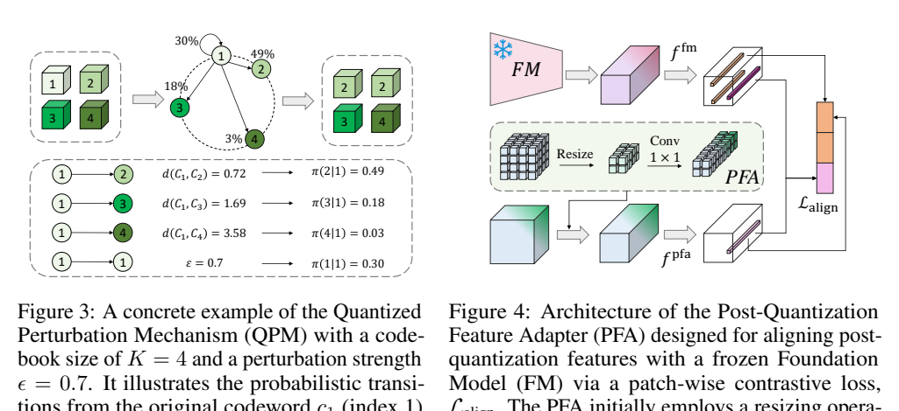
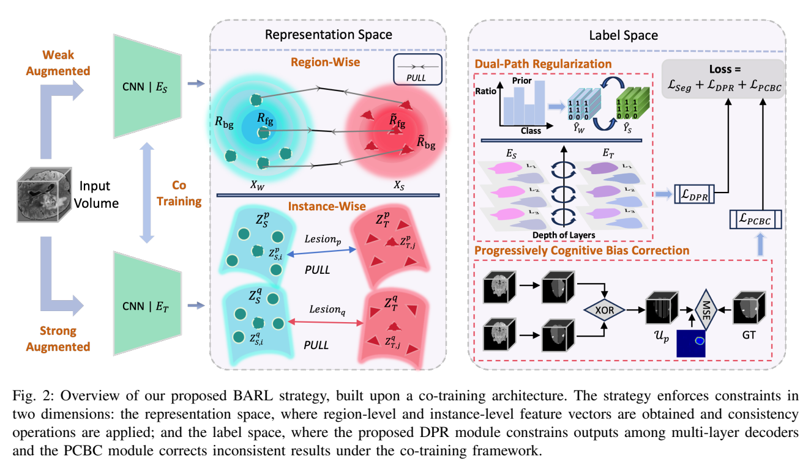
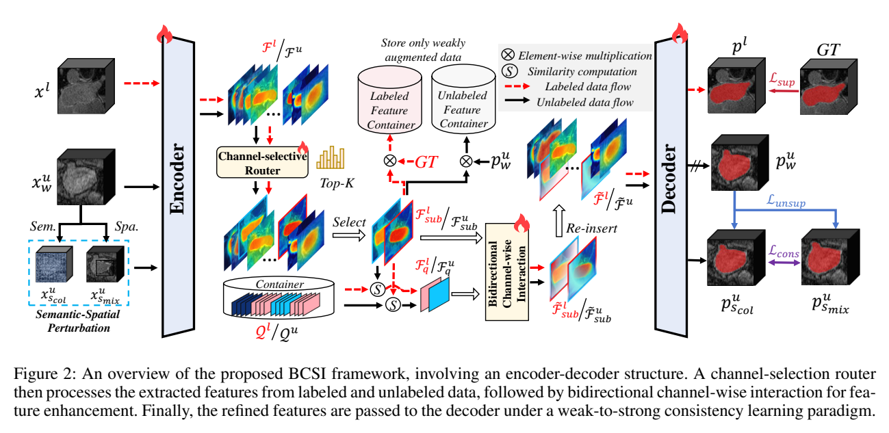

# arXiv 检索结果 / Results

## 1. UCAD: Uncertainty-guided Contour-aware Displacement for semi-supervised medical image segmentation
- Authors：Chengbo Ding, Fenghe Tang, Shaohua Kevin Zhou
- Venue：ISBI 2026
- Comments：Accepted by ISBI 2026
- First：2026-01-24T08:21:14+00:00；Latest：2026-01-24T08:21:14+00:00
- Abs：https://arxiv.org/abs/2601.17366v1
- PDF：https://arxiv.org/pdf/2601.17366v1
- Code：https://github.com/dcb937/UCAD, https://huggingface.co/huggingface, https://huggingface.co/docs/hub/spaces
- 解读来源：PDF 全文，共 6 页，6 页可提取文字
### [中文]
**中文翻译**
- 标题：UCAD：不确定性引导的轮廓感知位移用于半监督医学图像分割
- 摘要：现有的半监督分割中的位移策略仅在矩形区域上操作，忽略了解剖结构，导致边界失真和语义不一致。为解决这些问题，我们提出了UCAD，一种用于半监督医学图像分割的不确定性引导的轮廓感知位移框架，在增强一致性学习的同时保持轮廓感知语义。我们的UCAD利用超像素生成与解剖边界对齐的解剖连贯区域，并采用不确定性引导的选择机制，选择性地位移具有挑战性的区域以实现更好的一致性学习。我们进一步提出了一种动态不确定性加权一致性损失，能够自适应地稳定训练并在未标注区域有效正则化模型。大量实验表明，UCAD始终优于最先进的半监督分割方法，在有限标注下实现了更优的分割精度。代码可在以下网址获取：https://github.com/dcb937/UCAD。

UCAD 将半监督分割中的区域位移从矩形网格改为 SLIC 超像素区域，并用教师网络的像素熵选择高不确定超像素进行交换；同时引入动态不确定性加权一致性损失。在 ACDC 5%/10% 标签下 DSC 为 88.63%/89.93%，在 Synapse 5%/10% 下为 56.10%/66.73%，均优于所列基线。消融显示轮廓感知位移、不确定性选择与一致性损失逐步带来增益，但超像素数量、温度、β 退火等关键细节未报告。

## 1. 问题与动机

论文针对半监督医学图像分割中的输入级区域位移（region-level displacement）策略。作者指出，BCP 等随机位移以及 ABD 等不确定性引导位移都只在矩形网格或矩形区域上操作，忽略解剖结构的不规则、弯曲边界；当这些刚性区域被复制或交换时，会与解剖轮廓不自然地相交，造成边界扭曲和语义不一致 [p. 1][p. 2]。作者据此提出：能否在保留形状感知语义的同时继续利用区域位移？其方案是用超像素形成与解剖边界更一致的区域，并优先位移高不确定区域 [p. 2]。

## 2. 方法

整体框架建立在 Mean Teacher 上，包含教师网络、学生网络、超像素划分、不确定性引导选择和混合监督 [p. 2, Fig. 2]。

**轮廓感知划分。** 对输入图像 X 使用 SLIC 超像素算法，得到 K 个互不重叠的连通区域 s_k，覆盖整个图像域 Ω（式 1）[p. 2]。作者主张这些区域比矩形网格更贴合局部结构，但正文没有给出 K 的取值或超像素尺度设置。

**不确定性引导位移。** 教师网络对无标签图像 X_u 输出伪标签和像素级不确定性；像素不确定性用 Shannon 熵 H(X) 计算。对每个超像素 s，取其内部像素熵的均值作为区域不确定性 U(s)（式 2），再经温度 T 的 softmax 转为类别分布 P(s)（式 3）[p. 3]。按 P(s) 采样 N 个不确定超像素 S_N，生成二值掩码 M：选中区域为 1，其余为 0（式 4）[p. 3]。随后从有标签集和无标签集取两张图 X_a、X_b，以 M 混合图像和标签：X̃ = M⊙X_a + (1−M)⊙X_b，Ỹ = M⊙Y_a + (1−M)⊙Y_b（式 5–6）[p. 3]。Fig. 2 说明掩码区域会与有标签图像 X_l 位移，得到 X_mix 与 Ỹ_mix；反向位移过程在图中省略 [p. 2]。

**区域级混合损失。** 学生网络在混合图像上预测，监督项沿用 BCP 设计：L_seg = w_l·L_DiceCE(Ỹ, Y_l; M) + w_u·L_DiceCE(Ỹ, Y_p; 1−M)（式 7），其中 L_DiceCE 为 Dice 与交叉熵的线性组合，w_l、w_u 分别为有标签和无标签区域权重 [p. 3]。正文未报告 w_l、w_u 的具体数值。

**动态不确定性加权一致性损失。** 受 DyCON 启发，约束学生在无标签区域 Ω_u 上与教师预测一致，并按双方预测熵自适应加权（式 8）：
L_unc = (1/N_u) Σ_{x∈Ω_u} [ ||p_s(x)−p_t(x)||² / (exp(βH_s(x)) + exp(βH_t(x))) + β(H_s(x)+H_t(x)) ]。
其中 p_s、p_t 为学生和教师预测，H_s、H_t 为对应预测熵，N_u 为无标签体素数，β 为随训练逐渐退火的系数 [p. 3]。总损失 L_total = L_seg + λ·L_unc（式 9），λ 设为 0.2 [p. 3–4]。

## 3. 贡献

作者声称的贡献有三点：用无监督超像素生成解剖对齐、保边界的区域；用不确定性引导选择优先位移难学区域；提出动态不确定性加权一致性损失以稳定训练并正则化无标签区域 [p. 1–2]。我的解读是：核心新颖性在于把“位移单元”从矩形改为超像素，并把选择概率与教师熵绑定；一致性损失本身明确借鉴 DyCON [p. 3]，因此主要增量是将其与超像素位移框架组合。论文没有与 DyCON 做直接实验比较，故该组合的相对增益无法单独判断。

## 4. 实验与结果

**数据与划分。** ACDC 为 100 例 cine-MRI，按 BCP 划分 70 训练、10 验证、20 测试 [p. 3]。Synapse 为 30 例腹部 CT、3,779 张轴位切片、8 个器官，按 18/6/6 划分训练/验证/测试 [p. 3]。标签预算为 5% 和 10%。

**实现。** 输入尺寸 256×256，batch size 24，U-Net 骨干，SGD，weight decay 1e-4，momentum 0.9，学习率 0.01，固定随机种子，单张 NVIDIA GeForce 4090；λ=0.2；指标为 DSC 与 ASD [p. 3–4]。超像素数量、温度 T、采样数 N、β 的退火 schedule、w_l/w_u 均未在正文报告。

**ACDC（表 1）。** 5% 标签：UCAD 88.63% DSC、0.49 ASD；BCP 为 87.59%/0.67，MCF 为 82.37%/1.59，其余基线更低 [p. 4]。10% 标签：UCAD 89.93%/0.57；BCP 88.84%/1.17，MCF 87.67%/2.08 [p. 4]。作者称其他方法结果取自 BCP，UCAD 在相同设置下复现 [p. 4]。

**Synapse（表 2）。** 5% 标签：UCAD 56.10% DSC、34.77 ASD；ABD 51.28%/39.45，BCP 50.50%/55.89 [p. 4]。10% 标签：UCAD 66.73%/29.62；BCP 64.49%/31.95；ABD 表中显示为 62.41/24.22，排版疑似缺空格，但按原文可读为 DSC 62.41、ASD 24.22 [p. 4]。作者称相对 ABD 的 DSC 增益为 4.82% 和 2.24% [p. 4]，与表中 56.10−51.28=4.82、66.73−62.41=4.32 不完全一致；10% 条件下的 2.24 与表值不符，属于论文内部不一致，需谨慎对待。

**消融（表 3，Synapse 10%）。** 矩形位移基线 64.49% DSC/31.95 ASD；加轮廓感知位移（CAD）为 65.63%/32.38；再加不确定性引导选择（UGS）为 66.38%/29.69；再加 L_unc 为 66.73%/29.62 [p. 4]。该消融支持各模块逐步提升 DSC，但 CAD 单独使用时 ASD 反而略升（31.95→32.38），说明边界指标收益主要来自 UGS 与一致性损失。消融只在 Synapse 10% 上做，未报告 ACDC 消融或方差/显著性检验。

**定性结果。** Fig. 3 展示 10% Synapse 上 8 个器官的视觉比较，但正文未给出对应定量描述；我仅依据图注和正文，未解读图像内容 [p. 4]。

## 5. 评估

支持的结论：在作者报告的设置下，UCAD 在 ACDC 与 Synapse 的 5%/10% 标签预算上取得高于所列基线的 DSC，Synapse 消融显示三个组件组合后指标最好 [p. 4]。局限与缺失证据：第一，超像素数量、SLIC 尺度、温度 T、采样数 N、β 退火策略、w_l/w_u 均未报告，复现关键信息不足；第二，未与 DyCON 直接比较，难以分离一致性损失的贡献；第三，表 2 中 ABD 的 10% 数值与作者所述增益存在不一致，且 10% 下 UCAD 的 ASD（29.62）劣于 ABD（24.22），作者未讨论这一边界指标反转；第四，仅单种子结果，无均值/方差或显著性检验；第五，未报告计算开销与超像素生成时间。

## 6. 复现

可按正文复现的步骤：采用 Mean Teacher；用 SLIC 对每张图生成超像素；教师输出伪标签与像素熵，按超像素平均熵经温度 softmax 采样 N 个区域生成掩码；在有/无标签图像间做双向混合（正文只详述一个方向，反向省略 [p. 2]）；学生用式 7 的 DiceCE 混合监督，加式 8 的一致性项，λ=0.2；U-Net、256×256、batch 24、SGD（lr 0.01、momentum 0.9、weight decay 1e-4）、单张 4090、固定种子 [p. 3–4]。未报告而必须自行确定的细节包括：SLIC 的超像素数/紧凑度、T、N、β 初值与退火曲线、w_l 与 w_u、训练迭代数、数据增强、伪标签阈值（若有）。ACDC 与 Synapse 的划分已给出，可直接沿用 [p. 3]。

本篇未找到可可靠提取的方法流程图，请查看原文 PDF。

## 2. Domain-invariant Mixed-domain Semi-supervised Medical Image Segmentation with Clustered Maximum Mean Discrepancy Alignment
- Authors：Ba-Thinh Lam, Thanh-Huy Nguyen, Hoang-Thien Nguyen, Quang-Khai Bui-Tran, Nguyen Lan Vi Vu, Phat K. Huynh, Ulas Bagci, Min Xu
- Venue：ICASSP 2026
- Comments：accepted in ICASSP 2026
- First：2026-01-23T18:23:03+00:00；Latest：2026-01-23T18:23:03+00:00
- Abs：https://arxiv.org/abs/2601.16954v1
- PDF：https://arxiv.org/pdf/2601.16954v1
- Code：https://huggingface.co/huggingface, https://huggingface.co/docs/hub/spaces
- 解读来源：PDF 全文，共 5 页，5 页可提取文字
### [中文]
**中文翻译**
- 标题：域不变的混合域半监督医学图像分割与聚类最大均值差异对齐
- 摘要：深度学习在医学图像语义分割中已取得显著进展，但其成功在很大程度上依赖于大规模专家标注和一致的数据分布。在实际中，标注稀缺，且图像来自多个扫描仪或中心，导致出现域标签未知且域间差异严重的混合域场景。现有的半监督或域适应方法通常假设单一域偏移或可获取显式域索引，而这些假设在真实部署中很少成立。本文提出一种域不变的混合域半监督分割框架，同时增强数据多样性并缓解域偏差。复制粘贴机制（CPM）通过跨域迁移信息性区域来扩充训练集，而聚类最大均值差异（CMMD）模块对无标签特征进行聚类，并通过MMD目标将其与有标签锚点对齐，从而促使学习到域不变表示。该方法集成于教师-学生框架中，即使在有标签样本极少且存在多个未知域差异的情况下，也能实现稳健而精确的分割。在Fundus和M&Ms基准上的实验表明，我们的方法持续优于半监督和域适应方法，为混合域半监督医学图像分割提供了一种潜在解决方案。

论文提出面向混合域半监督医学图像分割的域不变框架：用复制粘贴机制（CPM）跨域拼接信息区域扩充训练样本，用聚类最大均值差异（CMMD）块通过HDBSCAN聚类无标签特征并以MMD对齐到有标签锚点，嵌入教师-学生网络。在Fundus（20张标注）上DC达86.99%、JC 78.22%；在M&Ms（20张标注）上DC约84.35%、JC约75.33%，优于所比较的SSL/DA方法。消融显示CPM单独提升DC/JC约3.83%/4.88%，CMMD进一步带来增益；CMMD作为插件加到MiDSS上把DC/JC从86.91%/78.12%提升到87.18%/78.45%。

# 论文阅读笔记：域不变的混合域半监督医学图像分割（CPM + CMMD）

## 1. 问题与动机

论文针对**混合域半监督医学图像分割**：只有少量来自某一域的有标签样本，大量无标签样本来自多个未知域（域数量K未知、无域标签），目标是训练一个能在所有域上泛化的分割模型 [p. 1][p. 2]。作者指出，标准半监督学习（SSL）或域适应（DA）通常假设单一目标分布或可访问显式域标签，在真实部署中很少成立 [p. 1]。

作者以MiDSS [13]为直接对照：Fig. 1a 的UMAP可视化显示，MiDSS在Fundus上学习到的特征按域分离、Silhouette Score较高，说明其产生的是域特定特征而非域不变特征 [p. 1][p. 2]。因此作者主张需要同时（i）扩大跨域训练空间、（ii）在特征空间显式消除域差异 [p. 2]。

## 2. 方法

### 2.1 问题定义
有标签集 S_l = {(x_i, y_i)}_{i=1}^N 来自域 D_j；无标签集 S_u = {x_i}_{i=1}^M 来自混合域 {D_1,…,D_K}，K未知。目标是学习 f_θ 在少量标注与大量无标注下跨域泛化 [p. 2]。

### 2.2 复制粘贴机制（CPM）
将弱增强无标签样本 x_wu、强增强样本 x_su 与有标签样本 x_lb 按二值掩码 M 拼接（M=1 表示感兴趣区域）[p. 2]：
- x_win = (1−M)⊙x_wu + M⊙x_lb；x_wout = M⊙x_wu + (1−M)⊙x_lb（式1–2）
- x_sin、x_sout 同理用 x_su 构造（式3–4）

教师 T 与学生 S 分别对混合样本预测（式5–6），以教师预测 p̂_win、p̂_wout 作为伪标签，对学生预测 p̂_sin、p̂_sout 施加 Dice + CE 一致性损失 L_in、L_out（式7–8），CPM 损失 L_CPM = L_in + L_out（式9）[p. 2]。

### 2.3 聚类最大均值差异块（CMMD）
CMMD 由聚类模块与基于MMD的域感知模块组成，应用于**编码器所有层**，以便在特征进入解码器（经跳跃连接）前去除域信号 [p. 2][p. 3]。

**聚类模块**：教师先对弱增强输入提取特征 f_Tu = E_T(x_wu)（式10），用HDBSCAN [16]按特征点密度聚类，得到Q个簇中心 c_u,i（随epoch更新，称伪中心）（式11）[p. 2]。学生编码器提取 f_Su = E_S(x_wu)（式12），计算到各伪中心的L2距离 d_i（式13），取最近簇作为伪域标签 p̂_d = argmin_i d_i（式14）[p. 2]。

**MMD域感知模块**：为避免所有簇两两计算MMD的高开销，选取有标签特征 f_Slb 作为锚点簇 C_anchor（因其i.i.d.来自域 D_j），对每个无标签簇 C_u,i 计算 MMD_i（式15），其中 k(x_i,x_j)=exp(−‖x_i−x_j‖²/2σ²) 为高斯核，m_i、n 分别为两簇特征数；对Q个MMD取平均得 L_MMD（式16）[p. 3]。

**域损失**：作者指出解码器层因跳跃连接仍保留域信号，且直接对解码器施加CMMD可能损害类别预测，故仅对编码器L层（L=5）计算 L^l_MMD，取平均得 L_domain（式17）[p. 3]。

### 2.4 总损失
L_total = L_sup + w(L_CPM + L_domain)（式18），其中 w = exp(−5(1−iter/iter_max)) 为随迭代变化的高斯型动态系数 [p. 3]。

## 3. 贡献

**作者声称的贡献**：（1）提出联合增强数据多样性与缓解域偏差的域不变混合域半监督分割框架；（2）CPM跨域迁移信息区域以扩充训练集；（3）CMMD聚类无标签特征并通过MMD与有标签锚点对齐，促进域不变表示；（4）在教师-学生框架中整合，在极少标注与多个未知域差异下取得稳健分割 [p. 1]。

**我的解读**：核心新颖点在于把“未知域数量下的聚类”与“以有标签域为锚点的MMD对齐”结合，并用HDBSCAN规避K未知问题；CPM本身与BCP [3]思路相近，属于数据层增强。CMMD被作者强调为无额外参数的插件（Table 4验证）[p. 4]，这是其相对价值所在。

## 4. 实验与结果

### 4.1 设置
- 数据集：Fundus [14] 与 M&Ms [15]；指标：Dice（DC）、Jaccard（JC）、Hausdorff距离（HD）、平均表面距离（ASD）[p. 4]。
- 骨干：教师与学生均为UNet [17]；训练迭代：Fundus 30k、M&Ms 60k；HDBSCAN参数 minClusterSize=10、minSample=5；GPU为A5000/RTX3090 [p. 4]。
- 标注预算：两个数据集主实验均为**20张有标签图像**，其余为无标签 [p. 4]。
- 基线：U-Net、UA-MT [4]、CPS [5]、FixMatch [2]、BCP [3]、CoraNet、UDA-VAE++、CauSSL、MiDSS [13]（作者复现MiDSS以保证公平比较）[p. 4]。

### 4.2 主要结果
**Fundus（20标注）**：作者称本方法DC≈87%，稳定优于MiDSS [p. 4]。Table 1中本方法平均 DC 86.99%、JC 78.22%、HD 8.25、ASD 3.96；MiDSS（复现）为 DC 86.91%、JC 78.12%、HD 5.21、ASD 2.57 [p. 4]。需注意：本方法在DC/JC上略高，但HD/ASD明显差于MiDSS（8.25 vs 5.21；3.96 vs 2.57），作者正文未讨论这一矛盾。

**M&Ms（20标注）**：作者报告本方法 DC≈84.4、JC≈75，为最佳 [p. 4]。Table 2中本方法平均 DC 84.35%、JC 75.33%、HD 5.08、ASD 2.54；MiDSS（复现）DC 84.25%、JC 75.20%、HD 5.21、ASD 2.57 [p. 4]。提升幅度较小（DC +0.10、JC +0.13），且HD/ASD仅微幅改善。

### 4.3 消融与分析
- **组件消融（Fundus，20标注）**：基线为UNet教师-学生+CE+弱到强一致性；加CPM使DC/JC提升3.83%/4.88%；再加CMMD达到DC 86.99%、JC 78.22% [p. 4]。Table 3中基线DC 83.06%、JC 73.19%，CPM后DC 86.89%、JC 78.07%，CMMD后DC 86.99%、JC 78.22% [p. 4]。可见CMMD在CPM之上的增量很小（DC +0.10、JC +0.15）。
- **插件性质（Table 4）**：将CMMD加到MiDSS上，Fundus DC/JC从86.91%/78.12%升至87.18%/78.45% [p. 4]。
- **特征可视化**：Fig. 1显示加CMMD后UMAP表示更混合，域特定变化减少 [p. 4]。

## 5. 评估

**有支持的结论**：CPM在Fundus消融中带来较明显提升（DC +3.83%），证据较直接；CMMD作为插件在MiDSS上带来小幅但一致的DC/JC提升；在20标注预算下，整体方法在DC/JC上优于所列基线。

**局限与缺失证据**：（1）CMMD在CPM之上的增量在Fundus仅+0.10 DC，M&Ms相对MiDSS仅+0.10 DC，提升幅度接近噪声，论文未报告方差或多seed结果 [p. 4]。（2）本方法HD/ASD在Fundus上劣于MiDSS，作者未解释 [p. 4]。（3）未报告无标签集规模、域数量、数据划分细节、学习率/优化器等训练超参 [p. 4]。（4）Table 1/2排版在PDF文本中较混乱，部分基线数值难以可靠对应，本文仅引用可辨认的汇总数字。（5）CMMD依赖HDBSCAN聚类质量，论文未分析聚类失败或Q估计错误的影响。

## 6. 复现

**已报告**：UNet教师-学生；Fundus 30k、M&Ms 60k迭代；HDBSCAN minClusterSize=10、minSample=5；20张标注；损失为L_sup + w(L_CPM + L_domain)，w=exp(−5(1−iter/iter_max))；编码器L=5层施加CMMD；高斯核MMD；A5000/RTX3090 [p. 2][p. 3][p. 4]。

**未报告**：优化器与学习率、batch size、输入分辨率、强弱增强的具体策略、教师更新方式（EMA系数）、无标签样本数量、数据划分与域分配、随机种子与重复次数、推理与后处理细节。复现前需向作者确认这些设置。

本篇未找到可可靠提取的方法流程图，请查看原文 PDF。

## 3. VQ-Seg: Vector-Quantized Token Perturbation for Semi-Supervised Medical Image Segmentation
- Authors：Sicheng Yang, Zhaohu Xing, Lei Zhu
- Venue：NeurIPS 2025
- Comments：Accepted by NeurIPS 2025
- First：2026-01-15T07:09:00+00:00；Latest：2026-01-15T07:09:00+00:00
- Abs：https://arxiv.org/abs/2601.10124v1
- PDF：https://arxiv.org/pdf/2601.10124v1
- Code：https://github.com/script-Yang/VQ-Seg, https://huggingface.co/huggingface, https://huggingface.co/docs/hub/spaces
- 解读来源：PDF 全文，共 18 页，18 页可提取文字
### [中文]
**中文翻译**
- 标题：VQ-Seg：用于半监督医学图像分割的向量量化Token扰动
- 摘要：基于特征扰动的一致性学习是半监督医学图像分割中广泛使用的策略。然而，许多现有的扰动方法依赖dropout，因此需要仔细手动调整dropout率，这是一个敏感的超参数，通常难以优化，并可能导致次优的正则化。为克服这一局限，我们提出VQ-Seg，这是首个采用向量量化（VQ）对特征空间进行离散化并引入新颖且可控的量化扰动模块（QPM）以替代dropout的方法。我们的QPM通过打乱码本索引的空间位置来扰动离散表示，从而实现有效且可控的正则化。为缓解量化可能造成的信息损失，我们设计了一种双分支架构，其中量化后的特征空间由图像重建和分割任务共享。此外，我们引入量化后特征适配器（PFA），以融入基础模型（FM）的引导，补充量化过程中丢失的高层语义信息。此外，我们收集了一个大规模肺癌（LC）数据集，包含828例标注为中心型肺癌的CT扫描。在LC数据集和其他公开基准上的大量实验证明了我们方法的有效性，其性能优于最先进的方法。代码见：https://github.com/script-Yang/VQ-Seg。

VQ-Seg 用向量量化（VQ）把编码特征离散化，并以“按码字距离概率替换码字索引”的量化扰动模块（QPM）替代 dropout 做一致性学习；同时用共享 Post-VQ 空间的重建+分割双分支缓解量化信息损失，并用冻结 DINOv2 引导的 Post-VQ 特征适配器（PFA）做 patch 级对比对齐。作者在自建 828 例中央型肺癌 CT 数据集（LC）和 ACDC 上报告 5%/10% 标注设置下优于 Unimatch、ABD、MCNet 等基线；LC 10% 时 Dice 0.7852、HD95 11.6179。消融显示 QPM、双分支、PFA 各自有增益，ε=0.7、λa=5、λu=1、码本 16,384 为报告的最佳设置。局限是扰动仅限离散 VQ 空间且引入基础模型带来额外计算开销。

# VQ-Seg 论文精读笔记

## 1. 问题与动机

半监督医学图像分割常用一致性学习：对同一输入施加扰动，要求预测保持稳定。作者聚焦特征级 dropout 这一类扰动，指出其核心问题是 dropout 率（DR）是敏感超参数：DR 过低扰动不足，DR 过高则性能急剧下降甚至模型崩溃 [p. 1][p. 2]。作者在 LC 数据集的全监督设置下给出 dropout 率扫描（Fig. 1）：DR=0.3/0.5 影响可忽略，DR≥0.7 后 Dice、Jaccard 明显下降、HD95/ASD 明显上升，DR=0.9 的预测不可用 [p. 2]。因此论文要解决的是：设计一种可控、稳定、可解释的特征扰动，替代需要精细调参的 dropout，并补偿量化带来的信息损失。

## 2. 方法

### 2.1 总体流程

输入图像先经编码器得到连续特征 z，再经 VQ 在可学习码本 C={c1,…,cK} 中取最近码字完成离散化；随后 QPM 对码字索引做结构化扰动，扰动后的离散表示同时送入图像重建解码器 Di 与分割解码器 Ds；PFA 把 Post-VQ 特征对齐到冻结基础模型（DINOv2）的语义特征 [p. 3][p. 4]。教师-学生框架中，教师由学生参数的 EMA 更新（α=0.996）[p. 8]。

### 2.2 向量量化与 QPM

量化索引为 i = argmin_j ||z − c_j|| [p. 5]。QPM 先设码本上的均匀先验 P(ci)=1/K，再定义从码字 ci 转移到 cj 的条件概率：j=i 时 π(j|i)=1−ε；j≠i 时 π(j|i)=ε·exp(−d(ci,cj))/Zi，其中 Zi=Σ_{k≠i} exp(−d(ci,ck))，ε∈[0,1] 控制扰动强度，d 为码字间距离 [p. 5]。由此得到扰动分布 Q(cj|ε)=Σ_i P(ci)π(j|i)，并计算 KL(P||Q) 作为扰动半径的度量 [p. 5]。Fig. 3（p. 5）给出 K=4、ε=0.7 的具体例子：原码字 c1 以 49% 的最高概率被替换为 c2，说明替换概率由码字距离决定。作者还给出 dropout 下 KL 的近似 DKL≈½[p/(1−p)+log(1−p)]，随 p→1 急剧增大，用以论证 dropout 在高率下不稳定 [p. 4][p. 15]；附录 B 证明 QPM 分布在 ε=1 时仍严格正且有界，KL 有限 [p. 16–17]。

### 2.3 共享 Post-VQ 空间的双分支

为缓解量化造成的细节损失，教师和学生解码器都采用双分支：x̂=Di(q(z))，ŷ=Ds(q(z)) [p. 6]。有标注数据损失 Ll=Lrec(xl,x̂Sl)+Lseg(yl,ŷSl)；无标注数据由教师生成伪标签 ỹu=argmax Ds^T(q(zTu))，学生损失 Lu=Lrec(xu,x̂Su)+Lseg(ỹu,ŷSu)+Lseg(ỹu,ŷSa)，其中 q′(zSu)=QPM(q(zSu)) 为扰动表示 [p. 6]。总双分支损失 Ldb=Ll+λu·Lu，Lrec 为 L1、Lseg 为交叉熵 [p. 6]。

### 2.4 PFA 与基础模型对齐

PFA 先 resize 再做 1×1 卷积，把 VQ 特征的空间分辨率和通道数对齐到冻结 FM 特征，然后用 patch 级对比损失 Lalign=−(1/HW)Σ_i log[exp(sim(f_i^pfa,f_i^fm)/τ)/Σ_j exp(sim(f_i^pfa,f_j^fm)/τ)]，sim 为余弦相似度，τ 为温度 [p. 7]。Fig. 4（p. 5）展示该适配器结构；实际采用 DINOv2 作为 FM [p. 7]。总目标 L=Ldb+λa·Lalign [p. 7]。

## 3. 贡献

作者声称的贡献包括：首个用 VQ 离散化特征空间并以 QPM 替代 dropout 的半监督分割方法；共享 Post-VQ 空间的重建+分割双分支；FM 引导的 PFA 对齐；以及新采集的 828 例中央型肺癌 CT 数据集 [p. 2–3]。我的理解是：核心新颖点在于把“扰动”从随机置零改为“在离散码本内按距离概率替换”，使扰动强度由单一 ε 控制且受码本结构约束；双分支与 PFA 更像是对量化信息损失的补偿设计，其增益在消融中分别得到验证，但并非独立于 VQ 框架的通用机制。

## 4. 实验与结果

### 4.1 数据与设置

LC 数据集为多中心 828 例胸部 CT，中央型肺癌，每例一个分割目标；ACDC 为 100 例短轴 cine-MRI [p. 7]。LC 按 70–10–20 划分训练/验证/测试，所有实验在 2D 切片上进行 [p. 7]。输入 resize 到 224×224；每迭代 mini-batch 为 8 个有标注 + 4 个无标注样本；训练 100,000 次迭代；AdamW，多项式学习率，backbone 初始学习率 5×10−6、任务头放大 40 倍，衰减 (1−t/T)^0.9；数据增强含随机旋转、颜色抖动及对无标注数据的 CutMix；VQ 用 STE 训练，主实验码本 K=16,384，并采用码本映射与熵正则；四块 RTX 4090 [p. 7–8]。对比方法包括 UNet、nnUNet、UA-MT、MCNet、SSNet、BCP、ARCO、ABD、Unimatch；VQ-Seg 采用与 Unimatch 相同的编解码结构，仅在编码器输出后加入量化与对齐 [p. 8]。指标为 Dice、Jaccard、HD95、ASD [p. 8]。

### 4.2 主要结果

LC 5% 标注：VQ-Seg Dice 0.6643、Jaccard 0.5257、HD95 12.2525、ASD 4.2276；第二好的 Unimatch Dice 0.6493、Jaccard 0.5071，ABD HD95 12.5608，MCNet ASD 4.9231 [p. 8]。LC 10% 标注：VQ-Seg Dice 0.7852、Jaccard 0.6731、HD95 11.6179、ASD 4.2094；第二好 MCNet Dice 0.7555、Jaccard 0.6414，UA-MT HD95 11.6724，ARCO ASD 4.3660 [p. 8]。ACDC 5%：Dice 0.9057、Jaccard 0.8173；10%：Dice 0.9103、Jaccard 0.8327，均优于 Unimatch（0.8915/0.8978）与 ABD、ARCO，并接近全监督 nnUNet-F 的 0.9185 [p. 17–18]。Table 6 报告 5%/10%/20%/50%/100% 标注下 Dice 分别为 0.6643/0.7852/0.8100/0.8507/0.9102 [p. 10]。

### 4.3 消融

Table 2（LC 10%）以 VQ 嵌入的 Unimatch 为基线：基线 Dice 0.7443；加 QPM 升至 0.7701；再加 DB 为 0.7784；单独加 PFA 为 0.7761；三者全加为 0.7852、Jaccard 0.6731、HD95 11.6179、ASD 4.2094 [p. 9]。Table 3：ε=0.3/0.5/0.7/0.9/1 时 Dice 为 0.7741/0.7803/0.7852/0.7418/0.7720，ε=0.7 最佳；λa=5、λu=1 为报告的最佳组合 [p. 9]。Table 4：DINOv2 在 5%/10% 下 Dice 0.6643/0.7852，优于 CLIP（0.6421/0.7483）、BiomedCLIP（0.6507/0.7629）、MAE（0.6386/0.7541）、Rad-DINO（0.6535/0.7793）[p. 10]。Table 5：码本从 1,024 增至 16,384 时 Dice 上升（5%：0.6531→0.6643；10%：0.7608→0.7852），32,768/65,536 时下降，利用率从 100% 降至 95%/92% [p. 10]。附录 D 报告 5% LC 上 10 次随机种子重复，VQ-Seg 误差棒更小，与各基线的配对双尾 t 检验 p<0.05 [p. 18]。

## 5. 评估

支持的结论：在报告的数据划分与 2D 设置下，VQ-Seg 在 LC 与 ACDC 的 5%/10% 标注设置中多数指标优于所列基线；消融支持 QPM、DB、PFA 各自有正贡献，且 ε 与码本大小存在报告的最优点。需要注意：Table 1 中 UNet-F 与 nnUNet-F 在 5% 和 10% 两列数值完全相同，这符合“全监督用全部数据”的标注，但也意味着它们不是同预算对照；LC 为作者自建数据，外部复现受限。作者自述局限：扰动仅作用于离散 VQ 空间，难以直接扩展到连续特征框架；引入 FM 带来额外计算开销 [p. 10]。缺失证据：正文未报告 PFA/FM 的具体推理开销数字、QPM 与 dropout 在相同半监督预算下的直接对照（仅有全监督 dropout 率扫描 Fig. 1）、以及多中心 LC 的分中心结果；附录 C/D 的部分表格与图在文本中仅以概述出现，具体数值需以原表为准。

## 6. 复现要点

已报告：PyTorch 2.4.1；224×224 输入；8 有标注 + 4 无标注/迭代；100,000 迭代；AdamW；backbone lr 5×10−6、头 ×40；多项式衰减 (1−t/T)^0.9；EMA α=0.996；STE；K=16,384；ε=0.7；λa=5；λu=1；DINOv2 冻结；LC 70–10–20 划分；2D 切片。未报告或无法从正文确认：码本维度、距离 d 的具体形式、τ 取值、PFA 的 resize/卷积细节维度、教师伪标签是否做置信度过滤、ACDC 的具体划分与预处理、随机种子数量（仅附录 D 说明 10 次）、以及 FM 特征提取的层选择。复现时应优先固定上述已报告超参，并对未报告项做敏感性说明而非默认为论文设置。

#### 原论文流程图 · Figure 3 · PDF 第 5 页

Figure3: AconcreteexampleoftheQuantized Figure 4: Architecture of the Post-Quantization PerturbationMechanism(QPM)withacode- FeatureAdapter(PFA)designedforaligningpost- booksizeofK =4andaperturbationstrength quantization features with a frozen Foundation ϵ = 0.7. Itillustratestheprobabilistictransi- Model (FM) via a patch-wise contrastive loss,

[原文来源](https://arxiv.org/pdf/2601.10124v1#page=5)

## 4. BARL: Bilateral Alignment in Representation and Label Spaces for Semi-Supervised Volumetric Medical Image Segmentation
- Authors：Shujian Gao, Yuan Wang, Zekuan Yu
- Comments：14 pages, 5 figures
- First：2025-10-19T14:50:47+00:00；Latest：2026-01-14T14:54:25+00:00
- Abs：https://arxiv.org/abs/2510.16863v2
- PDF：https://arxiv.org/pdf/2510.16863v2
- Code：https://huggingface.co/huggingface, https://huggingface.co/docs/hub/spaces
- 解读来源：PDF 全文，共 14 页，14 页可提取文字
### [中文]
**中文翻译**
- 标题：BARL：用于半监督体积医学图像分割的表示空间与标签空间双边对齐
- 摘要：半监督医学图像分割（SSMIS）旨在大幅降低标注成本的同时达到全监督性能。主流SSMIS方法依赖标签空间一致性，却忽视了同样关键的表示空间对齐。若不对潜在特征进行协调，模型难以学习到既具判别性又具空间连贯性的表示。为此，我们提出表示空间与标签空间双边对齐（BARL），这是一个耦合两个协作分支并在两个空间中强制对齐的统一框架。对于标签空间对齐，受协同训练与多尺度解码启发，我们设计了双路径正则化（DPR）和渐进式认知偏差校正（PCBC），以施加细粒度跨分支一致性，同时缓解从粗到细尺度的误差累积。对于表示空间对齐，我们在分支间进行区域级和病灶实例匹配，显式捕捉医学影像中常见的碎片化、复杂病理模式。在四个公开基准和一个专有CBCT数据集上的大量实验表明，BARL持续超越最先进的SSMIS方法。消融研究进一步验证了各组成部分的贡献。代码即将发布。

BARL 将半监督 3D 医学分割视为表示空间与标签空间的双边对齐问题：在表示空间做区域级与病灶实例级原型余弦对齐，在标签空间用 DPR（多尺度分布一致性、深度交叉伪监督、信息最大化）与 PCBC（基于双分支 L1 分歧的加权 MSE）约束双分支。在 BraTS 2020/2021、BraTS 2023 MEN、IXI 与私有 CBCT 上，10%/20%（IXI 5%）标签设置下多数指标优于 13 个基线；消融显示各模块均有贡献，实例级优于类级，表示维度 128–512 与中间层最有效。

## 1. 问题与动机

论文针对半监督体积医学图像分割（SSMIS）：仅有少量体素级标注、大量未标注 3D 扫描时，如何逼近全监督性能 [p. 1]。作者指出主流一致性正则主要在**标签空间**对齐（KL/MSE 软 logits，或 Dice/CE 硬伪标签），而忽略**表示空间**的特征对齐；仅对齐输出可能在潜在空间学到混乱表征，导致掩膜模糊或碎片化 [p. 1][p. 3]。医学病灶常呈同类别多连通碎片分布（Fig. 1(b)），自然图像上的双空间方法未针对该病理形态设计 [p. 2]。因此作者提出 BARL，在协同训练双分支上同时约束表示空间与标签空间 [p. 1][p. 3]。

## 2. 方法

**总体框架**：BARL 基于经典 co-training，使用两个参数独立的模型 E_S 与 E_T；输入生成弱增强视图 X_w 与强增强视图 X_s，E_S 处理 X_w、E_T 处理 X_s，分别输出特征 f_S/f_T 与概率图 P_S/P_T [p. 3][p. 4]。Fig. 2（p. 4）给出总览：表示空间做区域级与实例级特征一致性，标签空间由 DPR 约束多层解码器输出、PCBC 纠正跨分支不一致。

**表示空间对齐**：
- 区域级：对每个类别 c（前景/背景），由 P_S、P_T 取 argmax 得二值掩膜 M_S^c、M_T^c；用掩膜对特征做平均池化得原型 R_c 与 R̃_c（式 1–2），以余弦距离 1−cos(R_c,R̃_c) 拉近（式 3）[p. 4]。注意式 1 文字写“由 M_T^c 识别位置”，但求和下标与分母写作 M_S^c，符号存在不一致，论文未进一步澄清。
- 实例级：对 E_T 的病灶类掩膜做 3D 连通域分析（式 4），以最小体积 τ_vol=50 过滤小连通域（式 5），对每个实例掩膜 M_cj 分别在 f_S、f_T 上池化得 z_S^{c,j}、z_T^{c,j}（式 6–7），对 N_c 个实例取平均余弦距离（式 8）[p. 5]。动机是同类病灶碎片化，直接算类级原型会产生“原型偏移”，实例级提供天然一一对应 [p. 4][p. 5]。

**标签空间对齐**：
- DPR：主干为编码器+多层解码器，除全分辨率输出 P^(3) 外还有 3 个辅助头 P^(0)–P^(2) [p. 5]。包含：(i) 分布一致性 L_distr：对 4 个尺度软化后的 P_S^(k)、P_T^(k) 计算 MSE（式 9）；(ii) 深度交叉伪监督 L_CPS：由对方模型的 one-hot 伪标签以 CE 监督本模型，4 个尺度平均（式 10）；(iii) 信息最大化：熵最小化 L_ent（式 11）加类别先验匹配 L_KL（式 12–13），先验 q 取标注集经验类别频率 [p. 5][p. 6]。L_DPR = L_distr + L_CPS + (λ_ent L_ent + λ_KL L_KL)，λ_ent=0.5、λ_KL=0.1（式 14）[p. 6]。
- PCBC：以双分支概率的 L1 距离 U_p=||P_S,p−P_T,p||_1 作为像素不确定性权重（式 15），对标注数据计算加权 MSE（式 16），使分歧大的像素受更大惩罚；ε 为数值稳定小常数 [p. 6]。
- 监督损失：标注数据用 CE+Dice（式 17）[p. 6]。
- 总损失：L_s = 0.1×(L_region+L_instance) + L_DPR + L_PCBC + L_seg（式 18）[p. 6]。

## 3. 贡献

作者主张四点：将半监督分割形式化为双空间约束优化；提出 DPR/PCBC 的标签空间正则与区域/实例级表示对齐；在 4 个公开 3D 基准和 1 个私有 CBCT 上多标签比例验证；开展一致性工具、表示空间/维度、半监督框架等深入分析 [p. 2]。我的解读：核心新颖点在于把“碎片化病灶”作为设计依据，用连通域实例原型替代类级原型，并把多尺度解码器纳入跨分支一致性；这属于对既有 co-training/CPS/对比对齐的组合与医学适配，而非全新学习范式。

## 4. 实验与结果

**数据与划分**：BraTS 2021 共 1251 例，按 [25] 划分 1000/125/125 训练/验证/测试；BraTS 2020 共 369 例，划分 295/37/37；BraTS 2023 MEN 用 800/100/100；CBCT Tooth 260 例按 8:1:1；IXI 约 600 例健康脑 MRI，评估白质/灰质 [p. 6–7]。标签预算：主表用 10% 与 20%；IXI 用 5% [p. 7–8]。指标为 Dice、Jaccard、HD（95 分位）、ASD [p. 7]。

**训练设置**：RTX 4090、CUDA 12.4、Python 3.9.13、PyTorch 1.11.0；SGDW，动量 0.9，权重衰减 5e-4，Cosine Annealing；BraTS 系列 100 epoch、学习率 0.004→1e-5（20 epoch warm-up），IXI 50 epoch、0.002→0.0005，CBCT 60 epoch、0.006→0.0001；batch size 按显存调整（未给具体值）；弱-强增强类似 [29]；基础实验用修改版 Attention U-Net，表示头结构 Conv→Norm→ReLU→Conv，表示维度 128；τ_vol=50；所有实验五折验证 [p. 7][p. 8]。

**主结果（Table I，p. 7）**：10% 标签下 BraTS 2020 上 BARL Dice 0.8568、HD 8.7349、ASD 2.3675、Jaccard 0.7754；20% 下 Dice 0.8591、HD 8.6240、ASD 2.9829、Jaccard 0.7788。BraTS 2021 10% 为 Dice 0.9009、HD 3.7817、ASD 0.8105、Jaccard 0.8354；20% 为 0.9007/4.2163/0.9981/0.8334。BraTS 2023 MEN 10% 为 0.8400/6.9464/2.8431/0.7754；20% 为 0.8593/6.6270/1.6231/0.7945。CBCT 10% 为 0.8895/15.4037/4.6630/0.8041；20% 为 0.9083/7.7713/3.6331/0.8384。作者称在几乎所有指标上排名第一或第二，并优于 13 个基线（CPS、CPC、MT、UA-MT、Self-Training、MCT、MCT++、DTC、FBA、MCF、BSNet、CMF、PMT）[p. 7–8]。需注意 Table I 在 PDF 文本中排版错乱，部分基线的列对应关系难以逐格核对；上述 BARL 数字取自表中 “Ours” 行。

**IXI 5%**：BARL Dice 0.8979、HD 1.0379、ASD 0.6531、Jaccard 0.8082，作者称四项指标均最优 [p. 8]。

**消融（Table II，BraTS 2020，20%）**：完整模型 Dice 0.8591、HD 8.6240、ASD 2.9829、Jaccard 0.7788；去掉 IM 损失降至 Dice 0.8531；仅区域+实例表示对齐的组合为 0.8453/10.7179/3.9911/0.7618；实例级（0.8418）优于类级（0.8379），作者归因于类级原型偏移 [p. 8–9]。Table II 的勾选矩阵在文本中错位，逐行配置无法可靠还原，应视为部分不可读。

**标签空间工具（Table IV）**：BraTS 2020 上 MSE+CE 0.8568/8.7349/2.3675/0.7754 优于 MSE+Dice 0.8380、KL+Dice 0.8458、KL+CE 0.8479；BraTS 2021 上 KL+CE 的 Dice 0.9011 略高于 MSE+CE 的 0.9009，但 MSE+CE 的 Jaccard 0.8354 更高，KL+Dice 的 ASD 0.6918 最低 [p. 9]。作者结论是 MSE+CE 综合最稳。

**表示对齐数据来源（Table V，CBCT）**：20% 下 Labeled 0.8537、Unlabeled 0.8877、All 0.9083；10% 下分别为 0.8777、0.8805、0.8895，支持在全部数据上施加表示对齐 [p. 9]。

**表示空间与维度（Fig. 4，p. 10）**：在 rep0–rep3 四个位置、32–1440 维上测试；维度 >512 后性能下降，rep3 在 1440 维“完全训练失败”；最佳为第 3 编码器层（rep0）与第 3 解码器层（rep2），推荐 128–512 维 [p. 10]。该图仅有文字描述，具体数值无法从正文读取。

**主干（Table VI，BraTS 2023 MEN 20%）**：ResUNet 最佳 Dice 0.8786、HD 5.1654、ASD 0.8827、Jaccard 0.8181；AttentionUnet 0.8593/6.6270/1.6231/0.7945；U-Net 0.8574/5.3715/1.0639/0.7937；Swin-T 0.8342；SegViT 0.7319；Vnet 0.5833 [p. 10]。作者称 CNN 因归纳偏置在低标签下优于 Transformer。

**框架比较（Table VII，BraTS 2023 MEN 10%）**：Singleton(CCT dropout) Dice 0.8423、ASD 1.9798 最佳；Co-Training(asymmetric) HD 6.9464、Jaccard 0.7754 最佳、Dice 0.8400；Mean Teacher 0.8204；FixMatch 0.7887；Co-Training(symmetric) 0.7973 [p. 10–11]。

**外部验证（Fig. 5，p. 11）**：BraTS 2020 10% 训练、BraTS 2021 测试，BARL 在全部指标上优于 MCT++、DTC、CPS、CML、BSNet；具体数值仅在图内，正文未列出，无法核对。

## 5. 评估

支持的结论：在报告的数字上，BARL 在多个数据集/标签比例取得有竞争力的 Dice 与边界指标；消融支持区域+实例联合、实例级优于类级、IM 损失有效、全数据表示对齐优于仅未标注；表示维度与层位选择有实验依据 [p. 8–10]。局限与缺失证据：主表排版错乱使部分基线数字不可逐项核验；Table II 勾选配置不可读；Fig. 4/Fig. 5 的具体数值未在正文给出；batch size、增强具体参数、表示头插入位置细节、五折的方差/显著性均未报告；私有 CBCT 数据未公开，复现受限；PCBC 仅在标注数据上定义，未说明未标注数据是否参与；式 1–2 的掩膜符号不一致。作者未单列局限性章节。

## 6. 复现

可复现要点：双分支 co-training，E_S 弱增强、E_T 强增强；修改版 Attention U-Net + 并行表示头（Conv→Norm→ReLU→Conv），表示维度 128；τ_vol=50；λ_ent=0.5、λ_KL=0.1；表示损失总权重 0.1；SGDW（0.9，5e-4）、Cosine Annealing；BraTS 100 epoch、0.004→1e-5、20 epoch warm-up；IXI 50 epoch、0.002→0.0005；CBCT 60 epoch、0.006→0.0001；五折验证 [p. 6–8]。未报告：batch size 具体值、增强算子与强度、伪标签置信阈值（若使用）、表示头接入的确切层、随机种子、参数量/FLOPs 之外的推理成本、代码（作者称将发布）[p. 1][p. 7]。

#### 原论文流程图 · Figure 2 · PDF 第 4 页

Fig. 2: Overview of our proposed BARL strategy, built upon a co-training architecture. The strategy enforces constraints in two dimensions: the representation space, where region-level and instance-level feature vectors are obtained and consistency operations are applied; and the label space, where the proposed DPR module constrains outputs among multi-layer decoders and the PCBC module corrects inconsistent results under the co-training framework.

[原文来源](https://arxiv.org/pdf/2510.16863v2#page=4)

## 5. Bidirectional Channel-selective Semantic Interaction for Semi-Supervised Medical Segmentation
- Authors：Kaiwen Huang, Yizhe Zhang, Yi Zhou, Tianyang Xu, Tao Zhou
- Venue：AAAI 2026
- Comments：Accepted to AAAI 2026. Code at: https://github.com/taozh2017/BCSI
- First：2026-01-09T15:32:57+00:00；Latest：2026-01-09T15:32:57+00:00
- Abs：https://arxiv.org/abs/2601.05855v1
- PDF：https://arxiv.org/pdf/2601.05855v1
- Code：https://github.com/taozh2017/BCSI, https://huggingface.co/huggingface, https://huggingface.co/docs/hub/spaces, https://github.com/HiLab-git/
- 解读来源：PDF 全文，共 9 页，9 页可提取文字
### [中文]
**中文翻译**
- 标题：双向通道选择性语义交互用于半监督医学分割
- 摘要：半监督医学图像分割是应对标注数据有限场景的有效方法。现有方法主要依赖平均教师和双流一致性学习等框架。这些方法常面临误差累积和模型结构复杂等问题，同时忽视了标注数据流与未标注数据流之间的交互。为克服这些挑战，我们提出了一种用于半监督医学图像分割的双向通道选择性语义交互（BCSI）框架。首先，我们提出了一种语义-空间扰动（SSP）机制，该机制使用两种强增强操作对数据进行扰动，并利用来自弱增强的伪标签进行无监督学习。此外，我们对两种强增强的预测施加一致性约束，以进一步提升模型的稳定性和鲁棒性。其次，为减少标注数据与未标注数据交互过程中的噪声，我们提出了一种通道选择性路由（CR）组件，该组件动态选择最相关的通道进行信息交换。该机制确保仅激活高度相关的特征，从而最小化不必要的干扰。最后，采用双向通道级交互（BCI）策略来补充额外的语义信息并增强重要通道的表示。在多个基准3D医学数据集上的实验结果表明，所提方法优于现有的半监督方法。

论文提出 BCSI 半监督 3D 医学分割框架：用颜色抖动与复制粘贴构成语义-空间双强扰动（SSP），以弱增强预测作伪标签并约束两个强增强预测一致；再用通道选择路由器（CR）按学习到的通道分数选 Top-K 通道，在标注与未标注特征流之间做双向通道级交互（BCI），并用先进先出特征队列提供记忆。在 LA、BraTS-2019、Pancreas-CT 上，20% 标注时 LA Dice 91.84、BraTS-2019 86.86、Pancreas 83.24，均优于所列 11 个对比方法；消融显示双向交互优于单向，K=64 优于全通道 K=256，路由器优于随机选通道。

## 1. 问题与动机

论文针对标注稀缺下的半监督 3D 医学图像分割。作者指出，Mean Teacher（MT）依赖教师网络 EMA 更新，教师易受学生预测误差累积影响；互一致性/双解码器方法（如 MC-Net）虽提升稳定性，但结构复杂、不同分支在噪声大或结构复杂的医学图像上趋向相似决策边界，且网络间知识迁移的特征多样性不足 [p. 1]。作者进一步认为，现有方法常把标注与未标注数据分开训练，忽视两条数据流之间的交互；AllSpark 与 SKCDF 虽引入跨流特征再生或解耦，但缺少双向交互，也未区分各通道是否值得干预，过度操作通道会引入冗余与噪声 [p. 2]。因此目标是：在单一编码器-解码器结构下，实现标注/未标注数据流之间“有选择”的双向特征交互，同时用弱到强一致性提升鲁棒性 [p. 2]。

## 2. 方法

**总体流程。** 给定标注集 $D_L=\{(x_{l_i},y_{l_i})\}_{i=1}^{N_l}$ 与未标注集 $D_U=\{x_{u_i}\}_{i=N_l+1}^{N_l+N_u}$，$N_l\ll N_u$，输入为 $H\times W\times D$ 体数据 [p. 3]。框架（图 2，[p. 3]）为共享参数的编码器-解码器：先对输入施加两种强增强和一种弱增强，编码提取特征；CR 选 Top-K 通道；BCI 在标注与未标注流之间交互；特征写回原通道后送入解码器，在弱到强一致性范式下训练 [p. 3]。

**语义-空间扰动（SSP）。** 语义强增强为颜色抖动：$x_{u}^{scol}=\alpha\cdot x_u+\beta+\mathcal{N}(\mu,\sigma^2)$，其中 $\alpha$、$\beta$ 为随机对比度因子与亮度偏移，末项为高斯噪声 [p. 3, 式(1)]。空间强增强为复制粘贴：$x_{u}^{smix}=M\odot x_l+(1-M)\odot x_u$，$M$ 为随机初始化的二值掩码，用标注体数据空间混合未标注数据以破坏空间连续性 [p. 3, 式(2)]。弱增强版本记为 $x_u^w$。三者共享同一模型参数，得到预测 $p_u^{scol}$、$p_u^{smix}$、$p_u^w$ [p. 3, 式(3)]；$p_u^w$ 作为伪标签监督两个强增强预测，两个强增强预测之间再做一致性约束 [p. 3]。

**通道选择路由器（CR）。** 编码器输出标注特征 $F_l\in\mathbb{R}^{C\times h\times w\times d}$ 与未标注特征 $F_u$，轻量路由器 $G(\cdot)$ 生成通道分数 $s=G(\{F_l,F_u\};\theta_G)\in\mathbb{R}^C$ [p. 4, 式(4)]。构造稀疏掩码 $R=\delta(s\ge \tau_K(s))$，$\tau_K$ 为分数中第 K 大的阈值，$\delta$ 为通道级阈值函数 [p. 4, 式(5)]。按掩码取子集：$F_l^{sub}=F_l\odot R_l$，$F_u^{sub}=F_u\odot R_u$ [p. 4, 式(6)]。作者的设计意图是：特征交换既是增强也是结构化扰动，但只扰动信息量最大的通道，避免全通道混合带来的噪声 [p. 3-4]。

**双向通道级交互（BCI）。** 维护两个先进先出特征容器 $Q_l\in\mathbb{R}^{M\times L}$、$Q_u$，$M$ 为最大长度、$L$ 为单通道长度；每轮把标注特征乘真实类别标签、未标注特征乘伪标签后入队，满则丢弃最旧条目 [p. 4]。对每个被选通道，用余弦相似度在对方容器中检索最相似特征：$F_l^q=\{\arg\max_{f_q\in Q_l} Sim(F_{l,k}^{sub}, f_q)\}_{k=1}^{K}$，$F_u^q$ 对称 [p. 4, 式(7)]。随后做互注意力式扰动：$\tilde F_l^{sub}=\sigma(Q(F_l^{sub})K(F_u^q)^\top/\sqrt{d})V(F_u^q)+F_l^{sub}$，$\tilde F_u^{sub}$ 对称，$Q,K,V$ 为线性投影，$\sigma$ 为 softmax [p. 4, 式(8)]。最后按掩码写回：$\tilde F_l=\tilde F_l^{sub}\odot R_l+F_l\odot(1-R_l)$，未标注侧同理 [p. 4, 式(9)]。

**损失。** 总损失 $L_{total}=L_{sup}+L_{cons}+\lambda_u L_{unsup}$ [p. 4, 式(10)]，$\lambda_u(t)=\beta e^{-5(1-t/t_{max})^2}$，$\beta=0.1$，$t_{max}$ 为最大迭代数 [p. 4]。分割损失 $L_{seg}(p,y,W)=L_{BCE}+L_{IoU}$，$W$ 为不确定性权重图，用于让模型关注边界等困难区域 [p. 4, 式(11)]。无监督损失对两个强增强分别以弱预测为伪标签：$L_{unsup}=L_{seg}(p_u^{scol},p_u^w,W_u^{scol})+L_{seg}(p_u^{smix},p_u^w,W_u^{smix})$，空间扰动需在算损失前做空间还原 [p. 4, 式(12)]。一致性损失为两个强增强预测的逐像素平方差：$L_{cons}=\frac{1}{H\times W}\sum_{i\in H,j\in W}(p_u^{scol}(i,j)-p_u^{smix}(i,j))^2$ [p. 4, 式(13)]。监督损失对标注数据同样施加两种强增强与一种弱增强：$L_{sup}=L_{seg}(p_l^{scol},y_l,W_l^{scol})+L_{seg}(p_l^{smix},y_l,W_l^{smix})+L_{seg}(p_l^w,y_l,W_l^w)$ [p. 5, 式(14)]。

## 3. 贡献

作者声称的贡献有三点：BCSI 框架通过语义-空间弱到强一致性促进标注/未标注交互并避免误差累积、保持结构简单；CR 在跨流交互中动态识别关键通道以抑制噪声；BCI 聚焦被选通道与容器中特征的双向交互；并在多个基准上显著优于现有方法 [p. 2]。我的理解是：核心新颖点不在弱到强一致性本身（FixMatch/UniMatch 已有），而在“通道选择 + 双向跨流交互 + 特征队列”的组合；其中“交互即扰动”的定位是作者的解释性主张，论文用消融（表 5、表 7）提供了间接支持，但未直接测量扰动带来的表示变化。

## 4. 实验与结果

**数据与划分。** LA：100 个 3D 钆增强 MRI，按 BCP 设置 80 训练/20 测试 [p. 5]。Pancreas-CT：82 个 3D 腹部 CT，62 训练/20 测试 [p. 5]。BraTS-2019：335 例胶质瘤多模态 MRI，仅用 FLAIR，250 训练/25 验证/60 测试 [p. 5]。

**训练设置。** PyTorch 1.8.1、CUDA 11.2、单张 NVIDIA 4090；骨干 VNet；SGD，初始学习率 0.01，动量 0.9，权重衰减 0.0005；batch size 4；总迭代 30k；交互时选 Top-64 通道；容器最大长度 2560；LA 裁剪 112×112×80，其他数据集 96×96×96；测试不做扰动或增强 [p. 5]。指标为 Dice、Jaccard、95HD、ASD [p. 5]。

**主结果。** 表 1 同时列出 LA 与 BraTS-2019 在 10%/20% 标注比例下的结果（LA 对应 8/16 标注样本，BraTS 对应 25/50）[p. 5]。LA 10%：Ours Dice 91.07、Jaccard 83.67、95HD 5.57、ASD 1.53；20%：91.84/84.98/5.06/1.38。BraTS-2019 10%：86.17/77.10/8.43/1.37；20%：86.86/77.80/7.62/1.26 [p. 5, 表 1]。作者称 BraTS 10% 下相较次优 UnCo（Dice 85.09、95HD 1.89）Dice 提升至 86.17、95HD 降至 1.37，并比同为双流交互的 SKCDF Dice 高 3.17% [p. 5]。Pancreas 表 2：10%（6 例）Ours Dice 80.41、Jaccard 67.70、95HD 6.33、ASD 1.32；20%（12 例）83.24/71.61/4.87/1.16；作者称 10% 下相较 UnCo（78.53/7.36）Dice 提升、95HD 下降 [p. 6, 表 2]。

**消融。** 表 3（LA 与 BraTS-2019，20% 标注）[p. 6]：仅基线 88.60/82.86；加 SSP 90.58/85.59；仅 BCI（无 CR，即全通道交互）89.23/84.12；BCI+CR 90.22/84.72；全部 91.84/86.86。作者据此认为 SSP 优于 MT 结构、BCI 在 MT 结构上有效、CR 进一步带来提升（LA Dice 89.23→90.22）[p. 6]。表 4 的 SSP 设置消融：仅弱增强 90.22/84.72，弱+颜色 90.87/85.80，弱+颜色+混合 90.97/86.16，三者全用 91.84/86.86（LA/BraTS Dice）[p. 6]。表 5 交互方向：Lab.×Unlab. 90.58/85.59，Lab.→Unlab. 91.42/86.13，Lab.←Unlab. 91.39/86.05，双向 91.84/86.86 [p. 6]。表 6 通道数：K=32 为 91.66/86.46，K=64 为 91.84/86.86，K=128 为 91.36/86.31，K=256 为 91.27/86.14（LA/BraTS Dice）[p. 7]。表 7：随机选通道 90.67/85.88，路由器 91.84/86.86，作者称 Dice 分别高 1.17%（LA）与 0.98%（BraTS）[p. 7]。图 4 称 20% 标注下与全监督 VNet 及基于基础模型的方法比较，BraTS 的 95HD 超过全监督 VNet [p. 7]；图 3 为定性可视化 [p. 7]。

## 5. 评估

支持的结论：在报告的三数据集、给定标注比例与 VNet 骨干下，BCSI 的 Dice/95HD 等指标优于所列 11 个方法；消融一致显示双向优于单向、路由器优于随机、K=64 优于全通道，说明“选择性交互”有实证价值。局限与缺失证据：表 1 中 BS-Net 在 LA 20% 的 Jaccard 缺失（表中为“-”），无法完整比较；表 1 标题称 LA 与 BraTS-2019，但列设置“10%/8、20%/16、10%/25、20%/50”未逐列标明数据集归属，需结合正文推断，存在歧义 [p. 5]。表 3 中“仅 BCI”与“BCI+CR”两行勾选组合的语义依赖正文解释，表格本身易误读 [p. 6]。论文未报告参数量、训练时间、显存开销，也未给出多随机种子均值/方差，因此“结构简单”与稳定性主张缺少定量支撑。图 4 的具体数值未在正文给出，无法核验“超过全监督 VNet”的幅度 [p. 7]。此外，SSP 的复制粘贴使用标注数据混合未标注输入，其标签处理细节（混合区域伪标签如何定义）在正文中未展开。

## 6. 复现

按论文可复现的步骤：采用 VNet 编码器-解码器；对未标注数据做颜色抖动（随机对比度、亮度、高斯噪声）与基于随机二值掩码的标注-未标注复制粘贴两种强增强，另做弱增强；弱预测作伪标签，对两个强预测计算带不确定性权重的 BCE+IoU 损失，并加两强预测间平方差一致性损失；对标注数据同样施加两强一弱增强并计算监督损失；编码特征经路由器打分取 Top-64 通道，在标注/未标注特征队列（长度 2560，FIFO）中做余弦检索与 softmax 注意力交互后按掩码写回；总损失权重 $\lambda_u$ 用 $\beta=0.1$ 的高斯 warm-up；SGD lr 0.01、动量 0.9、权重衰减 0.0005、batch 4、30k 迭代；LA 裁剪 112×112×80，其余 96×96×96；测试不做增强 [p. 3-5]。未报告项：路由器 $G$ 的具体网络结构、不确定性权重 $W$ 的计算公式、特征队列初始化方式、优化器调度细节、随机种子与重复次数、推理是否滑窗及步长，均需查代码或补充材料，论文正文未给出。

#### 原论文流程图 · Figure 2 · PDF 第 3 页

Figure 2: An overview of the proposed BCSI framework, involving an encoder-decoder structure. A channel-selection router thenprocessestheextractedfeaturesfromlabeledandunlabeleddata,followedbybidirectionalchannel-wiseinteractionforfea- tureenhancement.Finally,therefinedfeaturesarepassedtothedecoderunderaweak-to-strongconsistencylearningparadigm.

[原文来源](https://arxiv.org/pdf/2601.05855v1#page=3)

