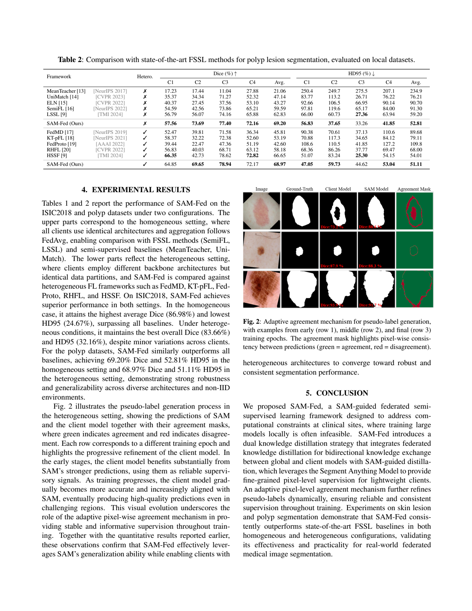

# arXiv 检索结果 / Results

## 1. HSMix: Hard and Soft Mixing Data Augmentation for Medical Image Segmentation
- Authors：Danyang Sun, Fadi Dornaika, Nagore Barrena
- First：2025-11-18T11:49:22+00:00；Latest：2025-11-18T11:49:22+00:00
- Abs：https://arxiv.org/abs/2511.17614v1
- PDF：https://arxiv.org/pdf/2511.17614v1
- Code：https://github.com/DanielaPlusPlus/HSMix, https://huggingface.co/huggingface, https://huggingface.co/docs/hub/spaces
- 解读来源：PDF 全文，共 28 页，28 页可提取文字
### [中文]
**中文翻译**
- 标题：HSMix：用于医学图像分割的硬软混合数据增强
- 摘要：由于标注成本高昂或某些疾病罕见，医学图像分割常受限于数据稀缺及由此产生的过拟合问题。自监督学习和半监督学习可在一定程度上缓解数据稀缺挑战。然而，这两种范式均较为复杂，且需要手工设计的预文本或定义良好的伪标签。相比之下，数据增强是应对数据稀缺问题的一种相对简单直接的方法。它已在图像识别任务中带来显著提升。然而，局部图像编辑增强技术在半分割场景中的有效性探索较少。我们提出HSMix，一种用于医学语义分割的硬软混合局部图像编辑数据增强新方法。在该方法中，硬增强图像通过组合来自两幅源图像的均质区域（超像素）生成。软混合方法进一步基于局部聚合的逐像素显著性系数进行亮度混合，以调整这些组合区域的亮度。两幅源图像的真实分割掩码经过相同的混合操作，以生成增强图像对应的掩码。我们的方法充分利用了先验轮廓和显著性信息，从而在增强图像中保留局部语义信息，同时以更丰富的多样性扩展增强空间。我们的方法是一种即插即用方案，与模型无关，适用于多种医学成像模态。大量实验证据表明其在多种医学分割任务中的有效性。源代码见 https://github.com/DanielaPlusPlus/HSMix。

HSMix 是一种面向医学图像分割的即插即用数据增强方法：先用 SLIC 超像素做硬混合（超像素级 CutMix，保留轮廓），再用基于相对显著性的软混合（每个超像素内按平均相对显著性确定亮度混合系数），图像与掩膜同步混合。在 ISIC 2017 T1、GlaS、MoNuSeg、Synapse、BraTS2018 上，配合 UNet、ResNet/EfficientNet 编码器、DeepLabv3+、TransUNet、HiFormer、UNeXt 等模型，DSC/JAC 普遍提升、HD95 多数下降；消融显示硬、软混合各自有效，二者组合最佳，超像素优于方形网格，显著性优于随机混合比例。方法不改变模型参数与 FLOPs，也不影响推理速度，但会增加训练时间。

# HSMix 论文精读笔记

## 1. 问题与动机

医学图像分割受标注成本高、部分疾病样本稀少影响，常出现数据稀缺与过拟合 [p. 1][p. 2]。作者指出，自监督学习需要精心设计的预文本任务，半监督学习依赖伪标签，二者都较复杂，且医学数据受隐私与法律限制难以获取额外无标注数据 [p. 2][p. 5]。基础几何变换（翻转、裁剪、旋转）效果有限，GAN 增强计算昂贵且训练困难 [p. 2][p. 5]。

局部图像编辑增强（Mixup、CutOut、CutMix、SuperpixelGridMix）主要在图像分类中被提出和验证，在分割任务中研究有限；且传统方法多用方形区域，会丢失轮廓信息 [p. 2][p. 3]。作者据此提出用超像素代替方形区域，并同时引入硬混合与软混合，以保留轮廓与显著性信息、扩大增强空间 [p. 3][p. 7]。

## 2. 方法

整体流程：对同一批次中任意两张图像 X1、X2 及其掩膜 Y1、Y2，同时生成一张硬混合图像 Xh 和一张软混合图像 Xs，连同对应掩膜 Yh、Ys 一起用于训练；增强只在训练阶段使用，推理阶段不使用 [p. 7][p. 10]。

**超像素生成。** 用 SLIC 算法生成超像素网格 SP1、SP2；每张图像的超像素数 l 从均匀分布 U(l_min, l_max) 随机采样，以增加多样性 [p. 10][p. 12]。

**硬混合（超像素级 CutMix）。** 对 SP2 中每个超像素按伯努利分布 B(1, p) 独立选择，选中则该超像素在混合掩膜 Mh 中取 1，否则取 0（式 1）[p. 7]。随后按式 2 逐元素混合：Xh = X1⊙(1−Mh) + X2⊙Mh，Yh = Y1⊙(1−Mh) + Y2⊙Mh [p. 8]。由于区域边界沿超像素轮廓而非方形，作者主张这能保留轮廓信息 [p. 7][p. 8]。

**软混合（超像素-显著性 Mixup）。** 先由两图归一化显著图 SA1、SA2 计算相对显著图 SA21(i,j) = SA2/(SA1+SA2)，且 SA12 = 1−SA21（式 3）[p. 8]。混合超像素网格 SPm = SP1⊙(1−Mh) + SP2⊙Mh（式 4）[p. 9]。对 SPm 中第 k 个超像素 Γk，将其内所有像素的相对显著性取平均得到该超像素的混合系数 λk（式 5），并令 Ms(i,j)=λk（式 6）[p. 9]。最终 Xs = X1⊙(1−Ms) + X2⊙Ms，Ys = Y1⊙(1−Ms) + Y2⊙Ms（式 7）[p. 10]。与全局固定比例的 Mixup 不同，这里每个超像素有 0 到 1 之间的连续混合比例，产生平滑标签 [p. 9][p. 16]。

**训练目标。** 使用交叉熵损失与 Dice 损失的组合 Lseg（式 8），其中 p_ij 为第 j 张图第 i 个像素对真实类的预测概率，y_ij 为真实类标签，B 为批大小，N 为类别数 [p. 10][p. 11]。

**关键设计。** 硬混合与软混合共用同一组超像素网格，作者称二者互补：硬混合提供精确的二值标签，软混合提供平滑标签 [p. 10][p. 16]。

## 3. 贡献

作者声称的贡献有三点：(1) 首个同时利用先验轮廓与显著性信息的硬软混合增强技术；(2) 通过硬软混合整合扩大增强空间多样性；(3) 即插即用、模型无关、适用于多种医学成像模态，并在多数据集多模型上优于其他方法 [p. 3][p. 4]。

我的解读：核心新颖点在于“超像素级硬混合 + 超像素内显著性加权软混合”的组合，以及图像与掩膜同步混合；显著性图与超像素算法均调用现成工具（OpenCV Static Saliency Fine Grained、SLIC），方法本身不引入新网络结构 [p. 12]。

## 4. 实验与结果

**数据集与划分。** ISIC 2017 T1（皮肤镜，2000 训练/150 验证/600 测试，二分类）；GlaS（腺体，85 训练/80 测试，二分类）；MoNuSeg（细胞核，30 训练/14 测试，二分类）；Synapse（CT 多器官，18 训练/12 验证，共 2212 轴位切片）；BraTS2018（285 例多模态 3D MRI，按 80%/20% 划分训练验证与测试，再按 Kermi 等提取 2D 切片，分 WT/TC/ET 三类）[p. 11]。

**模型。** UNet、UNet-EfficientNet-b2、UNet-ResNet50、UNet-ResNet101、DeepLabv3+、TransUNet、HiFormer-B、UNeXt [p. 11]。

**训练设置。** 默认输入 224×224；基础增强为随机翻转与 ±20° 旋转；AdamW，权重衰减 0.0005 [p. 12]。ISIC 2017 T1 基线批大小 8、学习率 0.0001，使用 HSMix 时批大小 4、学习率 0.0001；MoNuSeg 批大小 4、学习率 0.001；GlaS 批大小 4、学习率 0.0001；BraTS2018 批大小 4、学习率 0.001 [p. 12]。作者说明使用 HSMix 时实际批大小翻倍，因为每对图像生成两张增强图 [p. 12]。超像素参数：ISIC 2017 T1 为 l~U(30,80)、c=10；GlaS 与 Synapse 为 l~U(200,400)，c 分别为 10 与 0.1；MoNuSeg 为 l~U(300,500)、c=10；BraTS2018 为 l~U(50,150)、c=0.003；所有数据集 p=0.3 [p. 12][p. 18]。ISIC 2017 T1 重复 3 次报告均值±标准差，MoNuSeg 与 GlaS 用五折交叉验证 [p. 12]。

**主要结果。** ISIC 2017 T1：UNet 的 DSC 从 80.92% 升至 83.50%，TransUNet 从 84.76% 升至 85.57% [p. 13]。GlaS：UNet-EfficientNet-b2 的 JAC 从 79.39% 升至 80.15%，HiFormer-B 从 83.47% 升至 84.03% [p. 13]。MoNuSeg：UNeXt 的 DSC 从 71.61% 升至 72.29%、JAC 从 56.24% 升至 56.84%；DeepLabv3+ 的 JAC 从 49.94% 升至 50.28%，HD95 从 3.66 降至 3.55 [p. 13][p. 14]。Synapse：UNet 的 DSC 从 77.59% 升至 78.25%、JAC 从 64.24% 升至 68.40%；TransUNet 的 DSC 从 77.74% 升至 79.35%、JAC 从 67.46% 升至 69.30% [p. 14]。BraTS2018：UNet 平均 DSC 从 77.33% 升至 78.97%，UNeXt 从 66.41% 升至 68.29% [p. 15]。

**计算开销。** 在 ISIC 2017 T1 + UNet-ResNet101 上，HSMix 不改变参数量（166.8007 M）与 FLOPs（44.85 G），FPS 保持 81，但每 epoch 训练时间从 153 s 增至 262 s [p. 15]。与 GAN 方法相比，后者 FLOPs 升至 89.71 G、训练时间 307 s [p. 15]。

**与其他增强对比。** 同一设置下：Baseline DSC 84.38%、JAC 75.45%；MixUp（图像与掩膜）85.40%/77.04%；CutMix 85.04%/76.55%；CutOut 84.68%/76.15%；LCAMix 85.83%/77.35%；HSMix 85.91%/77.48%；SPDA 仅 54.47%/39.93% [p. 15]。作者解释 SPDA 因超像素化丢失细节而显著变差 [p. 15]。

**消融（UNet，GlaS 与 MoNuSeg）。** GlaS 上：基线 DSC 85.10%、JAC 75.22%；方形硬混合 87.17%/78.83%；超像素硬混合 88.53%/80.71%；随机比例软混合 89.66%/81.97%；显著性软混合 89.72%/81.99%；二者组合 90.83%/83.97% [p. 16][p. 17]。MoNuSeg 上组合将 DSC 从 76.51% 升至 79.63%、JAC 从 63.12% 升至 66.68% [p. 16]。作者据此认为超像素优于方形网格、显著性优于随机比例、硬软组合互补 [p. 16]。

**超像素数量与选择概率。** ISIC 2017 T1 上 l~U(30,80) 最佳（DSC 83.50%），常数 l=65 为 81.73%；GlaS 上 l~U(200,400) 最佳（90.83%），常数 l=300 为 89.27% [p. 17]。p=0.3 时最佳（图 5）[p. 18]。

**输入尺寸。** 224 与 512 下 HSMix 均优于基线；如 GlaS 上 UNeXt 从 82.00% 升至 86.20%（224），从 85.83% 升至 88.51%（512）[p. 19]。

## 5. 评估

支持的结论：在多个数据集、多种 CNN 与 Transformer 骨干上，HSMix 一致提升 DSC/JAC 并多数降低 HD95；消融支持超像素与显著性设计的有效性；计算开销证据表明其不增加模型参数、FLOPs 与推理时间，仅增加训练时间 [p. 13][p. 15][p. 16]。

需注意之处：部分表格在提供的文本中排版错乱（如 Table 1–5 的行列对应关系难以完全辨认），上述数字取自正文明确陈述或可辨认行，未逐格核对全部表格 [p. 13][p. 14][p. 15]。作者未报告显著性算法失败情形、超像素参数跨模态的敏感性分析之外的统计检验；BraTS2018 与 Synapse 未说明重复次数或方差来源 [p. 11][p. 12]。此外，作者将 SPDA 的大幅下降归因于细节丢失，属解释性意见而非直接实验证明 [p. 15]。

## 6. 复现

可复现要点：SLIC 生成超像素，l 按表 9 的均匀分布采样，compactness 按数据集取 10/0.1/0.003，p=0.3；OpenCV Static Saliency Fine Grained 生成显著图；按式 1–7 生成 Xh、Yh、Xs、Ys；损失为交叉熵 + Dice；AdamW，权重衰减 0.0005；各数据集批大小与学习率见 4.2 节；输入 224×224（消融含 512）；基础增强为翻转与 ±20° 旋转 [p. 12][p. 18]。

未报告或无法确认：训练 epoch 数、学习率调度策略、显著性图是否归一化的具体方式、随机种子、五折交叉验证的具体折划分、BraTS2018 的重复次数，以及 Table 1–5 中部分单元格的准确数值 [p. 12][p. 13][p. 14]。代码链接在摘要中给出，但论文正文未进一步说明实现细节 [p. 1]。

本篇未找到可可靠提取的方法流程图，请查看原文 PDF。

## 2. SAM-Fed: SAM-Guided Federated Semi-Supervised Learning for Medical Image Segmentation
- Authors：Sahar Nasirihaghighi, Negin Ghamsarian, Yiping Li, Marcel Breeuwer, Raphael Sznitman, Klaus Schoeffmann
- First：2025-11-18T09:58:06+00:00；Latest：2025-11-18T09:58:06+00:00
- Abs：https://arxiv.org/abs/2511.14302v1
- PDF：https://arxiv.org/pdf/2511.14302v1
- Code：https://huggingface.co/huggingface, https://huggingface.co/docs/hub/spaces
- 解读来源：PDF 全文，共 5 页，5 页可提取文字
### [中文]
**中文翻译**
- 标题：SAM-Fed：SAM引导的联邦半监督学习用于医学图像分割
- 摘要：医学图像分割在临床上具有重要意义，但数据隐私和专家标注成本限制了标注数据的可用性。联邦半监督学习（FSSL）提供了一种解决方案，但面临两个挑战：伪标签的可靠性取决于本地模型的强度，而客户端设备由于计算资源有限，通常需要紧凑或异构的架构。这些限制降低了伪标签的质量和稳定性，而大模型虽然更准确，却无法在客户端设备上训练或用于常规推理。我们提出SAM-Fed，一种联邦半监督框架，利用高容量分割基础模型在训练过程中指导轻量级客户端。SAM-Fed结合了双知识蒸馏与自适应一致性机制来细化像素级监督。在皮肤病变和息肉分割上跨同构与异构设置的实验表明，SAM-Fed始终优于最先进的FSSL方法。

SAM-Fed 将服务器端用 LoRA 微调的 SAM 作为高容量教师，向计算受限的客户端轻量模型提供像素级伪标签；通过教师与客户端预测的自适应一致性选择与置信度加权，缓解伪标签不可靠问题。在 ISIC2018 皮肤病变和四个息肉数据集上，同构（FedAvg）与异构（HSSF 式 RC/RF）设置下平均 Dice 分别为 86.98%/83.66% 和 69.20%/68.97%，均优于所列 FSSL 基线。

## 1. 问题与动机

论文针对联邦半监督学习（FSSL）中的医学图像分割：服务器持有公开有标签数据，客户端只持有私有**无标签**数据，且客户端设备算力有限、架构可能异构。作者指出核心矛盾是伪标签质量依赖本地模型容量，而客户端往往只能部署轻量模型；大模型虽更准，却难以在客户端训练或常规推理[p. 1]。现有 FSSL 工作多通过客户端间一致性、全局/局部蒸馏或异构聚合改进协作，但伪标签可靠性仍受各客户端本地模型精度与容量制约[p. 1]。因此作者提出用服务器端高容量分割基础模型 SAM 指导轻量客户端训练，并声称“在完全无标签客户端场景下联合服务器—客户端知识蒸馏用于分割”尚无先例[p. 1]。

## 2. 方法

**问题设定。** 服务器有公开有标签集 \(D_p=\{(x_{pi},y_{pi})\}\)，客户端 \(c\) 有私有未标注集 \(D_c=\{x_{cj}\}\)，客户端间数据分布非独立同分布；目标是在各客户端上协同训练分割模型[p. 2]。

**服务器端。** 服务器先在 \(D_p\) 上训练监督全局模型 \(M_G\)，并在同一数据上微调高容量教师 \(M_T\)。教师选用 SAM，冻结视觉与提示编码器，仅用 LoRA 适配（rank \(r=16\)、缩放 \(\alpha=32\)、dropout 0.1，可训练参数 6.65M）[p. 3]。随后把 \(M_T\) 权重与 \(D_p\) 广播给所有客户端[p. 2]。

**客户端端。** 客户端模型 \(M_c\) 先在 \(D_p\) 上训练以建立基础，再对私有未标注数据做半监督学习。SAM 只做一次前向生成初始伪标签，计算开销远低于训练；这些预测随后在 SSL 中与客户端输出动态集成[p. 2]。

**自适应一致性机制。** 对每个未标注样本，教师与客户端分别输出 softmax \(\tilde y^T_j=\sigma(M_T(x_{cj}))\)、\(\tilde y^c_j=\sigma(M_c(x_{cj}))\)，并取 \(\hat y^T_j=\arg\max\tilde y^T_j\)、\(\hat y^c_j=\arg\max\tilde y^c_j\)（式1）[p. 2]。像素级最终伪标签 \(\acute y_j(w,h)\) 按式2选择：若教师与客户端预测一致，接受共识；否则选置信度更高一方的预测[p. 3]。置信权重 \(\lambda_j(w,h)\) 按式3：一致时取 1；不一致时取 \(s_T/s_c\) 中较大者对应的归一化比值（原文写作 \(s_T\) 若 \(s_T>s_c\)，否则 \(s_c\)，其中 \(s_T=\max\tilde y^T_j\)、\(s_c=\max\tilde y^c_j\)）[p. 3]。作者解释：早期客户端预测置信度低，教师更可靠；随训练推进客户端逐渐对齐本地分布，其预测可能比冻结教师更可靠，故需动态调整二者贡献[p. 2]。

**无监督损失。** 用生成的伪标签与权重计算加权交叉熵：\(L_u=\frac{1}{|B_u|}\sum_{j\in B_u}\sum_{w,h}\lambda_j(w,h)\cdot\ell_{CE}(\hat y_j(w,h),\acute y_j(w,h))\)（式4），其中 \(B_u\) 为未标注 batch，\(\ell_{CE}\) 为交叉熵[p. 3]。

**聚合。** 同构设置用 FedAvg 做数据加权参数平均并广播；异构设置沿用 HSSF 的 Regularity Condensation（服务器在 \(D_p\) 上从客户端预测提取可靠知识）与 Regularity Fusion（客户端以 KL 散度损失吸收该知识）[p. 3]。整体流程见 Algorithm 1[p. 2]。

## 3. 贡献

作者声称的贡献有三点：利用服务器端高算力增强无标签客户端伪监督；基于服务器教师与客户端模型像素级预测一致性的半监督分割策略；同时支持 FedAvg 同构聚合与异构聚合[p. 1]。我的解读：核心工程贡献是把 SAM+LoRA 教师嵌入 HSSF 式 FSSL 流程，并以“一致性选择+置信度加权”替代单一伪标签来源；其方法本身是模块化组合，论文未给出与“仅用服务器全局模型作教师”等消融来单独量化 SAM 的增益。

## 4. 实验与结果

**数据与划分。** 皮肤病变用 ISIC2018（2,694 张），留 100 张为公开数据，其余分给四个客户端：200、400、800、1,194 张（D1–D4）[p. 3]。息肉用 Non-IID 五数据集：CVC-ColonDB（公开，380 张）及四个私有客户端集 CVC-ClinicDB（300）、EndoTect-ETIS（612）、CVC-300（396）、Kvasir（1,000）；每个私有集按 0.8:0.1:0.1 分训练/验证/测试[p. 3]。

**网络与训练。** 模拟四个客户端。异构时 C1、C2 用 ResNet18，C3、C4 用 ResNet34，服务器特征提取用 ResNet101；同构时所有客户端用 ResNet34。图像统一 resize 到 384×384，增强与超参同 HSSF[p. 3]。AdamW，初始学习率 0.0001[p. 3]。

**ISIC2018 结果（表1）。** 同构下 SAM-Fed 平均 Dice 86.98%、HD95 24.67%，优于 LSSL 的 83.40%/29.21%、SemiFL 的 80.59%/42.42% 等[p. 3]。异构下平均 Dice 83.66%、HD95 32.16%，优于 HSSF 的 79.11%/34.18%；但客户端 C2 的 Dice 为 76.52%，低于 HSSF 的 77.91%，说明并非每个客户端都占优[p. 3]。

**息肉结果（表2）。** 同构平均 Dice 69.20%、HD95 52.81%，优于 LSSL 的 62.83%/59.20%；异构平均 68.97%/51.11%，优于 HSSF 的 66.65%/54.01%[p. 4]。异构下 C1 的 Dice 64.85% 低于 HSSF 的 66.35%，C3 的 HD95 44.62% 差于 HSSF 的 25.30%[p. 4]。

**定性证据。** 图2（第4页）展示异构设置下早、中、末期训练中 SAM 与客户端预测及一致性掩码（绿=一致，红=不一致），作者据此说明客户端逐步对齐 SAM、伪标签质量随训练提升[p. 4]。该图仅依据图注与正文描述，未对图像内容作独立判读。

**消融。** 论文未报告组件消融（如去掉 SAM 教师、去掉自适应权重、固定权重等），因此各设计选择的独立贡献缺乏直接证据。

## 5. 评估

支持的结论：在两个任务、同构与异构设置下，SAM-Fed 的平均 Dice 与平均 HD95 均优于表中基线，说明“服务器大模型指导轻量客户端”在平均指标上有效。局限与缺失证据：第一，无消融，无法区分 SAM 教师、一致性选择与置信加权各自的贡献；第二，部分客户端指标劣于 HSSF（ISIC 的 C2、息肉的 C1 与 C3 HD95），平均优势可能由个别客户端驱动；第三，未报告通信轮数、本地 epoch、batch size、SAM 推理频率之外的计算开销、隐私威胁分析或多次运行方差；第四，息肉各客户端数据量差异大，Non-IID 程度与标签预算未系统变化；第五，表1、表2 在 PDF 文本中排版错位，部分数字与列对应关系需以原表为准，本文按可辨认文本转录。

## 6. 复现

可复现的设置：ISIC2018 公开 100 张、客户端 200/400/800/1,194 张；息肉五数据集及 0.8:0.1:0.1 划分；同构 ResNet34、异构 ResNet18/34、服务器 ResNet101；384×384 输入；AdamW，lr=0.0001；SAM 冻结视觉与提示编码器，LoRA r=16、α=32、dropout 0.1、6.65M 可训练参数；同构 FedAvg，异构按 HSSF 的 RC/RF 与 KL 损失[p. 3]。未报告：训练轮数/通信轮数、本地 epoch、batch size、学习率调度、SAM 具体变体与权重来源、损失中监督项与无监督项的组合权重、随机种子与重复次数、硬件。复现需先实现 HSSF 基线流程，再接入 SAM-LoRA 教师与式1–4 的伪标签机制。

#### 原论文流程图所在页（完整页面） · Figure 2 · PDF 第 4 页

Fig. 2 illustrates the pseudo-label generation process in We proposed SAM-Fed, a SAM-guided federated semi- the heterogeneous setting, showing the predictions of SAM supervised learning framework designed to address com- and the client model together with their agreement masks, putational constraints at clinical sites, where training large where green indicates agreement and red indicates disagree- models locally is often infeasible. SAM-Fed introduces a

[原文来源](https://arxiv.org/pdf/2511.14302v1#page=4)

## 3. DualFete: Revisiting Teacher-Student Interactions from a Feedback Perspective for Semi-supervised Medical Image Segmentation
- Authors：Le Yi, Wei Huang, Lei Zhang, Kefu Zhao, Yan Wang, Zizhou Wang
- Venue：AAAI
- Comments：Accepted by Proceedings of the AAAI Conference on Artificial Intelligence 40 (AAAI-26)
- First：2025-11-12T13:29:24+00:00；Latest：2025-11-12T13:29:24+00:00
- Abs：https://arxiv.org/abs/2511.09319v1
- PDF：https://arxiv.org/pdf/2511.09319v1
- Code：https://huggingface.co/huggingface, https://huggingface.co/docs/hub/spaces, https://github.com/lyricsyee/dualfete
- 解读来源：PDF 全文，共 12 页，12 页可提取文字
### [中文]
**中文翻译**
- 标题：DualFete：从反馈视角重新审视师生交互的半监督医学图像分割
- 摘要：师生范式已成为半监督学习中的经典框架。当应用于医学图像分割时，该范式因图像固有的模糊性而面临挑战，使其特别容易受到错误监督的影响。关键在于，学生对这些错误的迭代性再确认会导致自我强化的偏差。尽管一些研究试图缓解这种偏差，但它们往往依赖于对传统师生框架的外部修改，而忽视了其内在的纠错潜力。为此，本工作将反馈机制引入师生框架，以抵消错误的再确认。在这里，学生针对教师伪标签所引起的变化提供反馈，使教师能够相应地修正这些标签。我们明确指出，这种交互取决于两个关键组件：反馈归因器，用于指定触发学生更新的伪标签；以及反馈接收器，用于确定在何处应用该反馈。在此基础上，进一步提出了一种双教师反馈模型，该模型使反馈回路更具动态性，并通过跨教师监督解决分歧来获得更多收益，同时避免一致性错误。在三个医学图像基准上的全面评估表明，该方法在解决半监督医学图像分割中的错误传播方面是有效的。

论文针对半监督医学图像分割中教师-学生框架的确认偏差问题，提出将学生反馈引入教师伪标签修正的DualFete框架。核心是用学生一步更新前后在标注数据上的损失变化δ作为反馈信号，按一致性/分歧区域分别归因，并设计双教师交叉监督与反馈损失。在LA、Pancreas、BraTS19三个数据集上，DualFete在多数标签设置下取得最优Dice与95HD，如Pancreas 10%标签Dice 81.99、95HD 5.34，较AD-MT提升1.78 Dice并降低1.84体素95HD；消融显示反馈归因与接收器匹配、双教师协同是关键。作者承认BraTS结果存在波动并推测与验证集过拟合有关，但未报告多次运行方差等证据。

# DualFete 论文阅读笔记

## 1. 问题与动机

半监督医学图像分割（SSMIS）常用教师-学生范式：教师θ_T为无标注图像生成伪标签，学生θ_S据此训练[p. 3]。作者指出，医学图像固有的模糊性使伪标签易错，而学生反复拟合这些错误会形成自我强化的确认偏差（confirmation bias）[p. 1]。现有方法多依赖模型级扰动、置信度过滤或多模型竞争等外部修正，作者认为这些做法没有触及教师-学生框架自身的纠错潜力；模型级扰动在高度非线性网络中容易退化为自训练，无法维持有意义的分歧[p. 2]。图1的LA预实验（16个标注样本，评估第一个无标注样本并取最后100步平均）显示，常规方法在伪标签准确率上提升有限且存在一致错误，而反馈交互可减少一致错误[p. 1]。

## 2. 方法

### 2.1 基础教师-学生与反馈信号

设分割模型为f_θ，类别集C={0,...,C−1}。教师按ˆy_u=argmax_c f_c(x_u;θ_T)生成伪标签，学生最小化L_S(θ_S,θ_T;D_u)=1/N_u Σ ℓ(f(x_ui;θ_S),ˆy_ui)[p. 3]。为判断伪标签驱动的更新是否与标注数据监督方向一致，作者在标注小批量D′_l上计算学生一步更新前后的损失差：δ=L_l(θ_S)−L_l(θ′_S)，其中θ′_S=θ_S−ηΔθ_S，Δθ_S为无标注小批量上的随机梯度[p. 3]。δ>0表示伪标签更新与监督损失方向一致，δ<0表示相反。教师据此最小化反馈损失L_fb(θ_T;D′_u)=−δ log P(ˆy_u|x_u;θ_T,D′_u)：δ>0时提高该伪标签似然，δ<0时降低[p. 3]。作者说明δ是一阶近似下两个梯度的内积，与元伪标签（MPL）的双层优化相关[p. 3, p. 10]。

### 2.2 双教师反馈：归因器与接收器

单教师反馈对所有体素施加统一更新方向，作者认为纠错能力受限（图2(a)）[p. 3-4]。DualFete使用两个教师ϕ、ψ：预测一致时取共识伪标签，冲突时取两教师中置信度更高者，即ˆy_u=argmax_c max_{ϕ,ψ}{f_ϕc,f_ψc}[p. 4]。按一致性/分歧划分反馈归因器¯y_a={ˆy_u|ˆy_ϕu=ˆy_ψu}与¯y_d={ˆy_u|ˆy_ϕu≠ˆy_ψu}，并分别计算δ_a、δ_d（式7）[p. 4]。

反馈接收器由掩码M_θ¯y:=I(ˆy_θu⋆ˆy_¯θu, f_θˆy_θu⋄f_¯θˆy_¯θu)定义：对一致性区域用“=”和“<”，对分歧区域用“≠”和“>”[p. 4]。设计上，一致性反馈δ_a施加于两教师中置信度较低一侧；分歧反馈δ_d施加于置信度较高一侧。作者解释：δ_a>0时希望最大化伪标签置信度下界，δ_a<0时低置信度有利于产生分歧；δ_d>0时希望伪标签更自信，δ_d<0时更可能翻转为另一教师的预测[p. 4]。双教师反馈损失为L_df(θ)=−Σ_{¯y∈{¯y_a,¯y_d}} δ_¯y log P(ˆy_θu|x_u;θ,D_u,M_θ¯y)（式8）[p. 4]。

### 2.3 整体训练目标

学生仅用无标注数据D_u和双教师共识伪标签ˆy_u更新（式2、式6），并承担在标注数据上计算反馈的职责；可选地在D_l上微调[p. 4]。每个教师θ∈{ϕ,ψ}的目标为L_T(θ)=L_l(θ)+L_df(θ)+λL^A_cs(θ;¯θ,A)（式9），其中L_l为全监督损失，L^A_cs为对另一教师伪标签的交叉监督损失，A为强增强（如copy-paste、color-jitter），λ为ramp-up权重[p. 4]。交叉监督损失L^A_cs(θ;¯θ,A)=1/N_u Σ ℓ(f(A(x_ui);θ),Aˆy_¯θu)（式10），并对标签y仅做位置变换，另采用置信度阈值过滤不可靠目标[p. 4-5]。算法1概括了单步流程：两教师生成伪标签与归因器→计算反馈δ→得到接收器掩码→计算L_df→更新学生→更新两教师[p. 4]。

## 3. 贡献

作者主张的贡献有三点：(1) 将反馈机制引入教师-学生框架，使框架具备内在纠错能力；(2) 提出双教师反馈模型，协调交叉监督解决冲突与反馈损失保持教师多样性；(3) 在三个基准上验证有效性[p. 2]。我的理解是：核心新颖点在于把“学生在标注数据上的一步性能变化”作为伪标签质量的反馈信号，并用一致性/分歧归因与置信度高低侧接收器把单教师统一反馈细化为个体化反馈；双教师结构同时提供交叉监督，使反馈与教师间互学耦合。作者在补充材料中明确将自身与MPL区分：MPL式单教师反馈对所有体素概率施加统一方向，而DualFete做个体化反馈并增强跨教师学习[p. 10]。

## 4. 实验与结果

### 4.1 数据集与设置

实验使用LA（100例MRI，80训练/20测试；标签比例5%、10%、20%）、Pancreas（82例CT，62训练/20测试；10%、20%）、BraTS19（335例MRI，250训练/25验证/60测试；10%、20%）[p. 5]。LA与Pancreas用V-Net，BraTS用U-Net，输入尺寸与评估协议沿用先前工作；优化器为SGD，数据加载配置也沿用先前工作[p. 5]。分割损失为Dice与交叉熵组合，学生标注数据评估用交叉熵；似然P实现为逐体素伪标签概率的累积乘积；LA在式7中使用归一化梯度，Pancreas和BraTS不使用，作者称实验发现这样更好[p. 5]。指标为Dice（%）和95% Hausdorff距离（95HD，体素）[p. 5]。

### 4.2 与SOTA比较

表1报告了与Fully Supervise、UA-MT、SASSNet、DTC、URPC、PS-MT、MC-Net+、SS-Net、BCP、UniMatch、MutRel、AD-MT、TraCoCo的比较[p. 5]。DualFete在多数设置下最优：LA 5%（4例）Dice 90.35、95HD 6.42；LA 10%（8例）91.28、5.51；LA 20%（16例）91.89、5.24；Pancreas 10%（6例）81.99、5.34；Pancreas 20%（12例）83.49、4.76；BraTS 10%（25例）86.13、9.02；BraTS 20%（50例）85.83、8.12[p. 5]。作者特别指出Pancreas 10%标签较此前最佳AD-MT提升1.78 Dice并降低1.84体素95HD[p. 5]。微调版本（DualFete w.ft.）在部分设置略有变化，如LA 5%为90.22、5.89，Pancreas 20%为83.85、4.43，BraTS 20%为86.46、7.80[p. 5]。作者称微调在20%标签和较难的Pancreas上有额外收益，但在LA 5%/10%等极少标签下易过拟合；BraTS测试性能存在波动，作者推测25例验证集易过拟合[p. 6]。需要注意，表1中BraTS 10%的DualFete Dice 86.13低于TraCoCo的85.71？实际TraCoCo为85.71，DualFete更高；但BraTS 20%的DualFete 85.83低于TraCoCo的86.69，作者仍称“几乎全部基准和标签设置”最优，这一表述与表中BraTS 20%不符[p. 5]。

### 4.3 消融与机理分析

表2在LA 20%和Pancreas 20%上分析组件[p. 6]。基线（无D.T.、无归因、无接收器、无强增强）为LA 88.55/8.58、Pancreas 77.18/9.81。加入双教师与ˆy_u、接收器P、无强增强为LA 89.63/7.92、Pancreas 79.27/9.90；仅一致性归因¯y_a与低置信侧P_l为LA 89.83/8.08、Pancreas 76.83/12.2；仅分歧归因¯y_d与高置信侧P_h为LA 90.34/6.43、Pancreas 79.56/8.38；两者结合¯y_a,d与P_h,l为LA 90.35/6.19、Pancreas 80.77/8.22；但错配为P_l,h时降至LA 87.69/8.73、Pancreas 78.06/8.77[p. 6]。作者据此强调归因器与接收器正确匹配的关键性，并称强增强似然在此未带来增益，只有在弱到强一致性约束下才有用[p. 6]。

表4在双教师框架下比较L_df、L_cs、L^A_cs[p. 7]。LA 10%：仅L_l为86.82/9.96，+L_cs为88.37/9.27，+L_cs+L_df为90.77/6.19，+L^A_cs为90.39/7.03，+L^A_cs+L_df为91.28/5.51；LA 20%对应为88.55/8.58、90.30/6.80、91.66/6.12、91.10/6.12、91.89/5.24。Pancreas 10%：70.81/14.3、75.39/10.6、78.13/7.71、80.30/6.06、81.99/5.34；Pancreas 20%：77.18/9.81、79.62/6.84、80.92/7.89、82.17/5.43、83.49/4.76[p. 7]。作者结论是交叉监督提升学生性能，反馈损失进一步放大这一良性循环[p. 7]。

表3比较仅用L_df与仅用L^A_cs（Pancreas 20%）[p. 7]。仅L^A_cs时两教师Dice为78.42±8.46与80.51±6.23，熵（×10^4）为12.65±2.45与13.13±2.82；仅L_df时Dice骤降至57.40±24.63与54.38±28.83，熵为14.30±2.77与15.23±2.93。作者据此认为单独反馈损失不能维持对输入扰动的鲁棒性且增加预测不确定性，需与交叉监督配合[p. 7]。

图4的定性分析（LA 10%，先交叉监督预训练6k步，再以0.5k步施加不同约束）报告：L_cs强制共识但放大错误；δ_a<0迫使教师完全冲突；δ_d<0导致伪标签振荡甚至边界交替侵蚀、最终全背景崩溃；δ_d>0可增强伪标签置信度并促进分歧；两类反馈协同可抵消退化[p. 6]。图5显示L^A_cs置信度阈值0.7在多数场景最优，强增强似然在Pancreas 20%有显著提升[p. 7]。表5报告LA上V-Net的训练/推理成本：DualFete训练2.28 s/iter、显存10.25 GB、推理1.91 s/case；FullySup为0.15、5.15、1.93；AD-MT为0.67、7.26、1.93；TraCoCo为2.39、21.93、1.81[p. 7]。作者称双教师仅训练时使用，推理仅用学生，因此推理速度与基线相当[p. 7]。

## 5. 评估

支持的结论：反馈信号确实能改变教师伪标签更新方向，表2和表4显示在匹配的归因/接收器设计下，DualFete在LA与Pancreas多数设置优于基线；表3说明单独L_df不足，需与交叉监督结合；表5说明推理成本未显著增加。作者报告的局限包括：BraTS测试性能波动，推测验证集过拟合；微调在极少标签下易过拟合[p. 6]。

缺失或需谨慎的证据：论文未报告多次随机种子运行的均值与方差（除表3的六次增强评估外），因此表1的领先幅度是否稳定未知；BraTS 20%上DualFete低于TraCoCo，与“几乎全部最优”的表述不完全一致[p. 5]；表2中部分单元格排版拥挤，个别数字（如Pancreas 20%某行）难以完全辨认，本文只引用可清晰对应的数值；反馈损失中似然P的累积乘积实现、阈值选择对δ计算的具体影响、以及λ的取值与ramp-up schedule未在正文给出；计算δ需每步在标注小批量上做一次额外前向/更新评估，其额外开销未单独列出。作者将δ解释为梯度内积的一阶近似，但未给出该近似误差的定量分析[p. 3, p. 10]。

## 6. 复现要点

已报告：LA/Pancreas用V-Net、BraTS用U-Net；SGD优化器；输入尺寸与评估协议沿用Liu et al. 2024等先前工作；分割损失为Dice+交叉熵，学生标注评估用交叉熵；LA式7用归一化梯度，Pancreas/BraTS不用；L^A_cs置信度阈值0.7在多数场景最优；强增强可用copy-paste或color-jitter；λ为ramp-up权重；双教师仅训练使用，推理用学生；代码链接为https://github.com/lyricsyee/dualfete[p. 1, p. 4-5, p. 7]。

未报告或无法从正文确定：具体学习率、批大小、训练迭代总数（除定性分析中6k+0.5k步）、λ的具体数值与ramp-up曲线、置信度阈值在表1主实验中的取值、伪标签似然累积乘积的数值稳定实现、随机种子与重复次数、BraTS验证集早停策略。复现时应将这些标为待确认，不宜凭记忆补全。

本篇未找到可可靠提取的方法流程图，请查看原文 PDF。

## 4. Cross-pyramid consistency regularization for semi-supervised medical image segmentation
- Authors：Matus Bojko, Maros Kollar, Marek Jakab, Wanda Benesova
- First：2025-11-11T16:38:31+00:00；Latest：2025-11-11T16:38:31+00:00
- Abs：https://arxiv.org/abs/2511.08435v1
- PDF：https://arxiv.org/pdf/2511.08435v1
- Code：https://huggingface.co/huggingface, https://huggingface.co/docs/hub/spaces
- 解读来源：PDF 全文，共 7 页，7 页可提取文字
### [中文]
**中文翻译**
- 标题：用于半监督医学图像分割的跨金字塔一致性正则化
- 摘要：半监督学习（SSL）能够在假设标注数据有限且经过精心标注、同时有大量无标签数据支持学习的情况下训练强大的模型。本文提出一种混合一致性学习方法，通过利用两个解码器之间的跨金字塔一致性正则化（CPCR），有效利用无标签数据进行半监督医学图像分割。首先，我们设计了一种混合双分支金字塔网络（DBPNet），由一个编码器和两个略有不同的解码器组成，每个解码器在多个分辨率尺度上生成受扰动的辅助预测金字塔。其次，我们为该网络提出一种名为CPCR的学习策略，将现有的基于解码器主输出预测的一致性学习和不确定性最小化方法与我们的新型正则化项相结合。更具体地说，在该正则化项中，我们将软标签设置扩展到跨解码器的金字塔预测，以支持深度分层特征中的知识蒸馏。实验结果表明，带有CPCR的DBPNet优于五种最先进的自监督学习方法，并在一个公开基准数据集上与近期方法性能相当。

论文提出用于半监督医学图像分割的 DBPNet 与 CPCR：在 U-Net 编码器上接两个略有差异的解码器（TR 与 UP），并在两个解码器的 3 个辅助尺度上生成金字塔预测；CPCR 由主输出双向 KL 一致性（T-softmax 软伪标签）、辅助金字塔跨解码器一致性、平均预测熵最小化与 Dice 监督损失组成。在 ACDC 数据集、10% 标注、70/10/20 患者划分下，DBPNet 取得 DSC 88.11%、IoU 79.45%、95HD 4.12、ASD 1.11，优于表中五个 SSL 方法，但 DSC/IoU 低于 DVCPS（88.76/80.36），边界指标更优。论文未报告消融实验，CPCR 各组件的独立贡献缺乏直接证据。

## 1. 问题与动机

论文关注半监督医学图像分割：像素级标注昂贵，而大量未标注图像可用。作者将现有 SSL 方法归为伪标签与一致性正则两类，并指出网络级一致性方法（如 Mean Teacher 及其扩展）常需多模型或多轮前向，训练参数与开销大 [p. 2]。因此作者倾向单模型/多解码器结构：URPC 用单编码器-解码器加辅助头产生多尺度扰动预测 [p. 3]；MC-Net+ 用多个上采样策略不同的解码器互相锐化伪标签；MTNet 进一步用不同注意力与 T-softmax、平均预测不确定性最小化处理噪声伪标签 [p. 3]。本文的出发点是：把“双解码器主输出一致性”与“跨解码器的多尺度金字塔一致性”结合，在较少参数下利用深层层级特征中的未标注信息 [p. 3]。

## 2. 方法

### 2.1 网络结构 DBPNet

DBPNet 以带跳跃连接的 U-Net 为骨架，编码器共享，接两个解码分支：TR 分支用转置卷积上采样，UP 分支用 1×1 卷积加双线性上采样；两分支还使用 dropout 以制造输出差异 [p. 3]。相比 MC-Net+ 的三分支，作者简化为两支，理由是第三支对最终分割影响可忽略 [p. 3]。在两个解码分支的不同分辨率层级后接辅助分割头（共 3 个辅助尺度，主输出为第 4 尺度），每个头由 3×3 卷积、上采样和 softmax 组成，输出恢复到输入分辨率；各尺度分别施加 dropout、feature dropout 或 feature noise 以产生扰动 [p. 3]。图 1（[p. 4]）给出 DBPNet 与 CPCR 的整体流程；作者注明图中未画平均预测不确定性最小化，因为它不是本文贡献。

### 2.2 CPCR 损失

总损失为监督项加三个正则项 [p. 4]：

L_total = L_sup + 0.1·(L_maincon + L_um) + λ·L_auxcon。

**主一致性损失**：在第 4 尺度主输出上做双向知识蒸馏。先用 T-softmax 把 logit z 转成软概率 p̃_c = exp(z_c/T) / Σ_c' exp(z_c'/T)，T 控制软度 [p. 3]。然后 L_maincon = KL(P̃_TR^(4), P̃_UP^(4)) + KL(P̃_UP^(4), P̃_TR^(4))；KL 两个方向都算，但梯度只回传给学生分支，形成互为师生 [p. 4]。

**辅助一致性损失**：对 s=1..3 的辅助尺度，计算两解码器同尺度预测之间的平均双向 KL：L_auxcon = (1/3) Σ_s [KL(P̃_TR^(s), P̃_UP^(s)) + KL(P̃_UP^(s), P̃_TR^(s))] [p. 4]。作者的解释是低分辨率辅助预测仍含不同空间频率、捕捉低频成分与低层层级特征，因此该约束可在深层特征间起知识蒸馏作用 [p. 4]。

**不确定性最小化**：L_um = −(1/N) Σ_i Σ_c P̄_ci log(P̄_ci)，其中 P̄ = (P_TR^(s) + P_UP^(s))/2，仅取 s=4 的主输出平均，N 为像素数、C 为类别数 [p. 4]。该熵最小化用于增强置信度，并避免分别对两分支施加导致分支间不一致 [p. 4]。

**监督损失**：对标注数据，两分支主输出分别与真值 Y 计算 Dice：L_sup = L_dice(P_TR^(4), Y) + L_dice(P_UP^(4), Y) [p. 4]。

**权重**：主一致性与不确定性项固定系数 0.1；辅助项系数 λ(t) = w_max·exp(−5(1−t/t_max)^2)，为随时间升高的高斯 warm-up，w_max=0.1，避免训练早期被深层错误预测主导 [p. 4]。作者称三个正则项都同时作用于标注与未标注数据 [p. 4]。

## 3. 贡献

作者声称两点贡献 [p. 3]：(1) 混合式双分支金字塔网络 DBPNet，从两个解码器的多个尺度产生辅助金字塔预测；(2) CPCR 学习框架，把主输出上的一致性学习与不确定性最小化，与跨解码器辅助金字塔预测间的新正则项结合。

我的解读：真正的新意主要在“把 URPC 式多尺度辅助头复制到双解码器两侧，并在同尺度跨分支做软标签监督”，属于对 MC-Net+/MTNet 与 URPC 的组合式扩展；主一致性、T-softmax、熵最小化和 warm-up 均明确沿用 MTNet 或 URPC [p. 3–4]。论文没有给出该辅助项相对主一致性的独立增益证据（见第 5 节）。

## 4. 实验与结果

**数据与划分**：ACDC 公共基准，200 例短轴心脏 cine-MRI，来自 100 名患者，5 类病症分组；图像分辨率约 1.8×1.8×10.0 mm³，按 2D 短轴切片做 4 类分割（LV、Myo、RV、背景）[p. 5]。固定划分 70/10/20 名患者为训练/验证/测试 [p. 5]。

**预处理与训练**：切片归一化到 [0,1] 并缩放至 256×256；训练用随机翻转与旋转增强；验证/测试时缩放到 256×256 输入，再放大回原尺寸并堆叠为 3D 体积 [p. 5]。使用 10% 标注、其余未标注；采样与增强由随机种子 1337 确定 [p. 5]。SGD，动量 0.9，权重衰减 0.0001，学习率 0.01；batch size 24（12 标注 + 12 未标注）；T=10，w_max=0.1，t_max=200，每 150 次迭代递增 t；训练 50k 迭代，每 200 次迭代验证 [p. 5]。测试与验证只用 UP 分支，取第 4 尺度主输出作最终预测 [p. 5]。指标为 Dice、Jaccard（IoU）、ASD、95HD [p. 5]。

**对比结果（表 1，[p. 5]）**：10% 标注下，U-Net 为 DSC 77.34、IoU 66.20、95HD 9.18、ASD 2.45；全量标注 U-Net 为 91.65/84.93/1.89/0.56。对比方法：UA-MT 81.58/70.48/12.35/3.62；SASSNet 84.14/74.09/5.03/1.40；DTC 82.71/72.14/11.31/2.99；URPC 81.77/70.85/5.04/1.41；MC-Net 86.34/76.82/7.08/2.08；MC-Net+ 87.10/78.06/6.68/2.00；DVCPS 88.76/80.36/5.03/1.43；DBPNet（本文）88.11/79.45/4.12/1.11，参数量 1.83M。作者称 DBPNet 在所有指标上超过 MC-Net+，且参数量更少（两支而非三支）；DSC/IoU 低于 DVCPS，但 95HD 与 ASD 最优 [p. 5]。需要注意：DVCPS 结果直接取自其原论文，其余对比结果取自 Wu 等 [18] 并在相同设置下进行，作者称设置“基本遵循”以保证公平 [p. 5]。

**消融**：论文正文未报告任何消融实验，未单独量化 L_auxcon、L_maincon、L_um 或 warm-up 的贡献，也未报告不同标注比例、不同 T 或 λ 的敏感性。因此“新正则项带来额外性能提升”只有整体对比的间接支持，没有组件级证据 [p. 3–5]。

## 5. 评估

**有支持的结论**：在 ACDC 10% 标注、固定划分与所述训练设置下，DBPNet+CPCR 的 DSC 88.11、IoU 79.45 高于表中 UA-MT、SASSNet、DTC、URPC、MC-Net、MC-Net+，边界指标 95HD 4.12、ASD 1.11 为表中最低；参数量 1.83M 与 U-Net 的 1.81M 接近 [p. 5]。这些数字支持“在相近参数规模下取得有竞争力的分割性能”。

**未充分支持的结论**：摘要与结论称“优于五个 SOTA、与最新方法可比” [p. 2, p. 6]，但表中 DVCPS 的 DSC/IoU 更高，因此“可比”成立而“全面领先”不成立；作者也承认 DSC/IoU 未超过 DVCPS [p. 5]。关于辅助金字塔项“支持深层知识蒸馏”的机制性说法 [p. 3–4] 属于作者解释，论文未提供特征层可视化或消融来验证。作者还提到更复杂的损失“可能需要仔细调参” [p. 5]，这是已报告的局限。

**缺失证据**：无消融；无多标注比例（如 5%、20%）实验；无多次随机种子重复与方差/显著性检验（仅固定种子 1337）；无与 DVCPS 在同一代码框架下重训的对照；未报告推理时间或训练显存等效率指标，仅给出参数量；表 1 中 DVCPS 参数量为“–”，无法比较复杂度 [p. 5]。此外，验证/测试仅用 UP 分支，TR 分支在推理时被丢弃，这一选择对结果的影响未分析 [p. 5]。

## 6. 复现要点

已报告：PyTorch 实现，基于 MC-Net+ [18] 与 Luo 等 [12] 的公开基准代码；ACDC 固定 70/10/20 患者划分；10% 标注；256×256 输入；随机翻转与旋转；SGD（动量 0.9、权重衰减 1e-4、学习率 0.01）；batch 24（12+12）；T=10；w_max=0.1；t_max=200；每 150 迭代更新 t；50k 迭代；每 200 迭代验证；随机种子 1337；测试用 UP 分支第 4 尺度输出；硬件为 6 核 CPU、112GB RAM、V100，训练约 6–12 小时 [p. 5]。

未报告或无法从正文确定：辅助头的具体通道数、dropout/feature dropout/feature noise 的具体概率与各尺度分配、数据增强的具体参数（旋转角度范围、翻转方式）、学习率调度、验证集模型选择准则、Dice 与 KL 的具体实现细节（如是否对 softmax 取对数、KL 的归约方式）、λ(t) 中 t 的计数单位与总步数关系是否与 50k 迭代一致、以及是否使用深度监督对辅助头加监督损失。复现时这些需按所引代码库 [12,18] 补齐，论文本身不足以独立复现。

本篇未找到可可靠提取的方法流程图，请查看原文 PDF。

## 5. Dual Teacher-Student Learning for Semi-supervised Medical Image Segmentation
- Authors：Pengchen Zhang, Alan J. X. Guo, Sipin Luo, Zhe Han, Lin Guo
- First：2025-05-16T09:14:06+00:00；Latest：2025-11-07T05:24:39+00:00
- Abs：https://arxiv.org/abs/2505.11018v2
- PDF：https://arxiv.org/pdf/2505.11018v2
- Code：https://huggingface.co/huggingface, https://huggingface.co/docs/hub/spaces
- 解读来源：PDF 全文，共 15 页，15 页可提取文字
### [中文]
**中文翻译**
- 标题：双师生学习用于半监督医学图像分割
- 摘要：半监督学习减轻了医学图像分割中昂贵的人工标注负担。一种流行的方法是均值教师（MT）策略，它利用时间平均教师模型进行一致性正则化。在本工作中，MT策略在监督学习背景下被重新解释为一种自步学习形式，其中教师预测与真实标签之间的一致性隐式地引导模型从易到难。将这一见解扩展到半监督学习，我们提出了双师生学习（DTSL）。它利用两个信号来调节无标签数据上的学习节奏：来自组内教师的时间平均信号，以及来自第二个不同模型组中学生的跨架构信号。具体而言，一种新颖的一致性标签生成器（CLG）根据这两个信号之间的一致性生成伪标签，从而建立有效的学习课程。在四个基准数据集上的大量实验表明，所提方法始终优于现有最先进方法。值得注意的是，在四个数据集中的三个上，我们使用有限标注数据的半监督方法超过了其全监督对应方法，验证了我们自步学习设计的有效性。

论文将均值教师（MT）重新解释为监督学习中的自步学习机制，并提出双教师-学生学习（DTSL）用于半监督医学图像分割。DTSL使用两个不同架构的教师-学生组，通过组内EMA教师与跨组学生的预测一致性（JS散度阈值κ）生成伪标签（CLG），对不一致区域施加均匀正则化（URL）。在ACDC、PROMISE12、LA、Pancreas-NIH四个数据集上，DTSL在5%/10%/20%等有限标注设置下多数指标优于SOTA；在ACDC、PROMISE12、Pancreas-NIH上，半监督DTSL甚至超过全监督U-Net/V-Net基线。消融显示CLG贡献最大，URL增益较小；默认U-Net/ResU-Net组合最佳，κ≈0.1、2D α≈1.0、3D α≈0.1、ω=0.95。

## 1. 问题与动机

医学图像分割依赖专家逐像素标注，成本高。半监督医学图像分割（SSMIS）利用大量无标注数据缓解标注瓶颈[p. 1]。作者关注“学习节奏”控制：现有SSMIS方法多通过置信度阈值筛选伪标签，隐式形成由易到难的课程，但模型自报置信度可能校准不良，作为“简单样本”的唯一代理不可靠[p. 4]。

作者的核心观察是：在**全监督**设置下使用均值教师（MT）时，教师预测与真实标签的一致区域会随训练从目标中心扩展到边界（图1，[p. 2]），且MT在全监督ACDC/PROMISE12上带来提升（表1，[p. 2]）。作者据此主张MT隐式引入自步/课程学习：教师与GT一致时强化GT信号，不一致时产生竞争梯度，从而控制学习节奏（式3–5，[p. 2]）。但在无标注数据上，标准MT缺少GT信号，因此需要新的节奏控制机制[p. 3]。

## 2. 方法

### 2.1 整体框架

DTSL使用两个**架构不同**的教师-学生组（图2，[p. 4]）。组内教师与学生同架构；教师参数按EMA更新：Θ_T^t = ωΘ_T^{t−1} + (1−ω)Θ_S^t（式1，[p. 2]）。学生通过梯度下降优化复合损失。

对有标注样本，损失为 L_ℓ = L_sup + L_pace（式6，[p. 5]）；对无标注样本，L_u = L_pace（式8，[p. 5]）。L_sup为交叉熵与Dice损失的均值（式7，[p. 5]）。L_pace同时承担节奏控制与伪标签传播。

### 2.2 共识标签生成器（CLG）

为给学生0生成伪标签，CLG输入其**组内教师** teacher0 与**跨组学生** student1 的预测；学生1对称地使用 teacher1 与 student0（式13–14，[p. 6]）。

设两个模型输出为o1、o2（逐像素类别分布），逐像素计算JS散度：JS(o1,o2)=[KL(o1||m)+KL(o2||m)]/2，m=(o1+o2)/2（式9，[p. 5]）。以阈值κ划分一致/不一致区域：Mask_cons=1(JS<κ)，Mask_diff=1(JS≥κ)（式10–11，[p. 5]）。

最终伪标签为：一致区域取平均分布的argmax，不一致区域强制为背景类 onehot(0)（式12，[p. 6]）。作者称这形成自步课程：早期两信号只在简单区域一致，随训练一致区域扩展到困难区域[p. 6]。

### 2.3 节奏调节器 L_pace

L_pace = αL_semi + βL_URL（式17，[p. 6]）。L_semi为Dice损失，监督学生拟合CLG伪标签（式13–14，[p. 6]）。URL针对学生与跨组教师不一致的区域：先用JS(ŷ0s, ŷ1t)≥κ 得到 Mask0_diff（式15，[p. 6]），再在这些区域最小化学生输出与离散均匀分布的KL散度，即 L0_URL = Mask0_diff ⊙ KL(ŷ0s, Uniform)（式16，[p. 6]），鼓励高熵/不确定预测。

## 3. 贡献

作者声称的贡献包括：首次在监督语境分析MT的课程学习效应并扩展到半监督；首次在SSMIS中利用两个不同信号（时间平均信号与跨架构信号）实现自步学习，而非仅依赖置信度；首次在SSMIS中显式利用跨架构模型输出生成伪标签[p. 3]。

我的解读：方法的新意主要在**伪标签来源的组合**——用EMA教师与另一架构学生的共识替代单一教师置信度，并用URL处理分歧区域。但“自步学习”的证据主要是间接的（一致区域可视化、消融趋势），论文未直接度量课程难度排序或与显式自步学习目标对比。

## 4. 实验与结果

### 4.1 数据集与设置

四个数据集：ACDC（100例心脏MRI，70/20/10训练/验证/测试，4类）、PROMISE12（50例前列腺MRI，35/5/10）、LA（100例3D GE-MRI，80/20）、Pancreas-NIH（80例3D CT，60/20）[p. 7]。增强沿用BCP：弱增强为随机旋转/翻转，强增强另加颜色抖动与高斯模糊[p. 7]。

指标：ACDC/LA/Pancreas用DSC、Jaccard、95HD、ASD；PROMISE12用DSC与ASD[p. 7]。骨干：2D用U-Net与ResU-Net，3D用V-Net与ResV-Net[p. 7]。训练：PyTorch，单张RTX 3090；2D训练30k迭代，3D训练7.5k迭代；Adam，初始学习率1e−3，poly衰减（指数0.9）；2D随机裁剪256×256，LA裁剪112×112×80，Pancreas裁剪96×96×96[p. 7]。

### 4.2 主要比较结果

**ACDC**（表2，[p. 8]）：5%标注（3例）下DTSL DSC 90.09、Jaccard 82.43、95HD 1.74、ASD 0.54；10%标注（7例）下DSC 91.47、Jaccard 84.67、95HD 1.10、ASD 0.26。10%设置下优于SDCL（90.92/83.83/1.29/0.34）、M3HL（90.47/83.23/1.43/0.34）、β-FFT（90.54/83.24/1.51/0.49）等[p. 8]。全监督U-Net（70例）DSC 91.44、ASD 0.99；半监督DTSL（7例）DSC 91.47、ASD 0.26，超过全监督基线[p. 8]。

**PROMISE12**（表3，[p. 10]）：20%标注（7例）下DTSL DSC 85.19、ASD 0.97，优于β-FFT（84.40/1.13）与ABD（82.06/1.33）；作者称DSC比次优方法高2.69%[p. 9]。全监督U-Net（35例）DSC 84.76、ASD 1.58，半监督DTSL超过之[p. 10]。

**LA**（表4，[p. 11]）：5%标注（4例）下DTSL DSC 90.26、Jaccard 82.31、95HD 5.34、ASD 1.94；DSC/Jaccard/95HD优于SGRS-Net（89.70/81.40/6.68），但ASD略逊于AD-MT（1.85）与SGRS-Net（1.75）[p. 9, p. 11]。全监督V-Net（80例）DSC 91.47、ASD 1.51，半监督DTSL未超过全监督[p. 11]。

**Pancreas-NIH**（表5，[p. 12]）：10%标注（6例）下DTSL DSC 83.07、Jaccard 71.24、95HD 4.79、ASD 1.30，优于SGRS-Net（80.55/67.88/6.00/2.50）与AD-MT（80.21/67.51/7.18/1.66）[p. 12]。全监督V-Net（60例）DSC 82.60、ASD 1.33，半监督DTSL超过之[p. 12]。

### 4.3 框架增益 vs 无标注数据

作者比较五种设置：有限标注vanilla监督、有限标注监督DTSL、有限标注+无标注半监督DTSL、全标注vanilla监督、全标注监督DTSL[p. 7]。结论是大部分增益来自vanilla监督到监督DTSL的转变，而非加入无标注数据；例如ACDC 5%：U-Net 47.83→监督DTSL 81.36→半监督DTSL 90.09（DSC）[p. 8]。作者据此主张性能主要由自步学习策略驱动[p. 8]。

### 4.4 消融与超参数

ACDC 10%标注下（表6，[p. 12]）：vanilla MT DSC 80.10；Plain DTSL（双伪标签、无CLG/URL）89.73；加CLG 91.26；Plain DTSL+URL 88.65；完整CLG+URL 91.47。CLG带来最大提升，URL在CLG基础上再提升（91.26→91.47，ASD 0.43→0.26）[p. 12]。

CLG输入策略（表7，[p. 12]）：默认（teacher0+student1）DSC 91.47最佳；Strategy 1（student1+teacher1）90.21、Strategy 2（teacher0+teacher1）90.45、Strategy 3（student1+teacher0+teacher1）90.64[p. 12]。

架构组合（表8，[p. 12]）：U-Net/ResU-Net 91.47最佳；U-Net/Swin-Unet 88.67；ResU-Net/Swin-Unet 89.09[p. 12]。

超参数：κ在0.05–0.20测试，作者称四个数据集最优约0.1（表9，[p. 13]）；但表中ACDC 5%在κ=0.05时DSC 89.85略低于κ=0.10的90.09，PROMISE12 20%在κ=0.15时DSC 85.19高于κ=0.10的84.28，与“一致最优0.1”的表述存在出入，需以表为准。α在β=0.05固定下，2D最优约1.00、3D约0.10（表10，[p. 13]）；ω在0.90–0.99变化时DSC 91.12–91.33，最优0.95，作者称对ω鲁棒（表11，[p. 13]）。

## 5. 评估

支持的结论：DTSL在四个数据集多数指标上优于所列SOTA；CLG是主要增益来源；半监督DTSL在ACDC、PROMISE12、Pancreas-NIH上超过全监督基线，这一结果有表2/3/5支持[p. 8, p. 10, p. 12]。

局限与缺失证据：第一，“自步学习”解释主要基于一致区域可视化和消融趋势，未直接测量样本难度顺序，也未与显式自步学习损失对比。第二，表2中5%设置下DTSL的95HD（1.74）与ASD（0.54）劣于β-FFT（1.46/0.45），作者仍称“所有指标优于SOTA”，与表内数字不完全一致[p. 8]。第三，表9的κ最优值与正文“一致约0.1”的表述存在上述出入[p. 13]。第四，未报告参数量、推理成本、多次运行方差或统计显著性；单张3090训练，未说明随机种子与重复次数。第五，PROMISE12的“2.69%提升”未说明是绝对值还是相对值，按表3 DSC 85.19 vs 84.40应为0.79个百分点，该数字来源不明确[p. 9–10]。第六，URL的消融仅在Plain DTSL上单独测试（88.65），未报告“CLG+URL vs CLG”之外的更多组合，且URL增益较小。

## 6. 复现

已报告：四个数据集及划分[p. 7]；骨干U-Net/ResU-Net（2D）、V-Net/ResV-Net（3D）[p. 7]；30k/7.5k迭代；Adam，lr=1e−3，poly指数0.9；裁剪尺寸256×256、112×112×80、96×96×96；BCP增强策略[p. 7]；损失为CE+Dice的L_sup、Dice的L_semi、KL均匀分布的URL；κ≈0.1、β=0.05、2D α≈1.0、3D α≈0.1、ω=0.95[p. 12–13]。

未报告：批大小、EMA更新频率（每步或每迭代）、教师是否也接收强增强、CLG中教师/学生输入的具体增强配对、伪标签是否停止梯度、URL中Uniform是否含背景类、验证集使用方式、随机种子与重复次数、代码/数据划分文件。这些细节需从原文缺失处明确标注，不能据记忆补全。

本篇未找到可可靠提取的方法流程图，请查看原文 PDF。

