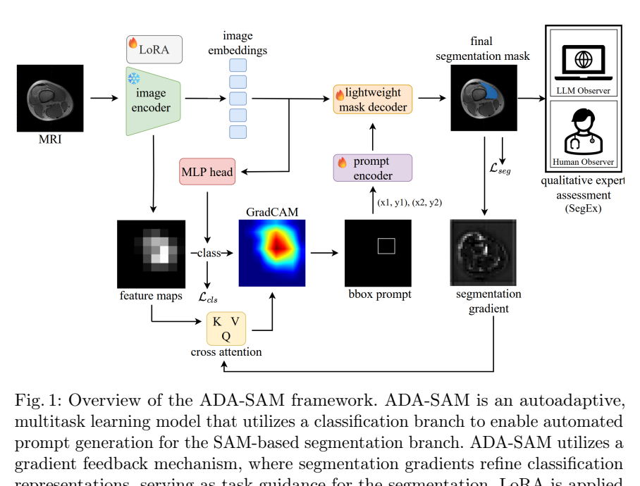

# arXiv 检索结果 / Results

## 1. Autoadaptive Medical Segment Anything Model
- Authors：Tyler Ward, Meredith K. Owen, O'Kira Coleman, Brian Noehren, Abdullah-Al-Zubaer Imran
- Comments：11 pages, 2 figures, 3 tables
- First：2025-07-02T15:44:32+00:00；Latest：2025-11-01T16:38:04+00:00
- Abs：https://arxiv.org/abs/2507.01828v2
- PDF：https://arxiv.org/pdf/2507.01828v2
- Code：https://github.com/tbwa233/ADA-SAM, https://huggingface.co/huggingface, https://huggingface.co/docs/hub/spaces
- 解读来源：PDF 全文，共 11 页，11 页可提取文字
### [中文]
**中文翻译**
- 标题：自适应医学分割一切模型
- 摘要：医学图像分割是影像工作流程中的关键任务，影响许多基于图像的决策。传统的全监督分割模型依赖大量标注训练数据，这些数据通常通过人工标注获得，过程昂贵、耗时且易出错。这表明需要准确、自动且标注高效的模型训练方法。我们提出ADA-SAM（自动化、领域特定、自适应分割一切模型），一种新颖的医学图像分割多任务学习框架，利用辅助分类器的类激活图来指导基于Segment Anything（SAM）框架的半监督分割分支的预测。此外，我们的ADA-SAM模型采用新颖的梯度反馈机制，通过使用分割梯度来指导和改进分类预测，从而在分割分支和分类分支之间建立可学习的连接。我们在康复试验期间收集的真实临床数据上验证了ADA-SAM，并证明我们提出的方法在有限标签设置下以两位数优势优于全监督和半监督基线。我们的代码可在：https://github.com/tbwa233/ADA-SAM 获取。

论文提出 ADA-SAM：用分类分支的 GradCAM 自动生成 SAM 的边界框提示，并以分割梯度反馈改进分类特征，实现无需人工提示的半监督多任务分割；在 21 例髌骨不稳患者膝关节 MRI（VL/VM 两类肌肉）上，仅用 5 个标注切片时平均 DSC 达 0.91，优于 SAM-Mix 的 0.77；LoRA 秩 r=8 最优，参数量约 26M；另提出 SegEx 人/LLM 专家视觉图灵测试，但定性结果与定量结论存在不一致，且部分表格排版难以辨认。

# ADA-SAM 论文阅读笔记

## 1. 问题与动机

论文面向膝关节损伤/术后康复中的股四头肌评估：股外侧肌（VL）与股内侧肌（VM）恢复不均衡与髌骨轨迹异常、ACL 移植物受力及创伤后骨关节炎相关，而临床评估多依赖手动力量测试和主观量表，缺少客观的影像量化手段 [p. 1]。深度学习分割（U-Net 及变体）虽可用于肌肉勾画，但需要大量逐切片人工标注，在康复临床试验中难以获得 [p. 2]。作者因此希望构建一种标注高效、无需人工提示、可自动适配医学域的分割框架，并同时利用未标注切片 [p. 2]。

作者认为现有方法不足在于：全监督模型依赖大量标签；普通半监督方法未利用任务间结构先验；SAM 类模型通常需要人工点/框提示，且直接微调参数量大、易过拟合 [p. 2, p. 4]。

## 2. 方法

### 2.1 总体流程

ADA-SAM 是双分支多任务框架（图 1，[p. 3]）：分类分支对输入 MRI 切片预测类别，并生成 GradCAM；分割分支以 SAM 为骨干，用分类分支产生的边界框作为提示，输出 VL/VM 掩码。分割梯度回传以更新共享/分类特征，形成“自提示—自反馈—自纠正”的闭环 [p. 3, p. 4]。

### 2.2 自动提示生成

设输入切片 x，分类分支输出类别概率 p∈[0,1]^C，取 c=argmax p；生成类激活图 M_CAM∈R^{H×W}，以阈值 τ 提取显著像素，其外接边界框 (x_min,y_min,x_max,y_max) 作为 SAM 提示 B [p. 4]。SAM 图像编码器得到特征 F(x)，提示编码器将 B 编码为 P(B)，掩码解码器据此预测分割 [p. 4]。论文未报告阈值 τ 的具体取值。

### 2.3 参数高效域适配

SAM 编码器参数量大，作者采用 LoRA：在 transformer 注意力层引入低秩矩阵 A、B，秩 r=8，以少量可训练参数实现域适配 [p. 4]。消融显示 r=8 时 DSC 0.91，r=2/4/6 分别为 0.84/0.85/0.86；r=8 使参数量降至 26M（原 ViT-B checkpoint 为 91M）[p. 8]。

### 2.4 半监督标签选择

仅部分切片带分割标签；选择时优先保证每类至少一个样本，其余随机抽取至目标数量 [p. 4]。分类标签由掩码构造：C={max(y_i)}，y_i∈{0,1,2,3}^{256×256}，即由切片中出现的最大类别号定义切片类别 [p. 3]。这一构造意味着含双肌肉的切片只保留一个类标签，论文未讨论其影响。

### 2.5 损失函数

分类使用 Focal loss：L_cls=−Σ_c α_c(1−p_{t,c})^γ k_c log(p_{t,c})，其中 C 为类别数，k_c 为 one-hot 真值，p_{t,c} 为预测概率，γ 为类别相关权重因子 [p. 5, 式(1)]。分割使用 Dice loss：L_seg=1−2Σ_i ŷ_i y_i/(Σ_i ŷ_i+Σ_i y_i) [p. 5, 式(2)]。总目标 L_mtl=L_cls+γL_seg，γ 为平衡权重 [p. 5]。注意论文在 Focal loss 与总损失中重复使用符号 γ，且未给出具体数值，存在符号歧义。

### 2.6 SegEx 专家评估

SegEx 是视觉图灵测试：由领域专家确定 MQ、MB、CN、SD、DC 五项标准（表 1，[p. 6]），其中 MQ/MB/SD/DC 为 1–4 分（1 最好），CN 为 0/1 二值；各指标标准化到共同区间后取平均 E_avg=(1/k)Σê_i [p. 5]。人类观察者为两名不同资历者，GT 与预测掩码随机混合、随机顺序、无交流 [p. 5]。LLM 观察者使用 GPT-4o，仅输入掩码以避免隐私问题，且不评 ED 指标（该指标依赖私有生物信息数据）[p. 5]。

## 3. 贡献

作者声称的贡献包括：新型自提示、自反馈、自纠正分割模型 ADA-SAM；结合领域专家与 LLM 的定性评估 SegEx；含 VL/VM 多类标注的 21 序列 Turbo Spin Echo MRI 数据集；以及在少至 5 个标注切片时仍表现良好 [p. 2]。

我的解读：核心新颖点是把分类 CAM 当作 SAM 的自动提示源，并用分割梯度反向影响分类表示，从而把“提示生成”和“任务引导”合并为一个可学习闭环；LoRA 主要解决计算与过拟合问题，属于工程适配而非概念创新。SegEx 的 LLM 评估在方法上较新，但其证据强度受限于样本量（3 个 3D 扫描）和指标设计。

## 4. 实验与结果

### 4.1 数据与设置

数据来自髌骨不稳患者（BRAINS 试验）[p. 5]。Turbo Spin Echo MRI，65 个切片堆栈，FOV 192×192 mm，采集矩阵 256×256，层厚 6 mm，体素 0.75×0.75×6 mm；21 名患者按 15/1/5 划分为训练/验证/测试，分别 975/65/325 切片 [p. 6]。

基线包括全监督 UNet、UNet++、Trans-UNet、nnU-Net、Swin-Unet、MedSAM、SAM-Mix，以及半监督多任务 UMTL、UMTL++、nnUMTL、SAM-Mix、SAM-PP [p. 6, 表 2]。非 SAM 基线训练 25 epoch，ADA-SAM 仅 10 epoch [p. 6]。硬件为 Intel Xeon w7-2475X、双 NVIDIA A4000（32GB）[p. 6]。指标为 Dice 系数（DSC），每个模型运行 5 次报告均值（标准差）[p. 7]。

### 4.2 定量结果

表 2 的排版在提供的文本中严重错位，部分数字无法可靠对应到行列，以下仅列出可辨认且与正文一致的结果。

半监督设置：5 个标注切片时，ADA-SAM 总体 DSC 0.91，SAM-Mix 0.77，SAM-PP 0.51，nnUMTL 0.28，UMTL++ 0.21，UMTL 0.19；作者称比第三名高 31% [p. 7]。50 切片时 ADA-SAM 总体 0.95，SAM-Mix 0.91，nnU-Net 0.81 [p. 7]。100 切片时 ADA-SAM 总体 0.92，SAM-Mix 0.90，nnU-Net 0.86 [p. 7]。注意 100 切片结果低于 50 切片，论文未解释该非单调现象。

全监督设置：5 切片时 ADA-SAM 总体 0.92，MedSAM 0.89，nnU-Net 0.77，Swin-Unet 0.61；100 切片时 ADA-SAM 0.92，MedSAM 0.90，nnU-Net 0.86 [p. 7]。作者称全监督下 ADA-SAM 有竞争力但不超越基线，然而表中 5 切片全监督 ADA-SAM（0.92）高于 nnU-Net（0.77）等，与“不超越”的表述存在张力；且“0 切片”行中 ADA-SAM 仍有 0.89，其含义（是否指无分割标签但用分类标签/预训练）论文未说明 [p. 7]。

### 4.3 消融

LoRA 秩消融：r=2/4/6/8 对应 DSC 0.84/0.85/0.86/0.91，r=8 最优，参数量 26M vs 原 91M [p. 8]。推理时间约 132 ms/图，SAM-Mix 约 150 ms/图（含 I/O）[p. 8]。论文未报告分类分支精度、提示框质量或去掉梯度反馈的消融，因此“梯度反馈带来增益”缺少直接证据。

### 4.4 定性评估

表 3 报告 3 个 3D 测试扫描的逐切片平均分 [p. 6, p. 8]。VM：GT 在观察者 1/2/LLM 下为 1.44/1.54/2.82，预测为 1.48/1.42/2.77；VL：GT 为 1.24/1.36/2.76，预测为 2.39/1.98/2.71 [p. 8]。即 VM 预测与 GT 接近，VL 预测在两名人类观察者下明显差于 GT（2.39 vs 1.24；1.98 vs 1.36），LLM 观察者则几乎无差异。作者称 VM 评分更高可能因其体积小、形状简单，并称部分评估者认为 ADA-SAM 的 VM 掩码优于 GT [p. 7–8]。该说法与表中 VM 预测略差于 GT 的数值不完全一致，应视为作者解释而非确证结论。

图 2 展示半监督 ADA-SAM 与 nnU-Net、Swin-Unet 的定性对比，作者称 ADA-SAM 改善了单肌肉切片的欠分割以及双肌肉切片的欠/过分割 [p. 7–8]。由于未提供图像本身，此处仅转述作者描述。

## 5. 评估

支持的结论：在 5/50/100 标注切片设置下，ADA-SAM 的 DSC 高于所列半监督多任务基线，且 5 切片时优势明显（0.91 vs 0.77）[p. 7]；LoRA r=8 优于更小秩 [p. 8]；推理速度略快于 SAM-Mix [p. 8]。

局限与缺失证据：第一，表 2 排版错乱，部分行列对应关系无法辨认，不能据此复核所有数字；第二，缺少分类分支消融、无梯度反馈消融、提示阈值 τ 敏感性分析，因而无法分离各组件贡献；第三，100 切片结果低于 50 切片，未解释；第四，SegEx 仅 3 个扫描、2 名人类观察者和 1 个 LLM，统计效力有限，且 VL 的人类评分显示预测明显劣于 GT，与“临床可用”的总体主张存在差距 [p. 8]；第五，论文未报告分类准确率、校准或失败案例；第六，数据仅来自单一中心、单一序列、21 名患者，泛化性证据有限。

## 6. 复现要点

已报告：数据划分 15/1/5（975/65/325 切片）；输入 256×256；SAM ViT-B 骨干 + LoRA r=8；分类 Focal loss + 分割 Dice loss，总损失 L_cls+γL_seg；ADA-SAM 训练 10 epoch，基线 25 epoch；5 次运行取均值；DSC 评价；双 A4000 GPU；代码链接 https://github.com/tbwa233/ADA-SAM [p. 4–8]。

未报告：学习率、优化器、batch size、数据增强、Focal loss 的 α/γ 具体值、总损失权重 γ、CAM 阈值 τ、LoRA 应用的具体层、分类分支架构与初始化、半监督中未标注数据的使用方式（是否仅用于分类或一致性正则）、推理时是否使用测试时增强。复现前需向作者或代码库确认这些细节。

#### 原论文流程图 · Figure 1 · PDF 第 3 页

Fig.1: Overview of the ADA-SAM framework. ADA-SAM is an autoadaptive, multitasklearningmodelthatutilizesaclassificationbranchtoenableautomated promptgenerationfortheSAM-basedsegmentationbranch.ADA-SAMutilizesa gradient feedback mechanism, where segmentation gradients refine classification

[原文来源](https://arxiv.org/pdf/2507.01828v2#page=3)

## 2. Style-Aware Blending and Prototype-Based Cross-Contrast Consistency for Semi-Supervised Medical Image Segmentation
- Authors：Chaowei Chen, Xiang Zhang, Honglie Guo, Shunfang Wang
- First：2025-07-28T11:26:24+00:00；Latest：2025-11-01T07:35:00+00:00
- Abs：https://arxiv.org/abs/2507.20729v2
- PDF：https://arxiv.org/pdf/2507.20729v2
- Code：https://huggingface.co/huggingface, https://huggingface.co/docs/hub/spaces
- 解读来源：PDF 全文，共 6 页，6 页可提取文字
### [中文]
**中文翻译**
- 标题：风格感知混合与基于原型的交叉对比一致性用于半监督医学图像分割
- 摘要：弱-强一致性学习策略被广泛应用于半监督医学图像分割中，通过利用有限的标注数据并强制弱到强的一致性来训练模型。然而，现有方法主要集中于设计和组合各种扰动方案，忽视了框架本身固有的潜力和局限性。在本文中，我们首先识别出两个关键缺陷：（1）分离的训练数据流，导致由标注流主导的确认偏差；（2）监督信息利用不充分，限制了对强到弱一致性的探索。为解决这些挑战，我们提出了一种风格感知混合与基于原型的交叉对比一致性学习框架。具体而言，受标注数据与未标注数据之间的分布不匹配可由统计矩表征这一经验观察的启发，我们设计了一个风格引导的分布混合模块以打破独立的训练数据流。同时，考虑到强伪标签中潜在的噪声，我们引入了一种基于原型的交叉对比策略，鼓励模型从弱到强和强到弱的预测中学习有信息量的监督信号，同时减轻噪声的不利影响。实验结果表明，我们的框架在多种半监督设置下的多个医学分割基准上具有有效性和优越性。

该论文针对半监督医学图像分割中弱-强一致性学习的两个缺陷——标注与未标注数据流分离导致确认偏差、强伪标签噪声导致强到弱监督信号利用不足——提出风格引导分布混合（SDB）与基于原型的交叉对比一致性（L_ctr）框架。SDB利用一阶/二阶统计量将未标注风格注入标注图像以打破独立数据流；L_ctr通过置信度加权原型与记忆库，在弱/强视图间进行双向点-原型对比。在Synapse（5%/10%标注）和ACDC（5%/10%标注）上，完整框架在10%设置下DSC分别达65.81%和89.27%，较基线提升10.03%和3.43%；消融显示直接强到弱Dice监督反而使DSC下降0.82%。

# 论文阅读笔记：Style-Aware Blending and Prototype-Based Cross-Contrast Consistency for Semi-Supervised Medical Image Segmentation

## 1. 问题与动机

半监督医学图像分割（SSMIS）普遍采用“弱-强一致性”范式：对未标注图像做弱增强得到伪标签，监督其强增强视图，从而把决策边界推向低密度区域 [p. 1]。作者指出该框架本身存在两个被忽视的缺陷：

- **训练数据流分离**：标注与未标注数据通常经各自对称流处理（如 AD-MT、ABD），有限标注数据无法代表整体分布，造成经验分布不匹配与确认偏差 [p. 1]。已有的跨流交互（BCP 的 patch 级复制粘贴、AllSpark 的跨注意力特征迁移）仍难以解决域内类间分布差异 [p. 1]。
- **监督信息利用不完整**：理论上弱/强预测可互为监督，但强预测含噪，通常不被用作伪标签，因而“强到弱”方向的一致性未被充分探索 [p. 1]。现有对比学习方法又依赖标注特征、易受噪声负采样影响、点对点对比计算开销大 [p. 1-2]。

作者的经验观察是：标注与未标注数据的分布差异体现在像素强度的一阶与二阶统计矩（对应亮度与对比度）上，且在标注数据少时更明显、跨类别不同（Fig. 1(c-d)，[p. 1]）。这构成 SDB 模块的直接动机。

## 2. 方法

### 2.1 问题设定与总体框架

数据集含小规模标注子集 D_l={(X_l,Y_l)} 与大规模未标注子集 D_u={X_u}，M≫N [p. 2]。整体遵循 Mean Teacher 范式，含标注分支与未标注分支，并加入 SDB 与原型交叉对比（Fig. 2，[p. 3]）。

**标注分支**：X_l 先经弱增强 A_w，再经 SDB 与未标注图像混合得到 X_lm，送入学生网络 f_θ 得预测 P_l；监督损失为交叉熵与 Dice 的组合：L_sup = ½[L_ce(P_l,Y_l)+L_dice(P_l,Y_l)]（式1，[p. 2]）。

**未标注分支**：教师模型对弱增强视图 A_w(X_u) 输出 P_uw 作为伪标签，监督学生对强增强视图 A_s(X_u) 的预测 P_us。无监督目标为 L_unsup = α·L_dice(P_us, argmax_c (P_uw)_c) + β·L_ctr（式2，[p. 2]）。

**总目标**：L = L_sup + λ(t)·L_unsup（式3），λ(t) 为高斯 ramp-up 函数 [p. 2]。

### 2.2 风格引导分布混合（SDB）

对标注与未标注批次中每个样本，按通道/空间计算风格表示（均值与标准差）：(μ*,σ*) = (E[X*], sqrt(E[(X*−μ*)²]+ε))（式4，[p. 2]）。随机采样一个未标注风格 (μ_u,σ_u)，将其应用于标注内容：

X_lm = η·X_l + (1−η)·[(X_l−μ_l)/σ_l·σ_u + μ_u]（式5，[p. 2]）。

η 控制标注与未标注风格的相对贡献。由于标注数据风格多样性有限且为避免信息损失，混合后的标注批次直接送入模型训练，不再做额外处理 [p. 3]。

### 2.3 基于原型的交叉对比一致性

**置信度引导的原型估计**：对未标注图像 X_u 的弱/强视图，计算特征 Z_v = q(f_θ(A_v(X_u))) ∈ R^{D×H×W} 与概率图 P_v = softmax(h(f_θ(A_v(X_u)))) ∈ R^{C×H×W}，v∈{w,s}（式6-7，[p. 3]）。类别原型由置信度加权特征聚合得到：P̃_vc = E[P_vc ⊙ Z_v] / E[P_vc]（式8，[p. 3]）。为缓解单批次原型偏差（类别缺失、批大小有限、各类学习进度不均），采用大小 K 的 FIFO 记忆库缓存历史原型，最终原型为按批次置信度加权的历史原型平均（式9，[p. 3]）。

**交叉对比损失**：弱视图像素特征被拉向强视图类别原型、远离不相似原型，反之亦然：

L_ctr = (1/2)Σ_{v∈{w,s}} Σ_{i,j} −log[ exp(sim(Z_vi,j, P̄_vŶ_vi,j)/τ) / Σ_c exp(sim(Z_vi,j, P̄_vc)/τ) ]（式10，[p. 4]）。

其中 τ 为温度超参，Ŷ_vi,j 为 EMA 更新教师 f̄_θ 的预测，更新式 θ̄←γ·θ̄+(1−γ)·θ，γ=0.99 [p. 4]。

## 3. 贡献

**作者主张**：(1) 识别出弱-强一致性框架中数据流分离与监督信息利用不完整两个缺陷；(2) 提出基于统计矩的风格引导分布混合模块以桥接标注/未标注数据流；(3) 提出基于原型的交叉对比策略，同时利用弱到强与强到弱预测并抑制噪声；(4) 在多个基准、多种半监督设置下取得竞争性/最优结果 [p. 1-2, p. 6]。

**我的解读**：SDB 本质是 AdaIN 式风格迁移在标注-未标注流间的应用，其新颖性在于将“分布差异可由一阶/二阶矩刻画”这一经验观察转化为显式的数据混合干预；交叉对比的核心贡献是把原型对比从单向（弱监督强）扩展为双向，并用置信度加权与记忆库稳定原型。二者组合的收益在消融中可分解，但 SDB 与 L_ctr 的交互效应是否超线性，论文未做深入分析。

## 4. 实验与结果

### 4.1 数据集与设置

- **ACDC**：100 例心脏 MRI，3 类（LV、Myo、RV）；70 例（1312 切片）训练、10 验证、20 测试（7:1:2）；半监督设置 5%（3 例）与 10%（7 例）标注 [p. 4]。
- **Synapse**：30 例腹部 CT，8 个器官；18 例（2211 切片）训练、12 测试；5%（1 例）与 10%（2 例）标注 [p. 4-5]。
- **训练**：30k 迭代，SGD，学习率 0.01，权重衰减 10⁻⁴，批大小 24，图像缩放至 256×256；弱增强为随机旋转与翻转，强增强为 ColorJitter 与高斯模糊；α=0.1，β=1.0，η~U(0,1)，τ=1.0，K=128 [p. 5]。
- **指标**：DSC（↑）与 ASD（↓，单位 mm）。

### 4.2 主要结果

**Synapse（Table I，[p. 4]）**：10% 设置下 Ours(BCP) 平均 DSC 66.59%、ASD 23.52；Ours(MT) 65.81%/15.88。5% 设置下 Ours(BCP) 61.87%/18.81，Ours(MT) 60.00%/19.73。作者称 BCP 扩展框架相对 BCP 的平均 DSC 增益为 18.78%（5%）与 14.82%（10%），并在胃（+20.12%、+19.92%）等困难器官上提升显著 [p. 5]。需注意：Table I 中部分单元格排版错乱（如 AD-MT 的 KL 列 80.36 与 72.67 位置异常、Ours(BCP) 10% 的 GB 列缺失），这些数字的可读性存疑，不应据此做精细比较。

**ACDC（Table II，[p. 4]）**：5% 设置下 Ours(BCP) 88.60%/0.61，Ours(MT) 87.31%/1.10；10% 设置下 Ours(BCP) 89.80%/0.95，Ours(MT) 89.27%/0.63。作者称 5% 下较 BCP 提升 1.01%、较 MCSC 提升 13.71%，10% 下较 SCP-Net 提升 1.1% [p. 5]。

**定性结果**：Fig. 3 显示在 ACDC 上对右心室的欠/过分割更平衡、边界更精确；在 Synapse 上对主动脉、肝脏及胰腺的分割更可靠 [p. 5]。

### 4.3 消融

**组件消融（Table III，[p. 5]）**：基线 DSC 为 Synapse 55.78%、ACDC 85.84%。加 SDB 后 Synapse 62.11%/19.28、ACDC 87.91%/1.04；仅加 L_ctr 为 61.28%/23.03 与 87.77%/0.99；SDB+L_ctr 为 64.23%/17.36 与 88.38%/0.97；再加记忆库 MB 达 65.81%/15.88 与 89.27%/0.63。相对基线的绝对 DSC 增益为 10.03%（Synapse）与 3.43%（ACDC）[p. 5]。

**交叉对比损失分解（Table IV，[p. 5]）**：在含 SDB 的前提下，仅加 L_spixel（强到弱 Dice）使 DSC 从 62.11 降至 61.29、ASD 从 19.28 升至 24.56（DSC −0.82%、ASD +5.28mm），说明直接用含噪强预测做像素级监督有害；单独加 L_wctr 为 62.35%/16.34，单独加 L_sctr 为 62.14%/21.32，二者组合达 65.81%/15.88，支持双向对比一致性的互补性 [p. 5]。

## 5. 评估

**有支持的结论**：(1) SDB 与 L_ctr 各自带来增益，组合后进一步提升，消融数据支持这一分解；(2) 强到弱像素级 Dice 监督有害、而双向原型对比有益，Table IV 提供了较清晰的对照；(3) 在两个数据集、两种标注比例下均报告了优于所列基线的平均 DSC。

**局限与缺失证据**：(1) 论文仅 6 页，未报告参数量、推理开销、多次运行的均值/方差或显著性检验，单次结果难以判断稳定性；(2) 未与更多近期方法（如 PH-Net、Density-guided 等被引工作）直接比较；(3) SDB 中 η 的分布、风格采样策略对结果的影响未做消融；(4) 记忆库大小 K 仅设为 128，未报告 K 的敏感性；(5) Table I 存在排版/数字错位，部分单元格无法可靠辨认；(6) 定性分析仅基于 Fig. 3 的少量示例，未量化边界误差。

## 6. 复现要点

- 数据划分：ACDC 70/10/20（7:1:2），Synapse 18 训练/12 测试；标注比例 5% 与 10% 对应具体例数见 §4.1 [p. 4-5]。
- 优化：SGD，lr=0.01，weight decay=10⁻⁴，batch size=24，30k iterations，输入 256×256 [p. 5]。
- 增强：弱=随机旋转+翻转；强=ColorJitter+高斯模糊 [p. 5]。
- 超参：α=0.1，β=1.0，η~U(0,1)，τ=1.0，K=128，EMA γ=0.99 [p. 4-5]。
- **未报告**：网络骨干的具体结构（仅称与基线 MT/BCP 结合）、投影头 q(·) 与分割头 h(·) 的详细通道配置、λ(t) 的具体 ramp-up 参数、优化器动量、是否使用深度监督、代码仓库的实际可用性（仅给出项目页链接）[p. 2-5]。复现时需自行补齐这些细节。

本篇未找到可可靠提取的方法流程图，请查看原文 PDF。

## 3. Diverse Teaching and Label Propagation for Generic Semi-Supervised Medical Image Segmentation
- Authors：Wei Li, Pengcheng Zhou, Linye Ma, Wenyi Zhao, Huihua Yang, Yuchen Guo
- Comments：Under Review
- First：2025-08-12T01:33:30+00:00；Latest：2025-10-29T05:58:05+00:00
- Abs：https://arxiv.org/abs/2508.08549v3
- PDF：https://arxiv.org/pdf/2508.08549v3
- Code：https://huggingface.co/huggingface, https://huggingface.co/docs/hub/spaces
- 解读来源：PDF 全文，共 11 页，11 页可提取文字
### [中文]
**中文翻译**
- 标题：面向通用半监督医学图像分割的多样化教学与标签传播
- 摘要：有限的标注和域偏移都是医学图像分割中经常遇到的重大挑战，由此衍生出半监督医学图像分割（SSMIS）、半监督医学域泛化（Semi-MDG）和无监督医学域适应（UMDA）等场景。传统方法通常孤立地针对特定任务定制，误差累积阻碍了无标签数据的有效利用并限制了进一步改进，导致在这些问题出现时性能欠佳。本文旨在开发一个掌握全部三项任务的通用框架。我们发现，解决问题的关键在于如何在存在有标签数据域偏移的情况下为无标签数据生成可靠的伪标签，并提高模型的多样性。为解决这一问题，我们采用多样化教学与标签传播网络（DTLP-Net）来提升通用半监督医学图像分割。我们的DTLP-Net包含一个学生模型和两个多样化的教师模型，可为学生模型生成可靠的伪标签。第一个教师模型将有标签数据和无标签数据的训练过程解耦，第二个教师模型定期进行动量更新，从而生成可靠而多样的伪标签。为充分利用数据中的信息，我们采用样本间和样本内数据增强来学习全局和局部知识。此外，为进一步捕捉体素级相关性，我们提出标签传播以增强模型的鲁棒性。我们在五个基准数据集上针对SSMIS、UMDA和Semi-MDG任务评估了所提出的框架。结果表明，在所有五个设置下相比最先进方法均有显著改进，表明我们的框架有潜力处理更具挑战性的SSL场景。

论文提出DTLP-Net统一框架，同时处理SSMIS、UMDA和Semi-MDG三类任务。核心是单学生+双教师（解耦扩散解码器与EMA均值教师）经熵加权集成生成伪标签，并配合跨集CutMix、掩码图像建模、知识蒸馏、掩码重建和体素级标签传播五种一致性/正则损失。在LA、Synapse、AMOS、MMWHS、M&Ms五个数据集上报告了优于SOTA的结果，例如LA 5%标签Dice 91.63%（超全监督0.16%）、MMWHS CT→MR Dice 83.4%、M&Ms 2%标签平均Dice 85.46%。消融显示各组件均有贡献，但部分表格数字在文本中难以完整辨认。

# DTLP-Net 论文精读笔记

## 1. 问题与动机

论文关注医学图像分割中“标注稀缺”与“域偏移”同时出现的现实问题，试图用一个统一框架覆盖三类任务：半监督医学图像分割（SSMIS）、无监督医学域适应（UMDA）和半监督医学域泛化（Semi-MDG）[p. 1]。作者指出，现有方法通常针对单一任务定制，在跨域场景下性能下降；已有统一尝试如AIDE和A&D虽覆盖多任务，但在UMDA/Semi-MDG上的提升相对有限[p. 1]。作者将原因归结为两点：(1) 域偏移下伪标签不可靠，导致误差累积与模型崩溃；(2) 数据内在结构（体素级关系、空间上下文）未被充分利用[p. 1]。因此，方法设计围绕“可靠且多样的伪标签”与“多层次一致性/结构约束”展开。

## 2. 方法

### 2.1 整体架构

训练数据由N_L个有标注样本D_l={(x_i,y_i)}和N_U个无标注样本D_u={x_i}组成，x_i为L×W×H体数据，y_i含Y类[p. 3]。网络含共享编码器E(x_l,x_u;ξ)与三个解码器：V-Net解码器D(x_l;ψ)（有标注分支）、扩散解码器D(x_l,x_u;ξ)（域不变特征分支）、V-Net解码器D(x_u;θ)（无标注学生分支）；学生分支另有EMA均值教师E(·;ξ_T)、D(·;θ_T)[p. 3]。推理时仅用D(x_u;θ)[p. 3, Fig. 1]。

### 2.2 扩散基线

遵循Diff-UNet与A&D，将标签one-hot化后加噪：y_t=√ᾱ_t y_0+√(1−ᾱ_t)ε，ε~N(0,1)[p. 3, Eq.1]。扩散编码器以concat([y_t,x_l])和时间步为输入，输出多尺度特征h_{l;ξ}^i，由D(x_l;ξ)预测清晰标签，损失L_diff为Dice+CE组合[p. 3-4, Eq.2]。有标注分支D(x_l;ψ)仅输入x_l，损失L_sup对多尺度输出逐层计算DiceCE[p. 4, Eq.3]。

### 2.3 多样教学与伪标签

第一教师：扩散分支迭代t次DDIM得到p_{u;ξ}；D(x_l;ψ)停梯度前向得到p_{u;ψ}。作者发现p_{u;ψ}过于稀疏、置信度过高，会压制p_{u;ξ}且对噪声不稳健，故对p_{u;ψ}做Gumbel-Softmax重参数化并加高斯模糊，最终p_{t1}=0.5·(Gumbel-Softmax(p_{u;ξ})+Softmax(p_{u;ψ}))[p. 4, Eq.4]。第二教师为EMA均值教师，p_{t2}=Softmax(p_{u;θ_T})，更新规则ξ_T=γξ_T+(1−γ)ξ，θ_T=γθ_T+(1−γ)θ[p. 4]。

集成：计算两教师预测熵H_{t1}、H_{t2}，权重w1=e^{−H_{t1}}、w2=e^{−H_{t2}}，集成预测p_{ti}=(w1 q_{t1i}+w2 q_{t2i})/(w1+w2)，伪标签y_t=argmax(p_{ti})，学生损失L_u为DiceCE[p. 4, Eq.5-7]。

### 2.4 全局-局部一致性

全局：跨集CutMix，随机3D二值掩码M，x_mix=(1−M)⊙x_i+M⊙x_j，y_t,mix同理，x_i∈D_u、x_j∈D_l∪D_u，损失L_mix[p. 4, Eq.8-9]。局部：掩码图像建模，按patch均匀采样掩码M（patch大小b、掩码率r），x_i,mask=M⊙x_i，损失L_mic[p. 4-5, Eq.10-11]。

### 2.5 知识蒸馏与掩码重建

针对硬伪标签噪声，用软Dice损失L_sdice将D(x_l;ψ)与D(x_l,x_u;ξ)的预测蒸馏到学生：L_kd=mean[L_sdice(p_{u;θ},p_{u;ξ})+L_sdice(p_{u;θ},p_{u;ψ})][p. 5, Eq.12]。掩码重建则最小化学生掩码输入logits与均值教师原始输入logits的L2差异：L_rec=mean(‖p_{u,l,mask}^{θ}−p_{u,l}^{θ_T}‖²/‖p_{u,l}^{θ_T}‖²)[p. 5, Eq.13]。

### 2.6 体素级标签传播

编码器后经线性层得特征e1,e2∈R^{D×LHW}，相关图C=Softmax(e1^T·e2)/√D，C∈R^{LHW×LHW}[p. 5, Eq.14]。将C乘到学生logits得p_{u;θ,corr}=D(E(x_u;ξ);θ)·C，相关损失L_corr=L_u_corr+L_l_corr[p. 5, Eq.15-17]。

### 2.7 总损失

L=L_diff+L_sup+L_mix+αL_mic+βL_kd+γL_rec+ηL_corr[p. 5, Eq.18]。

## 3. 贡献

作者声称的贡献包括：统一框架覆盖SSMIS/UMDA/Semi-MDG；双教师熵集成策略降低确认偏差；分层一致性机制（CutMix+掩码、标签传播、蒸馏与重建）[p. 2]。我的解读：核心增量在于把A&D的解耦扩散架构与均值教师、熵加权集成、体素相关传播组合起来；单看每个组件多为已有技术（CutMix、MIM、知识蒸馏、非局部相关），创新更多体现在组合与跨任务验证上。

## 4. 实验与结果

### 4.1 设置

五个数据集：LA、Synapse、AMOS（SSMIS）、MMWHS（UMDA）、M&Ms（Semi-MDG）[p. 5]。指标为Dice、ASD，SSMIS另加Jaccard、95HD[p. 5]。PyTorch 1.12.1，单张A100；SGD+多项式调度，lr=lr_init·(1−i/I)^0.9，300 epoch，batch size 4（2标注+2无标注）；掩码率0.5（LA为0.7），block大小为图像尺寸1/16[p. 5]。各数据集patch size、学习率与α/β/γ/η见Table I：LA 112×112×80、lr 1e-2、α2.0/β0.1/γ0.2/η1.2；Synapse与AMOS 64×128×128、lr 3e-2、α0.1/β0.2/γ0.5/η1.0（AMOS η1.3）；MMWHS 128×128×128、lr 5e-3、α1.0/β0.1/γ0.1/η0.9；M&Ms 32×128×128、lr 1e-2、α1.0/β0.1/γ0.1/η1.0[p. 6, Table I]。

### 4.2 SSMIS结果

LA 5%标签：Dice 91.63%、Jaccard 84.59%、95HD 4.40、ASD 1.41，较次优A&D提升1.70/2.77/0.85/0.36，并超全监督V-Net（91.47%）0.16%[p. 6, Table II]。LA 10%：Dice 92.43%、ASD 1.30，较GapMatch提升1.43%和0.16[p. 6]。Synapse 20%标签：平均Dice 66.01%±0.43、ASD 1.69±0.79，较前方法提升5.13% Dice[p. 6-7, Table III]；10%标签结果见Table IV，正文未逐项复述[p. 7]。AMOS 2%标签：Dice较次优AllSpark高8.79%、ASD低4.07[p. 6, Table V]。

### 4.3 UMDA与Semi-MDG

MMWHS MR→CT：Dice 92.1%，超全监督90.9%达1.2%；CT→MR：Dice 83.4%，低于全监督0.2%，较DDSP高3.1%（92.1 vs 89.0；83.4 vs 81.9），较A&D高12.0%（83.4 vs 71.4）[p. 7, Table VI]。M&Ms 2%/5%标签：平均Dice 85.46%/86.22%，较EPL高0.94%/0.5%，较BCP高9.81%/9.17%，较A&D高4.15%/2.91%[p. 7-8, Table VII]。

### 4.4 消融

LA 5%：基线90.35，加L_mic后90.94，加L_kd 90.73，加L_rec 91.16，全量91.63[p. 8, Table VIII]。LA 10%：全量92.43[p. 8]。Synapse 20%：基线64.58±1.17，逐步加入各损失至65.45±0.12，全量66.01±0.43[p. 8, Table IX]。多样教学消融：LA 5%与Synapse 20%上，双教师集成较单教师约提升2% Dice（Synapse）[p. 9, Table X]。超参敏感性：α=0.1、γ=0.2较优，γ过小硬伪标签噪声大、过大软预测噪声大，Dice波动较小[p. 9, Fig. 4]。掩码率消融：Synapse 20%下r=0.5时Dice 90.80、ASD 1.60，r=0.4/0.6略低[p. 9, Table XI]。

## 5. 评估

支持的结论：五个数据集、三类任务上均报告了正向结果，消融显示各组件单独加入均有增益，双教师集成在Synapse上约+2% Dice有明确证据[p. 9]。局限与缺失：部分表格（Table III、IV、V、VII、X）在提供的文本中排版错乱，具体逐类数字难以完整辨认，只能依赖正文引用的汇总数字；未报告多次运行的方差（除Synapse 20%与部分消融外），统计显著性未讨论；超参按数据集手工设定，跨数据集迁移成本未评估；标签传播的C矩阵为LHW×LHW，计算/显存开销未报告；与AIDE等统一方法的直接比较在正文中缺失。作者未设独立局限性章节。

## 6. 复现

已报告：PyTorch 1.12.1、单A100、SGD+多项式调度（指数0.9）、300 epoch、batch 4（2标注+2无标注）、各数据集patch size/学习率/掩码率/α/β/γ/η（Table I）、掩码block为图像尺寸1/16、LA掩码率0.7其余0.5[p. 5-6]。未报告：扩散步数t的具体值、DDIM采样步数、EMA衰减γ的具体值、Gumbel-Softmax温度、高斯模糊核大小、优化器动量/权重衰减、数据预处理与划分细节、随机种子与重复次数（除注明3次重复的Table III）、代码/模型是否公开。复现时应先按Table I配置，再对未报告项做敏感性扫描。

本篇未找到可可靠提取的方法流程图，请查看原文 PDF。

