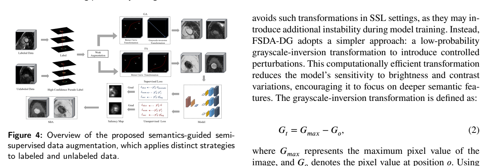

# arXiv 检索结果 / Results

## 1. Mind the Context: Attention-Guided Weak-to-Strong Consistency for Enhanced Semi-Supervised Medical Image Segmentation
- Authors：Yuxuan Cheng, Chenxi Shao, Jie Ma, Yunfei Xie, Guoliang Li
- First：2024-10-16T10:04:22+00:00；Latest：2025-07-07T10:28:59+00:00
- Abs：https://arxiv.org/abs/2410.12419v3
- PDF：https://arxiv.org/pdf/2410.12419v3
- Code：https://huggingface.co/huggingface, https://huggingface.co/docs/hub/spaces
- 解读来源：PDF 全文，共 9 页，9 页可提取文字
### [中文]
**中文翻译**
- 标题：关注上下文：注意力引导的弱到强一致性用于增强半监督医学图像分割
- 摘要：医学图像分割是诊断和治疗过程中的关键步骤，依赖于高质量标注数据，而这些数据往往难以获取且成本高昂。半监督学习通过利用未标注数据提升模型性能，是一种有前景的方法。尽管弱到强一致性是半监督图像分割中普遍采用的方法，但针对半监督医学图像分割任务专门设计的扰动策略研究仍然稀缺。为应对这一挑战，本文提出了一种简单而高效的半监督学习框架，名为注意力引导弱到强一致性匹配（AIGCMatch）。AIGCMatch框架在图像和特征两个层面引入注意力引导的扰动策略，以实现弱到强一致性正则化。该方法不仅保留了医学图像的结构信息，还增强了模型处理复杂语义信息的能力。在ACDC和ISIC-2017数据集上进行的大量实验验证了AIGCMatch的有效性。我们的方法在ACDC数据集的7例场景中取得了90.4%的Dice分数，超越了最先进的方法，展示了其在临床环境中的潜力和有效性。

论文提出 AIGCMatch 半监督医学图像分割框架，在图像级用注意力引导的 AttCutMix 替换随机 CutMix，在特征级用注意力引导的 AttFeaPerb 对高/低注意力通道施加强弱扰动，并以弱扰动预测监督强扰动预测。在 ACDC 数据集上，7-case（10% 标注）取得 90.40% Dice，1-case（1% 标注）为 86.25% Dice；消融显示两个模块单独使用均有提升，但 1-case 下 AttFeaPerb 单独使用低于基线。

## 1. 问题与动机

论文针对半监督医学图像分割中的弱到强一致性正则化。作者指出，现有方法（如 UniMatch）的扰动策略主要来自自然图像：图像级随机 CutMix 不区分语义区域，可能破坏医学图像中相邻组织间细微的强度差异与解剖结构；同时扰动多局限于输入图像级，未在特征级区分弱/强扰动 [p. 1][p. 2]。因此提出两个问题：C1 如何设计尊重医学图像特性的扰动；C2 如何把扰动扩展到高维语义特征层 [p. 2]。

## 2. 方法

整体框架包含监督分支与两个无监督分支，结构对比见图 3 [p. 4]。标注数据不做扰动，直接计算监督损失；无标签数据分别经过图像级 AttCutMix 与特征级 AttFeaPerb 生成强扰动预测，并由弱扰动预测进行一致性监督 [p. 3][p. 4]。

**图像级 AttCutMix**：利用解码器注意力图 A_decoder 生成二值掩码 M = (A_decoder > γ)，将两张无标签图像 x_A、x_B 按 M 混合：x̂ = M⊙x_A + (1−M)⊙x_B，标签同样混合 ŷ = M⊙y_A + (1−M)⊙y_B [p. 4, 式(1)-(3)]。与随机 CutMix 不同，交换区域由模型注意力决定，作者称可保留语义结构。γ 为控制掩码生成的预定义超参数，但正文未给出取值。

**特征级 AttFeaPerb**：对编码器第 i 个下采样模块的特征 F_i，用该模块注意力热图 A_i 生成掩码 M_i = (A_i > β) [p. 5, 式(4)]。弱扰动加在低注意力位置：F_i^W = F_i + G(F_i)⊙(t(x)×M_i)；强扰动加在高注意力位置：F_i^S = F_i + G(F_i)⊙(t(x)×(1−M_i)+φ) [p. 5, 式(5)-(6)]。其中 G(F_i) 为同形状高斯噪声，β 为预定义阈值，φ 为偏置项，t(x)=1−k×(1−x/epoch)^0.9 随训练轮次递增扰动强度，k 为最大扰动强度超参数 [p. 5, 式(7)]。扰动后的特征经 U-Net 跳跃连接送入对应解码器。作者将“低注意力通道加扰动”定义为弱扰动，“高注意力通道加扰动”定义为强扰动，并用弱扰动预测监督强扰动预测 [p. 5]。

**损失函数**：总损失 L = 1/2(L_x + L_u) [p. 5, 式(8)]。监督损失 L_x 为交叉熵与 Dice 损失。无监督损失包含图像级一致性 L_s 与特征级一致性 L_fp：L_s 对弱预测 p_w 与两个强预测 p_s1、p_s2 计算熵距离，并以 max(p_w)≥τ 过滤低置信像素 [p. 5, 式(9)]；L_fp 对特征级弱预测 p_fwp 与强预测 p_fsp 做同样过滤后的熵距离 [p. 5, 式(10)]。最终 L_u 将两项加权组合，权重 λ、μ 设为 0.5 [p. 6, 式(11)]。

## 3. 贡献

作者主张三点：提出简单高效的 AIGCMatch 框架；探索利用模型自身注意力在图像与特征两级引导扰动的策略；在 ACDC 上验证其优于 SOTA [p. 2]。我的理解是，核心新颖点在于把“弱到强”的定义从图像级扩展到特征级，并用注意力图决定扰动位置；但特征级弱/强扰动的划分依据主要是作者的经验假设（弱扰动预测质量优于强扰动），论文未给出直接验证该假设的实验 [p. 5]。

## 4. 实验与结果

**数据集与设置**：ACDC 含 100 例二维 cine 心脏 MR，70 训练/10 验证/20 测试；半监督划分为 1-case、3-case、7-case，分别对应 1%、5%、10% 标注数据 [p. 6]。骨干为简单 U-Net；SGD 优化器，初始学习率 0.01，训练 300 epochs 并使用学习率调度器；图像缩放 0.5–2.0 倍并裁剪翻转作为弱扰动；λ=μ=0.5 [p. 6]。评价指标为 Dice、Jaccard、95HD、ASD [p. 6]。

**主结果**（表 I，[p. 7]）：AIGCMatch 在 1/3/7-case 的 Dice 分别为 86.25±2.50、89.53±2.15、90.40±1.68；Jaccard 为 75.82、81.07、82.48；95HD 为 1.11、0.94、0.86；ASD 为 0.21、0.17、0.14。作者强调 7-case 的 90.40% 超过此前 SOTA DiffRect 的 90.18%，且 1-case 的 86.25% 高于 UniMatch 的 85.43% [p. 7]。但需注意：表 I 中部分基线在 1-case 下缺失（如 BCP、DMD、CrossMatch 等），且不同方法的 95HD/ASD 报告不完整，横向比较条件并不完全一致。

**消融**（表 II、表 III，[p. 7]）：表 II 比较四种扰动组合，7-case 下 Random+Random 为 89.85，Random+AttFeaPerb 为 90.20，AttCutMix+Random 为 89.92，AttCutMix+AttFeaPerb 为 90.40。表 III 给出 Baseline、AttCutMix、AttFeaPerb、AIGCMatch 在三个划分下的 Dice：1-case 分别为 85.43、86.56、85.23、86.25；3-case 为 88.86、89.13、89.25、89.53；7-case 为 89.85、89.92、90.20、90.40。证据表明两个模块在 3/7-case 均带来提升，但 1-case 下 AttFeaPerb 单独使用（85.23）低于 Baseline（85.43），说明特征级扰动在极少标注时可能不稳定；AIGCMatch 在 1-case 的 86.25 也略低于仅 AttCutMix 的 86.56。

## 5. 评估

支持的结论：注意力引导的图像级与特征级扰动在 ACDC 的 3/7-case 上均能提升 Dice，组合后在 7-case 达到 90.40%，与作者“有效”主张一致。局限与缺失证据：第一，摘要提到 ISIC-2017 数据集，但正文实验仅报告 ACDC，未给出 ISIC-2017 的任何设置或数字 [p. 1][p. 6]；第二，γ、β、k、τ 等关键超参数未报告取值，无法复现扰动强度与掩码比例；第三，特征级“弱扰动预测优于强扰动预测”的假设没有单独验证；第四，1-case 下 AttFeaPerb 单独使用低于基线，作者未讨论该异常；第五，表 I 中部分基线缺失 1-case 结果，SOTA 比较的公平性受限。

## 6. 复现

已报告：U-Net 骨干；SGD，初始 lr=0.01，300 epochs，学习率调度器；图像缩放 0.5–2.0 倍、裁剪、翻转；λ=μ=0.5；ACDC 70/10/20 划分及 1/3/7-case 标注比例；损失为交叉熵+Dice 监督项与熵距离一致性项 [p. 5][p. 6]。未报告：γ、β、k、τ 的具体值；批大小 B_u；无标签数据与标注数据的采样比例；AttCutMix 中掩码面积约束；特征扰动施加于哪些下采样层；是否使用 EMA 教师；ISIC-2017 实验细节；训练硬件与随机种子。这些缺失使精确复现存在困难。

本篇未找到可可靠提取的方法流程图，请查看原文 PDF。

## 2. Inpainting is All You Need: A Diffusion-based Augmentation Method for Semi-supervised Medical Image Segmentation
- Authors：Xinrong Hu, Yiyu Shi
- First：2025-06-28T23:44:18+00:00；Latest：2025-06-28T23:44:18+00:00
- Abs：https://arxiv.org/abs/2506.23038v1
- PDF：https://arxiv.org/pdf/2506.23038v1
- Code：https://huggingface.co/huggingface, https://huggingface.co/docs/hub/spaces
- 解读来源：PDF 全文，共 11 页，11 页可提取文字
### [中文]
**中文翻译**
- 标题：Inpainting 即所需：一种基于扩散的半监督医学图像分割增强方法
- 摘要：为医学数据集收集像素级标签可能是一个费力且昂贵的过程，在标注数据稀缺的情况下提升分割性能是一项关键挑战。本文提出 AugPaint，一种数据增强框架，利用 inpainting 从有限的标注数据中生成图像-标签对。AugPaint 利用潜在扩散模型，该模型以低开销生成高质量域内图像的能力著称，并针对 inpainting 任务调整采样过程而无需重新训练。具体而言，给定一对图像和标签掩码，我们裁剪出标记为前景的区域，并在反向去噪过程中对每个噪声水平以其为条件。被掩码的背景区域将逐渐被填充，所有生成的图像都与标签掩码配对。这种方法确保了合成图像与标签掩码之间匹配的准确性，使其区别于现有的数据集生成方法。生成的图像为训练下游分割模型提供了有价值的监督，有效应对了标注有限的挑战。我们在四个公开医学图像分割数据集上对我们的数据增强方法进行了广泛评估，包括 CT、MRI 和皮肤成像。所有数据集上的结果表明，AugPaint 优于最先进的标签高效方法，显著提升了分割性能。

AugPaint 利用潜在扩散模型（LDM）的 inpainting 能力，从少量已标注医学图像中生成新的图像-标签对：保留前景标注区域，仅重绘背景，从而保证合成图像与标签严格对齐。作者比较了条件 LDM 与无条件 LDM 两种实现，发现条件版本在掩码较大时倾向于重建原图、多样性差，因此主张采用无需重训的无条件 LDM 版本。在 ACDC、BraTS、Synapse、ISIC 2018 四个数据集上，仅用 1/2/5（或 10/20/50）例标注时，AugPaint 的平均 Dice 均优于自监督、半监督及 ControlNet 等基线；例如 ACDC 5 例达 77.73，Synapse 5 例达 68.40。生成样本数约 30/图时 Dice 达峰，继续增加反而下降；AugPaint 也可与 Global&Local、PCL、UniMatch 组合进一步提升。

# AugPaint 论文精读笔记

## 1. 问题与动机

医学图像分割依赖像素级标注，而 CT/MRI 标注成本高、需专业人员，隐私限制又使公开数据规模有限 [p. 1]。现有标签高效方法分两类：自监督/半监督学习挖掘无标注数据中的信息；生成式方法（主要是 GAN）合成图像-标签对。但 GAN 方法要么训练时需要大量图像-标签对，要么生成图像的标注不准确，损害下游微调 [p. 1]。

作者提出用 inpainting 做数据增强：给定已标注图像 x 和标签 y，裁剪出前景标注区域作为条件，让模型填补背景，生成的新图像天然继承原标签。动机来自 MIS 数据的两个观察：标签掩码相对自然图像较小，留出更多生成空间；同一数据集内前景器官形状纹理相似、背景（腹部/脑部）跨患者一致，既使生成图像能覆盖整体分布，也简化 inpainting [p. 1]。

## 2. 方法

### 2.1 总体设定

记数据集 S，标注子集 Sl={(xl,yl)}，无标注子集 Su={xu}。目标是用 Sl 扩充出合成对 (x̂l,ŷl)，再训练分割模型 [p. 3]。LDM 的训练使用全部数据 Sl∪Su，以学习整体分布 p(x) [p. 3, p. 5]。

### 2.2 条件 LDM 版本

先训练自编码器（编码器 E、解码器 D），下采样因子 f=2^m，z0=E(x0)。对随机噪声水平 t∈{1,…,T} 得到 zt。条件为随机掩码图像 xmask 经 E 投影得到 zmask=E(xmask)，将 zt 与 zmask 拼接输入噪声预测器 ϵθ，损失为 Lc=E‖ϵ−ϵθ(zt,zmask,t)‖（式 1）[p. 3]。推理时从标签 yl 提取各类别的边界框作为二值掩码，与 x0 相乘得到条件掩码；从高斯噪声 zT 开始逐步预测 ẑ0，再由 D 解码为 x̂0 [p. 3-4]。

### 2.3 无条件 LDM 版本（AugPaint 主方法）

受 RePaint 启发，直接使用现成的无条件预训练 LDM，无需针对 inpainting 重训 [p. 4]。流程见 Fig. 2 [p. 3] 与 Algorithm 1 [p. 4]：

1. z0=E(x0)，ẑT∼N(0,I)；
2. 对每个 t 从 T 到 1：由 z0 加噪得 zt；从 y0 提取边界框掩码并 resize 到 latent 尺寸；合成 ẑcond_t = mask⊙zt + (1−mask)⊙ẑt，即已知区域用真实 latent、未知区域用采样 latent；
3. ϵθ 预测噪声，按 DDIM 公式计算 τt、z̄0 与 ẑt−1；
4. 循环结束后 x̂0=D(ẑ0)。

关键设计是每个去噪步都用真实图像的已知区域校正，使未掩码区域保持与原图一致，从而合成图像与标签 y0 对齐 [p. 4]。作者还采用 DDIM 加速采样 [p. 4]。

### 2.4 多样性、质量与过滤

作者分析：条件 LDM 学的是 p(x|xmask)，当 xmask 很大或数据变化大时，该分布可能退化为 {x0}，inpainting 变成重建，增强数据只是原图复制，导致过拟合（Fig. 3 展示 BraTS/Synapse 上条件 LDM 在大掩码时直接重建输入）[p. 5]。无条件 LDM 以更间接的方式施加条件，更抗此问题 [p. 5]。

质量方面有两个风险：偏离原分布 p(x)、x̂0 与 y0 不匹配，通常源于条件掩码过小。作者采用两步过滤：先用标注数据训练一个分割模型，在生成图像的标注区域内计算置信度，按置信度排序仅保留前 50% [p. 5]。

## 3. 贡献

作者声称的贡献：提出基于 LDM inpainting 的增强框架，合成图像与标签严格对齐；揭示条件 LDM 会退化为重建、无条件版本更优；在四个数据集上验证优于 SOTA 标签高效方法，且可即插即用地与其他方法组合 [p. 1, p. 8]。

我的解读：核心新颖点不在 inpainting 本身（RePaint 已提出），而在于把“保留前景、重绘背景”作为保证标签对齐的增强策略，并系统比较条件/无条件两种实现。所谓“无需重训”仅指 inpainting 阶段复用无条件 LDM，但 LDM 本身仍需在目标数据集上从头训练（作者明确说四个数据集没有现成 checkpoint）[p. 6]。

## 4. 实验与结果

### 4.1 数据与设置

- ACDC：100 例心脏 MRI，按患者 70:15:15 划分 [p. 5]。
- BraTS（MSD 任务）：484 例 MRI，仅用 FLAIR 通道，按 UNETR 划分 90:5:5 [p. 5]。
- Synapse：30 例腹部 CT，4 个器官，划分 2:1:1 [p. 5]。
- ISIC 2018：2594 张训练、100 张验证；训练集再 8:2 分训练/验证，测试用官方验证集 [p. 5]。

所有 3D 体数据转为 2D RGB 切片，统一 resize 到 256×256×3；每个数据集独立生成 3 个划分，重复 3 次 [p. 6]。

实现：自训 VQ 正则自编码器，压缩率 f=4，latent 为 64×64；去噪 U-Net 四个分辨率阶段；自编码器与 U-Net 均 batch size 4、训练 1000 epochs；DDIM 50 步，每个标注对生成 5 个样本；A10 GPU 上生成 8 个样本平均 5.42 s，比 RePaint（50 步、5 次重采样）快约 20 倍 [p. 6]。分割 U-Net 四阶段、初始通道 64、batch 4、120 epochs、Adam、lr=0.0005 [p. 6]。

### 4.2 主要比较

基线包括 U-Net 直接监督、自监督 Global&Local 与 PCL、半监督 CNN&Trans、SS-Net、UniMatch，以及 Rand Aug 和 ControlNet [p. 6]。

ACDC（Table 1 [p. 5]）：1/2/5 例下 AugPaint 为 42.42/46.15/77.73，条件版为 38.67/42.77/74.05；最强基线 UniMatch 为 35.48/39.23/64.56；全监督（70 例）92.03。

BraTS（Table 1 [p. 5]）：1/2/5 例下 AugPaint 为 35.19/39.60/41.85，条件版 32.53/38.83/39.35；全监督（414 例）65.31。

Synapse（Table 2 [p. 6]）：1/2/5 例下 AugPaint 为 40.83/55.34/68.40，条件版 34.53/49.03/62.37；全监督（15 例）73.99。

ISIC 2018（Table 2 [p. 6]）：10/20/50 例下 AugPaint 为 77.58/80.46/82.14，条件版 73.05/79.57/81.45；全监督（2075 例）84.29。

作者报告相对从头训练的 Dice 平均提升：ACDC +20.40、BraTS +6.13、Synapse +21.07、ISIC +4.77 [p. 6-7]。

### 4.3 组合与掩码翻转

Table 3 [p. 6]：ACDC 5 例时 AugPaint 77.73，+Global&Local 80.90，+PCL 81.66，+UniMatch 80.49；ISIC 50 例时 82.14，+Global&Local 86.62，+UniMatch 83.56。

BraTS 专用掩码翻转（Fig. 4 [p. 7]）：随机水平/垂直翻转条件掩码，使肿瘤可出现在不同位置。Table 4 [p. 7]：1 例 Dice 35.19→36.27（+1.08），HD95 62.33→48.38（−13.95）；5 例 41.85→43.11（+1.26），HD95 38.43→35.22（−3.21）。

### 4.4 消融

- 架构（Table 5 [p. 7]）：ACDC 5 例，U-Net 52.24→77.73，DeepLabV3 81.24→86.63，TransUNet 72.01→80.98；ISIC 50 例，U-Net 78.45→82.14，DeepLabV3 82.03→83.60，TransUNet 83.13→84.57。
- 样本数（Fig. 5(a) [p. 8]）：Dice 在每张标注图约 30 个样本时达峰，继续增加下降；作者建议 5–10 个样本是成本与精度的平衡点。
- 标注量（Fig. 5(b) [p. 8]）：标注越多，AugPaint 相对优势越小，因为 LDM 仅用训练集训练，不提供外部信息。
- 掩码类型（Table 6 [p. 8]）：边界框掩码显著优于标签形状掩码。ACDC 1 例 34.45→42.42，5 例 54.18→77.73；ISIC 10 例 70.31→77.58，50 例 77.62→82.14。标签形状掩码在 ISIC 上甚至低于无增强基线。

## 5. 评估

支持的结论：在四个数据集、极低标注预算下，AugPaint 一致优于所比较的标签高效方法；无条件版本优于条件版本，与作者关于多样性退化的分析一致；边界框掩码优于标签形状掩码有定量证据；方法可与半监督/自监督方法组合。

局限与缺失证据：
- 过滤机制较粗糙，仅依赖少量标注训练的模型，作者自认这是限制 [p. 8]。
- 作者指出医学图像前景形状/颜色变化小，inpainting 无法改变已标注区域，可能过拟合；自然场景更复杂 [p. 8]。
- 未报告 LDM 训练成本、总采样时间随样本数的变化、过滤阈值敏感性；Table 4 的完整数值在正文中仅以文字给出，表格排版在提供的文本中不完整。
- 与 ControlNet 的比较中，ControlNet 使用相同 LDM 但条件方式不同，其训练细节未充分说明。
- 所有实验为 2D 切片，未验证 3D 体积一致性。

## 6. 复现要点

已报告：四个数据集及划分比例；2D 256×256×3 输入；VQ 正则自编码器 f=4、latent 64×64；去噪 U-Net 四阶段；自编码器与 LDM 各 1000 epochs、batch 4；DDIM 50 步；每对标注生成 5 个样本；过滤保留前 50%；分割 U-Net 四阶段、初始通道 64、batch 4、120 epochs、Adam、lr=0.0005；三个随机划分重复三次 [p. 5-6]。

未报告：LDM 的学习率、优化器、噪声调度具体参数；自编码器与 U-Net 的通道乘数；数据预处理中的强度归一化细节；过滤所用分割模型的训练配置；生成样本的随机种子；Table 4 中 HD95 的完整逐项数值在文本中仅部分可辨。复现时需自行确定这些细节。

本篇未找到可可靠提取的方法流程图，请查看原文 PDF。

## 3. FSDA-DG: Improving Cross-Domain Generalizability of Medical Image Segmentation with Few Source Domain Annotations
- Authors：Zanting Ye, Ke Wang, Wenbing Lv, Qianjin Feng, Lijun Lu
- Comments：This work has been accepted by Medcial Image Analysis journal; 15 pages, 11 figures, 10 Tables
- First：2023-11-05T07:44:40+00:00；Latest：2025-06-27T03:01:39+00:00
- Abs：https://arxiv.org/abs/2311.02583v2
- PDF：https://arxiv.org/pdf/2311.02583v2
- Code：https://github.com/yezanting/FSDA-DG, https://huggingface.co/huggingface, https://huggingface.co/docs/hub/spaces
- 解读来源：PDF 全文，共 17 页，17 页可提取文字
### [中文]
**中文翻译**
- 标题：FSDA-DG：利用少量源域标注提升医学图像分割的跨域泛化能力
- 摘要：基于深度学习的医学图像分割面临标注数据有限和域偏移带来的重大挑战。以往方法主要独立解决这些问题，而它们在医学成像中常同时出现。一种仅使用极少标注即可泛化到未见域的方法，因能降低数据标注和开发成本而具有显著实用价值。为实现这一目标，我们提出FSDA-DG，一种利用少量单源域标注提升医学图像分割跨域泛化能力的新方案。具体而言，我们的方法引入语义引导的半监督数据增强。该方法将图像划分为全局宽泛区域和语义引导的局部区域，并施加不同的增强策略以丰富数据分布。在此框架内，标注数据和无标注数据均被转化为广泛的域知识，同时保留域不变的语义信息。此外，FSDA-DG采用多解码器U-Net流水线半监督学习（SSL）网络，通过跨多个扰动的一致先验假设改进域不变表示学习。通过整合数据级和模型级设计，FSDA-DG在两项具有有限标注的挑战性单域泛化（SDG）任务上相比最先进方法取得了更优性能。代码公开于https://github.com/yezanting/FSDA-DG。

FSDA-DG面向“仅有少量单源域标注”的医学图像分割，同时处理标签稀缺与域偏移。方法上：对全局图像做GA（Bézier强度变换或低概率灰度反转），对由标签/伪标签定义的局部器官区域做FA（按类别的强度变换），再用基于梯度的显著性图SBA自适应融合两者；模型端用共享编码器+3个不同上采样解码器，以锐化后的多分支预测计算不确定性一致性损失，并加入解码器间MSE互学习损失，无监督损失按epoch渐进加权。在腹部CT→MRI、MRI→CT与心脏bSSFP→LGE、LGE→bSSFP四个跨域任务、10%/20%/50%标注率下，Dice总体优于DG、SSL与SSLODG基线；例如CT→MRI 20%标注平均Dice 83.97%，bSSFP→LGE 20%为84.56%。消融显示数据增强贡献最大，SBA、Lune与多解码器各有增益；作者也承认增强策略为启发式、缺乏理论框架。

## 1. 问题与动机

论文针对医学图像分割中“标签稀缺”与“域偏移”同时出现的场景，提出更严格的设定：只有**单个源域**的少量像素级标注，以及同源域的大量无标注图像，要求模型泛化到未见目标域（semi-supervised single-domain generalization, SDG）[p. 1][p. 2]。作者指出，SSL通常假设有标注与无标注数据同分布，但实际中有标注数据只是整体分布的一小部分，存在域偏置[p. 2]；DG/SDG方法则多假设源域全标注，且常只对整幅图做增强，难以在标签稀缺时稳定学习[p. 2][p. 3]。论文用Fig. 1(b)说明：即使训练与测试同域，引入域偏移知识也能提升SSL精度，从而论证内部域偏移的危害[p. 1]。作者的出发点是学习**域不变语义特征**，而非模拟未见域分布：同一解剖结构在不同模态间具有类级语义一致性，域偏移主要体现为像素亮度映射变化[p. 2][p. 4]。

## 2. 方法

### 2.1 语义引导的半监督数据增强
输入先归一化到[0,1][p. 5]。**全局增强GA**：以受约束的三次Bézier曲线做单调非线性强度变换，控制点P_i在[0,1]，端点固定为(0,0)与(1,1)，式(1)给出B(k)[p. 5]；以约0.9概率使用Bézier变换，否则使用灰度反转Γ(x)=G_max−G_o（式(2)），再叠加η~N(1,σ1)、μ~N(0,σ2)，即O_GA=ηΛ(x)+μ或ηΓ(x)+μ（式(3)(4)）[p. 5]。与Su et al.不同，作者刻意避免高概率反转以减小SSL训练不稳定[p. 5]。

**局部区域增强FA**：利用标签或训练中生成的伪标签m，对每个类别n施加独立参数：O_FA=Σ_n η_n ψ_n Λ(x,m)+μ_n（式(5)），背景ψ_0=1、前景类ψ_n=0.5，使FA区别于GA[p. 6]。无标注数据通过伪标签扩展FA[p. 6]。

**尺度平衡机制SBA**：先做弱增强𝒲得到平均图像与标签，计算梯度G=∇_{Ō_GA}L(M_Φ(Ō_GA),m̄)（式(7)），经l2归一化与平滑/下采样到g×g再插值回原尺寸得到显著性图S（式(8)），最终Ō_SBA=S·Ō_GA+(1−S)·Ō_FA（式(9)）[p. 6]。腹部与心脏的网格g分别取3和18[p. 9]。无标注样本在训练epoch超过阈值E后才启用SBA，否则仅用GA[p. 7, Algorithm 3]。作者称该机制用一致性损失参与显著性图计算，可在增强偏离真实分布时自适应削弱FA[p. 6]。

### 2.2 多解码器U-Net与不确定性一致性
共享编码器接3个解码器，分别用转置卷积、线性插值、最近邻插值上采样，形成模型级扰动[p. 6][p. 13]。先对每个分支输出做锐化：p′(y|x;ε_k)=p^{1/T}/(p^{1/T}+(1−p)^{1/T})（式(10)）[p. 7]。对像素i求跨分支平均p_i^avg（式(11)），分支不确定性U_i^k=p′_ik·log(p′_ik/p_i^avg)（式(12)），图像级U_k为像素平均（式(13)）[p. 7]。一致性损失L_uec=∂L_une+(1−∂)L_unr（式(14)），其中L_une为各分支U_k均值（式(15)），L_unr为以ω_ik=exp(−U_i^k)加权的锐化预测与平均预测的L2差（式(16)）[p. 8]。

**深度互学习**：L_wsm为各解码器两两预测的MSE（式(17)），促使分支互相学习、抑制训练震荡[p. 8]。无监督损失L_unsup=γL_uec+(1−γ)L_wsm（式(18)），并按w_h=exp(−0.5×(1−h/H)^2)随epoch渐进加权，使早期以监督为主[p. 8]。总损失L_total=μL_sup+(1−μ)w_hL_unsup（式(19)），L_sup为Dice损失[p. 8]。

## 3. 贡献

作者声称的贡献是：(1) 提出同时处理域偏移与标签稀缺的FSDA-DG框架；(2) 语义引导的半监督增强，把有/无标注数据转化为域知识并保留域不变语义；(3) 带一致性损失与深度互学习的多解码器U-Net pipeline SSL网络；(4) 大量实验证明在有限源域标注下具有更优的分布外泛化[p. 2-3]。我的解读：核心新颖点在于把“按类别的局部增强+显著性图融合”从全监督SDG迁移到半监督伪标签场景，并用多解码器不确定性把数据增强与模型扰动耦合；这属于工程组合式创新，单看各组件（Bézier增强、FixMatch式弱增强、互学习、不确定性加权）均有先例。

## 4. 实验与结果

**数据与设置**：跨模态腹部数据（CHAOS CT/MRI与MICCAI多图谱数据）和跨序列心脏数据（M&Ms类多序列心脏分割挑战数据），划分与预处理沿用Su et al. (2023)[p. 8]。弱增强包括仿射、弹性形变、亮度/对比度、gamma与高斯噪声，所有对比方法共用[p. 8]。骨干为从零训练的U-Net；batch size 16（有标注与无标注patch各半），Adam，初始学习率5×10⁻³，权重衰减3×10⁻⁵，单张RTX 3080 12GB[p. 9-10]。评价指标Dice、IoU、HD95[p. 10]。标注配置为10%/90%、20%/80%、50%/50%（有标注/无标注）[p. 9-10]。

**主要结果（Dice %）**：CT→MRI目标域，FSDA-DG在10%/20%/50%标注下平均Dice为80.35/83.97/85.99，对比SSLODG最强的EPL（70.91/73.68/76.12）与MIDSS（60.49/70.77/80.49）[p. 9]。MRI→CT目标域为66.89/76.98/84.97，对比EPL 64.64/71.24/74.08、MIDSS 57.81/69.08/81.82[p. 10]。bSSFP→LGE为78.75/84.56/85.87，对比EPL 71.22/73.86/81.35[p. 9]；LGE→bSSFP为77.45/83.15/85.33，对比EPL 65.47/73.79/75.81[p. 10]。作者称50%标注时在MRI目标域比LRSR与MIDSS分别高5.08%与5.50% Dice，IoU在四个目标域为76.03/76.20/74.38/76.82[p. 11]。Table 3/4给出均值±标准差与配对t检验显著性（p<0.05），多数对比显著[p. 11-12]。作者还报告FSDA-DG在LGE目标域以50%标注超过目标域全监督U-Net上界（85.87 vs 80.67）[p. 9][p. 11]，这一“超过上界”现象值得谨慎看待，论文未深入解释。

**消融**：数据增强消融（20%标注）显示，相对MC-Net+基线，完整增强在CT目标域Dice提升34.46%、IoU提升39.26%、HD95降低9.67 mm；bSSFP目标域分别提升33.83%、41.43%、13.66 mm[p. 13]。去掉SBA（#3，仅GA+FA）比完整模型低3.63%[p. 13]。SSL框架消融中，加入L_une使CT与bSSFP目标域Dice分别提升3.07%与4.12%；单独加入F_sharp或L_wsm收益有限，完整组合最好[p. 13]。超参在T=0.3、α=μ=γ=0.5时最佳（Fig. 9/10）[p. 13]。解码器数量消融（LGE，20%标注）显示2/3/4解码器单输出Dice为82.17/84.56/84.69，推理时集成多输出未提升精度，故测试只用共享编码器+第一解码器以降低开销[p. 14, Table 9]。与SwinUNet、TransUNet对比，U-Net骨干在CT与bSSFP目标域均更优（如bSSFP 83.15 vs 79.28/76.99）[p. 14, Table 10]。Grad-CAM显示FSDA-DG激活更集中于器官位置[p. 15]。

## 5. 评估

支持的结论：在作者设定的单源域、少标注、跨模态/跨序列协议下，FSDA-DG相对DG、SSL与SSLODG基线取得更高Dice/IoU和更低HD95，且消融支持GA、FA、SBA、L_une与多解码器各自有贡献。需要注意：增强策略被作者自认为启发式设计，缺乏自动化与理论框架[p. 15]；评价仅覆盖分割精度，未纳入校准、可解释性与临床效用等更广指标[p. 15]。此外，部分表格在提供的文本中排版错乱（如Table 1/2的列对齐、Table 5/6/7/8的数值与表头对应关系），我只能依据可辨认的数字引用，无法确认所有单元格；Table 3/4中个别显著性标记与均值关系也需以原表为准。论文未报告多次随机种子下的方差来源、伪标签阈值E的具体取值、以及H在渐进加权中的具体设定（仅说“某些情况下固定”）[p. 8]，这些属于复现缺口。

## 6. 复现要点

按论文可复现的步骤：采用U-Net从零训练；输入归一化[0,1]；先做仿射、弹性、亮度/对比度、gamma、高斯噪声弱增强；GA用三次Bézier（端点(0,0),(1,1)，控制点随机于[0,1]）或约10%概率灰度反转，η~N(1,σ1)、μ~N(0,σ2)；FA按类独立参数，背景ψ=1、前景ψ=0.5，无标注用伪标签；SBA用梯度显著性图，腹部g=3、心脏g=18；3解码器分别转置卷积/线性插值/最近邻；T=0.3，α=μ=γ=0.5；batch 16（标注:无标注=1:1 patch），Adam lr=5e-3，weight decay=3e-5；测试仅用第一解码器[p. 5-9][p. 13-14]。未报告：σ1、σ2具体数值，伪标签启用epoch阈值E，渐进加权中H的取值，训练总epoch数与patch尺寸，以及是否使用早停或模型选择准则。代码链接为https://github.com/yezanting/FSDA-DG[p. 1]。

#### 原论文流程图 · Figure 4 · PDF 第 5 页

Figure 4: Overview of the proposed semantics-guided semi- 𝑡 𝑚𝑎𝑥 𝑜 superviseddataaugmentation,whichappliesdistinctstrategies where 𝐺 represents the maximum pixel value of the to labeled and unlabeled data. 𝑚𝑎𝑥

[原文来源](https://arxiv.org/pdf/2311.02583v2#page=5)

## 4. AdvMIM: Adversarial Masked Image Modeling for Semi-Supervised Medical Image Segmentation
- Authors：Lei Zhu, Jun Zhou, Rick Siow Mong Goh, Yong Liu
- Venue：MICCAI 2025
- Comments：Accepted to MICCAI 2025
- First：2025-06-25T16:00:18+00:00；Latest：2025-06-25T16:00:18+00:00
- Abs：https://arxiv.org/abs/2506.20563v1
- PDF：https://arxiv.org/pdf/2506.20563v1
- Code：https://github.com/zlheui/AdvMIM, https://huggingface.co/huggingface, https://huggingface.co/docs/hub/spaces
- 解读来源：PDF 全文，共 11 页，11 页可提取文字
### [中文]
**中文翻译**
- 标题：AdvMIM：用于半监督医学图像分割的对抗掩码图像建模
- 摘要：视觉Transformer近期因其在捕获长程依赖方面的卓越能力而在医学图像分割任务中广受欢迎。然而，Transformer需要大量标注数据才能有效，这阻碍了其在标注稀缺的半监督学习场景中的适用性，因为该场景中仅有有限的标注数据可用。最先进的半监督学习方法提出组合式CNN-Transformer学习，用卷积神经网络与Transformer进行交叉教学，取得了有前景的结果。然而，在有限标注数据下有效训练Transformer仍是一项具有挑战性的任务。本文提出一种对抗掩码图像建模方法，以充分释放Transformer在半监督医学图像分割中的潜力。使用Transformer进行半监督学习的关键挑战在于缺乏足够的监督信号。为此，我们提出通过掩码图像建模从原始域构建辅助掩码域，并训练Transformer以掩码输入预测完整分割掩码，从而增加监督信号。我们利用有标注数据的原始标签和无标注数据的伪标签来学习掩码域。为进一步使原始域从掩码域受益，我们从多域学习角度对本方法进行了理论分析，并设计了一种新颖的对抗训练损失以缩小原始域与掩码域之间的域差距，从而提升半监督学习性能。我们还将对抗掩码图像建模扩展到CNN网络。在三个公开医学图像分割数据集上的大量实验证明了本方法的有效性，我们的方法显著优于现有方法。我们的代码已公开于 https://github.com/zlheui/AdvMIM。

论文提出 AdvMIM：在 CNN-Transformer 交叉教学框架上，用掩码图像建模构造辅助掩码域，让 Swin-UNet 从被遮挡输入预测完整分割掩码，以增加有限标注下的监督信号；并从多域学习角度给出误差上界，指出原域与掩码域的域差会损害半监督性能，因此引入最小二乘 GAN 形式的对抗损失对齐两域，同时把该机制扩展到 CNN 分支。在 ACDC、Synapse、ISIC 三个数据集上，AdvMIM 在 3%/10%、15%/30% 等标注比例下均报告优于对比方法，例如 ACDC 3% 上 Dice 85.4%、HD 2.0mm；消融显示掩码域学习与对抗对齐分别带来增益，默认掩码比例 0.7、λadv=0.001 最佳。

# AdvMIM 论文精读笔记

## 1. 问题与动机

论文面向半监督医学图像分割：只有少量标注数据、大量未标注数据，目标是训练准确的分割模型 [p. 3]。作者指出，ViT 虽擅长长程依赖，但比 CNN 更依赖标注；已有半监督方法（伪标签、一致性正则、协同训练、对抗训练）直接配 Transformer 效果不佳 [p. 2]。当前较强的做法是 CNN-Transformer 交叉教学（如 CTCT、M-CnT），用 CNN 给未标注数据产生伪标签来训练 Transformer [p. 2]。作者认为即便如此，Transformer 在少量标注下仍缺少足够监督信号，因此要构造额外学习任务来“释放”其潜力 [p. 2]。

## 2. 方法

### 2.1 交叉教学分割

给定标注集 Dl={(xl,yl)} 和未标注集 Du={xu}，训练 Transformer 分割网络 S 与 CNN 网络 C，二者互为教师：未标注样本的伪标签由对方网络 argmax 预测给出，即 ŷu=argmax(C(xu))（对 S 而言）[p. 3-4]。伪标签按最大预测概率加权 wu=max(C(xu)) 作为确定性度量 [p. 4]。Transformer 的标注/未标注分割损失为交叉熵加 Dice：Llseg=E[H(yl,S(xl))+Dice(yl,S(xl))]，Luseg=E[wuH(ŷu,S(xu))+Dice(ŷu,S(xu))]（式1-2）[p. 4]。CNN 用同样损失，只是伪标签由 Transformer 提供 [p. 4]。

### 2.2 掩码域学习

借鉴 SimMIM 的掩码操作，但不重建像素，而是把图像块按比例 ρ 遮挡、用带位置嵌入的可学习 mask token 替换，要求 Transformer 从可见块推断整幅分割掩码 [p. 4]。这样同一模型获得“新输入+新任务”的额外监督 [p. 2,4]。掩码域损失对标注数据用真实标签、对未标注数据用伪标签及权重：Llmdl=E[H(yl,S(xml))+Dice(yl,S(xml))]，Lumdl=E[wuH(ŷu,S(xmu))+Dice(ŷu,S(xmu)]（式3-4，原文公式括号略有排版问题）[p. 4]。默认 ρ=0.7 [p. 4]。

### 2.3 对抗掩码域适应

作者把伪标注原域 P′ 与伪标注掩码域 Q′ 都视为含噪标注域，给出定理1：原域期望误差 ϵP(h) ≤ 12ϵP′(h)+12ϵQ′(h)+14dHΔH(P,Q′)+12λ+γ（式5），其中 γ 为伪标签噪声率，dHΔH 为域差异，λ 为最优联合误差 [p. 5]。证明思路是用三角不等式处理伪标签噪声，并引用 Ben-David 等 Lemma 4 建立多域界 [p. 5]。作者据此论证：分割损失和掩码域损失分别最小化前两项，确定性加权缓解 γ，但还需最小化原域与掩码域的域差（第三项）[p. 5]。

为此引入域判别器 Ds，输入预测掩码、输出域预测；Transformer 与判别器做最小二乘 GAN 博弈 [p. 5]。判别器损失 Ldmim(Ds)=E[(Ds(S(xl))−1)^2]+E[(Ds(S(xmu)))^2]，Transformer 对抗损失 Ladvmim(S)=E[(Ds(S(xmu))−1)^2]（式6-7）[p. 5]。与 DAN 等“标注 vs 未标注”对抗不同，这里对齐的是“原域标注数据 vs 掩码域未标注数据” [p. 6]。

### 2.4 扩展到 CNN

对 CNN 分支施加同样掩码、掩码域学习和对抗对齐，增加判别器 Dc；总体目标为 min_{S,C} Llseg+Luseg+Llmdl+Lumdl+λadvLadvmim，min_{Ds,Dc} Ldmim（式8），λadv 经验设为 0.001 [p. 6]。

## 3. 贡献

作者声称的贡献包括：(1) 提出 AdvMIM 以释放 Transformer 在半监督分割中的潜力；(2) 从多域学习给出理论分析并提出对抗损失缩小掩码域与原域差距；(3) 将方法扩展到 CNN；(4) 在三个公开数据集上显著优于现有方法 [p. 3]。我的理解是：核心新颖点在于把 MIM 从“重建像素”改为“从掩码输入预测完整分割掩码”，并用伪标签把该辅助任务扩展到未标注数据；对抗对齐则是把域适应理论落到“原域-掩码域”这一对特定域上。定理本身依赖已有域适应界，属于分析性支撑而非全新理论工具。

## 4. 实验与结果

**数据集与划分**：ACDC 为 100 例心脏 MRI，按 [15] 用 70/10/20 例训练/验证/测试，标注比例 3% 与 10% [p. 6]。Synapse 为 30 例腹部 CT、8 类器官，按 [12] 用 18/12 例训练/测试，标注比例 15% 与 30% [p. 6]。ISIC 为 2,594 张皮肤镜图像（1,838 训练、756 验证），标注比例 3% 与 10% [p. 6]。

**实现**：Transformer 为 Swin-UNet，CNN 为 UNet；UNet 仅辅助训练、不用于最终预测 [p. 6]。判别器为五层 CNN；SGD 训练 30,000 迭代，初始学习率 0.05、动量 0.9、权重衰减 1e-4；batch size 16（标注/未标注各半）；随机裁剪 224×224，随机翻转与旋转；指标为 Dice 与 HD [p. 6-7]。

**消融（表1，ACDC 10% / Synapse 15%）**：仅标注基线在 ACDC 10% 为 Dice 79.6、HD 4.1，Synapse 15% 为 45.7、43.1；加加权交叉教学后升至 86.6/2.5 与 63.1/26.7；再加掩码域学习为 88.2/1.8 与 65.0/23.5；再加对抗掩码域适应为 88.9/1.3 与 65.8/22.9；扩展到 CNN 后 AdvMIM 为 89.0/1.3 与 66.3/22.7 [p. 7]。该表支持“掩码域学习提供额外监督、对抗对齐进一步增益”的论断，但各组件增益幅度不同，Synapse 上对抗对齐的 Dice 增益仅 0.8。

**与 SoTA 比较（表2）**：ACDC 3% 上 AdvMIM 为 Dice 85.4、HD 2.0，比此前最佳 M-CnT（75.3/10.7）高 10.1 个 Dice 点、HD 低 8.7mm；ACDC 10% 为 89.0/1.3，比 M-CnT 的 88.4/4.4 高 0.6、HD 低 3.1 [p. 7]。Synapse 15% 为 66.3/22.7，比 M-CnT 65.3/32.6 高 1.0、HD 低 9.9；30% 为 74.8/15.5，比 71.4/31.2 高 3.4、HD 低 15.7 [p. 7]。ISIC 3% 为 79.8/22.2，比 77.9/32.1 高 1.9、HD 低 9.9；10% 为 81.8/19.5，比 81.1/24.4 高 0.7、HD 低 4.9 [p. 7]。作者强调 3% 极端标注下仍保持 85.4%（ACDC）与 79.8%（ISIC）[p. 8]。

**掩码比例（表3，ACDC 3%）**：ρ=0.1/0.3/0.5/0.7/0.9 对应 Dice 84.7/85.0/85.1/85.4/80.5，HD 2.4/2.3/2.1/2.0/3.8；0.7 最佳，过大明显下降 [p. 8]。**λadv 敏感性（表4，ACDC 3%）**：0.0001/0.001/0.01/0.1/1.0 对应 Dice 85.0/85.4/85.3/85.3/76.6，HD 2.3/2.0/2.1/2.1/4.8；0.001 最佳，过大变差 [p. 8]。图2 给出 ACDC 3% 的定性比较，但正文仅描述“明显更好”，未给量化 [p. 8]。

## 5. 评估

支持的结论：在报告的三数据集、指定标注比例与相同骨干设定下，AdvMIM 的 Dice/HD 优于所列基线；消融支持掩码域学习与对抗对齐各自有效；掩码比例与 λadv 的敏感性实验支持默认值选择 [p. 7-8]。局限与缺失证据：定理1 的证明仅为 sketch，未给完整推导与常数细节 [p. 5]；表1、表2 在 PDF 文本中排版交错，部分单元格（如 EM、DCT 等行）数字与列对齐难以完全辨认，本文只引用可清晰对应的 AdvMIM 与 M-CnT 数字；未报告参数量、推理开销、多次运行方差或统计显著性；未报告伪标签阈值、判别器具体通道配置、学习率调度等细节；跨数据集仅三个，且均为 2D 切片式设定，3D 体数据与多中心泛化未验证。

## 6. 复现要点

可复现的设置：Swin-UNet + UNet 交叉教学；伪标签取 argmax 并以最大概率加权；掩码比例 0.7，mask token 带位置嵌入；判别器五层 CNN；最小二乘 GAN 对抗损失；λadv=0.001；SGD 30,000 迭代、lr 0.05、momentum 0.9、weight decay 1e-4、batch 16（半标注半未标注）、224×224 随机裁剪、翻转与旋转；ACDC 70/10/20、Synapse 18/12、ISIC 1,838/756 划分 [p. 6-7]。未报告：判别器通道数/优化器细节、是否对 S 与 C 使用不同学习率、伪标签是否冻结或在线更新、验证集模型选择准则、随机种子与重复次数、代码虽给出链接但正文未列超参搜索范围。

本篇未找到可可靠提取的方法流程图，请查看原文 PDF。

## 5. C3S3: Complementary Competition and Contrastive Selection for Semi-Supervised Medical Image Segmentation
- Authors：Jiaying He, Yitong Lin, Jiahe Chen, Honghui Xu, Jianwei Zheng
- Venue：ICME 2025
- Comments：Accepted to ICME 2025
- First：2025-06-09T02:34:19+00:00；Latest：2025-06-25T05:23:29+00:00
- Abs：https://arxiv.org/abs/2506.07368v2
- PDF：https://arxiv.org/pdf/2506.07368v2
- Code：https://github.com/Y-TARL/C3S3, https://huggingface.co/huggingface, https://huggingface.co/docs/hub/spaces
- 解读来源：PDF 全文，共 6 页，6 页可提取文字
### [中文]
**中文翻译**
- 标题：C3S3：用于半监督医学图像分割的互补竞争与对比选择
- 摘要：针对医学领域标注样本不足这一固有挑战，半监督医学图像分割（SSMIS）提供了一种有前景的解决方案。尽管当前大多数方法在勾画主要目标区域方面取得了令人印象深刻的结果，但它们在精确捕捉边界的细微细节方面仍存在困难。这一缺陷往往导致显著的诊断不准确。为解决该问题，我们提出C3S3，一种新颖的半监督分割模型，协同整合互补竞争与对比选择。该设计显著锐化边界勾画并提升整体精度。具体而言，我们开发了一个结果驱动的对比学习模块，专门用于细化边界定位。此外，我们引入了一个动态互补竞争模块，利用两个高性能子网络生成伪标签，从而进一步提升分割质量。所提出的C3S3在两个公开可访问的数据集上进行了严格验证，涵盖MRI和CT扫描的实践。结果表明，与先前的前沿竞争者相比，我们的方法取得了更优的性能。特别是在95HD和ASD指标上，我们的方法取得了至少6%的显著提升，凸显了重大进展。代码可在https://github.com/Y-TARL/C3S3获取。

论文提出C3S3半监督医学图像分割框架，在VNet与ResVNet双骨干上集成动态互补竞争（DCC）与结果驱动对比学习（ODCL）模块。DCC通过加权竞争（α=0.8）选择更优骨干生成伪标签并互相监督，ODCL利用交集/并集掩码在特征空间构造正负样本对。在LA MRI（16标注/64未标注）与Pancreas-CT（12标注/50未标注）上，C3S3在95HD与ASD上优于所列半监督基线，LA达95HD 5.14、ASD 1.57、Dice 91.24%，Pancreas-CT达95HD 6.96、ASD 1.74、Dice 80.93%。消融显示ODCL与DCC各自带来边界指标改善，但训练细节与部分实验设置报告不完整。

## 1. 问题与动机

论文针对半监督医学图像分割（SSMIS）中标注样本不足的问题，指出当前伪标签监督与一致性正则方法虽能较好定位主要目标区域，却难以精确刻画边界细节，进而影响诊断准确性[p. 1]。作者将两类主流策略——伪标签自训练与一致性正则（常基于Mean Teacher或协同训练）——作为背景，认为它们在边界细化上仍不足[p. 1]。为此，作者提出C3S3，将对比学习与半监督学习结合，目标是在少量标注数据下同时提升区域重叠与边界距离指标[p. 1]。

## 2. 方法

### 2.1 总体框架

训练集含N个标注样本与M个未标注样本（M≫N），图像为三维体积x∈R^{H×W×D}，标签y∈B^{H×W×D}[p. 2]。输入先经两次随机数据增强，再分别送入两个骨干：VNet（A）与ResVNet（B），得到预测Ŷ_A=A(X)、Ŷ_B=B(X)[p. 2]。图2（第3页）给出整体流程：标注数据走监督损失，未标注数据经投影后进入ODCL，同时两骨干预测间计算一致性损失与伪标签损失[p. 3]。

标注数据使用交叉熵与Dice损失：L_seg=L_ce(Ŷ^L,y)+L_dice(Ŷ^L,y)[p. 2]。未标注部分的总损失为L_unsup=L_cp(Ŷ^U_A,Ŷ^U_B,Ŷ^L)+λL_iuc(p_A,p_B,p^-)，其中λ为平衡权重，具体取值“取决于具体任务”[p. 3]。整体损失为L_total=L_seg+L_cos+L_unsup[p. 3]。

### 2.2 DCC模块

DCC的核心是让两个骨干在竞争中选择当前表现更优者生成伪标签，监督另一骨干，从而降低Mean Teacher式师生网络间的强依赖[p. 1][p. 3]。具体地，对两次增强后的输出{Ŷ^1_A,Ŷ^2_A}与{Ŷ^1_B,Ŷ^2_B}，先用标注数据计算监督损失，再用加权竞争函数L_competition=αL_ce(Ŷ^L,y)+(1−α)L_dice(Ŷ^L,y)判断哪个骨干当前更具竞争力[p. 3]。随后用较优骨干生成伪标签，计算伪监督损失L_cp=MSE(Ŷ^U1,Y^U1_p)+MSE(Ŷ^U2,Y^U2_p)[p. 3]。此外，为减小同一骨干两次增强预测间的分歧，使用余弦距离构造一致性损失L_cos(Ŷ^1_A,Ŷ^2_A)=1−Ŷ^1_A·Ŷ^2_A/(‖Ŷ^1_A‖_2·‖Ŷ^2_A‖_2)[p. 3]。作者称竞争所需的两项损失在训练中已计算，因此选择较优骨干不引入额外计算[p. 3]。

### 2.3 ODCL模块

ODCL分两阶段：空间位置二值掩码与双空间交并损失[p. 3]。未标注数据经两骨干提取特征并投影到低维特征图，对两特征图做二值化后取交集与并集，分别得到掩码M_∩与M_∪；经掩码得到p^1_A、p^2_A（以及p^1_B、p^2_B），负样本记为p^-[p. 4]。作者将交集部分视为高置信前景，将并集之外的体素视为高置信背景；给定锚点，同一空间位置的体素作为正样本[p. 4]。

对比损失形式为：L_iuc1(φ1,φ2)=−log[ M_∩e^{cos(φ1,φ2)/τ} / (M_∩e^{cos(φ1,φ2)/τ}+(1−M_∩)Σ_{n=1}^{N}e^{cos(φ1,φn)/τ}) ]，其中φ2为来自p_B的正体素，φn为负体素，N为采样负体素总数，τ为温度超参数[p. 4]。背景体素对应L_iuc2，将M_∩替换为(1−M_∪)与M_∪的相应形式[p. 4]。单对特征图的损失为L_iuc(p_A,p_B,p^-)=1/N_p Σ_{φ1∈p_A}L_iuc1+1/N_p Σ_{φ1∈p_A}L_iuc2，N_p为p_A体素数[p. 4]。最终双空间交并损失对四组跨分支特征图对求和：L_all=L_iuc(p^1_A,p^1_B,p^-)+L_iuc(p^1_A,p^2_B,p^-)+L_iuc(p^2_A,p^1_B,p^-)+L_iuc(p^2_A,p^2_B,p^-)[p. 4]。

## 3. 贡献

作者声称的贡献有三点：提出ODCL模块（含空间位置二值掩码与双空间交并损失）以增强边界刻画；提出DCC模块以加权竞争机制生成精确伪标签并让两子网互相学习；以VNet与ResVNet为双骨干组装成C3S3，并在LA MRI与Pancreas-CT两个公开基准上取得新state-of-the-art[p. 2]。我的解读是：DCC在概念上接近“双学生竞争+伪标签互督”，其新意主要在于用加权竞争分数动态选择教师而非EMA教师；ODCL则把对比学习中的正负样本定义与分割预测的交并区域绑定，属于面向边界的样本构造策略。论文未提供与“静态竞争”或“固定教师”变体的直接对照，因此“动态优于静态”的断言主要基于设计动机而非消融证据[p. 3][p. 6]。

## 4. 实验与结果

### 4.1 数据集与设置

LA数据集含100个MR体积，训练裁剪112×112×80，推理用滑窗[p. 4]。Pancreas-CT含82个CT扫描，裁剪96×96×96，采用K折交叉验证评估[p. 4]。评价指标为Dice、Jaccard、95HD与ASD；前两者衡量区域重叠，后两者衡量边界对齐，95HD取表面距离的95百分位，ASD为平均表面距离[p. 4]。对比方法包括UA-MT、SASSNet、DTC、SS-Net、MCF、CAML、CauSSL与TraCoCo[p. 4]。

### 4.2 LA结果

LA上使用16个标注（20%）与64个未标注体积[p. 5]。C3S3取得95HD 5.14、ASD 1.57、Dice 91.24%、Jaccard 84.01%[p. 5]。作为参照，全监督VNet（80标注）为95HD 5.61、ASD 1.51、Dice 91.47%、Jaccard 84.36%；全监督ResVNet为95HD 4.97、ASD 1.81、Dice 91.05%、Jaccard 83.48%[p. 5]。半监督基线中，TraCoCo为95HD 5.63、ASD 1.79、Dice 90.94%、Jaccard 83.47%；CAML为95HD 6.11、ASD 1.68、Dice 90.78%、Jaccard 83.19%；MCF为95HD 6.68、ASD 2.02、Dice 88.02%、Jaccard 79.51%[p. 5]。作者据此强调C3S3在95HD与ASD上优于所有所列半监督方法，且Dice接近全监督VNet[p. 5]。

### 4.3 Pancreas-CT结果

Pancreas-CT使用12个标注（20%）与50个未标注扫描，四折交叉验证[p. 5]。C3S3取得95HD 6.96、ASD 1.74、Dice 80.93%、Jaccard 68.06%[p. 5]。全监督VNet（62标注）为95HD 7.21、ASD 1.69、Dice 80.72%、Jaccard 68.90%；全监督ResVNet为95HD 7.38、ASD 1.63、Dice 79.84%、Jaccard 67.35%[p. 5]。半监督基线中，TraCoCo为95HD 7.34、ASD 1.84、Dice 80.90%、Jaccard 69.26%；CauSSL为95HD 8.11、ASD 2.34、Dice 79.97%、Jaccard 67.32%；MCF为95HD 11.59、ASD 3.27、Dice 75.00%、Jaccard 61.27%[p. 5]。作者称C3S3在95HD与ASD上最佳，Dice最高，Jaccard为半监督方法中第二高[p. 5]。

### 4.4 消融

α影响：在LA上α从0.0到1.0变化，作者称影响相对温和，最佳为α=0.8，对应95HD 5.14、ASD 1.57、Dice 91.24%、Jaccard 84.01%；α=1.0时为95HD 5.94、ASD 1.97、Dice 88.89%、Jaccard 80.58%[p. 6]。

模块消融（表IV，第6页）：基线（无L_iuc、无L_cp）为95HD 6.97、ASD 2.03、Dice 87.12%、Jaccard 80.14%；仅加ODCL为95HD 5.64、ASD 1.81、Dice 89.92%、Jaccard 81.88%；仅加DCC为95HD 6.27、ASD 1.86、Dice 90.18%、Jaccard 82.26%；两者合用为95HD 5.14、ASD 1.57、Dice 91.24%、Jaccard 84.01%[p. 6]。作者据此认为ODCL显著改善边界定位，DCC降低伪标签错误并增强鲁棒性[p. 6]。需要注意，表IV未在正文中明确说明所用数据集与标注比例；从数值与表III一致推断可能为LA 20%设置，但论文未显式标注，属于报告不完整。

## 5. 评估

支持的结论：在所述LA与Pancreas-CT设置下，C3S3在95HD与ASD上优于表中列出的半监督基线，且消融显示ODCL与DCC各自带来边界指标改善[p. 5][p. 6]。作者摘要称95HD与ASD“至少提升6%”，但表中相对提升因基线不同而异，论文未说明该百分比的计算基准，需谨慎解读[p. 1]。

局限与缺失证据：论文未报告训练轮数、优化器、学习率、批大小、λ具体取值、τ取值、负样本采样数N、投影器结构、伪标签生成的具体选择规则（如何比较两骨干的竞争分数）等复现关键细节[p. 3][p. 4]。表IV的数据集与标注预算未在正文标明[p. 6]。此外，DCC“动态优于静态”的说法缺少与静态竞争或EMA教师的直接消融；ODCL中交集/并集掩码的阈值二值化方式也未说明[p. 4]。定性结果图4仅以图注形式出现，正文未给出逐例数值，无法据此独立核验[p. 5]。

## 6. 复现

已报告的可操作设置：双骨干为VNet与ResVNet；输入经两次随机增强；LA用112×112×80裁剪、滑窗推理，16标注/64未标注；Pancreas-CT用96×96×96裁剪，12标注/50未标注，四折交叉验证；α=0.8；损失由L_seg、L_cos、L_cp与L_iuc组成，L_cp用MSE，L_cos用余弦距离[p. 3][p. 4][p. 5][p. 6]。未报告：优化器与学习率、训练迭代/轮数、批大小、λ与τ的具体值、负样本数N、特征投影维度、伪标签置信度筛选或竞争分数比较的细节、数据增强的具体类型[p. 3][p. 4]。复现时需将这些标为未知并按论文结构自行设定，但不应视为论文已报告。

本篇未找到可可靠提取的方法流程图，请查看原文 PDF。

