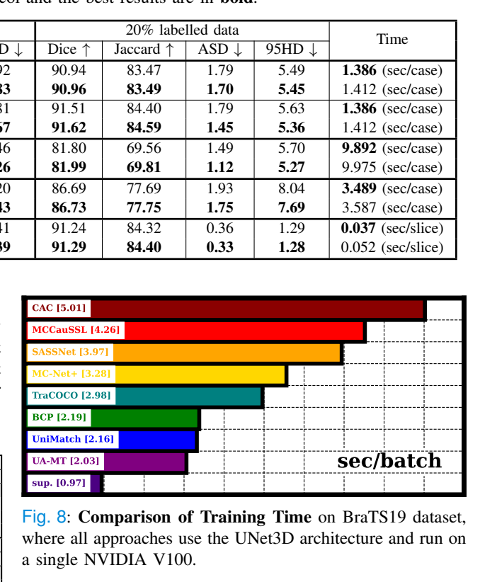

# arXiv 检索结果 / Results

## 1. Semi-Supervised Multi-Modal Medical Image Segmentation for Complex Situations
- Authors：Dongdong Meng, Sheng Li, Hao Wu, Guoping Wang, Xueqing Yan
- Venue：MICCAI 2025
- Comments：10 pages, 2 figures, accepted at MICCAI 2025
- First：2025-06-20T16:37:44+00:00；Latest：2025-06-20T16:37:44+00:00
- Abs：https://arxiv.org/abs/2506.17136v1
- PDF：https://arxiv.org/pdf/2506.17136v1
- Code：https://huggingface.co/huggingface, https://huggingface.co/docs/hub/spaces
- 解读来源：PDF 全文，共 10 页，10 页可提取文字
### [中文]
**中文翻译**
- 标题：复杂情况下的半监督多模态医学图像分割
- 摘要：半监督学习有效缓解了医学图像标注有限的问题，但其在复杂背景和挑战性任务中的性能往往不足。多模态融合方法通过提供互补信息可显著提升医学图像分割的准确性。然而，在半监督条件下，由于难以有效利用未标注数据，这些方法难以取得显著改进。迫切需要一种有效且可靠的多模态学习策略，以在半监督分割中利用未标注数据。为解决这些问题，我们提出了一种新颖的半监督多模态医学图像分割方法，利用互补的多模态信息在有限标注数据下提升性能。我们的方法采用多阶段多模态融合与增强策略，充分利用互补的多模态信息，同时减少特征差异并增强特征共享与对齐。此外，我们有效引入对比互学习以约束跨模态的预测一致性，从而提升半监督任务中分割结果的鲁棒性。在两个多模态数据集上的实验结果表明，所提框架具有优越的性能和鲁棒性，在解决复杂场景下的医学图像分割任务方面具有重要潜力。

论文提出半监督多模态医学图像分割框架：双分支编码器在多个编码阶段融合两模态特征，模态感知增强模块按通道重加权，并以对比式互学习（用对方模态预测作伪标签、停止梯度）约束无标注数据的一致性。在 BraTS2019（T1ce+T2）与私有 NPC（CT+MR T2）上，5%/10% 标注下 DSC 与 ASD 多数优于 MT、ICT、EM、URPC、MLRPL、MMCML、CMC；BraTS 5% 时 DSC 85.16%、ASD 2.38 mm。消融显示多阶段融合贡献最大（T1ce 分支 DSC 68.44→81.94）。局限：仅单一 α=1.0、无重复种子方差检验、NPC 为私有数据、融合层与增强模块细节报告不足。

## 1. 问题与动机

论文针对**标注稀缺条件下的多模态医学图像分割**，尤其是复杂肿瘤（形状不规则、邻近组织复杂、边界模糊）场景 [p. 1][p. 2]。作者认为：现有半监督方法多依赖自训练/协同训练或一致性约束，在复杂目标上表现有限；而多模态融合方法虽能利用互补信息，但大多面向全监督，半监督下难以有效利用无标注数据 [p. 2]。作者进一步指出两条相关路线的问题：MMCML 类方法只约束跨模态**预测结果**的一致性，未充分利用多模态信息；CMC 类方法用独立编码器提取模态特异特征再做融合对齐，但独立编码器会加大特征差异，导致不同模态分割精度明显不一致 [p. 2]。因此作者主张在**早期编码阶段**就进行多阶段特征融合与对齐，并配合模态感知增强与跨模态互学习 [p. 2][p. 3]。

## 2. 方法

**输入与数据定义。** 两模态数据记为 $D_a^l,D_b^l$（有标注，$M$ 例）与 $D_a^u,D_b^u$（无标注，$N$ 例，$M\ll N$），输入 $x^a,x^b\in\mathbb{R}^{H\times W\times D}$，标签 $y\in\mathbb{R}^{C\times H\times W\times D}$ [p. 3][p. 4]。框架为端到端双分支网络，两模态共享同一标注，同时输出各自预测 [p. 4]。

**多阶段多模态融合（MMF）。** 编码器各阶段低层特征记为 $F^a=\{f^a_s\}_{s=1}^4$、$F^b=\{f^b_s\}_{s=1}^4$；在每个编码阶段将两模态特征融合为 $F^{ab}$ 并回传至各自编码器的下一阶段，以对齐特征、减小模态差异 [p. 4]。融合层由拼接、两层卷积和一个非线性激活组成，公式为 $f^s_{fused}=F_{sigmoid}(F_{conv2}(F_{conv1}(F_{cat}(f^a_s,f^b_s))))$ [p. 4，式(3)]。注意：式(3) 与正文“融合后传回两个编码器”的具体连接方式在文中未画清，Fig. 1 仅给出总体示意 [p. 3]。

**模态感知增强（MAE）。** 用不同感受野的多个卷积层建模局部与全局信息，再经全局平均池化、全连接、Softmax 得到通道注意力权重：$W^a=F_{softmax}(F_{fc}(F_{gap}(\psi_1(F^a)+\psi_2(F^a))))$，其中 $\psi_1,\psi_2$ 为不同核尺寸的变换 [p. 4，式(2)]；另一模态同法处理，加权后的特征进入解码器生成输出 [p. 4]。文中未报告 $\psi_1,\psi_2$ 的具体核尺寸与通道压缩比。

**对比式互学习（MCML）。** 有标注数据用监督损失：$\mathcal{L}_{sup}=\mathbb{E}[\mathcal{L}_{CE}(f_\phi(x^a),g_\phi(x^b),y)+\mathcal{L}_{DICE}(\cdot,y)]$ [p. 5，式(4)]。无标注数据先由两网络各自生成伪标签 $p^a_l=f_\phi(x^a)$、$p^b_l=g_\phi(x^b)$，再最小化 $\mathcal{L}_{unsup}=\mathbb{E}[\|f_\phi(x^a)-p^b_l\|_2+\|g_\phi(x^b)-p^a_l\|_2]$ [p. 5，式(6)]。关键设计是**伪标签侧停止梯度**：$p^a_l$ 与 $f_\phi(x^a)$ 之间、$p^b_l$ 与 $g_\phi(x^b)$ 之间不回传梯度 [p. 5]。总损失 $\mathcal{L}_{total}=\mathcal{L}_{sup}+\alpha\mathcal{L}_{unsup}$，$\alpha$ 为跨模态约束权重 [p. 5]。

## 3. 贡献

作者声称的新颖点有三：(1) 多阶段多模态特征融合，在早期编码阶段对齐低层视觉特征以降低模态差异；(2) 模态感知特征增强模块，强调重要模态特异特征、抑制无关信息；(3) 协同互学习目标，保证跨模态预测一致性与鲁棒性 [p. 2][p. 3]。我的解读：核心增量是把“早期逐阶段融合”与“预测级互学习”组合起来，并用停止梯度避免伪标签塌缩；这与 MMCML（仅预测一致性）和 CMC（独立编码器后融合）形成对照 [p. 2]。但各组件本身（通道注意力、伪标签互监督）并非全新，创新主要在组合方式与融合位置。

## 4. 实验与结果

**数据与划分。** BraTS2019：335 例四模态 MRI，本文用 T1ce 与 T2 做全肿瘤分割，随机取 250/25/60 例为训练/验证/测试；预处理为裁剪零强度区域并逐扫描 min-max 归一化 [p. 5]。NPC 私有数据：161 例放疗患者，CT（512×512，层厚 3.0 mm，像素 1.27×1.27 mm²）与 MR T2（384×384，3.0 mm，1.30×1.30 mm²），随机取 112/17/32 例；CT 转 HU 并按窗宽窗位归一化，MR T2 做 min-max，CT 与 T2 刚性配准 [p. 5][p. 6]。标注预算为 5% 与 10%，另报告 100% 全监督上界 [p. 6][p. 8]。

**训练设置。** PyTorch、单张 NVIDIA A6000，从零训练；SGD，初始学习率 $1\times10^{-2}$，batch size 4，最多 60k 迭代，dropout 0.5，$\alpha=1.0$；随机裁剪 112×112×96（NPC）与 96×96×96（BraTS）[p. 6]。指标为 DSC 与 ASD [p. 6]。**未报告**：backbone 具体网络名、参数量、学习率调度、数据增强细节、随机种子与重复次数。

**对比结果（Table 1）[p. 8]。** 单模态半监督方法（MT、ICT、EM、URPC、MLRPL）按通道拼接多模态输入；多模态方法为 MMCML 与 CMC。BraTS 5%：本文 DSC 85.16±7.10、ASD 2.38±2.83，优于次优 URPC 83.14±8.93 / 3.19±3.70；MMCML 仅 75.83±17.53。BraTS 10%：本文 85.82±7.97 / 2.19±2.73，优于 URPC 84.82±9.35 / 2.33±2.57；100% 全监督为 88.35±6.3 / 1.48±1.53。NPC 5%：本文 69.33±9.16 / 2.19±1.45，URPC 为 69.03±8.57 / 2.29±1.69，差距很小；NPC 10%：本文 72.67±7.56 / 1.74±0.89，优于 ICT 71.48±6.40 / 2.17±2.33；全监督 77.03±6.35 / 1.53±0.98。需注意 Table 1 中“Ours”行在 PDF 文本里出现重复数字串，属排版/抽取伪影，应以单次数值理解，但无法从文本完全确认 [p. 8]。

**消融（Table 2，BraTS 5%）[p. 8]。** 基线（双分支）T1ce 68.44±14.46 / T2 79.28±10.82；加 MMF 后 T1ce 81.94±10.48（+12.5 个百分点，作者称因共享 T2 特征）、T2 82.98±9.64；再加 MAE 为 83.84±8.74 / 83.74±8.63，但 ASD 反而升至 3.66±4.25 / 3.91±4.44；MMF+MCML 为 83.96±8.02 / 84.43±7.56，ASD 2.62±3.54 / 2.70±3.53；三者全用达 85.16±7.10 / 84.95±7.25，ASD 2.38±2.83 / 2.67±3.09。该消融说明 MMF 贡献最大，MAE 与 MCML 主要提升 DSC，MAE 单独加入时 ASD 变差，作者未解释此现象。

**定性结果。** Fig. 2 展示 10% 与 5% 标注下与 SOTA 的视觉对比，作者称本文更贴合真值、能捕捉更多边缘细节并分割分散 NPC 病灶 [p. 6][p. 7]；但图像本身未作为可解析输入，只能依据图注与正文陈述。

## 5. 评估

**有支持的结论。** 在给定划分与 5%/10% 预算下，本文方法在 BraTS 上稳定领先所有对比方法，且消融支持 MMF 是主要增益来源 [p. 8]。NPC 上 5% 时仅略高于 URPC（69.33 vs 69.03），10% 时优势更明显，说明“显著优于 SOTA”的表述在 NPC 5% 条件下证据偏弱 [p. 8]。

**报告的限制与缺失证据。** 作者未设专门局限性章节，仅提出未来扩展到其他任务 [p. 9]。缺失包括：未报告 backbone 架构与融合层通道数；$\alpha$ 仅取 1.0，无敏感性分析；无多随机种子或显著性检验，标准差虽给出但未做统计比较；NPC 为单中心私有数据，外部泛化未知；Table 1 存在文本重复伪影，个别数值可靠性需核对原表 [p. 8]；MAE 导致 ASD 变差的原因未分析 [p. 8]。

## 6. 复现要点

按文中可执行步骤：两模态分别输入双分支编码器；在 4 个编码阶段用“拼接+两层卷积+sigmoid”融合并回传；对融合特征做双核卷积+全局池化+全连接+Softmax 的通道加权；解码输出后，有标注数据算 CE+Dice，无标注数据用对方预测作停止梯度伪标签算 L2 一致性，$\alpha=1.0$；SGD，lr $10^{-2}$，batch 4，60k 迭代，dropout 0.5，裁剪尺寸如上 [p. 4][p. 5][p. 6]。**未报告**：编码器/解码器具体结构、融合层卷积核与通道、优化器动量与权重衰减、学习率衰减策略、伪标签是否阈值化、验证集使用方式、硬件以外的时间成本。

本篇未找到可可靠提取的方法流程图，请查看原文 PDF。

## 2. SWDL: Stratum-Wise Difference Learning with Deep Laplacian Pyramid for Semi-Supervised 3D Intracranial Hemorrhage Segmentation
- Authors：Cheng Wang, Siqi Chen, Donghua Mi, Yang Chen, Yudong Zhang, Yinsheng Li
- Comments：11 pages, 4 figures, 6 Tables
- First：2025-06-12T03:16:49+00:00；Latest：2025-06-12T03:16:49+00:00
- Abs：https://arxiv.org/abs/2506.10325v1
- PDF：https://arxiv.org/pdf/2506.10325v1
- Code：https://github.com/SIAT-CT-LAB/SWDL, https://huggingface.co/huggingface, https://huggingface.co/docs/hub/spaces, https://github.com/SIAT-CT-
- 解读来源：PDF 全文，共 11 页，11 页可提取文字
### [中文]
**中文翻译**
- 标题：SWDL：基于深度拉普拉斯金字塔的分层差异学习用于半监督3D颅内出血分割
- 摘要：医学影像的最新进展已使基于深度学习的分割成为主流方法，但其通常需要大量人工标注数据。然而，由于标注过程繁琐且成本高昂，获取颅内出血（ICH）的标注仍然尤为困难。半监督学习（SSL）已成为解决标注数据稀缺问题的一种有前景的方案，尤其是在体素医学图像分割中。与主要关注高置信度伪标签或一致性正则化的传统SSL方法不同，我们提出了SWDL-Net，一种新颖的SSL框架，其利用拉普拉斯金字塔与深度卷积上采样的互补优势。拉普拉斯金字塔擅长边缘锐化，而深度卷积通过灵活的特征映射提升细节精度。我们的框架通过一种有效整合这些互补方法的差异学习机制，实现了对病灶细节和边界的更优分割。在271例ICH数据集和公开基准上的大量实验表明，在仅有2%标注数据的场景下，SWDL-Net优于当前最先进的方法。在仅有5%标注数据的公开脑出血分割数据集（BHSD）上的进一步评估也证实了我们方法的优越性。代码和数据已在https://github.com/SIAT-CT-LAB/SWDL发布。

SWDL-Net 是一种面向 3D 颅内出血（ICH）分割的半监督框架，核心是用双解码器（深度转置卷积 DC 与深度拉普拉斯金字塔 DelPU）之间的“分层差异”作为额外学习信号，并把该差异回注编码器。作者在 271 例临床 PBGTH 数据上仅用 2% 标注取得 Dice 89.32%、HD95 2.06 voxel，在公开 BHSD 数据 5% 标注下 Dice 51.81%，均优于 UAMT、URPC、LeFeD；消融显示 T=3、ξ=1e-3、μ=1.5 为最优设置，去掉深度监督或差异学习均导致下降。

## 1. 问题与动机

论文针对非增强 CT（NCCT）上的 3D 颅内出血（ICH）分割。作者指出，全监督方法（U-Net、Swin-UNet、nnFormer、HDC-Net 等）依赖大量专家标注，而 ICH 标注耗时昂贵；现有半监督方法主要分两类：一致性正则（I2CS、URPC、MC-Net+、UniMatch 等）与伪标签（UA-MT、BoostMIS、ComWin 等）。作者认为近期半监督 ICH 方法仍有不足：不确定性引导方法对阈值敏感，弱监督 CAM 方法边界不完整，cut-paste 增强可能产生解剖上不真实的样本，YOLO-SAM 混合方法受检测分辨率限制 [p. 1]。因此论文提出 SWDL-Net，试图利用拉普拉斯金字塔“边缘锐化”与深度卷积上采样“灵活特征映射”的互补性，通过两条解码路径之间的差异学习来利用无标注数据 [p. 1][p. 2]。

## 2. 方法

整体流程（Fig. 1(a)，[p. 3]）：先用 DC 编码器提取特征；双解码器在每个层级分别用深度转置卷积（DC decoder）和深度拉普拉斯金字塔上采样（DelPU decoder）生成特征；再计算两条路径在各层的差异，并将差异递归回注编码器。

**分层差异学习（SWDL）**：设迭代周期为 T，第 p 次迭代、第 s 层的特征差异为
∆(s,p) = f_s^θDC(y_{s+1}^{DC,p}) − f_s^θDelPU(y_{s+1}^{DelPU,p})（式 1）[p. 2]。
编码器特征更新分三种情况（式 2）：s=1 时直接 y_E,p^s = f_E^s(x)；s>1 且 p=1 时只用上一层编码特征；s>1 且 p>1 时把 ξ∆(s−1,p−1) 加到上一层编码特征上再送入当前层。ξ 控制差异影响强度 [p. 2]。

**DelPU 模块**（Fig. 1(b)，[p. 3]）：四阶段流水线。(1) 高斯金字塔：G_d = DW(G_{d−1}⊗g)，DW 为三线性插值下采样，g 为高斯核（式 3）。(2) 拉普拉斯金字塔：L_d = G_d − UP(G_{d+1})⊗g，UP 为三线性插值上采样（式 4）。(3) 加权重建：y_d = μL_d + UP(y_{d+1})⊗g（d<D），y_D = G_D（式 5）；μ 越大边缘锐化越强。(4) 最终上采样到目标分辨率 [p. 3]。

**分层自适应深度**：D 按输入最大维度选取：≤8 取 0，8–32 取 1，32–64 取 2（式 6），以平衡重建保真度与计算量、避免低分辨率退化 [p. 3]。

**损失**：有标注数据用 Losssup = LossDC + LossDelPU + LossDS（式 7）。正文一处写 DC 解码器用“deeply supervised Dice loss”、DelPU 用 CE [p. 3]，但式 7 下方又写 LossDC 为 Dice、LossDelPU 为 CE，两处表述存在不一致，需以原文为准并注意该歧义。深度监督权重 ωs = {0.8, 0.6, 0.4, 0.2, 0.1}，从低层到高层 [p. 4]。无标注数据用两个解码器输出之间的 MSE：Lossunsup = (1/M)Σ MSE(f_DC(x_i), f_DelPU(x_i))（式 8）；总损失为二者之和（式 9）[p. 4]。推理时只需编码器加主解码器一次前向，不需要差异学习 [p. 4]。

## 3. 贡献

作者声称的贡献有三点：双解码器混合架构与路径间差异学习；跳跃连接中的差异特征计算（先算路径差、非线性激活、再加权求和，而非简单拼接）；按输入尺寸动态调整金字塔深度的分层自适应机制 [p. 2]。我的理解是：真正区别于现有一致性/伪标签方法的核心在于“把两个解码器的分层特征差作为无监督信号回注编码器”，而 DelPU 本身是拉普拉斯金字塔与深度上采样的结合；论文未给出与“仅双解码器不加差异回注”的严格对照之外的更强因果证据，因此“差异学习优于其他一致性形式”应视为作者主张而非已被完全隔离验证的结论。

## 4. 实验与结果

**数据与预处理**：北京天坛医院 2020.4–2022.11 回顾性收集 99 名患者、共 271 次颅脑检查；256 层 CT（Philips、GE），体素 0.408×0.408×5 至 1×1×5 mm³ [p. 4]。预处理包括：15 年经验神经放射科医生用 3D Slicer 手工勾画；重采样到 0.5×0.5×5 mm³（三线性插值）；Otsu 阈值 150 HU 加形态学闭运算做颅骨剥离；固定阈值 20–40 HU 加膨胀/腐蚀提取出血 ROI [p. 4]。

**训练设置**：基线为 VNet；sklearn KFold 划分 80% 训练/20% 测试，random_state=367；Python 种子 1337，NumPy/PyTorch 同步固定；SGD，lr=0.01，weight decay=0.0001，momentum=0.9；输入 16×64×64，batch size 32（2 标注 + 30 无标注）；RTX 3090，PyTorch [p. 5]。评价指标为 Dice、HD95、ASD、Accuracy、Precision、Jaccard，均报告 95% 置信区间；统计用 Wilcoxon 符号秩检验（含 tie 校正，式 10）[p. 4][p. 5]。

**PBGTH 2% 标注结果**（Table I，[p. 7]）：SWDL Dice 89.32% [88.40,90.23]，HD95 2.06 [1.58,2.54] voxel，ASD 0.59 [0.45,0.73]，Acc 95.92%，Pre 90.81%，Jac 80.87%。对比 UAMT 84.56/6.23/2.05、URPC 86.73/3.61/1.07、LeFeD 87.53/3.51/1.01；全监督 VNet（100% 标注）为 92.48/1.15/0.29。作者称 SWDL 达到全监督 VNet Dice 的 96.6%，比 LeFeD 高 1.79%，HD95 低 41.3%，Jac 高 3.49%；ASD 相对基线降低 41.6%–71.2%，HD95 降低 41.3%–66.9% [p. 5][p. 7]。Wilcoxon 检验称所有指标显著改善，箱线图 n=55 例 [p. 6]。

**消融**：μ 在 1.3–1.7 间测试，μ=1.5 最优（Dice 89.32，比 μ=1.4 高 1.92%），μ=1.6 降至 88.34（Table II，[p. 7]）。T=2/3/4/5 中 T=3 最优，T=4 下降最明显（Dice 87.75，HD95 3.51）（Table III，[p. 8]）。ξ 从 1e-2 到 1e-4，ξ=1e-3 最优；ξ=1e-4 时 Dice 86.63、HD95 4.04（Table IV，[p. 8]）。组件消融（Table V，[p. 8]）：完整 SWDL 89.32，去 DS 为 88.82，去 DL 为 88.15，两者都去为 87.00；HD95 分别为 2.06、2.65、2.61、3.58，作者称相对 SWDL-DS 改善 22.6%、相对 SWDL-DS-DL 改善 42.5%，并称 DS 与 DL 合计带来 2.32% Dice 提升 [p. 8][p. 9]。

**BHSD 公开数据**：192 例 NCCT，80%/20% 划分（153 训练/39 测试），仅 5% 标注（8 例）[p. 8]。Table VI [p. 9]：SWDL Dice 51.81% [42.39,61.24]，HD95 19.78，ASD 5.62，Acc 97.40%，Pre 63.69%，Jac 40.44%；UAMT 48.70/27.38/10.48，URPC 48.17/27.09/8.43，LeFeD 50.70/23.91/6.85；全监督 VNet 61.00/20.37/7.00。作者称 SWDL 达到全监督 Dice 的 85%，Precision 领先其他方法 7.2–25.5% [p. 8]。注意 BHSD 上 SWDL 的 HD95（19.78）略优于全监督 VNet（20.37），但 Dice 差距仍大，作者将其归因于 BHSD 出血亚型更复杂 [p. 10]。

## 5. 评估

支持的结论：在作者设定的 2% PBGTH 与 5% BHSD 条件下，SWDL 的 Dice、HD95、ASD、Precision、Jaccard 均优于所列三种半监督基线，且置信区间较窄；消融一致显示 DS 与 DL 各自有贡献，超参数存在明确峰值。局限与缺失证据：作者自述 3D 深度卷积与拉普拉斯金字塔对层间上下文捕捉可能有限，需在更多出血亚型（蛛网膜下腔、脑室内）验证，且所有方法在 PBGTH 上优于 BHSD，可能因 PBGTH 病灶更一致 [p. 10]。此外，论文未报告与更多近期 SOTA（如 MC-Net+、UniMatch、ComWin）的对比；未说明 2%/5% 标注的具体抽样方式与多次重复实验的方差来源；Table I/II 等表格在文本中排版混杂，部分数值需以原表为准；DC/DelPU 损失分配在正文中存在前后不一致 [p. 3]；推理时“只需主解码器”但未明确主解码器是 DC 还是 DelPU。

## 6. 复现

已报告：数据来源与预处理阈值、重采样间距、VNet 基线、KFold 80/20、random_state=367、种子 1337、SGD lr=0.01/wd=1e-4/momentum=0.9、输入 16×64×64、batch 32（2 标注+30 无标注）、RTX 3090、PyTorch、ωs 列表、μ=1.5、T=3、ξ=1e-3、深度监督权重 [p. 4][p. 5][p. 7][p. 8]。未报告或无法确认：具体网络层数/通道数、DelPU 每层卷积核设置、无标注数据采样策略、训练总迭代轮数与早停规则、2%/5% 标注样本的选取随机过程、BHSD 的具体病例编号划分、代码运行环境版本；代码与数据链接为 https://github.com/SIAT-CT-LAB/SWDL [p. 1]，但论文正文未给出完整配置文件。

本篇未找到可可靠提取的方法流程图，请查看原文 PDF。

## 3. Co-Evidential Fusion with Information Volume for Medical Image Segmentation
- Authors：Yuanpeng He, Lijian Li, Tianxiang Zhan, Chi-Man Pun, Wenpin Jiao, Zhi Jin
- First：2025-06-03T06:13:19+00:00；Latest：2025-06-03T06:13:19+00:00
- Abs：https://arxiv.org/abs/2506.02492v1
- PDF：https://arxiv.org/pdf/2506.02492v1
- Code：https://huggingface.co/huggingface, https://huggingface.co/docs/hub/spaces
- 解读来源：PDF 全文，共 30 页，30 页可提取文字
### [中文]
**中文翻译**
- 标题：面向医学图像分割的带信息量的协同证据融合
- 摘要：尽管现有的半监督图像分割方法已取得良好性能，但它们无法有效利用多源体素级不确定性进行针对性学习。因此，我们提出两项主要改进。首先，我们引入一种新颖的基于广义证据深度学习的使用广义证据深度学习扩展的传统D-S证据理论的赌注式协同证据融合策略，以获得医学样本中每个体素更精确的不确定性度量。这有助于模型学习混合标注信息，并在标注数据与未标注数据之间建立语义关联。其次，我们引入质量函数信息量（IVUM）的概念来评估所构建的证据，实现两种证据学习方案。一种通过将质量函数的信息量与原始不确定性度量相结合来优化证据深度学习。另一种则整合基于协同证据融合策略的学习模式，利用IVUM设计新的优化目标。在四个数据集上的实验证明了我们方法的竞争性性能。

该论文在半监督医学图像分割中引入D-S证据理论与信息量（IVUM），提出pignistic协同证据融合、不确定性引导学习（UGL）及基于IVUM的两种证据优化目标。在LA、NIH-Pancreas、ACDC和BraTS四个数据集上，5%/10%/20%标注比例下多数指标优于BCP等基线；例如LA 5%标注时Dice达91.63%，较BCP的88.02%提升3.61个百分点。作者报告主要代价是计算资源消耗增加，但未给出运行时间或显存数据。

## 1. 问题与动机

半监督医学图像分割（SSL）旨在利用少量标注体数据和大量无标注体数据提升分割性能。作者指出，现有SSL方法（自训练、GAN、图模型）存在误差传播、训练不稳定、高不确定性与模糊边界难处理等问题[p. 2]。更具体地，现有方法“无法有效利用多源体素级不确定性进行针对性学习”[p. 1]。因此，论文试图将D-S证据理论中的证据融合与信息量度量引入半监督分割，用体素级证据评估来抑制噪声伪标签、建立标注与无标注数据之间的语义关联[p. 2]。

## 2. 方法

### 2.1 整体框架

输入为3D体数据 X∈R^{W×H×L}，输出体素标签 Y∈{0,1,...,S−1}^{W×H×L}。训练集 ζ 由 Q 个标注样本 ζ_l 和 W 个无标注样本 ζ_u 组成，W≫Q[p. 3]。框架包含两个子网络 N_s1、N_s2，采用类似BCP[58]的相互教学训练策略：预训练阶段用标注数据分别得到参数 I_s1、I_s2；自训练阶段 N_s1 先反向传播更新，再由 N_s2 更新[p. 8]。

### 2.2 预训练阶段

从两组标注数据 ζ_l1、ζ_l2 中各随机取一个样本，用随机零中心掩码 M1（零值区域尺寸 ηW×ηH×ηL）做copy-paste：

X_M1 = X_l1a ⊙ M1 + X_l2b ⊙ (1−M1)，Y_M1 同理[p. 8, 式(14)(15)]。

混合样本与两组原始标注样本分别送入网络，预测经 G（如ReLU）转为非负证据，证据维度沿类别方向，每个体素对应一个证据向量[p. 9, 式(19)]。基础损失为交叉熵加Dice：L_Is1 = L_ce(P_M1,Y_M1)+L_dice(P_M1,Y_M1)[p. 9, 式(17)]。

### 2.3 不确定性引导学习（UGL）

对每个体素证据 v_η=[v_η,1,...,v_η,N]，按EDL定义不确定性 U=N/T，T=Σc_k，c_k=v_k+1[p. 5, 式(4)]。将所有体素不确定性排序后，用动态权重函数：

ϖ(r,t)=ϕ·tanh(ξ(r)λ(h(t)))+1[p. 9, 式(22)]，

其中 ξ(r)=2r/R−1 随训练轮次变化，λ(h(t))=2h(t)/T−1 随体素不确定性排序位置变化，ϕ 限制权重幅度。作者的设计意图是：先给低不确定性（易学）体素较高权重，再逐步提高高不确定性体素的权重[p. 9]。对应排序损失 L_sort,Is1 为加权后的交叉熵与Dice组合[p. 10, 式(23)]。

### 2.4 协同证据融合与IVUM（CDIF）

将混合数据证据 ε1 与两组原始标注数据证据 ε2、ε3 分别融合。作者提出基于pignistic变换的新组合规则：

ε_ς({P_i}) = ε_d({P_i})·ε_e({P_i}) + |P_i|/(|S|+|P_i|)·(ε_d({P_i})·ε_e({S}) + ε_d({S})·ε_e({P_i}))[p. 10, 式(30)]，

再做归一化[p. 11, 式(31)]。作者解释：基数较大的命题其信念值变化较小，从而获得更明显的不确定性指标[p. 11]。融合结果为 ε1,2=F(ε1,ε2)、ε1,3=F(ε1,ε3)[p. 11, 式(32)]。

IVUM定义为融合证据的不确定性分量与信息量之积：IVUM_ε1,2 = ε1,2(P_η^{N+1})·IV(ε1,2)[p. 11, 式(33)]，其中 IV 为mass function的信息量，按Deng熵迭代分离计算，收敛阈值 ρ[p. 7, 式(12)(13)]。归一化后记为 ÎVUM。改进的EDL目标为：

L_gl,Is1 = Σ_j (1−ÎVUM^j) Σ_k y_jk(logU^j−logc_jk)[p. 11, 式(34)]。

### 2.5 结合IVUM的UGL（ULM）

按 ÎVUM 重新排序体素，得到新的动态权重 ϖ(r,t)_ÎVUM[p. 11, 式(35)]，并构造 L_s−gl,Is1 = ϖ(r,t)_ÎVUM·L_gl[p. 11, 式(36)]。最终预训练总损失：

L_finalIs1 = L_Is1 + λ1L_sort,Is1 + λ2L_gl,Is1 + λ3L_s−gl,Is1[p. 11, 式(37)]；

N_s2 的总损失为 L_finalIs2 = L_Is1 + E_Is1[p. 12, 式(38)]。

### 2.6 自训练阶段

在标注与无标注数据之间做copy-paste：X_M1lu = X_li⊙M + X_um⊙(1−M)，X_M2lu = X_lj⊙(1−M)+X_un⊙M[p. 12, 式(39)(40)]。无标注部分由另一子网络生成伪标签，取最大连通分量作为最终伪标签[p. 12]。基础损失 L_Ns1 为两组混合输入的交叉熵加Dice[p. 13, 式(45)]。UGL、CDIF、ULM分别以 L_sort,Ns1、L_gl,Ns1、L_s−gl,Ns1 形式复用[p. 14, 式(47)(51)(52)]，总损失为：

L_finalNs1 = L_Ns1 + λ4L_sort,Ns1 + λ5L_gl,Ns1 + λ6L_s−gl,Ns1[p. 14, 式(53)]，N_s2 同理[p. 14, 式(54)]。

## 3. 贡献

作者声称的贡献有四点[p. 2-3]：(1) 提出协同证据融合策略，用原始标注数据辅助学习混合标注特征及标注-无标注关系；(2) 将mass function信息量引入EDL，并结合D-S证据理论提供多维度证据评估；(3) 提出新的证据优化目标，其中一个依赖前述学习模式；(4) 在四个数据集、三种标注比例上验证优越性。

我的解读：核心新颖点在于把“证据融合后的IVUM”同时用于重加权EDL损失（式34）和体素排序（式35），形成两级体素级学习信号；融合规则式(30)是作者对传统Dempster组合规则的修改，但其理论性质（如结合律、交换律）论文未讨论。

## 4. 实验与结果

### 4.1 数据集与设置

四个数据集：LA（154例MRI，100训练/54测试，训练集内80训练/20验证）[p. 17]；NIH Pancreas-CT（80例，18例作验证）[p. 17]；ACDC（100例有标注，7:1:2划分）[p. 19]；MSD BraTS（484例MR体，16:3:1划分）[p. 19]。指标为Dice、Jaccard、95HD、ASD[p. 16]。

LA：3D V-Net骨干，SGD，初始学习率0.01，每2.5K迭代衰减10%，预训练2K、自训练15K迭代，patch 112×112×80，掩码零值区域74×74×53，批大小4[p. 17]。Pancreas：四层3D V-Net，Adam，学习率0.001，预训练60轮、自训练200轮，patch 96×96×96，批大小4[p. 17-19]。ACDC：2D U-Net，SGD，学习率0.01，patch 256×256，预训练10K、自训练30K迭代，批大小12[p. 19]。BraTS：SGD，学习率0.01，动量0.9，预训练2K、自训练15K迭代，patch 128×128×96，批大小4[p. 19]。每批标注与无标注样本数相等[p. 16]。

### 4.2 主要结果

表1[p. 15]：LA 5%标注下，本文方法Dice 91.63、Jaccard 83.58、95HD 5.26、ASD 1.67；BCP为88.02、78.72、7.90、2.15，作者称分别提升3.61、4.86、2.64、0.48[p. 19]。LA 10%：本文91.99/84.22/4.54/1.25，BCP 89.62/81.31/6.81/1.76。LA 20%：本文92.16/84.51/4.69/1.18，BCP 90.34/82.50/6.75/1.77。

NIH-Pancreas 5%：本文82.36/70.38/7.67/2.31，BCP 80.33/67.65/11.78/4.32；作者指出本文5%标注性能超过BCP 10%标注设置[p. 21]。ACDC 5%：本文90.66/83.37/3.61/0.93，BCP 87.59/78.67/1.90/0.67——注意此处95HD与ASD本文数值高于BCP，与作者“尤其在后两项指标上优于SOTA”的表述[p. 21]不一致，表中BCP的95HD=1.90、ASD=0.67均低于本文的3.61、0.93。ACDC 10%：本文91.17/83.74/2.36/0.70，BCP 88.84/80.62/3.98/1.17；20%：本文91.57/84.83/2.20/0.68，BCP 89.52/81.62/3.69/1.03。

BraTS表2[p. 16]：第一部分的比较方法数值直接取自Co-BioNet[41][p. 21]。5%标注下本文平均HD 7.29、DSC 79.27，Co-BioNet为9.06、76.82；10%下本文6.31、82.77，Co-BioNet 7.59、80.75；20%下本文5.31、83.69，Co-BioNet 6.87、80.86。第二部分复现V-Net与Co-BioNet，5%标注下本文Dice 81.96、Jaccard 70.19、95HD 5.14、ASD 0.92，Co-BioNet为77.20、67.56、7.81、0.97；100%标注下本文84.54/75.66/4.33/0.33，Co-BioNet 82.53/72.94/5.23/0.44[p. 16]。

### 4.3 消融与参数分析

表3[p. 20]在LA 5%标注下网格搜索λ1–λ6。作者报告最优为λ1=1.6、λ2=2.4（预训练），λ4=1.6、λ5=2.4（自训练），此时Dice 91.63、Jaccard 83.58、95HD 5.26、ASD 1.67[p. 22]；并称λ3=λ6时性能最佳[p. 22]。该表数值密集，部分单元格排版错位（如λ3=2.4、λ6=1.6处Jaccard显示90.31，明显异常），无法可靠辨认，不应据此下结论。图9–11[p. 18]展示λ1/λ2、λ4/λ5、λ3/λ6变化曲线，但正文未给出具体数值。

### 4.4 可视化

图12[p. 21]对比LA、BraTS、Pancreas，图13[p. 22]对比ACDC上BCP；作者称本文分割更平滑、细节更完整、误判更少。此处仅依据图注与正文描述，未对图像本身作独立判读。

## 5. 评估

支持的结论：在作者设定的四个数据集与5%/10%/20%标注比例下，表1和表2显示本文方法在多数Dice/Jaccard指标上优于所列基线，且LA 5%标注下相对BCP的提升有明确数字支撑[p. 15, 19]。参数分析表明λ2、λ5（IVUM相关损失权重）取2.4附近时表现较好，与作者关于IVUM有效性的主张方向一致[p. 22]。

需要注意的问题：(1) ACDC 5%下95HD/ASD本文劣于BCP，与正文“尤其后两项指标占优”的表述矛盾[p. 15, 21]；(2) BraTS第一部分基线数值直接引用Co-BioNet原文，第二部分自行复现后Co-BioNet数值与第一部分不一致（如5%平均DSC 76.03 vs 77.20），作者承认“存在一定差异”[p. 16, 21]，但未分析原因；(3) 表3部分单元格疑似排版错误，无法完整核验参数结论；(4) 论文未报告运行时间、显存或参数量，仅结论中定性承认计算资源消耗更高[p. 24]；(5) 未报告多次运行的均值/方差或显著性检验；(6) 融合规则式(30)缺乏理论性质分析；(7) 与ETCL、EVIL、BFSSL、EPE、EUA的差异仅在文字层面讨论[p. 23]，无直接实验对比。

## 6. 复现

已报告：LA用3D V-Net+SGD（lr 0.01，每2.5K迭代×0.1，预训练2K/自训练15K迭代，patch 112×112×80，掩码零值区74×74×53，批大小4）[p. 17]；Pancreas用四层3D V-Net+Adam（lr 0.001，预训练60轮/自训练200轮，patch 96×96×96，掩码64×64×64，批大小4，旋转/缩放/翻转增强）[p. 17-19]；ACDC用2D U-Net+SGD（lr 0.01，patch 256×256，预训练10K/自训练30K迭代，批大小12）[p. 19]；BraTS用SGD（lr 0.01，动量0.9，预训练2K/自训练15K迭代，patch 128×128×96，批大小4）[p. 19]。损失权重最优值λ1=1.6、λ2=2.4、λ4=1.6、λ5=2.4，λ3=λ6[p. 22]。

未报告或无法辨认：ϕ 的具体取值、IVUM迭代中的允许误差 ρ、证据生成函数 G 的完整定义（仅举例ReLU）、伪标签置信阈值、数据划分随机种子、硬件环境、训练总时长、代码链接。自训练阶段“迭代/轮数设置参考BCP”[p. 16]意味着部分细节需查阅BCP原文。

本篇未找到可可靠提取的方法流程图，请查看原文 PDF。

## 4. Translation Consistent Semi-supervised Segmentation for 3D Medical Images
- Authors：Yuyuan Liu, Yu Tian, Chong Wang, Yuanhong Chen, Fengbei Liu, Vasileios Belagiannis, Gustavo Carneiro
- Venue：published in IEEE TRANSACTIONS ON MEDICAL IMAGING, FEB 2025
- Comments：17 pages, 10 Figures and 6 Tables
- First：2022-03-28T06:31:39+00:00；Latest：2025-06-01T14:52:18+00:00
- Abs：https://arxiv.org/abs/2203.14523v3
- PDF：https://arxiv.org/pdf/2203.14523v3
- Code：https://github.com/yyliu01/TraCoCo, https://huggingface.co/huggingface, https://huggingface.co/docs/hub/spaces, https://github.com/yyliu01/, https://github.com/seung-lab/
- 解读来源：PDF 全文，共 17 页，17 页可提取文字
### [中文]
**中文翻译**
- 标题：面向3D医学图像的平移一致半监督分割
- 摘要：3D医学图像分割方法已取得成功，但其对大量体素级标注数据的依赖是一个需要解决的缺点，因为获取此类标注的成本很高。半监督学习（SSL）通过使用大量无标注数据和少量有标注数据训练模型来解决这一问题。最成功的SSL方法基于一致性学习，即最小化从无标注数据的扰动视图获得的模型响应之间的距离。这些扰动通常使视图之间的空间输入上下文保持相当一致，这可能导致模型从空间输入上下文而非分割对象中学习分割模式。在本文中，我们引入了平移一致协同训练（TraCoCo），这是一种一致性学习SSL方法，通过改变空间输入上下文来扰动输入数据视图，使模型能够从视觉对象中学习分割模式。此外，我们提出用新的跨模型置信二值交叉熵（CBC）损失替代常用的均方误差（MSE）半监督损失，这改善了训练收敛性并保持了对协同训练伪标签错误的鲁棒性。我们还将CutMix增强扩展到3D SSL以进一步提高泛化能力。我们的TraCoCo在不同骨干网络下的左心房（LA）和脑肿瘤分割（BRaTS19）数据集上展示了最先进的结果。我们的代码可在https://github.com/yyliu01/TraCoCo获取。

TraCoCo 是一种面向 3D 医学图像分割的半监督协同训练方法。其核心是用“平移扰动”生成两个具有非空交集且背景上下文不同的子体积，并在交集区域强制两个独立初始化网络（以及同一网络的两个平移视图）的预测一致，从而减少模型对背景器官空间拓扑的“记忆”。同时提出置信区域交叉熵（CRC）损失替代常用的 MSE 半监督损失，只对高置信前景/背景体素施加惩罚，以兼顾收敛速度与伪标签噪声鲁棒性；并将 CutMix 扩展到 3D。作者在 LA、Pancreas-CT、BraTS19 三个 3D 数据集和 ACDC 2D 切片基准上报告了优于多种 SOTA 的 Dice/Jaccard/ASD/95HD 结果，消融显示平移一致性、CRC 和 3D CutMix 各有贡献。需要注意：部分表格在提供的文本中排版错乱，若干数字需以原文表格为准；作者对 ASD 略差的解释属于分析性意见。

## 1. 问题与动机

3D 医学图像分割依赖大量体素级标注，成本高。半监督学习（SSL）用少量标注加大量未标注数据训练，其中一致性学习最常用：对未标注数据做不同扰动得到不同视图，再最小化视图间预测差异 [p. 1]。作者指出，现有扰动（如数据增强、不同初始化网络、Mean Teacher 的 EMA）通常保持视图间空间输入上下文基本一致，模型可能从“背景器官的空间拓扑”而非前景对象本身学习分割模式；在 3D 医学图像中，目标常被位置相对稳定的背景器官包围（如左心房被肺静脉和二尖瓣包围），这种强背景信号会加剧“记忆”训练样本，导致未标注数据背景稍有变化时预测不一致 [p. 1–2]。图 1 用 LA 原始体积与平移后体积展示 SASSNet、UA-MT、CAC 在重叠区域的分割不一致，作为动机证据 [p. 2]。作者还批评 CAC 的密集对比学习计算昂贵、只覆盖有限正负样本对，且依赖固定解码器产生的可能噪声伪标签，易引入确认偏差 [p. 2]。

## 2. 方法

### 2.1 总体框架

TraCoCo 是双网络协同训练框架：两个分割网络 fθ1、fθ2 结构相同但参数独立初始化 [p. 3–4]。输入为 3D 体积 x，标注集 DL 小、未标注集 DU 大。总目标为

θ1*,θ2* = argmin [ ℓsup(DL,θ1,θ2) + λ( ℓsem(DU,θ1,θ2) + ℓtra(DL∪DU,θ1,θ2) ) ]，

其中 λ 为 cosine ramp-up 函数，控制监督与半监督/一致性损失的权衡 [p. 4, Eq.1]。ℓsup 对标注子体积同时计算两个网络的交叉熵与 Dice 损失 [p. 4, Eq.2]。

### 2.2 平移一致性损失

对每个体积（标注或未标注）随机抽取两个中心 f、s 的子体积 x̂f、x̂s，要求其晶格交集 Ω̂f,s 非空；两个子体积分别加均匀噪声 ξ∼U(−0.2,0.2) 后送入两个网络，得到 ŷf1、ŷs1、ŷf2、ŷs2 [p. 4, Fig.2]。平移一致性损失为

ℓtra = Σ_x [ α1 ℓkl(x̂f,s,θ1,θ2) + α2 ℓreg(x̂f,s,θ1,θ2) ]，

其中 ℓkl 在交集区域计算同一网络两个平移视图之间的 KL 散度（即 KL(ŷf1,ŷs1)+KL(ŷf2,ŷs2)），ℓreg 用 Shannon 熵平衡前景/背景体素；实验中 α1=1.0、α2=0.1 [p. 5, Eq.3–5]。关键设计是：两个视图来自同一体积但空间上下文不同，交集区域迫使模型对背景变化不敏感。

### 2.3 置信区域交叉熵（CRC）损失

半监督损失 ℓsem 用两个网络的预测互为伪标签：

ℓsem = −Σ_{x∈DU}Σ_ω [ ℓcrc(ŷf1(ω),ŷf2(ω)) + ℓcrc(ŷf2(ω),ŷf1(ω)) ]。

CRC 定义为：若伪标签 a 的最大类概率 > γ，则对前景类计算交叉熵；若最小类概率 < β，则对背景类计算交叉熵；否则该体素不产生梯度 [p. 5, Eq.6–8]。γ、β 为超参数。作者称 CRC 替代常用 MSE 损失，目的是保持对伪标签错误的鲁棒性同时改善收敛；并给出梯度分析：MSE 梯度随置信度增长过慢，CE 对噪声伪标签梯度过大，CRC 对不自信伪标签梯度为零、对自信且预测不一致的伪标签梯度大 [p. 13–14, Tab.XI]。

### 2.4 3D CutMix

在未标注数据上随机生成 3D 二值掩码 m（一个随机位置和大小的 1 盒），将两个样本 i、j 的输入与第二网络伪标签分别混合：νmij=(1−m)⊙x̂fi+m⊙x̂fj，ŷf2,ij=(1−m)⊙ŷf2,i+m⊙ŷf2,j；半监督损失相应改为对混合输入和混合伪标签计算 [p. 5, Eq.9–10]。

## 3. 贡献

作者声称的贡献有两点：1）基于平移一致性的协同训练策略，通过变化空间输入上下文促进跨模型预测一致，缓解背景器官导致的过拟合；2）熵驱动的 CRC 损失，只取最自信的正/负伪标签进行协同训练，改善收敛并保持对伪标签错误的鲁棒性 [p. 2]。此外作者将 CutMix 扩展到 3D SSL 以提升泛化 [p. 2]。我的解读：平移一致性是本文最核心的新意，它把“背景上下文变化”显式作为扰动维度；CRC 更像是对 MSE/CE 的折中设计，其增益在消融中相对较小（LA 0.44%、Pancreas 0.54% Dice）[p. 10]。

## 4. 实验与结果

### 4.1 数据集与划分

- LA：100 个 3D MRI，各向同性 0.625 mm；80 训练/20 测试，沿用 [6],[11] 的样本 ID；标注预算 8、16（以及图中 32）[p. 5–6]。
- Pancreas-CT：82 个 3D CT；62 训练/20 测试，沿用 [44] 划分；标注预算 6、12（图中 24）[p. 5–6]。
- BraTS19：335 个脑 MRI，仅用 FLAIR 做二分类；250 训练/25 验证/60 测试；标注预算 25、50（图中 125）[p. 6]。
- ACDC：100 个心脏 MRI，70/10/20 训练/验证/测试；用 2D 切片训练与评估，标注预算 3、7、14 [p. 6, p. 9]。

### 4.2 训练设置

LA 与 Pancreas 用 VNet，BraTS19 用 3D-UNet，ACDC 用 2D UNet [p. 6]。初始学习率 5e−2，poly 衰减 (1−iter/max_iter)^0.9；LA/Pancreas max_iter=15,000，BraTS19 为 30,000；λ 用 40 次迭代 cosine ramp-up，从 0 开始；SGD momentum 0.9，weight decay 0.0005；每批 2 个标注+2 个未标注体积；LA 裁剪 112×112×80，BraTS19/Pancreas 裁剪 96×96×96；2D 切片 batch size 4、裁剪 256×256 [p. 6]。推理只用 fθ1，滑窗 stride：LA 18×18×4，Pancreas/BraTS19 16×16×16；BraTS19 报告最后 epoch，其余报告最佳结果 [p. 6]。指标为 Dice、Jaccard、ASD、95HD，并报告参数量与 MACs [p. 6]。

### 4.3 主要结果

- LA（Tab.II）：8 标注最佳结果下，TraCoCo Dice 89.29%、Jaccard 80.82%、ASD 2.28、95HD 6.92；16 标注下 Dice 90.94%、Jaccard 83.47%、ASD 1.79、95HD 5.49 [p. 7]。作者称 8/16 标注下 Dice 分别比 MC-Net+ 高 0.9% 和 0.44%，Jaccard 高 1.45% 和 0.73%，95HD 好 1.12 和 0.21 体素 [p. 6]。但表中 16 标注下 MC-Net+ 最佳 Dice 为 91.07%，高于 TraCoCo 的 90.94%，与正文表述存在不一致；应以表格数字为准并注意该矛盾。
- Pancreas（Tab.III）：6 标注下 Dice 79.22%、Jaccard 66.04%、ASD 2.57、95HD 8.46；12 标注下 Dice 81.80%、Jaccard 69.56%、ASD 1.49、95HD 5.70 [p. 7]。作者称 6 标注下 Dice/Jaccard 比 MC-Net+ 高 5.21%/6.02%，95HD 比 MC-Net+ 和 URPC 分别好 4.13 和 14.11 体素；12 标注下 Dice 和 95HD 比 MC-Net+ 好 1.21% 和 0.77 [p. 6]。
- BraTS19（Tab.IV）：25 标注下 Dice 85.71%、Jaccard 76.39%、ASD 2.27、95HD 9.20；50 标注下 Dice 86.69%、Jaccard 77.69%、ASD 1.93、95HD 8.04 [p. 8]。作者称 50 标注下 Dice 比 SASSNet 和 LG-ER-MT 高 1.09% 和 1.02%，Jaccard 比 URPC 高近 2%；25 标注下 Jaccard 高 1.31% [p. 8]。
- ACDC（Tab.V）：3 标注下 Dice 89.46%、Jaccard 81.51%、ASD 0.71、95HD 2.43；7 标注下 Dice 90.44%、Jaccard 83.01%、ASD 0.42、95HD 1.41；14 标注下 Dice 91.24%、Jaccard 84.32%、ASD 0.36、95HD 1.29 [p. 9]。作者称比 UniMatch 的 Dice 和 95HD 分别高 0.54% 和 2.34% [p. 9]。

### 4.4 消融与证据

- 组件消融（Tab.VI，LA 16 标注、Pancreas 12 标注）：以 CPS 协同训练+3D CutMix 为基线，加入平移一致性 ℓtra 使 Dice 提升 0.83%（LA）和 1.58%（Pancreas）；再用 CRC 替换 CE 提升 0.44% 和 0.54% [p. 10]。
- 损失函数消融（Tab.VII）：在 LA 上 CRC 比 KL 高 1.14% Dice、比 CE 高约 0.78%、比 MSE 高约 1.39%；Pancreas 上比 MSE 高 1.51% [p. 10]。
- 阈值消融（Fig.7）：BraTS19 上 γ=0.65 比 γ=0.3 高 1.76% Dice；β=0.1 比 β=0.0 和 0.05 分别高 1.39% 和 0.61%，更高 β 会显著下降 [p. 11]。
- 重叠区域消融（Tab.XII）：BraTS19 25 标注下，交集为子体积 1/4 到全尺寸随机时 Dice 85.71、ASD 2.27；固定 1/4 时 84.82、2.76；固定 1/2 时 85.00、2.84；全子体积时 84.76、2.36 [p. 15]。
- 与 CAC 对比（Tab.IX）：在 LA 8 标注和 BraTS19 25 标注上，TraCo(Co) 比 CAC(Co) Dice 高 1.01% 和 1.26% [p. 11, p. 13]。
- 训练效率（Fig.8）：在 BraTS19、UNet3D、单卡 V100 上，CAC 训练成本最高，TraCoCo 约为 CAC 的一半；但比依赖 EMA 的 Mean Teacher 类方法（BCP、UniMatch、UA-MT）更慢，因为另一分支需要反向传播 [p. 11]。注意 Fig.8 图注写 V100，正文写 A6000，存在不一致。
- 后处理（Tab.VIII）：连通域阈值（CCT）过滤小于输入体积 1/1500 的孤立假阳性区域，在 LA、BraTS19、Pancreas 上均带来小幅提升；LA 8 标注 Dice 89.29→89.31，16 标注 90.94→90.96；BraTS19 25 标注 85.71→85.79，50 标注 86.69→86.73；Pancreas 6 标注 79.22→79.46，12 标注 81.80→81.99 [p. 11]。
- 其他骨干（Tab.X）：BraTS19 25 标注下 3DnnUNet Dice 86.94、TransUNet 87.13，均高于 3DUNet 的 85.71 [p. 13]。

## 5. 评估

支持的结论：平移一致性在多个数据集和标注预算下带来稳定增益，且消融显示其贡献不能仅由协同训练+CutMix 解释 [p. 10, p. 13]；CRC 在损失消融中优于 MSE/KL/CE [p. 10]；方法在 2D ACDC 上也有效 [p. 9]。作者报告的限制：ASD 在部分设置下略差于 SOTA，作者解释为模型更依赖前景、对困难内点更敏感，这属于分析性意见而非直接实验证明 [p. 6, p. 10]；训练时间比 Mean Teacher 类方法长 [p. 11]；未来工作提到降低大体积运行时间并保持前景敏感性 [p. 15]。缺失证据：提供的文本中多张表格排版错乱，部分基线数字无法可靠辨认；未报告多次随机种子运行的方差或显著性检验；未报告 CRC 阈值在 LA/Pancreas 上的完整敏感性；Fig.8 的硬件描述存在 V100/A6000 不一致。

## 6. 复现

已报告：VNet（LA/Pancreas）、3D-UNet（BraTS19）、2D UNet（ACDC）；学习率 5e−2、poly 衰减指数 0.9、max_iter 15,000/30,000；SGD momentum 0.9、weight decay 0.0005；batch 2 标注+2 未标注；裁剪尺寸 112×112×80 或 96×96×96；λ 40 次 cosine ramp-up；α1=1.0、α2=0.1；ξ∼U(−0.2,0.2)；CRC 默认 γ=0.65、β=0.1（由 Fig.7 消融推断）；滑窗 stride 18×18×4 或 16×16×16；CCT 过滤阈值 1/1500 体积 [p. 5–6, p. 11]。未报告：两个网络的初始化方式细节、优化器具体实现（是否 SGD 带 Nesterov）、数据增强的完整参数、随机种子数量、CRC 在 LA/Pancreas 上的阈值选择依据、CutMix 掩码大小分布、以及表格中部分基线的复现细节。代码链接为 https://github.com/yyliu01/TraCoCo [p. 1]。

#### 原论文流程图 · Figure 8 · PDF 第 11 页

Fig. 8: Comparison of Training Time on BraTS19 dataset, where all approaches use the UNet3D architecture and run on a single NVIDIA V100.

[原文来源](https://arxiv.org/pdf/2203.14523v3#page=11)

## 5. Decoupled Competitive Framework for Semi-supervised Medical Image Segmentation
- Authors：Jiahe Chen, Jiahe Ying, Shen Wang, Jianwei Zheng
- Comments：Published in ECAI 2024
- First：2025-05-30T14:56:00+00:00；Latest：2025-05-30T14:56:00+00:00
- Abs：https://arxiv.org/abs/2505.24667v1
- PDF：https://arxiv.org/pdf/2505.24667v1
- Code：https://github.com/JiaheChen2002/DCF, https://huggingface.co/huggingface, https://huggingface.co/docs/hub/spaces
- 解读来源：PDF 全文，共 8 页，8 页可提取文字
### [中文]
**中文翻译**
- 标题：解耦竞争框架用于半监督医学图像分割
- 摘要：面对医学领域标注样本不足的关键挑战，半监督医学图像分割（SSMIS）成为一种有前景的解决方案。具体而言，大多数遵循均值教师（MT）或双学生（DS）架构的方法已取得值得称道的结果。然而，迄今为止，这些方法因两个固有局限而面临性能瓶颈，\textit{例如}，由于采用指数移动平均（EMA）机制导致的MT结构内部过度耦合问题，以及DS结构中两个学生之间的严重认知偏差，二者均可能导致效能降低，甚至最终模型崩溃。为缓解这些问题，本工作提出了一种解耦竞争框架（DCF），其利用一种直接的竞争机制进行EMA更新，以动态方式有效解耦学生与教师。此外，学生之间实现了宝贵且精确见解的无缝交换，保证了更好的学习范式。所引入的DCF在三个公开可访问的数据集上进行了严格验证，涵盖2D和3D数据集。结果表明我们的方法优于先前的尖端竞争者。代码将发布于https://github.com/JiaheChen2002/DCF。

论文提出解耦竞争框架（DCF），用两个学生网络在每次迭代中按Dice等指标竞争，胜者通过EMA更新教师，教师再对落败学生做额外伪标签监督（辅导机制），学生间用交叉伪监督保持一致性。在LA（10%/20%标签）、Pancreas-CT（10%/20%）、ISIC（5%/10%）上报告了优于UA-MT、BCP、UCMT等基线的Dice等指标；消融显示以Dice为竞争指标、仅辅导落败学生效果最好。

# 论文阅读笔记：Decoupled Competitive Framework for Semi-supervised Medical Image Segmentation

## 1. 问题与动机
半监督医学图像分割（SSMIS）旨在用少量标注数据和大量未标注数据训练分割模型。作者指出当前主流的两类结构存在瓶颈：Mean Teacher（MT）用指数滑动平均（EMA）把教师与学生强耦合，教师难以充分支持学生，常需叠加MagicNet、BCP等复杂模块；Dual Student（DS）虽去掉教师，但两个学生能力不均会产生认知偏差，错误知识交换可能导致模型崩溃，通常还需额外稳定约束 [p. 1]。因此作者希望在不引入复杂模块的前提下，同时缓解“师生过耦合”和“双学生认知偏差”两个问题 [p. 1-2]。

## 2. 方法
### 2.1 整体流程
DCF包含三个同构网络：教师 f(·;θt) 与两个学生 f(·;θs1)、f(·;θs2)，均随机初始化 [p. 3]。对输入 X 施加两次随机增强 ξ、ξ′，分别得到 Yt=f(X;θt)、Ys1=f(X+ξ;θs1)、Ys2=f(X+ξ′;θs2) [p. 3]。整体结构见 Figure 2（p. 3）：Block A 展示双学生交叉伪监督，Block B 展示基于Dice、交叉熵、95HD等指标的竞争机制 [p. 3]。

### 2.2 损失项
- 有标注监督损失：Lseg = Lce(f(xL;θ), y) + Ldice(f(xL;θ), y)，其中 y 为标注，θ 对应当前被训练网络 [p. 3, Eq.1]。
- 竞争：每次迭代用Dice、CE、95HD等指标比较两个学生，选出胜者 fw 与败者 fl [p. 3, Algorithm 1]。
- 教师EMA更新：θt′ = αθt−1 + (1−α)θt，其中 α 为EMA衰减率，θt 为胜者参数；由于胜者动态变化，教师参数不与任一学生固定耦合 [p. 3]。
- 辅导损失：Lms = (1/M)Σ Lseg(f(xUj;θus), ŶUj)，ŶUj 为教师对未标注样本的伪标签，且仅施加于当前表现较差的学生 [p. 4, Eq.2]。
- 学生间交叉伪监督：Lcps = (1/M)Σ[Lseg(f(xUj;θs1), ŶUj) + Lseg(f(xUj;θs2), ŶUj)]，其中 ŶUj 来自另一学生的预测 [p. 4, Eq.3]。
- 无监督总损失：Lunsup = Lcps + Lms [p. 4, Eq.4]；总损失 Ltotal = Lseg + λLunsup，λ 平衡无监督项，作者称训练早期不确定性高，故引入该权重稳定训练 [p. 4, Eq.5]。

### 2.3 设计分析
作者用权重距离（Figure 3a，p. 3）说明教师与两个学生的权重距离呈此消彼长：胜者更新教师后与其更近，另一学生则更远，教师权重在两者间交替，而非被单一学生束缚 [p. 4]。预测距离（Figure 3b，p. 3）显示两个学生预测距离先下降后趋于稳定，教师与学生的预测距离也呈类似趋势，作者据此认为一致性约束有效 [p. 4]。

## 3. 贡献
作者声称的贡献有三点：提出DCF框架以突破MT/DS瓶颈；设计竞争与辅导机制缓解师生紧耦合、增强学生知识获取；不依赖复杂模块即在三个基准上取得新的state-of-the-art [p. 2]。我的理解是：核心新颖点在于“用动态竞争结果决定EMA更新源”，把MT中固定的学生-教师对应关系改为在两个学生间切换；辅导机制则是对落败学生的额外伪标签监督。二者组合并不复杂，但作者强调其无需修改网络结构、不增加参数量，且竞争指标本就要在监督训练中计算，因此额外开销小 [p. 3]。

## 4. 实验与结果
### 4.1 数据集与设置
- LA：2018 Atrial Segmentation Challenge，100例3D钆增强MRI，分辨率0.625×0.625×0.625 mm³；80例训练、20例评估；训练集中10%（8例）和20%（16例）作为标注 [p. 4]。
- Pancreas-CT：NIH临床中心公开数据，HU调整到[−125,275]或[−120,240]，重采样到1.0×1.0×1.0 mm³；62例训练、20例评估；10%（6例）和20%（12例）标注 [p. 4-5]。
- ISIC：2594张2D皮肤镜图像；1815训练、779验证；5%（91张）和10%（181张）标注 [p. 4]。
- 指标：3D用Dice、Jaccard、95HD、ASD；2D主要用Dice [p. 5]。
- 实现：PyTorch，NVIDIA 3090；LA用V-Net，500 epochs，batch size 4（2标注+2未标注），随机裁剪112×112×80，推理滑窗同尺寸、步长18×18×4，AdamW，学习率1e-4 [p. 5]。Pancreas-CT裁剪96×96×96，推理步长16×16×16，600 epochs，其余同LA [p. 5]。ISIC用DeepLabv3+加ResNet50，batch size 8（4标注+4未标注），图像resize到256×256，30 epochs，AdamW，学习率1e-4 [p. 5]。

### 4.2 主要结果
- LA（Table 1，p. 5）：10%标注下DCF Dice 89.94%、Jaccard 81.78%、95HD 6.38、ASD 1.80，优于BCP的89.62%、UCMT的88.13%等；20%标注下Dice 91.44%、Jaccard 84.28%、95HD 5.24、ASD 1.55，优于BCP的90.74%等。作者称相对V-Net基线（10%：78.96%；20%：86.87%）有显著提升 [p. 5-6]。
- Pancreas-CT（Table 2，p. 6）：10%标注下DCF Dice 78.94%、Jaccard 66.05%、95HD 11.69、ASD 1.38，优于RCPS的76.62%等；20%标注下Dice 81.65%、Jaccard 69.48%、95HD 6.77、ASD 1.21，优于RCPS的81.59%等。作者指出DCF在10%与20%间的Dice差距仅2.71%，认为其更充分利用未标注数据 [p. 6]。
- ISIC（Table 3，p. 6）：5%标注下DCF Dice 88.88%，高于UCMT的88.22%；10%标注下89.23%，高于UCMT的88.46% [p. 6]。

### 4.3 消融
- 辅导机制（Table 4，p. 7，LA 20%标注）：无辅导91.10%；教师辅导所有学生90.26%；轮流辅导90.63%；辅导高绩效学生90.70%；仅辅导低绩效学生91.44%（Dice最高，Jaccard 84.28%、95HD 5.24、ASD 1.55）[p. 7]。作者据此认为仅辅导落败学生最有效，同时辅导两者可能加大学生间方差 [p. 7]。
- 竞争指标（Table 5，p. 7，LA 20%标注）：仅用Dice时Dice 91.44%最佳；CE 90.50%、Jac 89.32%、ASD 90.80%、95HD 90.72%；组合指标如Dice+Jac 89.07%、CE+Jac+Dice 88.45%反而下降 [p. 7]。作者认为Dice最能准确评价医学分割模型，但也承认不同任务可考虑其他指标 [p. 7]。

## 5. 评估
支持的结论：在三个公开数据集、两种标注比例下，DCF的Dice等指标总体优于所列基线；消融支持“仅辅导落败学生”和“Dice作为竞争指标”的设计选择。作者也报告了局限：两个学生的动态互动主要在训练前中期明显，后期逐渐减弱，未来需研究增强学生间一致性 [p. 7]。

缺失或需谨慎之处：论文未报告α、λ的具体取值，也未说明竞争指标的具体计算频率或是否平滑；未给出多次运行的均值/方差或显著性检验；Pancreas-CT和ISIC的对比结果部分直接采用原论文报告值，训练细节一致性有限 [p. 6]。此外，Table 4/5的消融仅在LA 20%标注下进行，跨数据集泛化性证据不足 [p. 7]。Figure 3、5、6为可视化证据，本文仅依据图注与正文描述，未对图像内容作独立判读 [p. 3, p. 7]。

## 6. 复现
已报告：三个网络的同构结构；两次随机增强；LA用V-Net、500 epochs、batch 4、裁剪112×112×80、推理步长18×18×4、AdamW、lr=1e-4；Pancreas-CT 600 epochs、裁剪96×96×96、推理步长16×16×16；ISIC用DeepLabv3+ ResNet50、batch 8、256×256、30 epochs、AdamW、lr=1e-4 [p. 5]。未报告：EMA衰减α、损失权重λ、竞争指标的具体实现细节（如是否用标注数据计算、是否滑动平均）、数据增强的具体类型与强度、随机种子与重复次数、GPU数量与训练总时长。代码链接在摘要中给出，但正文未提供更多实现细节 [p. 1, p. 5]。

本篇未找到可可靠提取的方法流程图，请查看原文 PDF。

