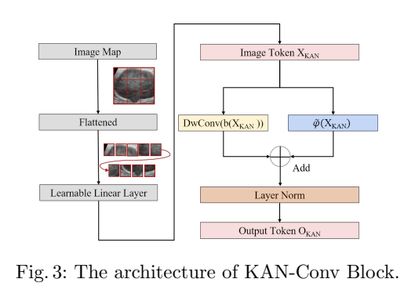
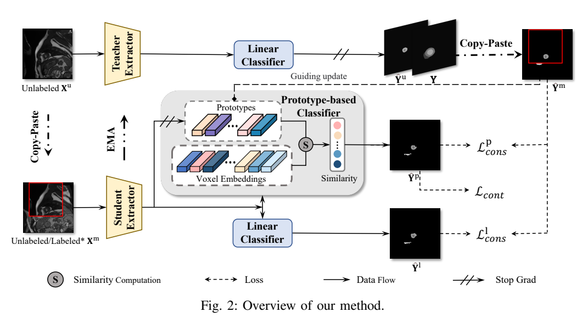
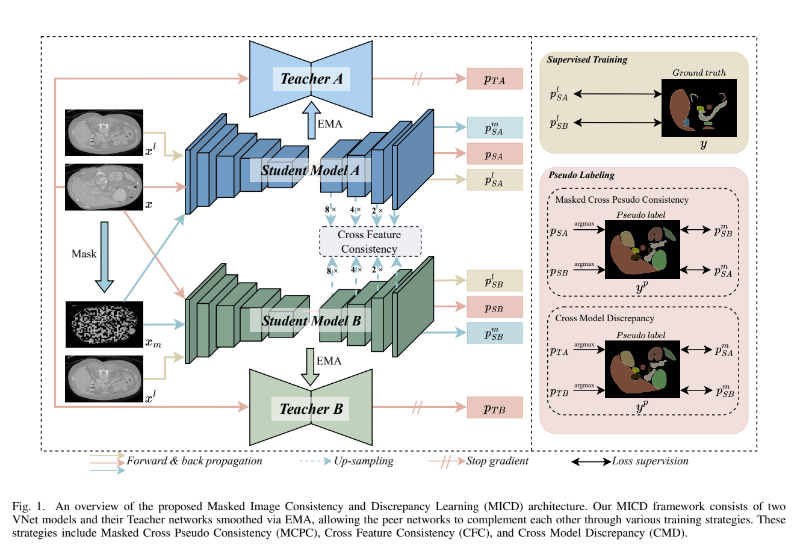

# arXiv 检索结果 / Results

## 1. Semi-KAN: KAN Provides an Effective Representation for Semi-Supervised Learning in Medical Image Segmentation
- Authors：Zanting Ye, Xiaolong Niu, Xuanbin Wu, Wenxiang Yi, Yuan Chang, Lijun Lu
- Comments：18 pages, 7 figures, 6 tables
- First：2025-03-19T08:27:41+00:00；Latest：2025-03-19T08:27:41+00:00
- Abs：https://arxiv.org/abs/2503.14983v1
- PDF：https://arxiv.org/pdf/2503.14983v1
- Code：https://huggingface.co/huggingface, https://huggingface.co/docs/hub/spaces
- 解读来源：PDF 全文，共 18 页，18 页可提取文字
### [中文]
**中文翻译**
- 标题：Semi-KAN：KAN为医学图像分割中的半监督学习提供有效表示
- 摘要：基于深度学习的医学图像分割已取得显著成功；然而，它通常需要大量像素级标注，这既昂贵又耗时。半监督医学图像分割（SSMIS）提供了一种可行的替代方案，这得益于CNN和ViT的进展。然而，这些网络通常依赖单一固定激活函数和线性建模范式，限制了其有效学习鲁棒表示的能力。鉴于标注数据有限，实现鲁棒表示学习变得至关重要。受Kolmogorov-Arnold网络（KAN）启发，我们提出Semi-KAN，利用KAN尚未挖掘的潜力来增强SSMIS中用于表示学习的主干架构。我们的发现表明：(1) 与具有固定激活函数的网络相比，KAN在参数更少的情况下展现出更优的表示学习能力；(2) KAN在高语义特征空间中表现出色。基于这些见解，我们将KAN集成到标记化的中间表示中，在U-Net流程中将其有选择地应用于编码器瓶颈和解码器顶层，以提取高层语义特征。尽管可学习激活函数改善了特征扩展，但它们带来了显著的计算开销，而性能提升仅 marginal。为缓解这一问题，我们降低特征维度并采用水平扩展以捕获多种模式表示。此外，我们设计了一种具有不确定性估计的多分支U-Net架构，以有效学习多样化的模式表示。在四个公开数据集上的大量实验表明，Semi-KAN优于基线网络，同时使用更少的KAN层和更低的计算成本，从而凸显了KAN作为SSMIS一种有前景方法的潜力。

Semi-KAN 将 KAN 的可学习激活函数选择性嵌入 U-Net 的编码器瓶颈与解码器顶层，以共享编码器、多解码器架构和基于不确定性的一致性损失进行半监督医学图像分割；在 GlaS、BUSI、CVC、ACDC 四个公开数据集上，10% 标注时 Dice 分别达 85.57%、64.21%、54.41%、84.91%，优于 MC-Net+ 与 AC-MT，但边界指标在较高标注率下不及 AC-MT；消融显示可学习激活函数在 GlaS 10% 标注下较 ReLU 提升 Dice 5.16 个百分点。

## 1. 问题与动机

论文针对半监督医学图像分割（SSMIS）中标注稀缺的问题：像素级标注昂贵耗时，而现有 CNN/ViT 主干依赖固定激活函数与线性建模模式，在仅 5% 或 10% 标注时难以学到鲁棒表示 [p. 1]。作者认为 KAN 在边上放置可学习激活函数、以样条函数增强非线性表示，可能弥补这一不足；但 KAN 计算开销大，因此需要研究“用在哪里、用多少” [p. 2-3]。作者还指出 KAN 的可解释性在医学图像任务中尚未被具体实现 [p. 3, p. 8]。

## 2. 方法

**整体架构**：Semi-KAN 采用共享编码器 + 多独立解码器的 U-Net 流程；不同解码器使用不同上采样策略作为扰动，输出概率图平均后作为伪标注 [p. 5, Fig. 2]。编码器与解码器均结合 CNN 与 KAN：前三个卷积块处理高分辨率、弱语义特征；KAN 仅用于编码器底部（瓶颈）与解码器顶层，即高语义特征空间 [p. 3, p. 5-6]。

**卷积块**：3×3 卷积 + BN + ReLU，记为 O_Conv = ReLU(BN(Conv(x)))（式 1）[p. 5-6]。

**KAN-Conv Block**（Fig. 3, p. 6）：卷积块输出经 Tokenization 切成扁平 2D patch，再经可训练线性投影 E 嵌入 D 维潜空间，得到 X_KAN = E(Tokenization(O_Conv))（式 3），多个 patch 拼接为式 4。KAN 层与深度可分离卷积（DwConv）并联/组合，输出由式 5 给出：Y_{n,i,j} = Σ_n Σ_i Σ_j φ_{n,j,i} X_{n,s+i,q+j}，其中 P 为 patch 大小、N=hw/P²、k 为核大小，每个 φ 是带独立可训练参数的单变量非线性函数 [p. 6-7]。φ 的构造为 φ = w_b·b(x) + φ̃(x)，φ̃(x)=w_s·Spline(x)，b(x)=SiLU(x)（式 6-8）；作者沿用原始 KAN 的样条设置 [p. 7]。

**不确定性一致性损失**：对每个解码器输出先做锐化 p′(y|x;ε)=p^{1/T}/(p^{1/T}+(1-p)^{1/T})（式 9），T 为温度超参数；再对 B 个解码器求平均得伪标注 p_avg（式 10）。不确定性 U_b = Σ_a Σ_b p′_{ab}·log(p′_{ab}/p_avg)（式 11）[p. 7]。一致性损失 L_consistency = ∂·L_uncertainty + (1−∂)·L_rectify（式 12），其中 L_uncertainty 为 U_b 的均值（式 13），L_rectify 为按权重 ϖ_ab=e^{−U_ab} 加权的预测与伪标注差异（式 14）；作者称 L_rectify 强调可靠预测、忽略不可靠预测，L_uncertainty 降低预测熵 [p. 8]。注意：式 14 在正文中再次被标为“L_uncertainty”，疑为排版笔误，按上下文应为 L_rectify；∂、T、B 的具体取值未在正文报告。

**可解释性设计**：共享编码器保证高层语义一致，独立解码器通过任务特定激活函数捕捉不同模式；使用最少特征通道与可学习 B 样条激活，便于剪枝冗余节点 [p. 8]。

## 3. 贡献

作者主张：(1) 首次将 KAN 引入 SSMIS；(2) 发现 KAN 在更少参数下表示学习更强、且在高语义特征空间更有效，据此选择性放置 KAN；(3) 通过降低特征维度与水平扩展（多分支）平衡性能与计算；(4) 设计带不确定性估计的多分支 U-Net；(5) 提出面向医学图像的可解释性方案 [p. 1, p. 3, p. 8]。我的解读：核心工程贡献是“KAN 的稀疏、分层放置 + 多解码器一致性”，而非新的半监督范式；所谓“首次”与“可解释性”多为架构层面的主张，正文未给出系统的可解释性量化评估。

## 4. 实验与结果

**数据集与设置**：BUSI、GlaS、CVC-ClinicDB、ACDC 四个公开数据集；BUSI/GlaS/CVC 沿用 [14] 预处理，ACDC 沿用 [16]；图像重采样至 512×512；标注比例 10%（ACDC 额外 5%）[p. 8-9]。训练用 PyTorch、RTX 3090（24GB）、Adam、batch size 32、momentum 0.9、weight decay 0.001、最多 800 epochs [p. 9]。评价指标：Dice、Jaccard、HD95、ASD；对比 MC-Net+、AC-MT，并以 100% 标注的 U-Net 作为上界 [p. 9]。

**主要结果**（正文叙述与表格）：GlaS 50% 标注 Dice 91.04%、Jaccard 84.51%；10% 标注 Dice 85.57%、Jaccard 74.79%，较 MC-Net+ 提升 4.66/4.65 个百分点 [p. 9]。BUSI 10% 标注 Dice 从 MC-Net+ 的 60.96% 提升到 64.21% [p. 10, p. 12]。ACDC 5% 标注 Dice 65.67%、Jaccard 52.80%、HD95 14.67、ASD 4.49，较次优方法提升 4.80/2.61 个百分点、1.02/0.58 voxel [p. 12]。表 1-4 的排版在文本中严重错乱（多列数字交错），例如表 1 中 Semi-KAN 行出现“64.21 ↑ 85.57 ↑ 3.25 4.66 48.32 ↑ 74.79 ↑ 2.10 4.65 8.33 ↑ 5.23 ↓ 1.41 0.72 2.95 ↓ 3.89 ↑ 0.11 0.12”等无法可靠对齐的数值，故除正文明确复述的数字外，不逐格引用表格 [p. 10-11]。

**边界表现**：作者承认 AC-MT 在边界分割上有优势：10% 标注时 Semi-KAN 为 HD95 8.87、ASD 3.99，AC-MT 为 9.90、4.35；但 20% 标注时 CVC 上 AC-MT 的 HD95/ASD 比 Semi-KAN 好 0.95/0.24 voxel，50% 时好 1.6/0.29 voxel，作者归因于 AC-MT 的双网络教师-学生监督与边界优化策略，但代价是计算量显著增加 [p. 13]。

**消融**：(1) 激活函数：GlaS 10% 标注下，Semi-KAN（KAN 层）Dice 85.57%、Jaccard 74.79%、HD95 5.23、ASD 3.89；ReLU 版为 80.41%、66.38%、7.10、4.02；Att-Unet(ReLU) 为 79.87%、66.01%、5.95、3.08。作者称 Dice 提升 5.16、Jaccard 提升 8.41、HD95 降低 1.87 voxel；20%/50% 标注下也保持优势 [p. 13, Table 5]。(2) 全监督表示能力：与 U-KAN 在 100% 标注下比较，ACDC Dice 92.05 vs 91.65（Jaccard 83.24 vs 84.93，Jaccard 反而下降）；GlaS 93.71 vs 91.85；BUSI 79.02 vs 75.73；CVC 90.92 vs 88.92 [p. 15, Table 6]。(3) 与 Att-Unet 在不同标注率下比较，作者称 Semi-KAN 在 Dice、Jaccard、HD95 上更优 [p. 15]。

**可解释性观察**：作者将最高语义层（16×16）上采样至 256×256 叠加原图，称特征与解剖边界对齐；解码器激活函数呈现跨分支一致的 B 样条模式 [p. 13, Fig. 6-7]。这些为定性观察，未报告量化指标。

## 5. 评估

支持的结论：在四个数据集、5%-50% 标注预算下，Semi-KAN 的 Dice/Jaccard 总体优于 MC-Net+ 与 AC-MT；可学习激活函数相对 ReLU 的增益在 GlaS 10% 标注下有明确数字支持；全监督下相对 U-KAN 在三个数据集 Dice 更高。局限与缺失证据：(1) 表 1-4 排版错乱，许多数值无法与条件可靠对应，正文只复述了部分数字；(2) 未报告 ∂、T、B、KAN 层数/样条阶数、各数据集具体划分与预处理细节、参数量与训练时间，Fig. 1 的 GFLOPs 数值在正文中不可读 [p. 2]；(3) 边界指标在 20%/50% 标注下不及 AC-MT，作者以计算成本解释，但未给出公平的计算量对比表；(4) “可解释性”仅定性展示，未做剪枝实验或临床可用性评估；(5) 全监督 ACDC 上 Jaccard 低于 U-KAN，说明优势并非全面。

## 6. 复现

已报告：PyTorch、RTX 3090 24GB、Adam、batch size 32、momentum 0.9、weight decay 0.001、最多 800 epochs、输入 512×512、标注比例 5%/10%/20%/50%、四个数据集及预处理来源 [p. 8-9]。未报告：学习率、损失权重 ∂、温度 T、解码器数 B、KAN 样条阶数与网格数、KAN 层具体通道数、数据划分与随机种子、推理 GFLOPs 与参数量、代码/权重链接。复现时需先向作者确认这些超参数，并注意表 1-4 的数值错位问题。

#### 原论文流程图 · Figure 3 · PDF 第 6 页

Fig.3: The architecture of KAN-Conv Block.

[原文来源](https://arxiv.org/pdf/2503.14983v1#page=6)

## 2. Multi-Prototype Embedding Refinement for Semi-Supervised Medical Image Segmentation
- Authors：Yali Bi, Enyu Che, Yinan Chen, Yuanpeng He, Jingwei Qu
- First：2025-03-18T15:23:52+00:00；Latest：2025-03-18T15:23:52+00:00
- Abs：https://arxiv.org/abs/2503.14343v1
- PDF：https://arxiv.org/pdf/2503.14343v1
- Code：https://github.com/Briley-byl123/MPER, https://huggingface.co/huggingface, https://huggingface.co/docs/hub/spaces
- 解读来源：PDF 全文，共 6 页，6 页可提取文字
### [中文]
**中文翻译**
- 标题：面向半监督医学图像分割的多原型嵌入细化
- 摘要：医学图像分割旨在在体素级别识别解剖结构。分割精度依赖于区分体素差异。与类间方差研究中取得的进展相比，类内方差受到的关注较少。此外，传统线性分类器受限于每个类别仅有一个可学习权重，难以捕捉这种更精细的区分。为应对上述挑战，我们提出了一种基于多原型的嵌入细化方法，用于半监督医学图像分割。具体而言，我们设计了一种基于多原型的分类策略，从体素嵌入之间的结构关系角度重新思考分割问题。通过沿每个类别中多个原型的分布对体素进行聚类，来探索类内变化。接着，我们引入一致性约束以缓解线性分类器的局限性。该约束整合了来自线性分类器和所提出的基于原型的分类器的不同分类粒度。在两个常用基准上的全面评估中，我们的方法相比最先进方法取得了更优性能。代码可在 https://github.com/Briley-byl123/MPER 获取。

论文提出多原型嵌入细化（MPER）用于半监督医学图像分割：在Mean Teacher框架下，用每类K个原型对体素嵌入做更细粒度分类，并与线性分类器做一致性约束，另加InfoNCE对比损失和基于证据理论的置信度加权原型更新。在LA（5%/10%标注）和ACDC（5%/10%标注）上，Dice分别达88.82%/90.01%和88.64%/89.69%，优于BCP等SOTA；消融显示K=3最优，且同时使用有/无标注体素更新原型最好。

# 多原型嵌入细化用于半监督医学图像分割：详细阅读笔记

## 1. 问题与动机

论文关注半监督医学图像分割。作者指出，分割精度依赖区分体素差异，但既有工作更多研究类间差异（inter-class variance），对同一类内部体素差异（intra-class variance）关注不足[p. 1]。同时，传统线性分类器每类只学习一个权重向量，难以刻画同类体素之间的语义歧义，从而限制了对类内变化的建模[p. 1]。

作者还认为，现有半监督方法（一致性正则、熵最小化、伪标签等）在类内体素差异方面进展有限，且缺乏处理不确定性的原则性方式，在模糊区域可能产生不可靠预测[p. 1]。原型学习虽已被引入半监督分割，但通常每类只生成一个原型（对体素嵌入做掩码平均池化），难以描述类内变化[p. 1]。因此，论文提出用每类多个原型形成子中心，从体素嵌入的结构关系角度重新思考分割，并用线性分类器与原型分类器之间的一致性约束整合不同分类粒度[p. 1-2]。

## 2. 方法

### 2.1 总体框架

方法基于经典Mean Teacher[p. 2]，采用两阶段训练：预训练与自训练。预训练阶段用有标注图像训练监督特征提取器，并采用Copy-Paste增强：随机裁剪一幅图像粘贴到另一幅上得到混合图像[p. 2]。教师与学生网络的提取器都用预训练特征提取器初始化；教师处理无标注图像 Xu 生成伪标签 Ŷu，权重通过学生网络的指数滑动平均（EMA）更新[p. 2]。学生接收双向Copy-Paste生成的混合图像 Xm（无标注图像 Xu 随机裁剪粘贴到有标注图像 Xl 上，或反之），由学生提取器得到嵌入 Z ∈ R^{H×W×D×d}[p. 2]。原型分类器基于 Z 预测 Ŷp，线性分类器预测 Ŷl；真实标签 Y 与伪标签 Ŷu 按同样方式混合得到混合标签 Ŷm，作为学生网络的监督[p. 2]。

### 2.2 多原型分类器

每类定义 K 个原型，第 c 类第 k 个原型记为 p_k^c ∈ R^d，c∈{0,…,C−1}，k∈{0,…,K−1}[p. 2]。对体素嵌入 z，计算其与所有原型的余弦相似度，取每类中最高相似度组成相似度向量，再经温度 τ1 的 softmax 得到概率：

ŷ_p^c = exp(sim(z, p^{k*})/τ1) / Σ_{c'} exp(sim(z, p^{k*}_{c'})/τ1)，

其中 k* 是每类中相似度最高的原型索引，sim(·,·) 为余弦相似度[p. 2]。最高相似度原型所属类别即体素预测类别[p. 2]。

原型初始化采用MiniBatchKMeans对体素嵌入聚类[p. 2]。更新采用动量策略：先用混合标签 Ŷm 分类体素，再按与多原型的最高相似度把每类体素分成若干簇，最后用簇内体素嵌入均值更新原型：p_{t+1} = η p_t + (1−η) z̄_t[p. 2-3]。其中 z̄_t 是第 t 次迭代簇的平均嵌入，η∈(0,1) 控制更新速率[p. 3]。计算均值时，无标注体素只保留伪标签置信度超过阈值 α 的嵌入，并与有标注体素嵌入一起计算，以保证使用可靠嵌入[p. 3]。

### 2.3 一致性约束与训练目标

线性分类器通过 softmax 线性层给出概率：ŷ_l^c = exp(w_c^T z) / Σ_{c'} exp(w_{c'}^T z)，w_c 为第 c 类可学习权重[p. 3]。作者认为线性分类器在早期训练中对噪声和数据不完整更稳健，有助于稳定和加速收敛[p. 3]。

一致性约束包含线性一致性损失 L_cons^l 和原型一致性损失 L_cons^p，二者均由交叉熵损失 L_ce 与Dice损失 L_dice 实现：L_cons^* = L_ce(Ŷ*, Ŷm) + L_dice(Ŷ*, Ŷm)，* 表示 l 或 p[p. 3]。教师给出的混合标签 Ŷm 作为桥梁，对齐两个分类器的预测[p. 3]。

此外设计基于InfoNCE的对比损失 L_cont：每个体素嵌入 z 为查询，所有原型为键；z 与其最接近原型 p* 构成正对，其余原型为负样本：L_cont = −log[exp(z^T p*/τ2) / Σ_{c,k} exp(z^T p_k^c/τ2)][p. 3]。

总损失为 L = L_cons^l + λ(t)(L_cons^p + γ L_cont)[p. 3]。γ 控制对比损失相对重要性；λ(t) 为Sigmoid Ramp-up动态权重，从0增至1，使训练初期依赖线性预测保持稳定，随后逐步增强原型预测作用[p. 3]。

### 2.4 证据理论相关描述

引言提到用证据理论为体素预测分配置信分数、动态分配 belief mass 以缓解模糊区域影响[p. 2]，但方法章节没有给出证据理论的具体公式或模块实现；正文可辨认的方法主体是上述多原型分类、一致性约束与对比损失。因此，证据理论在本文中更像动机性叙述，其具体实现细节在提供文本中未报告。

## 3. 贡献

作者声称的贡献包括：提出多原型分类策略，通过体素沿多原型分布聚类来探索类内变化；提出线性分类器与原型分类器之间的一致性约束，整合不同分类粒度；在LA和ACDC两个基准上取得优于SOTA的性能[p. 1-2]。

我的解读是：核心新颖点在于把“每类单原型”扩展为“每类K个原型”，并用动量聚类更新原型，同时用混合伪标签把线性分类器和原型分类器对齐；对比损失进一步拉近体素与最近原型。证据理论在摘要和引言中被强调，但方法部分缺乏可复现的公式，因此其实际贡献强度在文本证据上弱于多原型与一致性约束。

## 4. 实验与结果

### 4.1 数据集与设置

在LA和ACDC两个基准上评估[p. 3]。LA使用3D V-Net作为特征提取器，ACDC使用2D U-Net[p. 3]。LA训练数据为随机裁剪的112×112×80图像块，掩码零值区域定义为74×74×53，并应用旋转、翻转等增强；ACDC随机裁剪的掩码零值区域为170×170[p. 4]。所有实验设 η=0.999、α=0.9、τ1=τ2=0.1、K=3[p. 4]。数据集相关超参数：γ=0.02、0.1；batch size为8和24；预训练2k和10k迭代；自训练15k和30k迭代；使用NVIDIA GeForce RTX 4090[p. 4]。论文未明确说明γ、batch size、迭代数分别对应哪个数据集，也未报告优化器、学习率等细节。

### 4.2 主要结果

LA上，5%标注（4例有标注、76例无标注）时，本文方法Dice 88.82%、Jaccard 80.00%、95HD 7.40、ASD 2.02；10%标注（8例有标注、72例无标注）时Dice 90.01%、Jaccard 81.94%、95HD 6.51、ASD 1.74[p. 4, Table I]。对比BCP在5%时Dice 88.02%、10%时89.62%[p. 4]。

ACDC上，5%标注（3例有标注、67例无标注）时Dice 88.64%、Jaccard 80.21%、95HD 1.51、ASD 0.60；10%标注（7例有标注、63例无标注）时Dice 89.69%、Jaccard 81.88%、95HD 1.65、ASD 0.56[p. 4, Table II]。作者指出，仅用10%标注时，相比全标注U-Net的Dice仅下降1.75%[p. 4]；全标注U-Net在ACDC上Dice为91.44%[p. 4, Table II]。

定性结果：图3和图4分别展示LA的3D分割可视化和ACDC的2D分割可视化，作者称在10%标注下本文方法更精确[p. 4]。图5为ACDC上的t-SNE可视化，作者称使用20%标注数据时，本文方法对Class 1得到更紧凑的嵌入[p. 4]。这些图的具体图像内容未作为模型输入，本文仅依据图注和正文描述。

### 4.3 消融实验

损失消融在ACDC 5%标注下进行[p. 4, Table III]：仅 L_cons^l 时Dice 87.18%、Jaccard 78.02%、95HD 3.73、ASD 1.07；加 L_cons^p 后Dice 88.05%、Jaccard 79.26%、95HD 2.73、ASD 0.80；再加 L_cont 后Dice 88.64%、Jaccard 80.21%、95HD 1.51、ASD 0.60[p. 5]。该消融支持两个一致性损失和对比损失逐步带来提升。

原型更新消融在LA 10%标注下进行[p. 5, Table IV]：无更新时Dice 89.55%、Jaccard 81.25%、95HD 6.83、ASD 1.73；仅用有标注体素更新时Dice 89.76%、Jaccard 81.53%、95HD 6.79、ASD 1.80；仅用无标注体素更新时Dice 89.57%、Jaccard 81.25%、95HD 7.10、ASD 1.79；同时使用两者时Dice 90.01%、Jaccard 81.94%、95HD 6.51、ASD 1.74[p. 5]。作者据此认为联合更新能构建更有代表性的原型并适应数据分布变化[p. 5]。

原型数量消融在ACDC 5%标注下进行[p. 5, Table V]：K=1时Dice 87.10%、Jaccard 77.93%、95HD 3.32、ASD 1.05；K=2时87.52%、78.45%、2.59、0.87；K=3时88.64%、80.21%、1.51、0.60；K=4时88.11%、79.43%、2.87、0.83；K=5时87.98%、79.18%、3.00、0.76[p. 5]。作者推测过多子中心破坏紧凑性，故取K=3以平衡精度与计算成本[p. 5]。

## 5. 评估

支持的结论：在报告的两个数据集和给定标注比例下，多原型分类器、两个一致性损失和对比损失均带来指标改善；K=3优于K=1、2、4、5；联合使用有标注与无标注体素更新原型在LA 10%设置下优于三种替代方案。主要结果在Dice、Jaccard、95HD、ASD上与BCP等SOTA相比具有竞争力[p. 4-5]。

局限与缺失证据：论文只有6页，方法部分未给出证据理论的具体实现，摘要中“uncertainty modeling”的贡献缺乏可复现细节；未报告多次运行的均值/方差或统计显著性；未报告优化器、学习率、预训练与自训练超参数到数据集的明确对应；消融大多只在单一数据集、单一标注比例下进行，跨数据集泛化证据有限；t-SNE和可视化仅以文字描述，未提供定量支撑。此外，Table IV中“Unabeled”为原文拼写，且仅用有标注体素更新时ASD反而略差于无更新，说明部分指标趋势并不完全一致。

## 6. 复现

可复现的已报告设置：Mean Teacher框架；LA用3D V-Net、ACDC用2D U-Net；LA图像块112×112×80、掩码零值区域74×74×53；ACDC掩码零值区域170×170；η=0.999、α=0.9、τ1=τ2=0.1、K=3；γ=0.02/0.1、batch size=8/24、预训练2k/10k迭代、自训练15k/30k迭代；RTX 4090；代码链接见摘要[p. 1, 4]。未报告：优化器类型与学习率、权重衰减、EMA具体更新式、MiniBatchKMeans的簇数/初始化细节、λ(t)的Sigmoid具体形式、证据理论模块实现、随机种子与重复次数、推理与后处理细节。复现时应优先按上述已报告超参数搭建Mean Teacher与双向Copy-Paste流程，并注意γ、batch size、迭代数与数据集的对应关系在原文中未明确，需要向作者代码确认。

#### 原论文流程图 · Figure 2 · PDF 第 3 页

Fig. 2: Overview of our method.

[原文来源](https://arxiv.org/pdf/2503.14343v1#page=3)

## 3. Boosting Semi-Supervised Medical Image Segmentation via Masked Image Consistency and Discrepancy Learning
- Authors：Pengcheng Zhou, Lantian Zhang, Wei Li
- First：2025-03-18T08:20:35+00:00；Latest：2025-03-18T08:20:35+00:00
- Abs：https://arxiv.org/abs/2503.14013v1
- PDF：https://arxiv.org/pdf/2503.14013v1
- Code：https://huggingface.co/huggingface, https://huggingface.co/docs/hub/spaces
- 解读来源：PDF 全文，共 6 页，6 页可提取文字
### [中文]
**中文翻译**
- 标题：通过掩码图像一致性和差异学习提升半监督医学图像分割
- 摘要：半监督学习通过利用未标注数据在医学图像分割中具有重要意义。在其策略中，协同训练框架尤为突出。然而，以往的协同训练研究主要集中于网络初始化差异和伪标签生成，而忽视了信息交换与模型多样性保持之间的平衡。本文提出了掩码图像一致性与差异学习（MICD）框架，包含三个关键模块。掩码交叉伪一致性（MCPC）模块通过跨掩码输入分支的伪标签丰富上下文感知和小样本学习。交叉特征一致性（CFC）模块通过确保解码器特征一致性增强信息交换和模型鲁棒性。交叉模型差异（CMD）模块利用EMA教师网络监督输出并保持分支多样性。这些模块共同通过关注细粒度局部信息和在异构框架中保持多样性来解决现有局限。在两个公开医学图像数据集AMOS和Synapse上的实验表明，我们的方法优于最先进的方法。

MICD 是一个用于半监督医学图像分割的双分支协同训练框架，包含三个模块：MCPC 用一支分支对原图生成的伪标签监督另一支分支对掩码图的预测；CFC 约束两个学生模型在解码器四层特征上的一致性；CMD 用各自的 EMA 教师网络监督学生输出以保持分支多样性。在 AMOS 数据集 5% 标签下，MICD 的 Avg. Dice 为 56.11%，比 DHC 的 49.53% 高 6.58 个百分点；在 2% 和 10% 标签下分别为 42.75% 和 66.39%。在 Synapse 数据集 20% 和 40% 标签下，Avg. Dice 分别为 54.1% 和 65.83%。消融实验显示，MCPC 单独带来 4.34 个百分点的 Dice 提升，三个模块组合带来 6.58 个百分点的提升。

# MICD：掩码图像一致性与差异学习的半监督医学图像分割阅读笔记

## 1. 问题与动机

论文关注半监督医学图像分割：标注 3D 医学体数据成本高，因此希望利用少量标注数据和大量无标注数据训练分割模型 [p. 1]。作者将协同训练（co-training）视为主要路线：两个不同初始化的网络互相为对方生成伪标签。作者指出，已有协同训练工作主要关注网络初始化差异和伪标签生成，却忽视了“信息交换”与“模型多样性保持”之间的平衡；模型可能过早耦合，无法从不同特征视角学习，导致特征提取次优、泛化受限 [p. 1]。

作者还提到，教师—学生式平均教师方法可能因领域特定迁移而收敛到相似局部极小值并产生确认偏差，因此转向双分支协同训练 [p. 1]。本文要解决的问题是：在双分支异构框架中，既让分支间充分交换信息，又保持分支差异，并提升对细粒度局部信息和少数类的分割能力。

## 2. 方法

### 2.1 总体框架

MICD 使用两个 VNet 学生模型 AS 和 BS，参数分别为 θA、θB；另有两个由学生权重经指数滑动平均（EMA）得到的教师模型 AT 和 BT [p. 2]。EMA 更新为 θ′t = αθ′t + (1−α)θt，其中 t 为训练迭代，α 控制更新率 [p. 2]。两个学生采用两种不同加权方式 Wdiff 和 Wdist 初始化训练差异，具体做法沿用 DHC [p. 2]。图 1（第 3 页）给出整体结构：两个 VNet 学生、两个 EMA 教师，以及 MCPC、CFC、CMD 三种训练策略。

掩码算子定义为 xm = M(r,s) ⊙ x，其中 r 为掩码比例，s 为掩码块大小（文中举例 3×3×3）[p. 2]。

### 2.2 Masked Cross Pseudo Consistency（MCPC）

对输入 xi（来自标注集或无标注集），先得到掩码图 xmi = M ⊙ xi，再分别送入两个学生模型，得到 pmASi = f(xmi; θA) 和 pmBSi = f(xmi; θB)，并用 argmax 得到伪标签 ŷmASi、ŷmBSi [p. 2]。MCPC 损失为：

Lcps = (1/(N+M)) Σi [ Wdiffi · Lce(pASi, ŷmBSi) + Wdisti · Lce(pBSi, ŷmASi) ]

即一支分支对原图的预测 pASi / pBSi 去匹配另一支分支对掩码图的伪标签，从而在掩码输入分支之间进行交叉伪标签监督 [p. 2]。作者的设计意图是：掩码迫使模型关注不同区域，增强上下文理解和小样本感知，促进更准确的像素级预测 [p. 1]。

### 2.3 Cross Feature Consistency（CFC）

作者认为仅靠伪监督会丢失信息，因此增加解码器特征一致性约束。两个学生从解码器四层提取特征 dAS1i…dAS4i 和 dBS1i…dBS4i，CFC 损失为：

Lcon = (1/(N+M)) Σi Σk=1..4 λk · Lkl(dASk,i, dBSk,i)

其中 Lkl 为 KL 散度，λk = 0.2 × k（k=1,2,3,4），即越深的解码器层权重越大，理由是深层特征更抽象、语义更丰富 [p. 2]。该模块用于在输入扰动下保持两分支解码器特征一致，增强信息交换和模型鲁棒性 [p. 1–2]。

### 2.4 Cross Model Discrepancy（CMD）

CMD 用教师模型监督各自的学生分支，以保持分支多样性。教师 AT、BT 对原图 xi 计算 pATi、pBTi，并取 argmax 得到伪标签 ŷATi、ŷBTi；学生 AS、BS 对掩码图 xmi 计算 pmASi、pmBSi。差异损失为：

Ldis = (1/(N+M)) Σi [ Lce(pmASi, ŷATi) + Lce(pmBSi, ŷBTi) ]

作者称最小化该损失可让学生在教师指导下学习，同时保持与教师的一定差异，从而保留双分支多样性 [p. 3]。

### 2.5 总体目标

监督损失 Lsup 在标注数据上结合交叉熵 Lce 和 Dice 损失 Ldice，并用 Wdiffi、Wdisti 平衡两个学生分支的贡献 [p. 4]。总损失为：

Ltotal = Lsup + β(Lcps + Lcon + Ldis)

β 采用随 epoch 变化的高斯 ramp-up 策略（引用 CLD）[p. 4]。

## 3. 贡献

作者声称的贡献有三点：提出 MICD 半监督框架，兼顾细粒度局部信息和异构框架中的多样性；提出 MCPC 捕捉细粒度局部语义并强调少数类，CFC 保证稳定性和信息交换，CMD 借助 EMA 防止过早耦合；在 AMOS 和 Synapse 两个公开数据集上优于 SOTA [p. 2]。

我的解读：本文的核心工程点是把“掩码输入 + 跨分支伪标签”与“解码器多层特征一致性”和“教师—学生差异保持”组合进 DHC 式双分支协同训练。MCPC 的交叉监督方向（原图预测匹配掩码图伪标签）与常见“掩码图预测匹配原图伪标签”不同，但论文没有单独消融这一方向选择，因此其必要性属于作者主张而非已被实验分离验证的结论。

## 4. 实验与结果

### 4.1 数据集与设置

AMOS 含 360 例 CT、15 个前景类；Synapse 含 30 例增强腹部 CT、13 个前景类；数据划分沿用 DHC [p. 4]。Synapse 因样本少，用不同随机种子做三折验证 [p. 4]。骨干为 CNN 的 VNet；SGD，动量 0.9，初始学习率 0.01，poly 衰减；batch size 为 2（1 个标注样本 + 1 个无标注样本）；Python 3.8.19、PyTorch 2.2、RTX 4090、CUDA 11.8 [p. 4]。评价指标为 Avg. Dice、Avg. ASD 和每类平均 Dice [p. 4]。

### 4.2 主要结果

AMOS 5% 标签（表 I）：MICD 的 Avg. Dice 为 56.11%，Avg. ASD 为 16.22；DHC 为 49.53%，提升 6.58 个百分点 [p. 4–5]。表 I 中多数类上 MICD 领先，但左肾上腺（LAG）、肝脏（Li）、前列腺/子宫（P/U）除外 [p. 5]。作者称在胆囊、食管、胰腺、右肾上腺、十二指肠、膀胱等较小少数类上表现突出 [p. 5]。

AMOS 2% 和 10% 标签（表 II）：MICD 的 Avg. Dice 分别为 42.75% 和 66.39%，相比 DHC 的 38.28% 和 64.16% 分别提升 4.47 和 2.23 个百分点 [p. 5]。

Synapse 20% 和 40% 标签（表 III）：MICD 的 Avg. Dice 分别为 54.1% 和 65.83%，相比 DHC 的 48.61% 和 57.13% 分别提升 5.49 和 8.7 个百分点；对应 Avg. ASD 为 9.32 和 5.99 [p. 5]。

### 4.3 消融

表 IV 在 AMOS 5% 标签下做模块消融：基线（无三模块）Dice 49.53%；仅 MCPC 为 53.87%（+4.34）；MCPC+CFC 为 54.56%（较仅 MCPC +0.69）；MCPC+CMD 为 55.02%（较仅 MCPC +1.15）；三者全用为 56.11%（较基线 +6.58）[p. 5]。这些结果支持三个模块组合有效，但表中未给出仅 CFC、仅 CMD 的完整对照数字（表 IV 的排版在提供的文本中不完整，部分单元格无法辨认），因此无法从所给文本判断各模块单独贡献。

## 5. 评估

支持的结论：在作者报告的设置下，MICD 在 AMOS 2%/5%/10% 和 Synapse 20%/40% 标签预算上均取得高于所列基线的 Avg. Dice，且消融显示三模块组合优于基线。

局限与缺失证据：论文未报告 α、掩码比例 r、掩码块大小 s、β 的具体数值或搜索范围；未报告训练 epoch 数、图像预处理/裁剪尺寸、推理方式；未报告参数量、训练时间或显存开销。Synapse 只报告 20% 和 40% 两档，AMOS 未报告 20%/40%。表 I 和表 IV 在提供的文本中排版错乱，部分数字无法可靠对应到方法或模块组合，本文只引用可辨认的数字。作者未讨论失败案例或跨数据集泛化到其他模态的实验。

## 6. 复现

可复现的设置：VNet 骨干；SGD（动量 0.9，初始 lr 0.01，poly 衰减）；batch size 2（1 标注 + 1 无标注）；EMA 教师；λk = 0.2k；β 用高斯 ramp-up；数据划分沿用 DHC；Synapse 三折不同随机种子；PyTorch 2.2 / CUDA 11.8 / RTX 4090 [p. 2–4]。未报告：α、r、s、β 的具体值、训练轮数、输入 patch 大小、数据增强细节、推理与后处理、代码或超参搜索协议。复现时需向作者索取这些细节，或按 DHC 的公开实现补齐划分与训练配置。

#### 原论文流程图 · Figure 1 · PDF 第 3 页

Fig. 1. An overview of the proposed Masked Image Consistency and Discrepancy Learning (MICD) architecture. Our MICD framework consists of two VNetmodelsandtheirTeachernetworkssmoothedviaEMA,allowingthepeernetworkstocomplementeachotherthroughvarioustrainingstrategies.These strategiesincludeMaskedCrossPseudoConsistency(MCPC),CrossFeatureConsistency(CFC),andCrossModelDiscrepancy(CMD).

[原文来源](https://arxiv.org/pdf/2503.14013v1#page=3)

## 4. Striving for Simplicity: Simple Yet Effective Prior-Aware Pseudo-Labeling for Semi-Supervised Ultrasound Image Segmentation
- Authors：Yaxiong Chen, Yujie Wang, Zixuan Zheng, Jingliang Hu, Yilei Shi, Shengwu Xiong, Xiao Xiang Zhu, Lichao Mou
- Venue：MICCAI 2024
- Comments：MICCAI 2024
- First：2025-03-18T07:44:09+00:00；Latest：2025-03-18T07:44:09+00:00
- Abs：https://arxiv.org/abs/2503.13987v1
- PDF：https://arxiv.org/pdf/2503.13987v1
- Code：https://github.com/WUTCM-Lab/Shape-Prior-Semi-Seg, https://huggingface.co/huggingface, https://huggingface.co/docs/hub/spaces, https://github.com/WUTCM-Lab/
- 解读来源：PDF 全文，共 11 页，11 页可提取文字
### [中文]
**中文翻译**
- 标题：追求简洁：简单而有效的先验感知伪标签方法用于半监督超声图像分割
- 摘要：医学超声成像无处不在，但人工分析难以跟上需求。自动分割可以提供帮助，但需要大量标注数据，而这类数据十分稀缺。利用无标注数据和有限标注数据的半监督学习是一种有前景的方法。现有最先进方法使用一致性正则化或伪标签，但变得越来越复杂。在标注不足的情况下，这些模型往往依赖伪影，或产生解剖上不合理分割结果。本文提出一种简单而有效的伪标签方法，利用对抗学习的形状先验来正则化分割。具体而言，我们设计了一个编码器-双解码器网络，其中形状先验充当隐式形状模型，惩罚解剖上不合理但并非偏离真值的预测。无需额外技巧，我们的简单方法在不同划分协议下的两个基准上均达到最先进性能。我们为未来半监督医学图像分割提供了强基线。代码见 https://github.com/WUTCM-Lab/Shape-Prior-Semi-Seg。

论文提出一种简洁的半监督超声图像分割框架：编码器加双解码器，其中 Dl 仅用少量标注数据学习并生成伪标签，Dp 在无标注数据上以伪标签为监督、并受对抗学习的形状先验（DSR）约束。DSR 由预训练 WGAN-GP 的判别器充当，只惩罚解剖上不合理的预测，而不惩罚与真值有偏差但形状合理的预测。在 TN3K 与 BUSI 上按 1/8、1/4、1/2 标注比例实验，Dice/IoU 均优于所列半监督方法；1/8 设置下 TN3K Dice 82.21、BUSI Dice 75.19。消融显示 DSR 在两个数据集上约带来 1% 的稳定提升。

# 论文阅读笔记：面向简洁的半监督超声分割——先验感知伪标签方法

## 1. 问题与动机

论文针对医学超声图像分割中像素级标注稀缺的问题，采用半监督学习同时利用少量标注图像与大量无标注图像 [p. 1]。作者指出，现有主流路线分为一致性正则与伪标签两类：前者通过输入或模型扰动约束同一图像的不同预测一致，后者用教师模型生成伪标签训练学生模型；这些方法不断叠加分支、注意力、纠错模块和额外损失，设计日趋复杂 [p. 2]。

作者进一步提出两个观察：标注不足时模型容易学到伪影而非有意义的形态线索；深度网络可拟合任意边界，因而会产生违反基本解剖原则的不自然分割（Fig. 1，[p. 2]）。一致性正则无法在缺少真值约束时纠正解剖上不合理的边界，伪标签则可能在高不确定区域强化教师模型的错误 [p. 2]。已有利用形状信息的工作主要让全监督网络的输出更接近真值，并未利用解剖形状先验，而超声病灶边界常模糊，形状先验尤为关键 [p. 3]。

## 2. 方法

### 2.1 整体网络

网络由编码器 E、双解码器 Dl 与 Dp、深度形状正则器 DSR 组成（Fig. 2，[p. 3–4]）。E 为 ResNet，将输入映射为特征；Dl 与 Dp 结构相同，均为五个卷积块、每块含两层 Conv-BN-ReLU，但职责不同：Dl 只从有限标注数据学习，并为 Dp 产生伪标签；Dp 不接触标注数据，在伪标签引导与 DSR 正则下分割无标注图像。推理阶段只需 E 与 Dp [p. 4]。

### 2.2 形状先验建模与 DSR

作者先预训练一个 GAN：生成器从随机隐向量合成形状掩码，判别器区分生成掩码与真实掩码；训练后丢弃生成器，保留判别器作为 DSR，用于量化任意输入掩码的解剖合理性 [p. 4]。生成器为五层转置卷积（BN+ReLU），判别器为五层卷积（Leaky ReLU）。由于真值掩码数量有限且分辨率高，训练不稳定，作者将所有掩码统一缩放到 64×64，并采用带梯度惩罚的 Wasserstein 损失 [p. 4]：

L_spm = E_{x̃~P_g}[D(x̃)] − E_{x~P_r}[D(x)] + λ E_{x̂~P_x}[(‖∇_{x̂}D(x̂)‖₂ − 1)²]

其中 D 为判别器，P_g 与 P_r 分别为生成掩码与真实掩码分布，第三项为梯度惩罚。训练时判别器最小化 L_spm，生成器通过第一项最大化 L_spm 以欺骗判别器 [p. 4–5]。DSR 定义为 ℓ_dsr = −E_{x̃~P_m}[D(x̃)]，P_m 为分割网络预测掩码的分布 [p. 5]。

### 2.3 训练策略与损失

每次迭代采样标注批 B_s={(x_i,y_i)} 与无标注批 B_u={u_i}。标注分支损失为交叉熵：L_s = (1/|B_s|) Σ ℓ_ce(Dl∘E(x_i), y_i) [p. 5]。

对无标注图像 u_i，E 提取特征，Dl 产生伪分割掩码；随后对特征施加 dropout（掩码 m_i），扰动特征经 Dp 预测掩码。无标注损失为：

L_u = (1/|B_u|) Σ [ ℓ_ce(Dp∘(m_i⊙E(u_i)), Dl∘E(u_i)) + λ ℓ_dsr(Dp∘(m_i⊙E(u_i))) ]

即伪标签一致性项加形状正则项，λ 控制正则强度 [p. 5]。总损失 L = L_s + γL_u [p. 5]。

## 3. 贡献

作者声称的贡献有三点：一是无需复杂设计、简单有效的编码器-双解码器架构；二是引入对抗学习的形状先验，作为正则器只惩罚不真实输出、不惩罚偏离真值但合理的输出；三是提供简单强基线，并在两个公开超声数据集上做大量实验与消融 [p. 3]。

我的解读：方法的新意主要在于把 GAN 判别器作为“形状合理性打分器”接入伪标签训练，而非提出新的半监督一致性机制；双解码器分工使 Dp 完全不接触标注，形状先验与伪标签监督在同一损失中耦合。其“简单”是相对近期多模块、多损失方法而言，实际仍包含 GAN 预训练与两阶段流程。

## 4. 实验与结果

### 4.1 数据与设置

TN3K 含 3,493 张甲状腺结节超声图，使用 614 张测试、301 张验证、2,578 张训练；BUSI 含 780 张乳腺超声图（平均 500×500），仅用 647 张良性/恶性图像，576 张训练、71 张测试 [p. 6]。标注比例设为 1/8、1/4、1/2，指标为 Dice 与 IoU [p. 6]。

DSR 训练：真值掩码缩放至 64×64，批大小 16，生成器与判别器各用 RMSprop、学习率 0.00005，共 5,000 轮 [p. 7]。分割训练：图像缩放至 320×320，随机裁剪至 256×256，随机旋转/缩放增强；批大小 16，SGD（动量 0.9、权重衰减 0.00001），多项式学习率调度，init_lr=0.001、power=0.9，共 200 轮 [p. 7]。基线为 ResNet34 骨干的全监督 UNet，对比 FixMatch、SemiMedSeg、U2PL、ST++、AugSeg、UniMatch、MTNet、SS-Net [p. 7]。

### 4.2 主要结果

TN3K（Table 1，[p. 6]）：本文方法在 1/8、1/4、1/2 下 Dice 分别为 82.21、83.24、84.17，IoU 为 73.16、74.47、75.70；全监督 UNet 对应 Dice 为 73.98、80.06、81.75。1/8 下作者称相对全监督基线提升 8.23%、相对次优半监督方法提升 4.88% [p. 8]。

BUSI（Table 2，[p. 6]）：本文方法 Dice 为 75.19、79.43、80.41，IoU 为 66.90、71.17、72.02；UNet Dice 为 67.89、77.01、77.06。定性结果（Fig. 3，[p. 7]）显示本文方法在大目标、小目标和多实例上较优。

### 4.3 消融

Table 3 [p. 8] 比较去掉 DSR 与完整模型：TN3K 上 w/o DSR 的 Dice 为 81.19、82.26、83.08，完整模型为 82.21、83.24、84.17；BUSI 上 w/o DSR 为 74.14、78.31、79.51，完整模型为 75.19、79.43、80.41。作者称 DSR 在两个数据集上稳定带来约 1% 提升，并缓解“多孔”等问题；Fig. 4 [p. 8] 展示使用 DSR 后形状更自然连贯。

## 5. 评估

支持的结论：在给定两个数据集与三种标注比例下，完整模型 Dice/IoU 均高于表中所有对比方法；DSR 消融在六个设置上均有一致但幅度较小的提升（约 0.9–1.1 个百分点）。

局限与缺失证据：论文未报告 λ、γ 的具体取值及敏感性分析；未说明 DSR 预训练所用真值掩码是否仅来自标注子集，若使用全部训练掩码则与半监督设定存在信息泄漏风险，文中未澄清。未报告参数量、推理速度、多次运行方差或统计显著性；对比方法的训练细节与复现配置未给出，公平性难以独立核验。BUSI 仅用 647 张良性/恶性图像，正常类被排除，结论不能直接外推到三类场景。定性图仅作示例，未量化形状合理性。

## 6. 复现

已报告：DSR 的 64×64 输入、批大小 16、RMSprop、学习率 0.00005、5,000 轮、WGAN-GP 损失；分割网络的 320×320 缩放、256×256 裁剪、旋转/缩放增强、批大小 16、SGD 动量 0.9、权重衰减 0.00001、init_lr=0.001、power=0.9、200 轮；数据划分与标注比例 [p. 6–7]。代码链接在摘要中给出。

未报告：λ 与 γ 数值、dropout 比率与位置、ResNet 具体深度（仅称 ResNet，基线为 ResNet34）、GAN 与分割网络的初始化与随机种子、验证集使用方式、早停或模型选择准则、对比方法的超参配置。复现前需向作者确认这些细节。

本篇未找到可可靠提取的方法流程图，请查看原文 PDF。

## 5. Pairwise Similarity Regularization for Semi-supervised Graph Medical Image Segmentation
- Authors：Jialu Zhou, Dianxi Shi, Shaowu Yang, Chunping Qiu, Luoxi Jing, Mengzhu Wang
- First：2025-03-17T04:14:36+00:00；Latest：2025-03-17T04:14:36+00:00
- Abs：https://arxiv.org/abs/2503.12800v1
- PDF：https://arxiv.org/pdf/2503.12800v1
- Code：https://huggingface.co/huggingface, https://huggingface.co/docs/hub/spaces
- 解读来源：PDF 全文，共 9 页，9 页可提取文字
### [中文]
**中文翻译**
- 标题：用于半监督图医学图像分割的成对相似性正则化
- 摘要：半监督医学图像分割算法通过充分利用无标签数据的价值，显著缓解了标注数据有限的限制，实现了精度的显著提升。然而，有标签数据与无标签数据之间的分布偏移削弱了对有标签数据信息的利用。为缓解该问题，我们提出了一种基于成对相似性正则化（PaSR）的图网络特征对齐方法，用于半监督医学图像分割。PaSR通过保持目标域与源域之间特征图的成对结构相似性的一致性，对齐不同域中图像的图结构，减少医学图像中的分布偏移问题。同时，通过对齐图聚类信息进一步提升教师网络中伪标签的准确性，以增强模型的半监督效率。实验部分在三个医学图像分割基准数据集上进行了验证，结果表明在多项指标上优于先进方法。在ACDC数据集上，平均提升超过10.66%。

论文提出PaSR，一种用于半监督医学图像分割的成对相似性正则化图网络特征对齐方法。它基于双向复制粘贴框架，在教师-学生网络的编码器特征上构建体素图，以特征间成对相似度作为边权，通过最小化无标签图像与混合图像相似度矩阵的平均绝对距离来对齐域内/域间图结构，并用GCN聚合、MLP聚类辅助分割。在PROMISE12（20%标签）、ACDC（5%/10%标签）、Pancreas-NIH（10%/20%标签）上，Dice等指标优于U-Net、UA-MT、SASSNet、DTC、SS-Net、BCP、GraphCL等基线；ACDC 10%标签下平均提升10.66%。消融显示浅层相似度矩阵更有效，α过大反而降低性能。

## 1. 问题与动机

论文针对半监督医学图像分割（SSMIS）中**有标签与无标签数据之间的分布偏移**问题。作者指出，尽管理论上两类数据同分布，但有标签数据极少，难以准确推断真实分布，导致无标签数据与有标签数据之间出现分布偏移，削弱了有标签信息的利用 [p. 1]。现有工作多从域适应、伪标签生成或数据增强角度处理数据量差异，但较少通过**图结构信息对齐**来缓解分布偏移对分割精度的影响 [p. 1]。作者还强调，医学图像中同类组织/器官在生理组成和代谢活动上高度相似，成像时对设备信号响应一致，因此同类特征相似度较高，特征相似性信息对分割有意义，但既有研究对此关注不足 [p. 2]。

## 2. 方法

### 2.1 问题定义与整体框架

训练集分为有标签集 $D_l=\{(X_l,Y_l)\}$ 和无标签集 $D_u=\{(X_u)\}$，输入为三维体数据 $X\in\mathbb{R}^{C\times D\times W\times H}$，目标是预测每体素的类别图 [p. 2–3]。PaSR 构建在**双向复制粘贴（BCP）教师-学生框架**上：教师网络 $N_T$ 与学生网络 $N_S$ 分别处理无标签图像和混合图像；教师先在仅有标签数据上预训练以生成伪标签，再在自训练阶段为无标签数据生成伪标签 $L_p=N_T(X_u;\Theta_t)$ [p. 3]。

双向复制粘贴从有标签和无标签图像中随机裁剪前景并互换粘贴到对方背景，得到混合图像 $x^{mix}_p$、$x^{mix}_q$，公式为 $x^{mix}_p=x_{lb}\cdot S+x_{ut}\cdot(1-S)$、$x^{mix}_q=x_{us}\cdot S+x_{la}\cdot(1-S)$，其中 $S$ 为裁剪掩码 [p. 3]。混合标签由真实标签与教师伪标签按同一掩码组合：$l^{mix}_p=y_{lb}\cdot S+l^p_t\cdot(1-S)$、$l^{mix}_q=l^p_s\cdot S+y_{la}\cdot(1-S)$ [p. 3–4]。学生网络对混合图像输出预测 $Y^{mix}=N_S(X^{mix};\Theta_s)$ [p. 4]。

### 2.2 成对相似性对齐

PaSR 只修改骨干网络的编码器。先用 CNN 池化层提取特征 $F=P_{CNN}(X_{in};\Theta_C)$，$F\in\mathbb{R}^{B\times V}$，$B$ 为批大小、$V$ 为体素特征维度 [p. 4]。对无标签图像特征 $F_u$ 和混合图像特征 $F_m$ 分别计算成对相似度矩阵：

$A_u=\frac{F_u\cdot F_u^\top-\mathrm{MAX}(F_u\cdot F_u^\top)}{\mu}$，$A_m=\frac{F_m\cdot F_m^\top-\mathrm{MAX}(F_m\cdot F_m^\top)}{\mu}$ [p. 4]。

其中 $A\in\mathbb{R}^{B\times N\times N}$，$N$ 为节点数，$\mu$ 用于缩放以适配后续聚类。作者将体素特征视为节点、节点间相似度视为边权，构建加权无向图；相似度高的节点更可能聚在一起，因此 $A$ 可近似聚类结果并保留跨簇节点结构 [p. 4]。

对齐损失采用教师与学生网络相似度矩阵的平均绝对距离：$d(A_u,A_m)=\frac{1}{N^2}\sum_{i=1}^{N}\sum_{j=1}^{N}|A^u_{ij}-A^m_{ij}|$ [p. 4]。作者解释：混合图像由有标签和无标签数据组成，$A_m$ 同时反映域间与域内相似性；当 $i,j$ 均来自无标签数据时，学生网络通过近似聚类信息把对齐数据知识传给教师的分割过程，从而提升伪标签质量；当 $i,j$ 来自不同子集时，$A_m$ 与 $A_u$ 分别代表域间和域内相似性，缩短二者距离可引导模型以域内相似性度量跨域特征；当 $i,j$ 均来自有标签数据时，对齐域内相似性可减小分布偏移 [p. 4]。教师和学生参数分别按 $\Theta_t\leftarrow\Theta_t-r\nabla_{\Theta_t}d(A_u,A_m)$、$\Theta_s\leftarrow\Theta_s-r\nabla_{\Theta_s}d(A_u,A_m)$ 更新 [p. 4]。

随后以 $A$ 为邻接矩阵、$G$ 为节点特征输入 GCN：$\hat{G}=\mathrm{GCN}(A,G;\Theta_G)$，聚合邻域信息以捕获全局与局部结构 [p. 4]。再用基于 softmax 的 MLP 对 $\hat{G}$ 做图节点聚类：$C=\mathrm{MLP}(\hat{G};\Theta_M)$，$C_{ij}$ 表示节点 $i$ 属于簇 $j$ 的概率 [p. 4]。图1（第3页）左侧展示整体框架：以双向复制粘贴后的体素特征为节点、成对相似度矩阵为边权，对齐后的矩阵作为邻接矩阵输入 GCN，最终用图聚类信息辅助分割；右侧展示成对相似性正则化对齐过程，即通过缩小教师-学生网络的成对相似度距离来对齐域内/域间相似性 [p. 3]。

### 2.3 损失函数与更新

预测损失对混合图像预测与混合标签使用 Dice 与交叉熵的加权融合，并用 $\gamma$ 区分有标签/无标签部分的可靠性：$L_{pre}=L_{pre_p}+L_{pre_q}$，其中 $L_{pre_p}=L_{com}(l^{mix}_p,y^{mix}_p)\cdot S+\gamma L_{com}(l^{mix}_p,y^{mix}_p)\cdot(1-S)$，$L_{pre_q}=L_{com}(l^{mix}_q,y^{mix}_q)\cdot(1-S)+\gamma L_{com}(l^{mix}_q,y^{mix}_q)\cdot S$ [p. 4–5]。成对相似性正则损失即 $L_{st}=d(A_u,A_m)$ [p. 5]。图聚类损失采用相关聚类损失 $L_{cl}=-\mathrm{Tr}(ACC^\top)$，以提高高相似节点同簇概率、降低低相似节点连接概率 [p. 5]。总损失为 $L=L_{pre}+\alpha L_{st}+\beta L_{cl}$，$\alpha$、$\beta$ 分别控制图域对齐与图聚类的贡献 [p. 5]。教师参数不直接梯度下降，而用指数滑动平均更新：$\Theta^T_t=\lambda\cdot\Theta^{T-1}_t+(1-\lambda)\cdot\Theta^T_s$ [p. 5]。

## 3. 贡献

作者声称的贡献有两点：提出面向 SSMIS 的图网络对齐方法 PaSR，通过约束特征图结构相似性正向引导输出特征一致性与伪标签质量；在多个常用医学图像分割基准上取得满意性能 [p. 2]。我的解读是：其核心新颖点在于把“成对相似度矩阵”同时当作对齐对象、GCN 邻接矩阵和聚类监督载体，将 BCP 的混合图像机制与图结构对齐结合；但整体框架仍依赖 BCP 的教师-学生与复制粘贴流程，PaSR 主要作为编码器层面的正则化插件 [p. 3–4]。

## 4. 实验与结果

### 4.1 数据集、划分与训练设置

三个数据集：PROMISE12（50 例前列腺 T2 MRI，7:2:1 划分训练/验证/测试，20% 标签，批大小 12，预训练 10,000 次、自训练 30,000 次，α=0.05，2D U-Net 骨干，输入块 256×256，掩码 170×170，SGD 学习率 0.01）[p. 5]；ACDC（150 例心脏 MRI，5% 和 10% 标签，批大小 12，预训练 10,000、自训练 30,000 次，α 分别为 0.05 和 0.01，2D U-Net，输入 256×256，掩码 170×170，SGD 学习率 0.01）[p. 5]；Pancreas-NIH（82 例腹部增强 3D CT，10% 和 20% 标签，V-Net 骨干，输入块 96×96×96，掩码 64×64×64，批大小 2，预训练 100、自训练 200 个 epoch，α=0.05，Adam 学习率 0.001）[p. 5]。默认 $\gamma=0.5$、$\beta=0.01$、$\mu=2$，固定随机种子，使用 NVIDIA 4090 GPU [p. 5]。评价指标为 Dice、Jaccard、95HD、ASD，前两者越高越好，后两者越低越好 [p. 5]。

### 4.2 对比结果

PROMISE12（20% 标签）：PaSR 的 Dice 82.90、Jaccard 71.28、95HD 4.87、ASD 2.46；次优 GraphCL 为 82.01、70.60、10.47、6.74；BCP 为 81.71、69.28、11.88、7.45 [p. 5, Table 1]。作者称 Dice 和 Jaccard 分别提升 1.08% 和 0.96%，95HD 和 ASD 提升 53.48% 和 7.17%，所有指标平均提升 15.68% [p. 6]。

ACDC：5% 标签下 PaSR 为 Dice 88.91、Jaccard 80.60、95HD 3.14、ASD 0.80；GraphCL 为 88.18、79.61、4.64、1.34；BCP 为 87.96、79.18、4.14、1.14 [p. 6, Table 2]。作者称 Dice/Jaccard 较次优提升 0.83%/1.24%，95HD/ASD 提升 24.15%/29.82%，平均提升 14.01% [p. 6]。10% 标签下 PaSR 为 89.43、81.47、3.09、0.83；BCP 为 89.03、80.84、5.12、1.19；GraphCL 为 88.06、79.50、3.63、1.13 [p. 6, Table 2]；作者称平均提升 10.66% [p. 6]，但结论部分写作“超过 10.10%” [p. 7]，两处数字不一致。

Pancreas-NIH：10% 标签下 PaSR 为 Dice 81.53、Jaccard 69.07、95HD 8.80、ASD 2.96；GraphCL 为 81.43、68.17、8.91、3.21 [p. 6, Table 3]，作者称平均提升 1.41% [p. 6]。20% 标签下 PaSR 为 83.54、72.02、4.69、1.73；GraphCL 为 82.47、70.46、8.72、2.62 [p. 6, Table 3]，作者称四项分别提升 1.29%、2.21%、43.15%、13.93% [p. 6]。

### 4.3 消融与超参数

图特征对齐消融：在 ACDC 5% 标签上比较 α=0.05 与 α=0（去掉图特征对齐），α=0.05 在所有指标上更优，说明对齐功能有效 [p. 6, Figure 2]。

特征深度消融（Table 4）：在 ACDC 5% 标签下，第1层相似度矩阵取得 Dice 88.91、Jaccard 80.60、95HD 3.14、ASD 0.80；第2层降至 81.02、69.78、6.52、1.78；第4层仅 39.31、30.89、63.51、35.17 [p. 7]。10% 标签下第1层为 89.43、81.47、3.09、0.83，第4层为 86.34、76.78、7.19、1.94 [p. 7]。作者称浅层矩阵更好，10% ACDC 上浅层比深层平均提升 31%，并推测深层网络平滑问题削弱局部特征区分能力 [p. 6–7]。

超参数 α 敏感性：在 ACDC 5% 和 10% 标签上，增大 α 可降低 95HD/ASD，但过大 α 会因过度对齐导致过拟合、忽略局部细节而降低整体性能；最优 α 分别为 0.05 和 0.01 [p. 7, Figure 3]。

可视化：核密度估计（Figure 4）显示 PaSR 在有标签与无标签数据间对齐更好；分割可视化（Figure 5）显示结果更接近真值 [p. 7]。

## 5. 评估

支持的结论：在报告的三数据集、指定标签比例与骨干下，PaSR 的 Dice/Jaccard 一致高于所列基线，95HD/ASD 的改善尤其明显；消融支持浅层相似度矩阵与图对齐项的作用 [p. 5–7]。

局限与缺失证据：第一，ACDC 平均提升在正文出现 10.66% 与 10.10% 两个数字，需核对 [p. 6–7]。第二，Table 1 中 DTC 的 95HD 与 ASD 数值排版粘连（“11.482.65”），无法可靠辨认 [p. 5]。第三，PROMISE12 表未列出 GraphCL 之外的 UA-MT、SASSNet 等基线，尽管正文称比较了这些方法 [p. 5–6]。第四，未报告参数量、推理开销、多次随机种子方差或统计显著性；固定随机种子但未说明重复次数 [p. 5]。第五，Pancreas-NIH 的 10% 与 20% 标签比例下 α 均设为 0.05，未做该数据集上的 α 敏感性分析 [p. 5–7]。第六，图4/图5的可视化结论仅依据作者描述，未提供定量对齐指标。

## 6. 复现

可复现的设置：BCP 式双向复制粘贴；教师预训练后用 EMA 更新（λ 未在正文给出具体值，属未报告）；学生用总损失 $L=L_{pre}+\alpha L_{st}+\beta L_{cl}$ 训练；默认 γ=0.5、β=0.01、μ=2；PROMISE12/ACDC 用 2D U-Net、输入 256×256、掩码 170×170、SGD 0.01、批大小 12、预训练 10,000/自训练 30,000 次；Pancreas-NIH 用 V-Net、输入 96×96×96、掩码 64×64×64、批大小 2、预训练 100/自训练 200 epoch、Adam 0.001 [p. 5]。未报告：EMA 系数 λ、GCN 与 MLP 的具体层数/维度、相关聚类损失中 C 的归一化细节、数据预处理与增强、推理时是否使用滑动窗口、以及代码/超参搜索范围。

本篇未找到可可靠提取的方法流程图，请查看原文 PDF。

