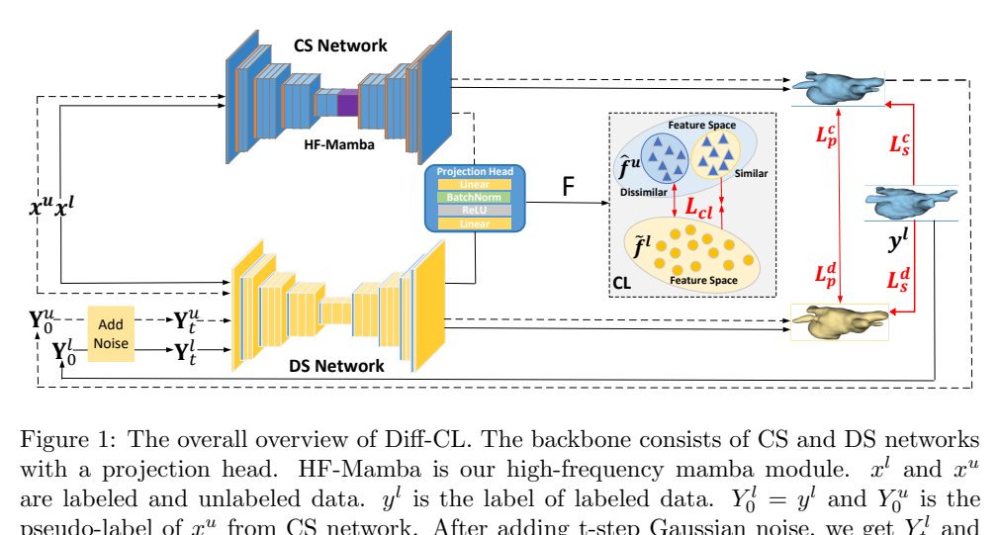
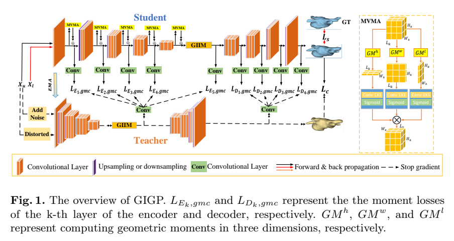
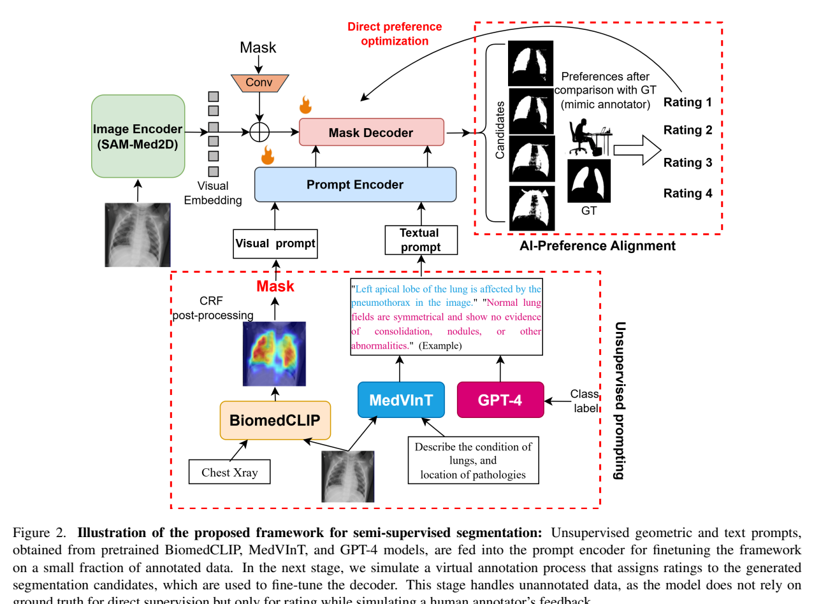

# arXiv 检索结果 / Results

## 1. Diff-CL: A Novel Cross Pseudo-Supervision Method for Semi-supervised Medical Image Segmentation
- Authors：Xiuzhen Guo, Lianyuan Yu, Ji Shi, Na Lei, Hongxiao Wang
- First：2025-03-12T13:59:09+00:00；Latest：2025-03-12T13:59:09+00:00
- Abs：https://arxiv.org/abs/2503.09408v1
- PDF：https://arxiv.org/pdf/2503.09408v1
- Code：https://huggingface.co/huggingface, https://huggingface.co/docs/hub/spaces
- 解读来源：PDF 全文，共 29 页，29 页可提取文字
### [中文]
**中文翻译**
- 标题：Diff-CL：一种用于半监督医学图像分割的新型交叉伪监督方法
- 摘要：半监督学习利用无标签数据中的信息来提升模型泛化能力，从而减少对大规模标注数据集的依赖。现有研究大多集中于有限样本，未能捕捉整体数据分布。我们认为，将分布信息与细节信息相结合对于获得更稳健、更准确的分割结果至关重要。一方面，扩散模型（DM）凭借其强大的生成能力能够有效学习数据分布，但其难以捕捉精细细节，导致生成的图像带有误导性细节。将DM与卷积神经网络（CNN）结合，可使前者学习数据分布，而后者校正精细细节。然而，通过CNN捕捉完整的高频细节需要大量计算资源，且易受局部噪声影响。另一方面，鉴于有标签数据与无标签数据来自同一分布，我们认为无标签数据中与有标签数据整体类别语义相似的区域很可能属于同一类别，而相似度极低的区域则不太可能。本工作从分布视角提出一种半监督医学图像分割框架（Diff-CL）。首先，我们提出扩散分割网络与卷积分割网络之间的交叉伪监督学习机制。其次，我们设计高频mamba模块以全局捕捉边界与细节信息。最后，我们应用对比学习实现从有标签数据到无标签数据的标签传播。我们的方法在三个数据集（包括左心房、脑肿瘤和NIH胰腺数据集）上取得了最先进（SOTA）的性能。

Diff-CL 提出一种面向半监督医学图像分割的双网络框架：扩散分割网络（DS）学习数据分布，卷积分割网络（CS）校正细节，二者通过交叉伪监督互相提供伪标签；同时设计 3D 高频 Mamba 模块（HFM）利用全局上下文提取高频边界细节，并用基于记忆库的类级对比学习把已标注数据的标签语义传播到未标注数据。在 LA、BraTS 和 NIH Pancreas 三个数据集上，5%/10%/20% 标注预算下 Dice 多数取得最优，但 95HD/ASD 等边界指标并非全面领先，作者也承认边界精度仍需改进。

## 1. 问题与动机

半监督医学图像分割旨在利用未标注数据降低标注依赖。作者认为现有方法（一致性正则、伪标签、对抗学习、图方法）多基于 CNN，只关注有限样本的局部细节，难以刻画整体数据分布，因而泛化不足 [p. 2–3]。另一方面，扩散模型（DM）能学习数据分布，但倾向于重建全局结构而牺牲细节，可能生成误导性细节；CNN 擅长细节却受限于卷积核感受野、易受局部噪声影响，且完整捕获高频细节计算代价高 [p. 3]。此外，现有标签传播方法依赖局部语义相似性，而局部相似可能跨类别出现，导致未标注区域类别难以判定；作者主张应从“整体类语义”的相似性出发进行标签传播 [p. 4]。

## 2. 方法

### 2.1 总体框架

Diff-CL 采用双骨干：扩散分割网络 DS（$\tilde F(\cdot)$）与卷积分割网络 CS（$\hat F(\cdot)$），二者后接投影头得到维度为 $d$ 的已标注/未标注特征 $\tilde f^l$、$\hat f^u$ [p. 9]。整体流程见 Figure 1（第 5 页）：CS 先对已标注与未标注数据前向，得到 softmax 输出与伪标签；DS 以图像和加噪后的标签为条件输入；两网络互相用对方伪标签监督，并叠加对比损失 [p. 5, p. 9–11]。

### 2.2 DS-CS 交叉伪监督

CS 对一批 $m$ 个已标注样本和 $n$ 个未标注样本输出 $\hat P^l$、$\hat P^u$，取 argmax 得伪标签 $\hat Y^l$、$\hat Y^u$ [p. 9–10]。DS 的输入需要标签条件：已标注样本用真实标签 $y^l$，未标注样本用 CS 伪标签 $\hat Y^u$，转为 one-hot 得 $Y_0^l$、$Y_0^u$，再按 DDIM 前向加噪：

$$Y_t^{l/u}=\sqrt{\bar\alpha_t}Y_0^{l/u}+\sqrt{1-\bar\alpha_t}\,\epsilon,\quad \epsilon\in N(0,1)$$

其中 $\bar\alpha_t$ 为预定义噪声调度系数 [p. 10, Eq. 5]。随后将 $(x^l,Y_t^l)$、$(x^u,Y_t^u)$ 拼接送入 DS，得到 $\tilde P^l$、$\tilde P^u$ 及伪标签 $\tilde Y^l$、$\tilde Y^u$ [p. 11]。

交叉监督损失为：

$$L_{dp}=D(\tilde P^u,\hat Y^u)+\lambda_1 E(\tilde P^u,\hat Y^u)$$
$$L_{cp}=D(\hat P^u,\tilde Y^u)+\lambda_2 E(\hat P^u,\tilde Y^u)$$

其中 $D$ 为 Dice 型重叠项（$1-2|\tilde P^u\cap\hat Y^u|/(|\tilde P^u|+|\hat Y^u|)$），$E$ 为交叉熵，$\lambda_1,\lambda_2$ 为权重 [p. 11, Eq. 6–9]。即 CS 的伪标签为 DS 提供分布信息，DS 的伪标签为 CS 提供细节校正。

### 2.3 高频 Mamba 模块（HFM）

HFM 的流程（Figure 3，第 12 页）为：对 CS 的 3D 特征 $\hat f^{l/u}$ 先做空间注意力（SA），再经 FFT 转到频域，用 fftShift 做频谱中心化，经高通滤波（HPF）保留高频分量，iFFT 回到空域，最后经 Space Mamba（SM）、LayerNorm 与 MLP 得到输出：

$$F_g=FFT(SA(\hat f^{l/u})),\quad F_h=iFFT(HPF(fftShift(F_g)))$$
$$F_m=SM(LN(F_h))+F_h,\quad F_o=MLP(LN(F_m))+F_m$$

SM 包含前向、后向和空间方向编码，用于以线性复杂度建模全局上下文 [p. 12, Eq. 10]。作者称该设计弥补 CNN 捕获高频细节计算代价高、易受局部噪声影响的问题 [p. 11]。

### 2.4 基于对比学习的标签信息传播

构建记忆库 MB，仅存储 DS 对已标注样本预测正确的像素特征及其标签；每类随机取 $p$ 个已标注特征构成类语义表示 $a=(a_1,\dots,a_C)$，$a_\gamma=(a_{\gamma1},\dots,a_{\gammap})$；再从 CS 投影的未标注特征中随机采样 $q$ 个特征 $b=(b_1,\dots,b_q)$ [p. 12–13]。对每个类 $\gamma$，用余弦相似度在 $b$ 中选出与 $a_\gamma$ 最相似的 top-k 作为正对 $b_{\gamma,P}$，最不相似的 top-k 作为负对 $b_{\gamma,N}$ [p. 13, Eq. 11–13]。对比损失采用 InfoNCE 形式：

$$L(a_i,b_j)=-\log\frac{e^{\cos(a_i,b_j)/\tau}}{e^{\cos(a_i,b_j)/\tau}+\sum_{\alpha=1,b_\alpha\in b_{\gamma,N}}^{k}e^{\cos(a_i,b_\alpha)/\tau}}$$

总对比损失 $L_{cl}=\sum_{\gamma=1}^{C}\sum_{i\in a_\gamma}\sum_{j\in b_{\gamma,P}}L(a_i,b_j)$，$\tau$ 为温度参数 [p. 13, Eq. 14–15]。其思想是拉近未标注区域与同类整体语义、推远与无关类语义。

### 2.5 总目标与训练

DS 与 CS 分别优化：$L_d=L_{ds}+\mu_1 L_{dp}$，$L_c=L_{cs}+\mu_2 L_{cu}$，其中 $L_{cu}=L_{cp}+\eta L_{cl}$；已标注监督项为 Dice 加交叉熵：$L_{ds}=D(\tilde P^l,y^l)+\beta_1 E(\tilde P^l,y^l)$，$L_{cs}=D(\hat P^l,y^l)+\beta_2 E(\hat P^l,y^l)$ [p. 14–15, Eq. 16–22]。训练流程见 Algorithm 1（第 14 页）：每轮采样已标注/未标注批，CS 前向得伪标签，加噪后送入 DS，计算各项损失并分别更新 CS 与 DS；推理时使用 CS。

## 3. 贡献

作者声称的贡献有三点：(1) 提出 DS 与 CS 的交叉伪监督机制，并设计 3D 高频 Mamba 模块全局学习高频细节；(2) 提出利用对比学习从已标注向未标注传播标签信息的新方法；(3) 在 MR 和 CT 数据集上验证 Diff-CL 显著提升泛化能力 [p. 4–5]。

我的解读：核心新颖点在于“扩散网络与卷积网络互为伪标签教师”这一双向蒸馏结构，以及把类级记忆库对比学习用于标签传播；HFM 更像是把频域高通滤波与 Mamba 结合以增强边界细节的工程模块。作者将“从分布视角”作为统一叙事，但论文并未给出分布层面的理论分析或显式分布度量，因此该主张更接近设计动机而非被严格验证的结论。

## 4. 实验与结果

### 4.1 数据集与设置

- **LA**：100 例 3D 钆增强 MR，分辨率 0.625 mm³；80 例训练、20 例测试；5% 与 10% 标注设置分别对应 4/76 与 8/72 [p. 15–16]。
- **BraTS 2019**：使用 T2-FLAIR 分割整个肿瘤区域，重采样至 1×1×1 mm³；250 训练、25 验证、60 测试；10% 与 20% 设置对应 25/225 与 50/200 [p. 16]。
- **NIH Pancreas**：82 例 3D CT，窗宽 [-120, 240] HU，裁剪后扩 25 voxels；62 训练、20 测试；10% 与 20% 设置对应 6/56 与 12/50 [p. 16]。

指标为 Dice、Jaccard、95HD、ASD。基线包括 V-Net、DTC、SASSNet、UA-MT、URPC、MC-Net、MC-Net+、AC-MT、CAML、ML-RPL [p. 16]。实现上，DS 与 CS 均以 V-Net 为骨干，SGD 训练 300 epochs，weight decay $3\times10^{-5}$，momentum 0.9，学习率 0.01，采用高斯升温 $\lambda(t)=2.0\times e^{-5(1-t/t_{max})^2}$；LA 输入 patch 112×112×80，滑窗步长 18×18×4；Pancreas 与 BraTS 输入 96³，滑窗步长分别为 16³ 和 64³ [p. 18–19]。Table 2（第 15 页）给出各数据集超参数，例如 Pancreas 6/56 时 $\mu_1=\mu_2=1$、$\beta=0.1\lambda(t)$、$\lambda_1=\lambda_2=1$、$\eta=0.007$、HF=0.8；LA 4/76 时 $\beta=0.01\lambda(t)$、$\eta=0.7$、HF=0.68；BraTS 25/225 时 $\eta=0.007$、HF=0.5。

### 4.2 主要结果

**LA（Table 3，第 17 页）**：5% 标注下 Diff-CL 达 Dice 89.03%、Jaccard 80.35%、95HD 6.36、ASD 2.18；作者称相较最优对比方法 Dice 高 1.49%、Jaccard 高 2.4%、95HD 低 3.54、ASD 低 0.01。10% 下为 Dice 91.00%、Jaccard 83.54%、95HD 5.08、ASD 1.68，作者称 Dice 高 1.56%、Jaccard 高 2.53%、95HD 低 2.84、ASD 低 0.08 [p. 19]。全监督 V-Net 为 Dice 91.62%、Jaccard 84.60%、95HD 5.40、ASD 1.64，Diff-CL 在 10% 下已接近该水平。

**BraTS（Table 4，第 18 页）**：10% 下 Diff-CL Dice 84.63%、Jaccard 75.05%、95HD 12.08、ASD 3.73；作者称 Dice 比 URPC 高 1.02%、Jaccard 高 1.53%。20% 下 Dice 85.45%、Jaccard 75.88%、95HD 9.05、ASD 2.60；作者称 Dice 比 URPC 高 1.35%、Jaccard 高 1.32% [p. 20]。但 95HD/ASD 处于中游，作者明确承认边界指标不占优 [p. 20]。

**Pancreas（Table 5，第 21 页）**：10% 下 Dice 78.21%、Jaccard 64.80%，作者称比 ML-RPL 的 77.95%/64.53% 高 0.26%/0.27%；20% 下 Dice 81.27%、Jaccard 68.87%，比 ML-RPL 的 80.29%/67.53% 高 0.98%/1.34% [p. 20–21]。同样，95HD 与 ASD 并非最优，作者称需进一步提升边界精度 [p. 21]。

### 4.3 消融

Table 6（第 22 页）在 Pancreas 与 LA 上逐步加入模块。Pancreas 20% 设置：仅监督损失 $L_{cs}+L_{ds}$ 为 Dice 71.52%、Jaccard 57.68%、95HD 18.12、ASD 5.41；加交叉伪监督后升至 80.36%/67.81%/8.85/2.00；再加 HFM 为 80.85%/68.32%/9.75/2.62；最后加 $L_{cl}$ 为 81.27%/68.87%/9.32/2.16。LA 10% 设置：仅监督为 84.81%/76.48%/8.84/2.14；加交叉伪监督为 86.54%/77.70%/6.02/2.26；加 HFM 为 88.17%/79.23%/8.23/2.80；加 $L_{cl}$ 为 89.02%/80.34%/6.32/2.16。消融显示交叉伪监督贡献最大，HFM 与 $L_{cl}$ 主要提升 Dice/Jaccard，但对 95HD/ASD 的影响不一致（如 Pancreas 加 HFM 后 95HD 从 8.85 升至 9.75）。

## 5. 评估

**支持的结论**：在三个数据集、两种标注预算下，Diff-CL 的 Dice/Jaccard 多数为最优或接近最优，说明双网络交叉伪监督与对比标签传播能提升区域重叠精度；LA 10% 下接近全监督 V-Net，支持“减少标注依赖”的主张 [p. 17, p. 19]。消融支持交叉伪监督是主要增益来源 [p. 22]。

**局限与缺失证据**：(1) 边界指标 95HD/ASD 在 BraTS 与 Pancreas 上并非最优，作者自己也承认边界精度不足 [p. 20–21]；HFM 的消融并未稳定改善边界指标，削弱了“高频模块提升细节”的强主张。(2) 论文称“SOTA”，但部分对比数字存在明显异常（如 Table 4 中 URPC 在 50/200 下 Jaccard 为 20.72，Table 5 中 URPC 在 6/56 下 Jaccard 为 18.99），这些数值与同表其他结果不一致，可能为排版或录入错误，论文未说明，需谨慎对待 [p. 18, p. 21]。(3) 未报告多次运行的均值/方差、显著性检验，也未报告推理耗时或显存开销，无法判断 HFM 的线性复杂度优势是否在实际中体现。(4) 对比学习依赖 DS 对已标注样本预测正确的像素构建记忆库，错误传播风险未被量化分析。(5) 论文未给出扩散步数 $t$、采样策略等关键细节，复现存在不确定性。

## 6. 复现

已报告：V-Net 骨干；SGD，300 epochs，lr 0.01，weight decay $3\times10^{-5}$，momentum 0.9；高斯升温 $\lambda(t)=2.0e^{-5(1-t/t_{max})^2}$，$t_{max}=300$；随机裁剪、翻转、旋转增强；LA patch 112×112×80、滑窗 18×18×4；Pancreas/BraTS patch 96³、滑窗 16³/64³；各数据集超参数见 Table 2 [p. 15, p. 18–19]。

未报告或无法辨认：扩散前向的具体时间步采样分布与 $t$ 的范围；DDIM 反向过程在训练中是否使用及步数；HFM 中高通滤波阈值 HF 的具体施加方式（Table 2 给出数值但正文未说明滤波器形式）；记忆库容量与更新策略；对比学习 top-k 的 $k$ 值、温度 $\tau$、每类采样数 $p$ 与未标注采样数 $q$；投影头结构；DS 与 CS 是否共享初始化；推理时是否使用滑动窗口以外的后处理；Table 2 部分单元格在文本中排列混乱，需以原表为准。

#### 原论文流程图 · Figure 1 · PDF 第 5 页

Figure 1: The overall overview of Diff-CL. The backbone consists of CS and DS networks with a projection head. HF-Mamba is our high-frequency mamba module. xl and xu are labeled and unlabeled data. yl is the label of labeled data. Yl = yl and Yu is the 0 0

[原文来源](https://arxiv.org/pdf/2503.09408v1#page=5)

## 2. GIGP: A Global Information Interacting and Geometric Priors Focusing Framework for Semi-supervised Medical Image Segmentation
- Authors：Lianyuan Yu, Xiuzhen Guo, Ji Shi, Hongxiao Wang, Hongwei Li
- First：2025-03-12T12:59:38+00:00；Latest：2025-03-12T12:59:38+00:00
- Abs：https://arxiv.org/abs/2503.09355v1
- PDF：https://arxiv.org/pdf/2503.09355v1
- Code：https://huggingface.co/huggingface, https://huggingface.co/docs/hub/spaces
- 解读来源：PDF 全文，共 10 页，10 页可提取文字
### [中文]
**中文翻译**
- 标题：GIGP：一种用于半监督医学图像分割的全局信息交互与几何先验聚焦框架
- 摘要：半监督学习通过利用无标签数据增强医学图像分割，减少对大量标注数据集的依赖。一方面，有限的标注数据与丰富的无标签数据之间的分布差异会阻碍模型泛化。大多数现有方法依赖局部相似性匹配，可能引入偏差。相比之下，Mamba以线性复杂度有效建模全局上下文，学习更全面的数据表示。另一方面，医学图像通常表现出由几何特征定义的一致解剖结构。大多数现有方法未能充分利用全局几何先验，如体积、矩等。在本工作中，我们引入全局信息交互与几何先验聚焦框架（GIGP）。首先，我们提出全局信息交互Mamba模块以减少标注与无标签数据之间的分布差异。其次，我们提出几何矩注意力机制以提取更丰富的全局几何特征。最后，我们提出全局几何扰动一致性以模拟器官动态和几何变化，增强模型学习泛化特征的能力。在NIH胰腺和左心房数据集上的优越性能证明了我们方法的有效性。

GIGP 是一个基于 Mean Teacher 的半监督 3D 医学图像分割框架，包含三个模块：GIIM 用 Mamba 在通道/样本方向做全局信息交互以缩小标注与未标注特征分布差异；GMAM 用二阶几何矩构造多视角注意力并在多尺度上约束归一化矩一致性；GGPC 用正弦波网格变形模拟器官形态变化并施加预测一致性。在 NIH Pancreas（6/56、12/50 标注/未标注）和 LA（4/76、8/72）上，Dice 分别达到 79.91/81.84 和 89.66/90.94，优于所列基线；但 95HD/ASD 并非总是最优，作者也承认局部边界对齐仍有改进空间。消融显示三个模块单独加入 MT 均提升四项指标，全部组合在 Pancreas 20% 设置下达到 Dice 81.84、Jaccard 69.66、95HD 6.19、ASD 1.44。

## 1. 问题与动机

论文针对半监督 3D 医学图像分割：标注数据少、未标注数据多，模型容易在两类数据间产生分布差异，且医学器官具有稳定的解剖几何结构（形状、尺寸、位置、方向等）。作者认为现有方法存在两点不足：其一，许多方法依赖局部相似性匹配（余弦相似度、全相关矩阵、图方法等）来传播标签信息，难以刻画整体数据分布，可能引入偏差 [p. 2]；其二，现有几何先验多局限于符号距离图、形状字典、体积恒常约束、骨架/边界或多边形顶点等少数几何特征，且 CNN 感受野受卷积核限制，主要捕获局部模式 [p. 2]。因此作者希望从“全局”角度同时利用全局上下文交互与更丰富的全局几何先验。

## 2. 方法

### 2.1 总体框架

GIGP 以 Mean Teacher（MT）为骨干 [p. 3]。每个前向批次包含 m 个标注样本与 n 个未标注样本；学生网络处理原始标注与未标注样本，教师网络处理未标注样本的噪声版本和全局几何扰动版本 [p. 3]。网络输出四组概率图：学生标注预测 P_sl、学生未标注预测 P_su、教师对噪声未标注的预测 P_t,nsu、教师对几何扰动未标注的预测 P_t,gpu [p. 3-4]。总损失为

L = L_s + γ1 L_c + γ2 L_gmc  (式1)

其中 L_s = Dice(P_sl, Y_l) + α_E CE(P_sl, Y_l)，仅用标注数据监督；L_c = MSE(P_su, P_t,nsu) + MSE(P_su, P_t,gpu)，是学生预测与教师两个扰动视图预测之间的一致性损失；L_gmc 为几何矩一致性损失；γ1、γ2、α_E 为权重系数 [p. 4]。论文未在正文给出 γ1、γ2、α_E 的具体数值。

### 2.2 GIIM：全局信息交互 Mamba

GIIM 基于 Mamba，在标注与未标注特征之间做通道级交互 [p. 4]。IIM 包含四个方向分量：前向 f、反向 r、通道间 c、样本间 t，输出为

IIM(F) = Mamba(F_f) + Mamba(F_r) + λ1 Mamba(F_c) + λ2 Mamba(F_t)  (式2)

λ1、λ2 为加权系数 [p. 4]。图 2（第 4 页）展示其结构：GSC 为门控空间卷积，LayerNorm 为层归一化，MLP 为多层感知机，IIM 为信息交互 Mamba；但正文未给出各分量的具体张量重排方式、Mamba 层数或隐藏维度。作者的设计意图是：把标注数据学到的参数/表示全局地迁移到未标注数据，从而缩小分布差距 [p. 3]。

### 2.3 GMAM：几何矩注意力机制

GMAM 由两部分组成：多视角二阶几何矩注意力（MVMA）与多尺度二阶归一化几何矩一致性（MSGC）[p. 4]。二阶矩用于捕获对称性、形状与方向 [p. 4-5]。

MVMA 加在每个编码器层之后。第 k 层编码器输出 P_k ∈ R^{C_k×H_k×W_k×L_k}，沿不同方向计算二阶矩：

μ^h_{k,pqr} = Σ_x (x−x0)^p (y−y0)^q (z−z0)^r P_k(x,y,z)  (式3)

其中 (x0,y0,z0) 为图像质心，p,q,r∈N 且 p+q+r=2；μ^h 的形状为 C_k×1×W_k×L_k，y、z 方向同理 [p. 5]。随后构造空间注意力图：

z_k(x,y,z) = P_k(x,y,z) + λ_P · P_k(x,y,z) · Π_{i∈{h,w,r}} σ(Conv(μ^i_{k,pqr}))  (式4)

λ_P 为网络学习的系数，σ 为 sigmoid，Conv 为 1×1 卷积 [p. 5]。作者指出 MVMA 在二维图像情形下包含 DiVA 模块作为特例 [p. 5]。

MSGC 施加于学生网络每个分辨率层，以及教师网络编码器和解码器的最终层 [p. 5]。归一化矩为：

μ^{sE_k/D_k}_{pqr} = Σ_{x,y,z} ((x−x0)/σ_x)^p ((y−y0)/σ_y)^q ((z−z0)/σ_z)^r f^{sE_k/D_k}(x,y,z)  (式5)

教师侧对应 μ^{t,ns/gp}_{E/D,pqr} 用 f^{t,ns/gp}_{E/D} 计算（式6），其中 σ_x = sqrt((1/H_k)Σ_x (x−x0)^2)，y、z 同理；f 为经通道对齐变换成单通道后的编码器/解码器特征 [p. 5]。MSGC 损失为：

L_gmc = Σ_{k=1}^{K} Σ_{p,q,r} (α_k |μ^{sE_k/D_k}_{pqr} − μ^{t,ns}_{E/D,pqr}| + β_k |μ^{sE_k/D_k}_{pqr} − μ^{t,gp}_{E/D,pqr}|)  (式7)

K 为编码器或解码器的分辨率层数，α_k、β_k 为权重系数 [p. 5]。正文未报告 α_k、β_k 的取值或随层变化的设置。

### 2.4 GGPC：全局几何扰动一致性

GGPC 在三维网格各轴上叠加正弦波扰动，生成形变网格：

G(x,y,z) = [x + A sin(2πf x), y + A sin(2πf y), z + A sin(2πf z)]^T  (式8)

A 为振幅，f 为频率，作者称其使扰动足够细微，以模拟器官动力学与几何变化 [p. 5-6]。然后用三维插值把 n 个未标注样本映射到形变网格：O_uj = F_grid(X_uj, G)（式9）[p. 6]。该扰动视图的预测进入 L_c 的第二项，与学生对原始未标注样本的预测做 MSE 一致性 [p. 4]。正文未给出 A、f 的具体取值，也未说明插值类型。

## 3. 贡献

作者声称的贡献有四点 [p. 3]：(1) GIIM 在对应空间位置联合学习标注与未标注特征，通过全局参数迁移缩小分布差距；(2) GMAM 用几何矩施加多视角、多尺度约束，并用注意力加权关键几何信息；(3) GGPC 用周期正弦波变形模拟器官动力学与几何变化；(4) 在 NIH Pancreas 与 Left Atrium 上验证有效性。

我的解读：核心新颖点在于把 Mamba 的全局序列建模与几何矩先验结合进 MT 半监督框架，并以正弦网格变形作为额外的几何扰动视图。但 GIIM 的“全局交互”具体如何跨样本/跨通道实现，正文只给出式2的加和形式，缺少消融拆解（如去掉 c/t 方向的影响）；GMAM 中 MVMA 与 DiVA 的关系作者自述为特例，因此其几何矩注意力的独立新颖性需要谨慎看待 [p. 5]。

## 4. 实验与结果

### 4.1 数据与设置

Pancreas：82 例增强 3D 腹部 CT，体积 512×512×181 至 512×512×466；软组织窗 [−120,240] HU；以胰腺区域为中心裁剪并外扩 25 voxels；62 例训练、20 例测试 [p. 6]。LA：2018 Left Atrium Segmentation Challenge 的 100 例 3D 钆增强 MRI，分辨率 0.6253 mm³；80 例训练、20 例测试；裁剪至心脏中心并零均值单位方差归一化 [p. 6]。

实现：PyTorch 2.4.0、CUDA 11.8、单张 RTX 4090；SGD，weight decay 3×10⁻⁵，momentum 0.9，学习率 0.01；300 epochs，带 early stopping；数据增强包括随机裁剪、翻转、旋转、缩放；骨干为 V-Net [p. 6]。Pancreas 随机裁剪 96×96×96，滑窗预测步长正文写作“16×16×16 和 64×64×64 voxels，分别”，表述含糊；LA 输入块 112×112×80，滑窗步长 18×18×4 [p. 6]。

### 4.2 主要结果

Pancreas（表1，第7页）：标注/未标注为 6/56 与 12/50。GIGP 的 Dice 为 79.91/81.84，Jaccard 66.99/69.66，95HD 9.21/6.19，ASD 2.21/1.44。作者称在 10% 与 20% 标注设置下分别比 ML-RPL 高 1.96%/2.46%（Dice/Jaccard）和 1.55%/2.13% [p. 6-7]。对照表中 ML-RPL 为 Dice 77.95/80.29、Jaccard 64.53/67.53、95HD 8.77/9.50、ASD 2.29/2.21 [p. 7]。注意：在 6/56 设置下 GIGP 的 95HD 9.21 高于 ML-RPL 的 8.77，ASD 2.21 略低于 2.29；作者也承认 ASD/95HD 并非总是最优，因为二者侧重局部边界精度 [p. 8]。

LA（表2，第7页）：标注/未标注为 4/76 与 8/72。GIGP 的 Dice 89.66/90.94，Jaccard 81.35/83.44，95HD 5.50/5.29，ASD 1.93/1.81。作者称在 5% 与 10% 设置下比 CAML 高 2.12%/3.40% 和 1.50%/2.43%（Dice/Jaccard）[p. 7]。CAML 表中为 Dice 87.54/89.44、Jaccard 77.95/81.01、95HD 10.76/10.10、ASD 2.58/2.09 [p. 7]。

定性结果：图3（第7页）为 Pancreas 20% 标注设置，图4（第8页）为 LA 10% 标注设置；作者称 GIGP 整体更完整、细节更接近真值，尤其在黄色虚线处对比明显 [p. 8]。由于图像本身不是模型输入，这里仅转述作者的文字描述，不判断图像细节。

### 4.3 消融

表3（第8页）在 Pancreas 20% 标注设置下以 MT 为基线：MT 单独 Dice 74.43、Jaccard 60.53、95HD 14.93、ASD 4.61；加 GMAM 为 79.86/67.02/10.41/2.18；加 GGPC 为 80.56/68.09/8.30/1.71；加 GIIM 为 79.45/66.78/11.00/2.83；三者全加为 81.84/69.66/6.19/1.44 [p. 8]。该消融支持每个模块单独有效、组合后四项指标均改善；但未报告各模块的超参数敏感性、计算开销，也未在 LA 上做同样消融。

## 5. 评估

支持的结论：在作者设定的 Pancreas 与 LA 标注预算下，GIGP 的 Dice/Jaccard 优于表中列出的基线，消融显示三个模块对 Pancreas 20% 设置均有正贡献 [p. 7-8]。作者也明确承认局部边界指标（ASD、95HD）并非总是最优，仍有改进空间 [p. 8]。

局限与缺失证据：第一，正文未给出 γ1、γ2、α_E、λ1、λ2、λ_P、α_k、β_k、正弦振幅 A 与频率 f 的具体取值，复现性受限 [p. 4-6]。第二，GIIM 的四方向分量缺少逐项消融，无法判断 c/t 方向的实际作用 [p. 4]。第三，MVMA 与 DiVA 的关系仅为作者陈述，未提供对比实验 [p. 5]。第四，表1中 URPC 的 Jaccard 为 18.99/22.75，与 Dice 72.66/75.22 明显不匹配，可能是排版或录入问题，正文未说明，无法据此判断 [p. 7]。第五，滑窗步长“16×16×16 和 64×64×64，分别”语义不清，无法确定各自对应何种设置 [p. 6]。第六，未报告参数量、推理时间、显存或 Mamba 相对 CNN 的实际开销。

## 6. 复现

已报告的可复现要点：V-Net 骨干；MT 框架；SGD（lr 0.01，momentum 0.9，weight decay 3×10⁻⁵）；300 epochs + early stopping；Pancreas 裁剪 96×96×96、窗 [−120,240] HU、外扩 25 voxels；LA 输入 112×112×80、滑窗 18×18×4；数据增强为随机裁剪、翻转、旋转、缩放；Pancreas 62/20 划分，LA 80/20 划分 [p. 6]。

未报告或无法辨认：各损失权重与模块系数；Mamba 层数、隐藏维度、扫描顺序实现细节；正弦扰动的 A、f 与插值方式；教师网络更新策略（EMA 衰减系数）；学习率调度；early stopping 的监控指标与耐心值；随机种子与重复实验次数；Pancreas 滑窗步长的准确对应关系 [p. 4-6]。复现时需将这些列为待定超参数并做敏感性分析。

#### 原论文流程图 · Figure 1 · PDF 第 3 页

Fig.1. The overview of GIGP. L and L represent the the moment losses Ek,gmc Dk,gmc of the k-th layer of the encoder and decoder, respectively. GMh, GMw, and GMl represent computing geometric moments in three dimensions, respectively.

[原文来源](https://arxiv.org/pdf/2503.09355v1#page=3)

## 3. Semi-Supervised Medical Image Segmentation via Knowledge Mining from Large Models
- Authors：Yuchen Mao, Hongwei Li, Yinyi Lai, Giorgos Papanastasiou, Peng Qi, Yunjie Yang, Chengjia Wang
- Comments：18 pages, 2 figures
- First：2025-03-10T00:43:45+00:00；Latest：2025-03-10T00:43:45+00:00
- Abs：https://arxiv.org/abs/2503.06816v1
- PDF：https://arxiv.org/pdf/2503.06816v1
- Code：https://huggingface.co/huggingface, https://huggingface.co/docs/hub/spaces
- 解读来源：PDF 全文，共 18 页，18 页可提取文字
### [中文]
**中文翻译**
- 标题：通过大模型知识挖掘的半监督医学图像分割
- 摘要：SAM等大规模视觉模型具有广泛的视觉知识，但其通用性和计算需求限制了它们在医学图像分割等专门任务中的应用。相比之下，U-Net++等任务特定模型常因标注数据稀疏而表现不佳。本研究提出一种策略性知识挖掘方法，利用SAM的广泛理解来提升小型本地部署深度学习模型的性能。
  在我们的方法中，我们在有限的标注数据集上训练U-Net++模型，并通过将SAM在未标注图像上推断的输出转换为提示来扩展其能力。该过程不仅利用了SAM的泛化视觉知识，还通过U-Net++迭代改进SAM的预测以适应专门的医学分割任务。挖掘出的知识作为“伪标签”丰富了训练数据集，从而能够对本地网络进行微调。
  应用于分别由胃肠道息肉和肺部X射线图像组成的Kvasir SEG和COVID-QU-Ex数据集时，在训练中使用相同数量的标注数据（75%和50%的标注数据）的情况下，我们提出的方法在Dice上分别比基线U-Net++模型持续提升了3%和1%的分割性能。值得注意的是，即使基线U-Net++模型仅使用标注数据（100%的标注数据）训练，我们提出的方法也超越了该基线模型。这些结果凸显了知识挖掘在利用SAM等大规模模型广泛（尽管通用）的知识来克服专门模型数据限制方面的潜力，同时保持了临床应用中至关重要的运行效率。

论文提出一种大小模型知识挖掘的半监督分割框架：先在少量标注数据上训练轻量 U-Net++，再用其预测生成点与边界框提示，驱动冻结的 SAM 为无标注图像生成伪标签，并以连续或一次性调度回训 U-Net++。在 Kvasir-SEG（75% 标注）上 Dice 由 0.722 提升至 0.756，在 COVID-QU-Ex（50% 标注）上由 0.933 提升至 0.944；消融显示点提示与框提示缺一不可，加入 mask 提示反而下降。

## 1. 问题与动机

医学图像分割依赖高质量像素级标注，但标注需专业人员、成本高且常受隐私限制，导致任务专用小模型（如 U-Net++）在稀疏标注下性能受限 [p. 2]。SAM 在约十亿自然图像-掩码对上训练，具备强泛化能力，但其零样本医学分割与专用方法仍有差距；直接微调 SAM（如 MedSAM、PEFT 方法）虽能适配医学域，却仍依赖高质量提示，且推理时保留大模型，临床部署的运算效率不足 [p. 2][p. 5]。作者因此希望：既不微调 SAM，也不在推理时强制使用 SAM，而是把 SAM 的通用视觉知识“挖掘”进本地轻量模型，以提升少标注条件下的分割性能 [p. 2][p. 3]。

## 2. 方法

整体流程见图 1 [p. 3]：U-Net++ 先在标注子集 {X_L, Y_L} 上监督训练至收敛；可选地用 SimCLR 在标注与无标注数据上自监督预训练 [p. 7]。随后对无标注图像 {X_U} 用 U-Net++ 推理，将预测掩码转换为 SAM 提示，SAM 保持冻结，仅作为“教师”生成伪标签；伪标签再与标注数据共同训练 U-Net++ [p. 6]。作者强调冻结 SAM 可避免不准确提示“污染”其知识库 [p. 6]。

提示生成有三类设计 [p. 7]：
- 点提示：从 U-Net++ 预测概率最高的像素中采样 x 个点；若并列最大概率的像素多于 x 个，则随机选 x 个。
- 边界框提示：取预测掩码在 0.5 阈值下的外接框。作者指出仅有点提示只能表达目标中心，无法告知 SAM 目标范围，而 SAM 会输出整体/部分/子部分三种掩码，故需框提示约束尺度 [p. 7]。
- mask 提示：被排除。原因是其稠密嵌入与图像嵌入逐点相加，约束过强，会放大小模型掩码误差；预实验观察到该权衡，并用消融验证 [p. 7][p. 13]。

伪标签调度有两种 [p. 8]：一次性生成在监督训练后只查询 SAM 一次，得到 {Y_pseudo_U} 后合并训练；连续生成则在每次访问无标注样本时在线推理 U-Net++ 并查询 SAM，伪标签随学生模型演化而更新，训练更慢但质量更高。

损失函数为 Dice 与 BCE 的加权和 [p. 8][p. 9]。监督损失 L = (1/B)Σ(L_Dice + k·L_BCE)，其中 B 为批内标注样本数，k 控制 BCE 权重，实验取 k=0.2。知识挖掘阶段总损失为监督项加 λ 倍伪标签项：L = (1/B)Σ(L_Dice + k·L_BCE) + λ(1/B′)Σ(L_pseudoDice + k·L_pseudoBCE)，B′ 为批内无标注样本数，λ=0.25，用于降低伪标签相对真实标注的不确定性权重。

## 3. 贡献

作者声称的贡献有三点 [p. 3]：提出大小模型交互的战略性知识挖掘机制以实现数据高效分割；测试不同视觉提示并识别最有效的点+框组合；证明方法可与域内微调的 SAM（MedSAM）及自监督方法（SimCLR）结合获益。

我的解读：核心新颖性不在伪标签本身，而在“用任务专用小模型自动提示冻结大模型，再把大模型输出回流训练小模型”的闭环，且推理时可选择只用 U-Net++ 或再调用 SAM 精修 [p. 3]。与最接近的工作 [21] 相比，作者强调其提示可在训练中迭代演化；与 SAMAug 相比，其提示来自目标数据集上训练的 U-Net++，而非冻结显著性模型随机采样 [p. 5]。不过这些差异主要是机制层面的，论文未提供与 [21] 或 SAMAug 的直接同条件数值比较。

## 4. 实验与结果

数据集：Kvasir-SEG 含 1,000 张胃肠道息肉图像，按 80%/10%/10% 随机划分训练/验证/测试 [p. 9]；COVID-QU-Ex 使用其中“COVID-19 Infection Segmentation Data”的 3,962 对肺部 X 光图像-掩码，预划分为 1864/1166/932 [p. 9]。训练子集再按标注/无标注比例 100%/0%、75%/25%、50%/50% 划分，无标注部分丢弃标签 [p. 10]。指标为 IoU 与 Dice [p. 9]。

训练设置 [p. 17][p. 18]：U-Net++ 以 ResNet34 为编码器；Adam（β1=0.9，β2=0.999），初始学习率 5e-5，权重衰减 0，批大小 8，T4 GPU；验证损失 3 轮不降则学习率乘 0.5，最低 1e-7；10 轮不降早停；最多 100 轮。数据增强含水平/垂直翻转、旋转、转置，概率 0.5；图像最短边缩放到 224 并中心裁剪为 3×224×224 [p. 17]。

Kvasir-SEG（表 1）[p. 10]：100% 标注监督基线 IoU 0.649±0.015、Dice 0.753±0.015。75% 标注下，监督基线 Dice 0.722±0.010；连续伪标签达 0.756±0.003（IoU 0.658±0.005），一次性为 0.743±0.016；连续方法超过 100% 标注基线。50% 标注下，监督基线 Dice 0.680±0.023，连续与一次性分别 0.708±0.030、0.706±0.017。SimCLR 组合在 75% 下连续为 Dice 0.747±0.014，低于纯连续 0.756；MedSAM 组合连续为 0.756±0.016，与 SAM 连续持平。作者称 75% 分割上提升约 3%，与表中 0.722→0.756 一致 [p. 12]。

COVID-QU-Ex（表 2）[p. 11]：100% 监督 Dice 0.944±0.006；75% 监督 0.936±0.002，连续 0.945±0.002，一次性 0.943±0.002；50% 监督 0.933±0.004，连续 0.944±0.004，一次性 0.943±0.003。连续方法在 50% 标注下超过 100% 监督基线，与作者陈述一致 [p. 12]。

消融（表 3，Kvasir-SEG 75% 标注）[p. 13]：仅框提示连续 Dice 0.732±0.017，低于点+框的 0.756±0.003；仅点提示连续仅 0.695±0.029，甚至低于监督基线 0.722±0.010；点+框+mask 连续为 0.738±0.015，较点+框下降。该证据支持“点与框均必要、mask 提示有害”的作者主张。

定性分析（图 2）[p. 14]：作者称 100% 监督的预测掩码较模糊并超出息肉区域，而伪标签方法产生更紧凑掩码；在 75% 分割下，全监督小模型难以区分多个分离息肉，SAM 辅助方法尝试分割小息肉，但仍有改进空间。该结论仅基于作者对示例的描述，论文未给定量边界误差指标。

## 5. 评估

支持的结论：在给定两个数据集和上述划分下，冻结 SAM 生成伪标签确实提升了同架构 U-Net++ 的 Dice/IoU，且连续调度多数情况下优于一次性；点+框提示组合优于单一提示。

局限与缺失证据：第一，作者明确不与其他大型 SOTA 模型比较，理由是轻量模型存在性能上限、比较不公平 [p. 10]；因此无法判断该方法相对专用半监督分割方法的竞争力。第二，未报告 SAM 具体版本、点提示数量 x、SAM 推理耗时、显存占用或连续调度的总训练成本；这些对“运算效率”主张很关键。第三，未与最接近的 SAM 伪标签半监督方法 [21] 做同条件实验。第四，仅两个数据集、单一骨干（ResNet34 U-Net++），未报告多次随机种子以外的统计检验；表中均值±标准差来源（几次运行）未说明。第五，表 1、表 2 的部分排版在文本中可读，但表 3 的完整行列在提供文本中仅部分可辨，本文只引用可辨认数值。第六，作者称“超过 100% 标注基线”，但 75% Kvasir 的连续 Dice 0.756 仅略高于 0.753，标准差分别为 0.003 与 0.015，差异的稳健性未被检验。

## 6. 复现

已报告步骤：准备 Kvasir-SEG 或 COVID-QU-Ex；按论文比例划分训练/验证/测试并进一步划分标注/无标注子集；用 ResNet34 编码器的 U-Net++，按表 4 超参数（Adam、5e-5、批 8、最多 100 轮、早停 10、ReduceLROnPlateau patience 3 factor 0.5 min 1e-7）在标注数据上训练；对无标注图像推理，取最高概率像素生成 x 个点提示、0.5 阈值外接框作为框提示，查询冻结 SAM；按连续或一次性方式生成伪标签；用 k=0.2、λ=0.25 的总损失回训 U-Net++；在测试集计算 Dice 与 IoU。可选加入 SimCLR 预训练或替换为 MedSAM。

未报告细节：点提示数量 x 的具体取值、SAM/MedSAM 的检查点与输入分辨率、伪标签是否做置信度过滤、连续调度每轮查询 SAM 的次数、随机种子数量、训练总时长与硬件完整配置（仅提 T4 GPU）、代码链接在文本中为占位表述。复现时需将这些标为待确认项。

本篇未找到可可靠提取的方法流程图，请查看原文 PDF。

## 4. Enhancing SAM with Efficient Prompting and Preference Optimization for Semi-supervised Medical Image Segmentation
- Authors：Aishik Konwer, Zhijian Yang, Erhan Bas, Cao Xiao, Prateek Prasanna, Parminder Bhatia, Taha Kass-Hout
- Venue：CVPR 2025
- Comments：Accepted to CVPR 2025
- First：2025-03-06T17:28:48+00:00；Latest：2025-03-06T17:28:48+00:00
- Abs：https://arxiv.org/abs/2503.04639v1
- PDF：https://arxiv.org/pdf/2503.04639v1
- Code：https://huggingface.co/huggingface, https://huggingface.co/docs/hub/spaces
- 解读来源：PDF 全文，共 13 页，13 页可提取文字
### [中文]
**中文翻译**
- 标题：通过高效提示与偏好优化增强SAM用于半监督医学图像分割
- 摘要：诸如Segment Anything Model（SAM）等基础模型在医学影像分割中日益受到关注，可支持多种下游任务。然而，此类模型本质上是监督式的，仍依赖于大量标注数据集或专家提供的提示。诸如主动学习等用于缓解此类局限的传统技术在范围上有限，并且仍然需要持续的人工参与和复杂的领域知识，以进行标签细化或建立奖励真值。为应对这些挑战，我们提出了一种增强的Segment Anything Model（SAM）框架，该框架利用以完全无监督方式生成的标注高效提示，同时仍通过对比语言-图像预训练和视觉问答捕获关键的语义、位置和形状信息。我们采用直接偏好优化技术来设计最优策略，使模型能够借助由模拟人类标注过程的虚拟标注器提供的简单评分或排序来生成高保真分割。我们的框架在肺部分割、乳腺肿瘤分割以及跨多种模态（包括X射线、超声和腹部CT）的器官分割等任务中达到最先进性能，证明了其在低标注数据场景中的有效性。

该论文提出一种半监督医学图像分割框架：用BiomedCLIP、MedVInT（VQA）和GPT-4在无监督方式下生成语义、位置与形状提示，微调SAM-Med2D的提示编码器与掩码解码器；随后用阈值化生成多个分割候选，由模拟虚拟标注者按与真值的IoU分档打分，并以DPO式损失（β1=1、β2=0.5）在无标注数据上对齐偏好。在胸部X光肺、乳腺超声肿瘤和AMOS-CT多器官三个数据集上，10%–50%标注预算下多数设置优于U-Net、nnU-Net、SAM、SAM-Med2D与Self-prompt；但100%数据时并非全面领先，且“虚拟标注者”评分仍使用真值，属于实验模拟而非真正无监督。

# 论文阅读笔记：Enhancing SAM with Efficient Prompting and Preference Optimization for Semi-supervised Medical Image Segmentation

## 1. 问题与动机
作者关注医学图像分割中SAM类基础模型的两个瓶颈：一是依赖专家提供点/框等提示，二是依赖大量标注数据；而主动学习等方案仍需持续人工参与和领域知识来精修标签或构造奖励真值[p. 1]。现有无监督提示方法（如MedCLIP-SAM）主要用语义提示生成伪标签，缺少足够的位置与形状信息；自提示方法（SAM-SP）虽在推理时不需要专家提示，但提升有限[p. 1][p. 2]。作者进一步指出，基于人类反馈的强化学习需要显式训练奖励模型，难以端到端，且需要复杂评分[p. 2]。因此论文目标是：用完全无监督方式生成更丰富的提示，并用DPO式偏好优化在少量标注加大量无标注数据上提升分割。

## 2. 方法
### 2.1 无监督视觉与文本提示
视觉提示：将图像与类别文本（如“chest x-ray”“benign breast tumor”“left kidney”“liver”）输入BiomedCLIP，用gScoreCAM生成显著性图，再经dense CRF后处理得到粗掩码；按数据集保留最大连通域或最多两个连通域（肺部可能有两个），从中提取包围框，并在区域内随机采样点提示[p. 4]。

文本提示：用PMC-CLIP式视觉编码器（预训练ResNet50加可训练投影层）提取图像嵌入；问题模板为“Question: {}, Answer is:”，经PMC-LLaMA初始化的词嵌入层得到文本嵌入，拼接后送入多模态Transformer解码器，由MedVInT式VQA输出形状与位置信息，例如“肝脏形状如何、位于何处”“乳腺肿瘤形状如何、位于何处”[p. 5]。同时用GPT-4根据器官/疾病标签生成通用描述；两类文本拼接后送入提示编码器[p. 5]。补充材料表3给出了三个数据集的具体提示模板[p. 12]。

提示编码器支持点、框、文本三类提示，均投影为256维；掩码解码器结合图像编码器嵌入与提示嵌入输出分割图（框架见图2，第4页）[p. 5]。

### 2.2 两阶段训练与DPO式偏好损失
第一阶段：仅用10%训练集标注，微调SAM-Med2D的视觉编码器、提示编码器和掩码解码器；损失为focal loss与Dice loss按20:1加权；Adam优化器，15个epoch，初始学习率1e-4、每10个epoch减半，图像缩放到256×256[p. 6]。

第二阶段：对同一图像-提示对，将输出概率在0.3、0.4、0.5、0.6处阈值化，得到4个候选Y1–Y4；用候选与真值的IoU分档{<0.4, 0.4–0.55, 0.55–0.7, >0.7}模拟虚拟标注者评分[p. 6]。作者从Bradley-Terry偏好模型与DPO出发（式1–4），把成对偏好改写为四候选加权形式（式5）：奖励较优的Y1、Y2，惩罚较差的Y3、Y4，并以初始微调模型π_fine作参考策略约束偏离；β1=1、β2=0.5由实验选定[p. 6][p. 12]。第二阶段训练30个epoch，学习率设置同上[p. 6]。

需要强调：作者明确说明该阶段虽不直接用真值做监督，但真值在评分中被动使用，以模拟人类标注者[p. 5]；因此“无标注”指不把真值作为逐像素监督，而非评分完全无需真值。

## 3. 贡献
作者主张的贡献有两点：一是融合语义、位置和通用疾病/器官信息的无监督提示策略，减少对人工几何提示的依赖；二是受DPO启发的损失，用模拟人类反馈实现半监督改进，无需显式奖励函数[p. 3]。我的理解是：方法的新意主要在“多源VLM提示组合＋四候选评分式DPO损失”的工程整合，而非提出新的分割骨干；其“虚拟标注者”本质是借助真值IoU构造偏好标签，属于半监督设定下的训练信号模拟。

## 4. 实验与结果
### 4.1 数据与设置
三个公开数据集：乳腺超声由BUSI（437良性、210恶性）与UDIAT（109良性、54恶性）组成，共810张，600训练/210测试[p. 6]；胸部X光使用COVID-QU-Ex的27,132张训练、6,788张测试[p. 6]；腹部CT使用AMOS-CT全部200例训练扫描，并在验证集100例CT上评估15个器官[p. 6]。评价指标为Dice、IoU和Surface Dice（SDC）[p. 6]。对比方法包括U-Net、nnU-Net、SAM、SAM-Med2D、Self-prompt（SAM-SP变体，去掉知识蒸馏），以及仅提示模块的监督基线[p. 6]。

### 4.2 主要结果
胸部X光20%数据时，本文方法Dice为78.87，对比U-Net 58.66、nnU-Net 60.97、SAM 61.64、SAM-Med2D 67.81、Self-prompt 68.41；50%数据时为89.68，监督提示基线为91.42[p. 7]。乳腺超声呈类似趋势，且20%到50%的提升明显大于10%到20%[p. 7]。AMOS-CT 20%数据时平均Dice为77.69，超过U-Net 59.35、nnU-Net 65.21、SAM 64.93、SAM-Med2D 66.57、SAM-Med3D 72.54、Self-prompt 71.83；50%时为85.70，与提示基线86.36接近[p. 7]。作者称除全量数据外在所有比例上优于SOTA[p. 7]，即100%数据时并未全面领先。

### 4.3 消融
表1（第8页）在胸部X光上以10%标注为基础：仅GPT-4文本提示Dice 57.02；仅BiomedCLIP视觉提示72.76；视觉+文本（-Alignment-VQA）较CLIP-only提升0.59%；再加入VQA（-Alignment）达75.60（10%数据）、79.13（20%数据）；加入偏好对齐后，10%标注+10%无标注数据达78.87[p. 8]。表2（第8页）比较评分策略：10%无标注数据时，rating与ranking在AMOS-CT上平均Dice分别为77.69与77.23，均显著优于仅对最佳候选回传损失的75.01；随无标注数据增加性能提升[p. 8]。补充材料表4显示，对5%–30%样本翻转相邻评分，30%噪声时X-ray、USD、CT的Dice仅下降0.24、0.20、0.24[p. 12]；表5显示β1=1、β2=0.5最优[p. 12]。

## 5. 评估
支持的结论：在10%–50%标注预算下，多源无监督提示与偏好对齐能稳定提升SAM-Med2D类框架，且消融支持视觉提示、VQA文本与偏好损失各自的贡献。局限与缺失证据：第一，评分依赖真值IoU，所谓“虚拟标注者”并非真正无标注，论文也承认真值的被动作用[p. 5]；第二，100%数据时未超过监督基线[p. 7]，说明方法主要收益在低数据区间；第三，表1、表2在PDF文本中排版错乱，部分行列对应关系难以可靠辨认，本文只引用可明确对应的数字；第四，未报告多次运行的方差、统计显著性、推理成本与跨中心外部验证；第五，DPO式损失在分割上的理论性质（如与奖励模型的关系）主要借用LLM文献，缺少针对分割的深入分析。

## 6. 复现要点
已报告：SAM-Med2D预训练编码器；第一阶段10%标注、15 epoch；第二阶段30 epoch；Adam，初始学习率1e-4、每10 epoch减半；256×256输入；focal:Dice=20:1；阈值0.3/0.4/0.5/0.6生成4候选；IoU分档{<0.4, 0.4–0.55, 0.55–0.7, >0.7}；β1=1、β2=0.5；点与框提示同时使用[p. 6][p. 12]。未报告或无法辨认：批大小、GPU具体数量与型号（仅写“64 GB NVIDIA T4 Tensor Core GPUs”）、数据划分随机种子、CRF参数、gScoreCAM具体层设置、MedVInT/GPT-4版本与调用参数、推理耗时、表1/表2完整行列结构[p. 6][p. 8]。复现时应优先固定上述已报告超参，并对未报告项做敏感性说明。

#### 原论文流程图 · Figure 2 · PDF 第 4 页

Figure 2. Illustration of the proposed framework for semi-supervised segmentation: Unsupervised geometric and text prompts, obtained from pretrained BiomedCLIP, MedVInT, and GPT-4 models, are fed into the prompt encoder for finetuning the framework on a small fraction of annotated data. In the next stage, we simulate a virtual annotation process that assigns ratings to the generated segmentation candidates, which are used to fine-tune the decoder. This stage handles unannotated data, as the model does not rely on

[原文来源](https://arxiv.org/pdf/2503.04639v1#page=4)

## 5. SemiSAM+: Rethinking Semi-Supervised Medical Image Segmentation in the Era of Foundation Models
- Authors：Yichi Zhang, Bohao Lv, Le Xue, Wenbo Zhang, Yuchen Liu, Yu Fu, Yuan Cheng, Yuan Qi
- First：2025-02-28T05:54:41+00:00；Latest：2025-02-28T05:54:41+00:00
- Abs：https://arxiv.org/abs/2502.20749v1
- PDF：https://arxiv.org/pdf/2502.20749v1
- Code：https://huggingface.co/huggingface, https://huggingface.co/docs/hub/spaces, https://github.com/YichiZhang98/SemiSAM
- 解读来源：PDF 全文，共 15 页，15 页可提取文字
### [中文]
**中文翻译**
- 标题：SemiSAM+：基础模型时代下重新审视半监督医学图像分割
- 摘要：基于深度学习的医学图像分割通常需要大量标注数据进行训练，由于标注成本高昂，使其在临床环境中适用性较低。与全监督方法相比，半监督学习（SSL）对从专家处获取大量标注的依赖较少，因而成为一种颇具吸引力的策略。除了现有通过设计新颖正则化策略实现的以模型为中心的SSL进展之外，我们预期，随着以Segment Anything Model（SAM）为代表的、使用位置提示具有通用分割能力的可提示分割基础模型的出现，将带来范式转变。在本文中，我们提出SemiSAM+，一个由基础模型驱动的SSL框架，用于高效地从有限标注数据中学习医学图像分割。SemiSAM+由一个或多个可提示基础模型作为通才模型，以及一个可训练的任务特定分割模型作为专才模型组成。对于给定的新分割任务，训练基于专才-通才协作学习流程，其中可训练的专才模型提供位置提示以与冻结的通才模型交互以获取伪标签，随后通才模型的输出为专才模型提供信息丰富且高效的监督，这反过来又有利于自动分割和提示生成。在两个公开数据集和一个内部临床数据集上的大量实验表明，SemiSAM+取得了显著的性能提升，尤其是在标注极其有限的场景下，并展现出作为一种即插即用策略的强大效率，可轻松适配不同的专才和通才模型。

SemiSAM+ 提出一种由分割基础模型驱动的半监督医学图像分割框架：可训练的任务专用模型（specialist）根据自身粗分割生成位置提示，冻结的 SAM-Med3D 等通用模型（generalist）据此输出伪标签，再通过置信度感知正则化监督 specialist。在 LA、BraTS19 和自建 PETS 三个 3D 数据集上，仅用 1–5 例标注时 Dice 显著优于 MT 等 SSL 基线；例如 LA 1 例标注下由 MT 的 40.64% 提升到 48.91%，5 例下由 64.82% 提升到 77.02%。该方法可插拔地适配 MT、UA-MT、DAN、DTC 等 specialist，并可组合多个 generalist；但作者也指出目前仅验证单目标分割，点提示对非紧凑不规则目标存在局限。

# SemiSAM+ 论文精读笔记

## 1. 问题与动机

医学图像分割依赖大量专家标注，而 3D CT/MRI/PET 的逐层标注成本高、机构间数据共享受限。半监督学习（SSL）利用少量标注加大量无标注数据，但作者指出：现有 SSL 主要做“模型中心”的正则化设计，在 10%/20% 标注预算下有效，当只有 1 张或极少数标注图像时，模型学不到足够判别信息，预测随机性强，利用无标注数据的收益有限 [p. 2]。

作者因此主张范式转变：利用以 SAM 为代表的可提示分割基础模型的预训练通用知识，作为伪标签来源指导专用模型学习，而不是仅靠模型自身在无标注数据上构造一致性约束 [p. 2][p. 3]。论文将 SemiSAM+ 定位为前作 SemiSAM 的扩展，增加方法设计、更全面文献与跨模态/跨目标实验 [p. 3]。

## 2. 方法

### 2.1 总体框架

SemiSAM+ 包含两部分：
- **Specialist（专用模型）**：可训练的任务特定分割网络，默认 3D U-Net，负责最终自动分割。
- **Generalist（通用模型）**：一个或多个冻结的可提示分割基础模型，默认 SAM-Med3D；PET 任务另用 SegAnyPET [p. 7]。

训练时，specialist 对输入图像输出粗分割 Sθ(xi)，据此生成位置提示 pn(xi)=Promptingn(Sθ(xi))，送入冻结 generalist FΘ 得到伪分割；该伪分割再以置信度感知正则项监督 specialist，同时 specialist 的自动分割与提示生成也在此过程中被改进 [p. 7]。图 4（第 5 页）给出整体流程：specialist 与 generalist 协同，额外置信度感知正则化用于避免极少标注下的错误引导。

### 2.2 损失函数

传统 SSL 目标为 minθ Lsup(θ;DL)+λLunsup(θ;DU)（式 1）[p. 6]。SemiSAM+ 增加 SAM 监督项：

minθ Lsup(θ;DL)+λLunsup(θ;DU)+βLsam(θ;Θ;DU)（式 13）[p. 8]。

其中 Lsup 为标注数据上的分割损失，Lunsup 为 specialist 原有 SSL 无监督正则（如 MT 的一致性损失），Lsam 为 generalist 伪标签监督，λ、β 为权重。

### 2.3 置信度感知正则化与提示策略

作者没有简单强制 specialist 与 generalist 输出一致，而是用不同提示下的预测差异估计 generalist 的偶然不确定性：Ux=D[FΘ(x,p1(x)),…,FΘ(x,pn(x))]（式 11）[p. 8]。随后采用区域选择式一致性：

Lsam(θ;Θ;DU)=Lrs−con(Sθ(xu),FΘ(xu,p(xu)),Ux)（式 12）[p. 8]。

式 4 的区域选择形式为按掩码 M 加权计算预测差异，M=I(U<uth)，即只保留低不确定性区域 [p. 6]。作者称该不确定性估计不需要针对 specialist 或 generalist 做特殊设计，因而保持灵活性 [p. 8]。

提示策略有两种：直接把 specialist 粗分割作为 mask prompt（m），或由粗分割生成点提示（p）[p. 7][p. 9]。

### 2.4 多通用模型扩展

给定 n 个 generalist，损失扩展为在式 13 后加入 βΣi Lsam(θ;Θi;DU)（式 14）[p. 8]。作者的解释是不同 generalist 学习侧重不同，组合可提供更可靠指导。

## 3. 贡献

**作者声称的贡献**：提出基础模型驱动的 SSL 框架；specialist 自动生成位置提示并与冻结 generalist 协同；引入置信度感知正则化；方法即插即用，可适配不同 specialist 与 generalist；在三个数据集上验证，尤其极端少标注场景提升显著 [p. 1][p. 3]。

**我的解读**：核心新颖点不是“用 SAM 生成伪标签”本身，而是把 specialist 的粗分割转化为 generalist 的位置提示，并用提示间预测差异估计不确定性来筛选监督区域，从而形成 specialist–generalist 双向受益的闭环。与 SAM 微调类方法相比，其推理阶段只保留 specialist（3D U-Net），参数规模显著更小 [p. 12]。

## 4. 实验与结果

### 4.1 数据与设置

三个 3D 数据集 [p. 7][p. 9]：
- **LA**：100 例 GE-MRI，0.625×0.625×0.625 mm³，划分为 75 训练/5 验证/20 测试。
- **BraTS19**：FLAIR-MRI 全肿瘤分割，250 训练/25 验证/60 测试。
- **PETS（自建）**：100 例 FDG-PET 全心分割，体素 4.07×4.07×3 mm³，40 训练/10 验证/50 测试。

实现：PyTorch、NVIDIA A100；specialist 为 3D U-Net；SGD，初始学习率 0.01，weight decay 1e-4，momentum 0.9，最多 30000 次迭代，poly 策略 (1−t/tmax)^0.9；batch size 2（一半标注、一半无标注）；patch 128×128×128；随机裁剪、翻转、旋转；推理用滑窗 [p. 9]。评价指标为 Dice、Jaccard、95HD、ASD。

### 4.2 主要对比

表 2（第 8 页）显示：LA 仅 1 例标注时，FS 基线 Dice 37.97%，MT 40.64%，SemiSAM+（MT/SAM-Med3D）48.91%；5 例时分别为 63.39%、64.82%、77.02%。BraTS 1 例时 FS 42.82%、MT 52.56%、SemiSAM+ 68.53%；5 例时 62.35%、70.48%、76.00%。全标注上界 LA 88.18%、BraTS 87.29%。

表 5（第 11 页）在 LA 上与 SAM 微调及 SSL 方法比较：1 例标注下 SemiSAM+（MT/SAM-Med3D）48.91%，低于 H-SAM 67.73% 和 SDCL* 76.95%；5 例下 77.02%，仍低于 H-SAM 81.82% 与 SDCL* 90.14%。但作者强调 SemiSAM+ 可叠加在 SDCL 上，得到 1 例 76.95%、5 例 90.14%，且推理参数仅与 3D U-Net 同级 [p. 12]。

### 4.3 消融与兼容性

表 3（第 9 页）在 LA 上比较提示策略：1 例标注时 mask prompt 48.78%、point prompt 47.94%、加不确定性校正（ur）48.91%；5 例时分别为 76.09%、75.14%、77.02%。作者据此认为 mask prompt 多数场景优于点提示，因为点提示在粗分割不准时可能误差累积，而置信度感知正则化提供更可靠指导 [p. 11-12]。

表 4（第 10 页）将 SemiSAM+ 套在 MT、UA-MT、DAN、DTC 上。LA 1 例标注：MT 40.64→48.91，UA-MT 41.73→50.10，DAN 44.61→62.26，DTC 41.62→53.52；BraTS 1 例：MT 52.56→68.53，UA-MT 65.38→71.75，DAN 62.68→70.32，DTC 53.48→67.29。多数设置提升明显，但并非所有组合都单调提升（如 LA 5 例 UA-MT 65.51→74.92 提升，而 BraTS 5 例 UA-MT 68.51→74.05 提升；个别设置如 BraTS 1 例 DTC 的 L/U 标为 1/74，与同表其他 1/249 不一致，原文如此，无法进一步核实）。

表 6（第 12 页）在 PETS 上：1 例标注 FS 27.66%、MT 35.68%、MT/SAM-Med3D 34.24%、MT/SegAnyPET 45.33%、双 generalist 39.54%；5 例分别为 31.51%、59.26%、67.34%、67.74%、72.88%。作者解释 SegAnyPET 与 PET 同模态、分布差距小，故优于 SAM-Med3D；组合两者多数场景更好 [p. 12-13]。

## 5. 评估

**有支持的结论**：在 1–5 例标注的极端场景下，SemiSAM+ 相对 MT 等 specialist SSL 基线有稳定且幅度较大的 Dice 提升；可插拔性在四种 specialist 和两种 generalist 上得到验证；多 generalist 组合在 PETS 多数设置下优于单 generalist。

**作者报告的局限**：实验仅覆盖单目标分割；点提示对非紧凑、不规则形状目标不友好；未来拟引入 scribble 与文本提示 [p. 14]。

**缺失或不充分证据**：论文未报告 λ、β、不确定性阈值 uth 的具体取值与敏感性分析；未给出训练时间/显存开销；表 5 中 SemiSAM+ 单独使用时不及 H-SAM、SDCL*，作者主要用“可叠加 SDCL”来论证竞争力；BraTS 表 4 中 DTC 的 L/U 数值疑似笔误，无法确认；PETS 仅报告 Dice，未报告 Jaccard/95HD/ASD。

## 6. 复现要点

已报告：3D U-Net specialist；SAM-Med3D 默认 generalist，PET 用 SegAnyPET；SGD lr=0.01、weight decay=1e-4、momentum=0.9、30000 迭代、poly 指数 0.9；batch size 2；patch 128³；随机裁剪/翻转/旋转；滑窗推理；数据划分如 4.1 [p. 9]。代码链接为 https://github.com/YichiZhang98/SemiSAM [p. 10]。

未报告：λ、β、uth 的具体数值；generalist 推理时的提示点数量与采样方式；多 generalist 的加权方式；训练硬件数量与耗时；PETS 的完整指标。复现时需自行调参并明确这些缺口。

本篇未找到可可靠提取的方法流程图，请查看原文 PDF。

