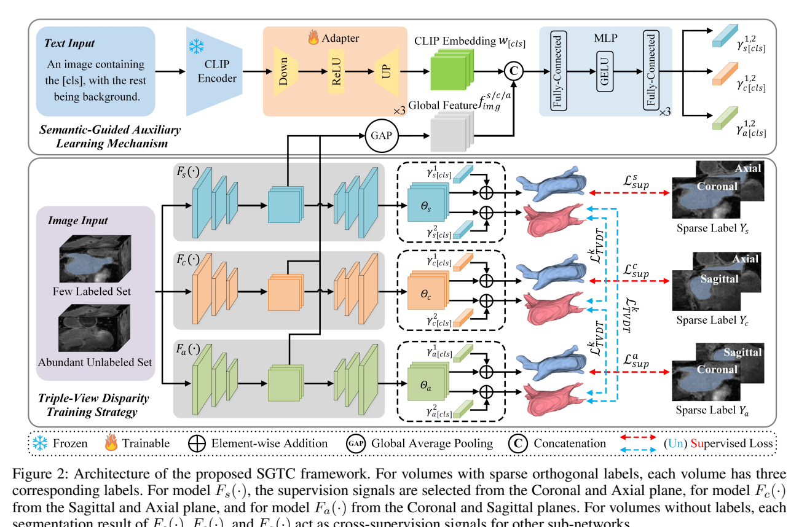
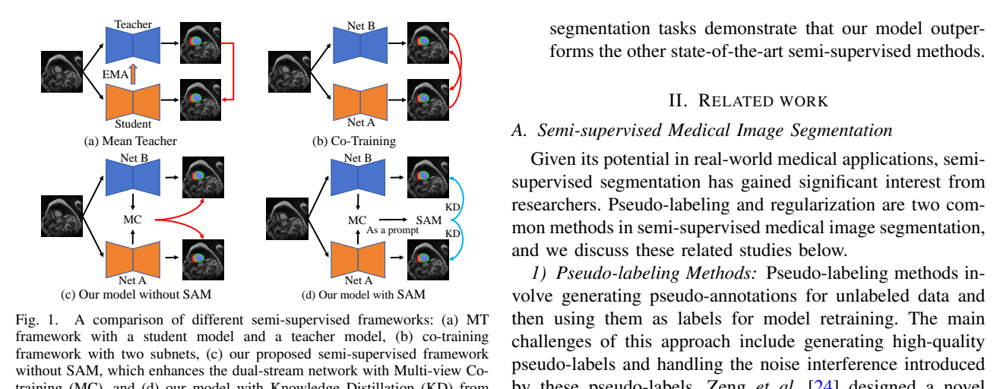
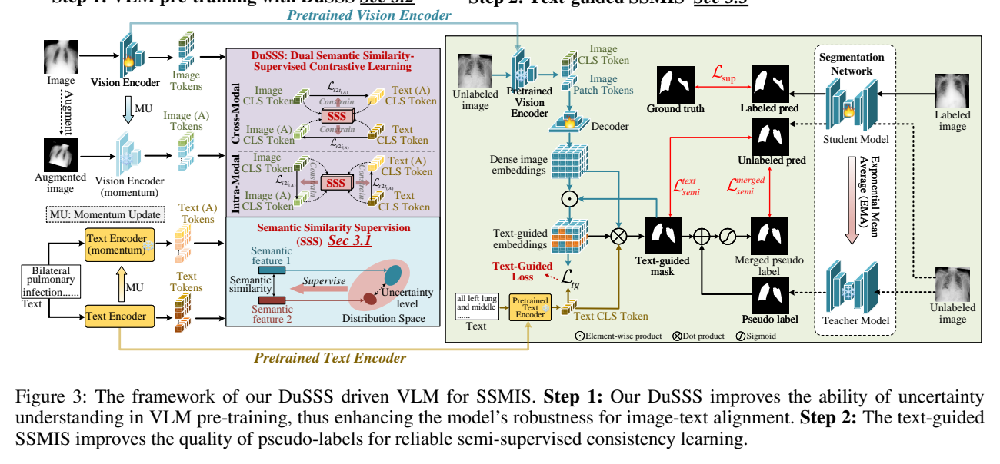
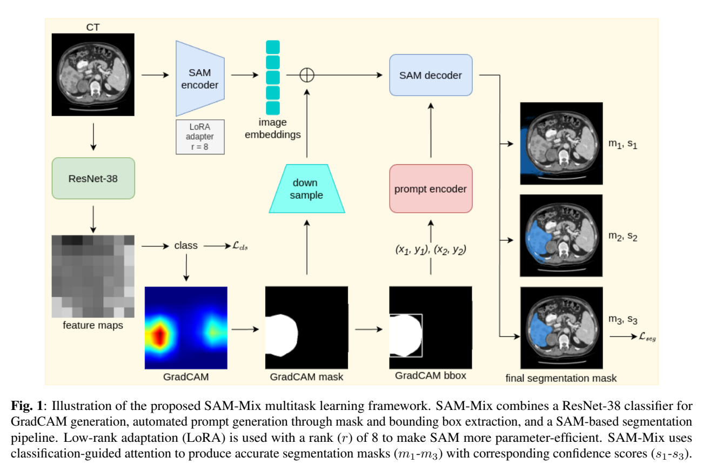

# arXiv 检索结果 / Results

## 1. SGTC: Semantic-Guided Triplet Co-training for Sparsely Annotated Semi-Supervised Medical Image Segmentation
- Authors：Ke Yan, Qing Cai, Fan Zhang, Ziyan Cao, Zhi Liu
- Venue：AAAI 2025
- Comments：Accepted by AAAI 2025
- First：2024-12-20T03:31:33+00:00；Latest：2024-12-20T03:31:33+00:00
- Abs：https://arxiv.org/abs/2412.15526v1
- PDF：https://arxiv.org/pdf/2412.15526v1
- Code：https://github.com/xmeimeimei/SGTC, https://huggingface.co/huggingface, https://huggingface.co/docs/hub/spaces
- 解读来源：PDF 全文，共 9 页，9 页可提取文字
### [中文]
**中文翻译**
- 标题：SGTC：语义引导三元组协同训练用于稀疏标注的半监督医学图像分割
- 摘要：尽管半监督学习在医学图像分割领域已取得显著进展，但逐层完整标注一个体数据样本仍然是一项昂贵且耗时的任务。更糟糕的是，现有大多数方法主要关注图像级信息而忽略语义特征，导致无法感知弱边界。为解决这些问题，我们提出了一种新颖的语义引导三元组协同训练（SGTC）框架，该框架仅通过标注少量体数据样本的三个正交切片即可实现高端医学图像分割，显著减轻了放射科医生的负担。我们的方法包含两个主要组成部分。具体而言，为实现语义感知的细粒度分割并提升伪标签质量，基于预训练的CLIP提出了一种新颖的语义引导辅助学习机制。此外，针对更具挑战性但更符合临床实际的场景，提出了一种新的三视图差异训练策略，该策略利用稀疏标注（即仅标注少量体数据的三个切片）在三个子网络之间进行协同训练，显著提升了鲁棒性。在三个公开医学数据集上的大量实验表明，在稀疏标注设置下，我们的方法优于大多数最先进的半监督对比方法。源代码可在 https://github.com/xmeimeimei/SGTC 获取。

SGTC 面向“仅标注少量体数据的三张正交切片”的稀疏标注半监督医学图像分割：用冻结 CLIP 文本编码器加可训练 Adapter 生成语义嵌入，经 MLP 产生通道调制参数注入三个 VNet 子网络；三个子网络分别由不同两平面切片监督，并对无标注体数据互相生成不确定性筛选的伪标签做三重共训练。LA2018、KiTS19、LiTS 上报告优于 7 个半监督基线；消融显示语义引导与三视图差异训练均有贡献，但部分表格排版错乱、若干设置未报告，需谨慎解读。

## 1. 问题与动机

论文针对三维医学图像分割中“逐切片完整标注代价高”的问题，提出更临床现实的稀疏标注设定：每个有标注体数据只标注三张正交切片（矢状面 S、冠状面 C、轴状面 A），且只标注少量体数据 [p. 1][p. 3]。作者认为现有半监督分割（伪标签类与一致性正则类）仍要求对有限标注体数据做逐切片密集标注 [p. 1]；已有稀疏标注方法如 PLN（每体数据 1 张切片）和 Desco（2 张正交切片）依赖切片传播或配准构造一致性，语义理解不足、边界不精确，且缺少三个平面的互补信息 [p. 2]。因此动机有两条：引入文本语义先验提升弱边界感知与伪标签质量；用三正交视图的子网络差异训练更完整地建模体数据分布 [p. 1][p. 2]。

## 2. 方法

**数据与符号。** 训练集含 M 个标注体数据 D_L={(X_l^i,Y_i)} 和 N 个无标注体数据 D_U={X_u^i}，N≫M [p. 3]。每个标注体数据仅保留三张正交切片：矢状面第 p 张 X_l^p,s、冠状面第 q 张 X_l^q,c、轴状面第 r 张 X_l^r,a，对应标注 Y^p,s、Y^q,c、Y^r,a [p. 3]。

**语义引导辅助学习（SGAL）。** 设计医学文本提示，经预训练 CLIP 文本编码器得到文本嵌入 w；因 CLIP 在自然图像上预训练、与医学图像存在域差，作者冻结 CLIP 编码器，仅训练其后的 Adapter（降维投影层、激活层、升维投影层），即 w=Adapter(CLIPEnc(Text Prompt))（式 1）[p. 3]。文本提示模板为“An image containing the [CLS], with the rest being background”，[CLS] 为具体类别名 [p. 3]。随后将 w 与分割网络编码器提取的全局图像特征 f_img 拼接，送入 MLP 得到跨模态参数 γ^{1,2}_{s/c/a}=MLP(w©f^{s/c/a}_img)（式 2，© 表示拼接）[p. 4]。γ 与各子网络最终分类层前特征 Θ_{s/c/a} 逐元素相加，再经 3D 卷积得到预测 P_{s/c/a}=Conv3D(Θ_{s/c/a}⊕γ^{1,2}_{s/c/a})（式 3，⊕ 表示逐元素相加）[p. 4]。图 2（第 3 页）给出整体架构：有标注体数据的三视图标签分别监督三个子网络，无标注体数据由三个子网络互相提供交叉监督 [p. 3]。

**三视图差异训练（TVDT）。** 三个子网络均为 3D VNet，记为 F_s、F_c、F_a [p. 4]。对标注体数据，每个子网络用另外两个平面的切片监督：Y_s=Y⊗W_s（式 4），W_s^i 在体素位于所选切片时为 1、否则为 0（式 5）；具体地，F_s 用冠状与轴状切片，F_c 用矢状与轴状切片，F_a 用冠状与矢状切片 [p. 3][p. 4]。这样既保持子网络间差异，又让每个子网络学习其他平面的知识 [p. 4]。对无标注体数据，F_s 的预测作为 F_c、F_a 的伪标签，另两个网络同理轮换；伪标签按 Monte Carlo dropout 估计不确定性，仅选不确定性低于阈值的体素参与训练 [p. 4]。无标注损失为加权交叉熵 L_kTVDT=−(1/Σm_i)Σ m_i ŷ_i^k log p_i，k=1,2（式 6），m_i 表示第 i 个体素是否被选中，p_i 为当前模型预测，ŷ^1、ŷ^2 为另两个子网络的伪标签 [p. 4]。

**监督损失与总损失。** 标注数据使用加权交叉熵 L_WCE（式 7）与加权 Dice L_Dice（式 8），L_Sup=½L_WCE+½L_Dice（式 9）[p. 4]。总损失 L_SGTC=(1−α)L_Sup+αL_kTVDT（式 10），α 为动态参数：前若干 epoch 让三张标注切片的监督损失主导，随后逐步增大无监督损失权重以稳定半监督训练 [p. 4]。

## 3. 贡献

作者声称的贡献有三点：提出语义引导辅助学习机制，实现语义感知的细粒度分割并提升伪标签质量；提出三视图差异训练策略，仅用少量体数据的三张标注切片增强子网络差异性与鲁棒性；在 LA2018、KiTS19、LiTS 三个跨模态（MR 与 CT）基准上验证优于多数 SOTA [p. 2]。我的解读：核心组合是“CLIP 文本嵌入做通道调制”加“三正交视图子网络互教”，前者提供语义先验，后者提供视图多样性与稀疏监督的结构化分配；两者都不是全新范式，但组合与稀疏标注设定较有针对性。作者还强调这是较早将文本表示用于稀疏标注半监督分割的尝试之一 [p. 2]。

## 4. 实验与结果

**数据集与划分。** LA2018：100 例钆增强 MR，分辨率 0.625×0.625×0.625 mm³，80 训练/20 测试 [p. 4]。KiTS19：300 例腹部 CT，层厚 1–5 mm，190 训练/20 测试 [p. 4]。LiTS：201 例腹部 CT，131 例有掩码，按 Desco 划分 100 训练/31 测试 [p. 5]。指标为 Dice、Jaccard、95HD、ASD [p. 5]。

**训练设置。** 所选三张切片尽量靠近各平面中心并包含前景；PyTorch；batch size 4（2 个标注体数据+2 个无标注体数据）；6000 次迭代；SGD；初始学习率 0.01 衰减至 0.0001；α 初始 0.1，每 150 次迭代增加 [p. 5]。

**对比基线。** MT、UA-MT、SASSNet、CPS、DTC、BCP、Desco 共 7 个方法；其他方法与 SGTC(Dual) 按 Desco 设置每体数据标注 2 张切片，SGTC 标注 3 张（S、C、A）[p. 5]。

**LA2018（10%，8 个标注样本，72 个无标注样本）。** 表 1 报告 SGTC Dice 0.847±0.044、Jaccard 0.738±0.066、95HD 17.442±11.719、ASD 4.256±3.836；次优 BCP 为 Dice 0.784±0.093、Jaccard 0.653±0.115、95HD 22.432±8.282、ASD 5.753±2.667；SGTC(Dual) 为 Dice 0.739±0.078 [p. 5]。作者称 Dice 超过次优 6.3% [p. 5]。

**KiTS19（10%，19 个标注样本，171 个无标注样本）。** 表 2 在正文中排版错乱，数字与行标签的对应关系无法可靠辨认；正文仅称 SGTC 在所有指标上优于现有方法，并称相较 BCP 与 DTC 的 Dice 分别提升 1.2% 与 1.5% [p. 5][p. 6]。因此具体数值不应据该表臆测。

**LiTS（10%，10 个标注样本，90 个无标注样本）。** 表 3 同样存在排版错乱，正文称标注数据越少优势越明显，但可核对的数值有限 [p. 6]。

**消融。** 表 4（KiTS19，9 个标注体数据）：无 SGAL 无 TVDT 时 Dice 0.780、Jaccard 0.655、95HD 41.630、ASD 14.110；仅 SGAL 为 0.892/0.814/10.945/3.318；仅 TVDT 为 0.896/0.817/11.985/3.106；两者合用为 0.915/0.837/9.968/2.668 [p. 6]。表 5 在相同标注策略（CAC 或 SCA）下比较，SGTC 在 CAC 为 Dice 0.911、SCA 为 0.915，作者据此称 SCA 更优且增益来自三视图差异训练 [p. 7]。表 6 文本提示消融（6 个标注、184 个无标注）：无提示 0.873，"A photo of a [cls]." 0.882，"There is a [cls] in this computerized tomography/magnetic resonance imaging." 0.883，本文提示 0.888 [p. 7]。图 6 比较三正交、两正交加一平行、三平行标注，称三正交在不同迭代下更优 [p. 7]；图 7 的 t-SNE 称三正交特征更集中 [p. 7]。表 7 的 α 分析（38 个标注、152 个无标注）：α=0.1 为 0.942/0.891，0.15 为 0.944/0.895，0.2 为 0.945/0.897，0.25 为 0.929/0.870，0.3 为 0.936/0.882，动态 α 为 0.947/0.901 [p. 7]。

## 5. 评估

支持的结论：在作者设定的 10% 稀疏标注条件下，SGTC 在 LA2018 上相对基线有明显 Dice 与表面距离优势 [p. 5]；消融表 4 支持 SGAL 与 TVDT 各自及组合带来提升 [p. 6]；文本提示与三正交标注的消融提供了方向性证据 [p. 7]。局限与缺失证据：KiTS19 与 LiTS 主表排版错乱，无法核对具体数值与标准差 [p. 6]；未报告 CLIP 具体版本、Adapter 结构细节、不确定性阈值、伪标签筛选比例、α 增长步长与上限、推理时使用哪个子网络或如何融合 [p. 3][p. 4][p. 5]；未报告参数量、训练时间与显存开销；对比基线是否在同一 backbone 与相同迭代预算下训练未明确；仅 10% 标注预算，缺少更低/更高预算曲线；作者自述当所选切片前景信息有限时性能下降 [p. 7]。此外，表 1 中 SGTC(Dual) 的“Scans Used”为 8/72，而正文称其他方法与 Dual 均标注 2 张切片，二者标注切片数不同，比较公平性需读者注意 [p. 5]。

## 6. 复现

可复现的已报告设置：三正交切片尽量取各平面中心且含前景；三个 3D VNet 子网络；冻结 CLIP 文本编码器并训练 Adapter；文本提示模板如式所述；伪标签用 Monte Carlo dropout 不确定性筛选；损失为式 6–10；batch size 4（2 标注+2 无标注）；6000 次迭代；SGD，学习率 0.01 衰减至 0.0001；α 初始 0.1、每 150 次迭代增加 [p. 3][p. 4][p. 5]。未报告：CLIP 预训练权重来源与输入分辨率、Adapter 各层维度与激活函数、MLP 层数与宽度、不确定性阈值、α 的增量与上限、数据预处理与体素间距重采样、数据增强、推理融合方式、随机种子与重复次数、硬件环境。KiTS19 与 LiTS 的具体结果数字因表格错乱无法可靠转录，复现时应以原表为准 [p. 6]。

#### 原论文流程图 · Figure 2 · PDF 第 3 页

Figure 2: Architecture of the proposed SGTC framework. For volumes with sparse orthogonal labels, each volume has three correspondinglabels.FormodelF (·),thesupervisionsignalsareselectedfromtheCoronalandAxialplane,formodelF (·) s c fromtheSagittalandAxialplane,andformodelF (·)fromtheCoronalandSagittalplanes.Forvolumeswithoutlabels,each

[原文来源](https://arxiv.org/pdf/2412.15526v1#page=3)

## 2. Uncertainty-Guided Cross Attention Ensemble Mean Teacher for Semi-supervised Medical Image Segmentation
- Authors：Meghana Karri, Amit Soni Arya, Koushik Biswas, Nicol`o Gennaro, Vedat Cicek, Gorkem Durak, Yuri S. Velichko, Ulas Bagci
- Venue：WACV 2025
- Comments：Accepted in WACV 2025
- First：2024-12-19T20:16:58+00:00；Latest：2024-12-19T20:16:58+00:00
- Abs：https://arxiv.org/abs/2412.15380v1
- PDF：https://arxiv.org/pdf/2412.15380v1
- Code：https://github.com/Meghnak13/UG-CEMT, https://huggingface.co/huggingface, https://huggingface.co/docs/hub/spaces
- 解读来源：PDF 全文，共 12 页，12 页可提取文字
### [中文]
**中文翻译**
- 标题：不确定性引导的交叉注意力集成平均教师用于半监督医学图像分割
- 摘要：本工作提出了一种新颖的框架——不确定性引导的交叉注意力集成平均教师（UG-CEMT），用于在半监督医学图像分割中实现最先进的性能。UG-CEMT结合了协同训练和知识蒸馏的优势，将受视觉Transformer（ViT）启发的交叉注意力集成平均教师框架（CEMT）与不确定性引导的一致性正则化以及强调不确定性的锐度感知最小化相结合。UG-CEMT通过促进子网络之间的高度差异性，在保持一致的网络架构和任务设置的同时提升了半监督性能。实验表明，在差异性、域泛化和医学图像分割性能方面，UG-CEMT相较于平均教师和交叉伪监督等现有方法具有显著优势。UG-CEMT在多中心前列腺MRI和心脏MRI数据集上取得了最先进的结果，这些数据集中的目标分割尤其具有挑战性。我们的结果表明，仅使用10%的标注数据，UG-CEMT就接近全监督方法的性能，证明了其在利用无标注数据实现稳健医学图像分割方面的有效性。代码已公开于\url{https://github.com/Meghnak13/UG-CEMT}

论文提出 UG-CEMT 半监督医学图像分割框架，将交叉注意力（CA）嵌入学生-教师网络以增强子网络差异，用 MC Dropout 熵估计加权一致性损失，并采用 SAM 优化器与两阶段训练。在 LA 数据集 5%/10%/20% 标签下 Dice 分别为 85.89/88.16/89.73，95HD 为 3.39/3.08/2.20 mm；在多中心前列腺数据集对应 Dice 为 65.68/70.36/72.02。消融显示 CA、EWA、不确定性图逐项增益，SAM 优于 L1/L2。但部分表格排版错乱、若干超参数（如 SAM ρ 在正文中前后不一致）与实现细节报告不清，需谨慎复现。

# UG-CEMT 论文精读笔记

## 1. 问题与动机

半监督医学图像分割（SSL）旨在用少量专家标注和大量无标注数据训练分割模型。作者指出主流方法分两类：一致性正则（如 Mean Teacher, MT）和伪标签（pseudo-labeling）。现有共训练（co-training）方法存在两个关键问题：其一，子网络之间差异（disparity）不足，容易过早收敛到共识，退化为自训练；其二，伪标签质量依赖置信度，低置信预测会传播错误 [p. 2–3]。作者还批评 UA-MT 等使用静态不确定性估计、MCF-Net 等使用伪标签时未充分考虑不确定性，以及固定阈值过滤低置信伪标签难以调参 [p. 2–4]。因此论文提出 UG-CEMT：用交叉注意力增强学生-教师特征交互与差异，用 MC Dropout 熵构造不确定性权重来加权一致性损失，并用 SAM 平滑损失景观以提升泛化 [p. 2–4]。

## 2. 方法

### 2.1 整体流程

框架如图 2 所示 [p. 4]，包含两阶段训练：第一阶段用标注与无标注数据训练 CEMT（Cross-attention Ensemble Mean Teacher），生成不确定性引导图（UGM）；第二阶段用这些 UGM 重新训练 CEMT 以精炼预测 [p. 4]。网络为学生-教师双分支，教师权重由学生权重的指数加权平均（EWA）更新：θ_t = βθ_{t−1} + (1−β)θ_t，β 为衰减率 [p. 5]。

### 2.2 交叉注意力（CA）

对学生特征 X_s 和教师特征 X_t，分别用可学习矩阵投影出 Q、K、V：Q_s=X_sW_Q^s，K_t=X_tW_K^t，V_t=X_tW_V^t；反向同理 [p. 4]。学生到教师的注意力为 CA_{s→t}=Softmax(Q_sK_t^T/√d_k)，教师到学生为 CA_{t→s}=Softmax(Q_tK_s^T/√d_k) [p. 4，式(1)(2)]。输出 O_{s→t}=CA_{s→t}V_t，O_{t→s}=CA_{t→s}V_s，再以可学习参数 γ 残差融合：X_s′=γ·O_{s→t}+X_s，X_t′=γ·O_{t→s}+X_t [p. 5，式(3)(4)]。作者称该机制增强特征对齐与信息交换，从而维持子网络差异 [p. 3–5]。

### 2.3 半监督目标

总目标为 min_θ Σ_{i=1}^{M} L_s[f(a_i;θ), b_i] + λ Σ_{j=M+1}^{M+N} L_c[f(a_j;θ,ζ), f(a_j;θ′,ζ′)] [p. 5，式(5)]。其中 L_s 为监督损失（Dice+交叉熵），L_c 为一致性损失，λ 为 ramp-up 系数，ζ、ζ′ 表示学生/教师的不同扰动（输入噪声、dropout）[p. 5]。

### 2.4 不确定性引导一致性

对输入做 T=8 次 MC Dropout 前向，得到均值预测 ŷ_mean，用熵 Entropy(ŷ_mean)=−Σ_c ŷ_c log ŷ_c 量化不确定性 [p. 5，式(6)]。一致性损失为 L_cons=E_{x∼u}[U(x)‖f_s(x)−f_t(x′)‖²₂]，其中 U(x)=exp(−Entropy(ŷ_mean))，低不确定性区域权重更高 [p. 6，式(7)]。作者强调不采用固定阈值过滤伪标签，而是把不确定性直接融入一致性正则 [p. 4]。

### 2.5 训练细节与 SAM

骨干为 V-Net，去掉每个卷积块的短残差连接；在 R-Stage 1 和 L-stage 5 后加 dropout（率 0.5），训练与不确定性估计时启用、测试时关闭 [p. 6]。EWA 衰减 α=0.99；ramp-up 函数 φ(t)=0.1×e^{−5(1−t/t_max)²} [p. 6]。SAM 优化器 ρ=0.5（方法节）[p. 6]，但实验节又写 ρ=0.05 [p. 6]，正文存在不一致。

## 3. 贡献

作者声称的贡献有三点：识别并解决共训练 SSL 中子网络差异不足与依赖低置信预测的问题，提出 CA 与不确定性引导一致性；两阶段不确定性驱动训练结合 SAM 提升跨域鲁棒性；在多个公开数据集（含 3D）上验证优于 SOTA [p. 2–3]。我的解读：核心新颖点是把 ViT 式交叉注意力用于学生-教师特征交互以人为维持差异，以及用熵权重替代阈值过滤；但“两阶段训练”和“EWA+一致性”本身并非全新，创新更多在组合与工程实现。

## 4. 实验与结果

### 4.1 数据集与设置

LA 数据集：100 例 3D 钆增强 MRI，按挑战指南 80 训练/20 测试 [p. 6]。多中心前列腺 MRI：116 例，来自 RUNMC、BMC、HCRUDB19、UCL、BIDME、HK 六个中心，92 训练/24 测试 [p. 6]。评价指标：Dice、Jaccard、95HD、ASD [p. 6]。实现：PyTorch、A6000 GPU，随机裁剪 112×112×80，SAM 基础学习率 0.01、动量 0.9、权重衰减 0.0001，batch size 4（标注/无标注各半），λ_s=0.05，一致性 ramp-up 40 epochs，温度 0.1，memory bank 每类 256 个 64 维嵌入，训练最多 6000 迭代，每 2500 迭代学习率降 0.1 [p. 6]。

### 4.2 LA 结果

表 1 [p. 7] 报告：5% 标签（4 标注/76 无标注）时 UG-CEMT Dice 85.89、Jaccard 76.23、95HD 3.39、ASD 0.69；10%（8/72）时 88.16/79.83/3.08/0.51；20%（16/64）时 89.73/81.63/2.20/0.50。对比 20% 下 SASSNet 95HD 12.31、ASD 3.27，作者称降至 2.30 与 0.50 [p. 7]，但表中 95HD 为 2.20，正文与表格数字不一致。全监督 B-VNet 100% 标签 Dice 91.20、95HD 4.56 [p. 7]。

### 4.3 前列腺结果

表 2 [p. 8]：5%（5/87）Dice 65.68、Jaccard 56.87；10%（9/83）70.36/60.73；20%（18/74）72.02/61.29。全监督 B-VNet 100% 为 80.76/67.49 [p. 8]。作者称 UA-MT 等在前列腺上相对表现更好，但 UG-CEMT 仍一致领先 [p. 8]。

### 4.4 消融

表 4 [p. 9]：5% 标签下 baseline ST Dice 78.16/95HD 11.89，加 EWA 得 83.72/6.37，加 CA 得 85.23/5.12，完整 UG-CEMT 85.89/3.39；10% 与 20% 呈相同趋势 [p. 9–10]。表 3 [p. 9]：20% 标签下 L1 Dice 88.02/95HD 6.08，L2 88.34/5.76，SAM 89.73/2.8（正文写 2.8，表 1 写 2.20，存在不一致）[p. 9]。图 6 比较 CR 与 PLG：前 2000 迭代 PLG 更好，之后 CR 反超，5000 迭代后差距扩大 [p. 9–10]。

### 4.5 计算成本

模型 9.66M 参数、47.1G MACs，6000 迭代训练约 1 小时 50 分钟 [p. 9]。

## 5. 评估

支持的结论：在 LA 与多中心前列腺数据上，UG-CEMT 在 5%/10%/20% 标签预算下多数指标优于所列基线；消融支持 CA、EWA、不确定性图各自带来增益，SAM 优于 L1/L2。作者报告的局限包括交叉注意力与不确定性估计增加计算开销、未验证更多任务与模态、不确定性校准有待研究 [p. 10]。缺失或不清之处：表 1、表 2 在 PDF 文本中排版错乱，部分数字需对照正文；SAM 的 ρ 在方法节为 0.5、实验节为 0.05；20% 下 95HD 在表 1 为 2.20 而正文与表 3 为 2.30/2.8；两阶段训练的具体切换条件、第二阶段损失细节、memory bank 与温度 0.1 的具体用途未在正文说明；未报告多次运行的均值/方差与显著性检验。

## 6. 复现

可复现的设置：V-Net 去短残差、dropout 0.5 置于 R-Stage 1 与 L-stage 5 后；T=8 次 MC Dropout；EWA α=0.99；ramp-up 上限 0.1；SAM 学习率 0.01、动量 0.9、权重衰减 1e-4；batch 4；裁剪 112×112×80；6000 迭代、每 2500 迭代学习率×0.1；λ_s=0.05；一致性 ramp-up 40 epochs；温度 0.1；memory bank 256×64 [p. 6]。未报告：SAM ρ 的最终取值（0.5 与 0.05 冲突）、两阶段切换的迭代点、第二阶段是否冻结教师、数据增强的具体类型与强度、随机种子与重复次数、前列腺数据各中心划分细节。代码链接在摘要中给出，但正文未说明依赖版本。

本篇未找到可可靠提取的方法流程图，请查看原文 PDF。

## 3. Learnable Prompting SAM-induced Knowledge Distillation for Semi-supervised Medical Image Segmentation
- Authors：Kaiwen Huang, Tao Zhou, Huazhu Fu, Yizhe Zhang, Yi Zhou, Chen Gong, Dong Liang
- Comments：12 pages, 7 figures
- First：2024-12-18T11:19:23+00:00；Latest：2024-12-18T11:19:23+00:00
- Abs：https://arxiv.org/abs/2412.13742v1
- PDF：https://arxiv.org/pdf/2412.13742v1
- Code：https://github.com/taozh2017/KnowSAM, https://huggingface.co/huggingface, https://huggingface.co/docs/hub/spaces
- 解读来源：PDF 全文，共 12 页，12 页可提取文字
### [中文]
**中文翻译**
- 标题：面向半监督医学图像分割的可学习提示SAM诱导知识蒸馏
- 摘要：标注数据有限推动了医学图像分割中半监督学习的发展。面向通用分割的现代大规模模型，如Segment Anything Model（SAM），已展现出强大的泛化能力。然而，将这些模型直接应用于医学图像分割仍会出现性能下降。本文提出了一种用于半监督医学图像分割的可学习提示SAM诱导知识蒸馏框架（KnowSAM）。首先，我们提出多视角协同训练（MC）策略，采用两个不同的子网络实施协同教学范式，从而获得更稳健的结果。其次，我们提出可学习提示策略（LPS），动态生成稠密提示并集成适配器以针对医学图像分割任务微调SAM。此外，我们提出SAM诱导知识蒸馏（SKD），将SAM中的有用知识迁移到两个子网络，使其能够从SAM的预测中学习，并缓解训练过程中错误伪标签的影响。值得注意的是，我们子网络生成的预测被用于为SAM生成掩码提示，促进模块间的有效信息交换。在各种医学分割任务上的大量实验结果表明，我们的模型优于最先进的半监督分割方法。关键的是，我们的SAM蒸馏框架可以无缝集成到其他半监督分割方法中以提升性能。代码将在本稿件被接收后发布于：https://github.com/taozh2017/KnowSAM

论文提出 KnowSAM 半监督医学分割框架：双流 U-Net/V-Net 通过多视角协同训练（MC）与混合聚合模块（HAM）融合预测、熵不确定性和差异图；用可学习提示策略（LPS）为 SAM 生成稠密特征提示并加适配器微调；以 SAM 为教师对两个子网做知识蒸馏（SKD），子网融合预测又作为 SAM 的掩码提示；另加不确定性引导数据增强（UGDA）。在结肠镜、超声甲状腺、ISIC-2018、ACDC、BCSS 上，10%/30% 标签设置下多数指标优于 12 个半监督基线；消融显示 HAM、LPS、UGDA 和各损失项均有贡献。

# KnowSAM 论文精读笔记

## 1. 问题与动机

论文针对半监督医学图像分割：标注像素级数据成本高，需利用大量无标签数据。作者指出，均值教师（MT）类方法存在学生-教师认知偏差问题，双流协同训练（co-training）又因无标签数据缺少真值监督，容易产生低质量伪标签与子网分歧 [p. 1]。另一方面，SAM 等基础模型泛化能力强，但直接用于医学分割会性能下降；已有将 SAM 接入医学分割的工作多依赖点/框等硬提示，错误提示会显著削弱 SAM 效果 [p. 1]。因此作者希望把 SAM 的泛化知识通过蒸馏迁移给轻量子网，同时避免推理时依赖 SAM。

## 2. 方法

整体流程见 Fig. 2 [p. 3]：输入图像分别送入两个结构不同的子网 FA、FB，得到预测 Ŷa、Ŷb；二者与熵图、差异图一起进入混合聚合模块（HAM），得到融合预测 Ŷf。Ŷf 作为 SAM 解码器的掩码提示；同时 SAM 图像编码器提取特征 Z，经轻量解码器 ψ(·) 生成可学习稠密特征提示 Pb。两类提示共同送入 SAM 解码器得到 Ŷs。SAM 仅用有标签数据监督，其输出再通过蒸馏指导两个子网；推理时只用子网，Ŷf 为最终结果 [p. 3-5]。

**多视角协同训练（MC）与 HAM。** 熵图定义为 H = −Σ_c Ŷ_c log Ŷ_c（式 1），分别得到 Ha、Hb；差异图 M = B(Ŷa) ⊕ B(Ŷb)（式 2），B 为二值化、⊕ 为异或。HAM 将 {Ha,Hb}、M、{Ŷa,Ŷb} 拼接后经 Conv-BatchNorm-LeakyReLU 融合：Ŷf = FCBL(FCAT{FCBL(Ha,Hb), FCBL(M), FCBL(Ŷa,Ŷb)})（式 3）。Ŷf 仅由有标签真值监督，Lfuse = LSEG(Ŷf, Yl)（式 4），LSEG = Dice + CE。两个子网之间还有双向互相监督 Lmut = LCE(Ŷa,Ŷb) + LCE(Ŷb,Ŷa)（式 5）[p. 3-4]。

**可学习提示策略（LPS）。** 用轻量解码器 ψ 从 SAM 编码特征 Z 生成稠密提示 Pb = ψ(Z; Θm)（式 6），Pb ∈ R^{B×Nb×L}；Ŷf 作为掩码提示，SAM 解码器输出 Ŷs = Fs(Pb, Ŷf; Θs)（式 7）。作者在 SAM 图像编码器和解码器中加入 adapter 微调，SAM 仅受有标签真值监督：Lsam = LSEG(Ŷs, Yl)（式 8）[p. 4]。

**SAM 诱导知识蒸馏（SKD）。** 用温度 T 的软 softmax（式 9）软化概率，蒸馏损失 Lkd = KL(ŶaT, ŶsT) + KL(ŶbT, ŶsT)（式 10），梯度只回传到两个子网，不回传 SAM [p. 4]。

**不确定性引导数据增强（UGDA）。** 对有标签数据做弱增强、无标签数据做强增强（式 11）；用 Ŷf 的熵图划分 16 个 patch，取平均不确定性最高的 5 个区域，在有标签与无标签数据间做双向 copy-paste，混合图像标签由有标签真值和 SAM 伪标签组成 [p. 4-5, Fig. 3]。

**总损失。** 子网损失 Lsup = LSEG(Ŷa,Yl)+LSEG(Ŷb,Yl)+Lfuse（式 12）；熵损失 Lent 对两子网逐像素熵求和（式 13）；总损失 Ltotal = Lsup + Lkd + λe·Lent + λm·Lmut（式 14），λe 经验设为 0.9，λm 用高斯 warm-up λm(t)=β·e^{−5(1−t/tmax)^2}，β=1 [p. 5]。

## 3. 贡献

作者声称的贡献包括：提出 KnowSAM 框架，把 SAM 泛化能力通过蒸馏用于半监督分割，并可无缝接入其他半监督方法；提出 MC/HAM 融合子网输出、熵不确定性和差异区域；提出 LPS 以稠密可学习提示替代易错的硬坐标提示；在多种医学分割任务上取得优于 SOTA 的结果 [p. 2]。我的解读是：核心工程创新在于“子网→SAM 掩码提示”和“SAM→子网蒸馏”的双向信息交换，以及用 HAM 把不确定性/分歧显式建模为可学习融合输入；LPS 与 adapter 微调更接近对 SAM 的医学适配，而非全新分割范式。

## 4. 实验与结果

**数据与设置。** 结肠镜：CVC-ClinicDB 与 Kvasir 共 1450 张训练、798 张测试；超声甲状腺：TN3K+TG3K 训练/验证，TN3K 614 张 + DDTI 637 张测试；ISIC-2018：2594 训练、1000 测试；ACDC：70 训练/10 验证/20 测试；BCSS：3888 张 1024×1024 裁剪图，按 70%/10%/20% 划分 [p. 5]。所有任务从训练集随机取 10% 或 30% 作为有标签数据 [p. 5]。子网为 U-Net 与 V-Net，SAM 用 base 版本；SAM 用 Adam，初始学习率 0.0001；子网用 SGD，动量 0.9、权重衰减 0.0001、初始学习率 0.01；batch size 24，迭代 50k，输入 256×256；NVIDIA 3090、PyTorch 1.8.1/CUDA 11.2 [p. 5]。指标为 Dice、IoU、95HD，3D 数据另加 ASD [p. 5]。

**对比结果。** 与 MT、UA-MT、DTC、URPC、MC-Net、MC-Net+、MCF、CDMA、CauSSL、BS-Net、BCP、CAML 等 12 个方法比较 [p. 5]。结肠镜 10% 标签下 KnowSAM Dice 82.86%、IoU 75.19%、95HD 3.46；30% 下 84.28%/76.98%/3.20（Table I）[p. 6]。超声 10% 下 Dice 69.76%、IoU 62.14%、95HD 4.51；30% 下 70.37%/62.53%/4.57 [p. 6]。ISIC-2018 10% 下 85.98%/79.25%/4.41，30% 下 88.74%/82.93%/4.22 [p. 6]。ACDC 10% 标签（7 例）下 Dice 89.56%、IoU 81.66%、HD95 1.28、ASD 0.36；30%（21 例）下 91.13%/84.11%/1.29/0.30（Table II）[p. 7]。BCSS 10% 下 Dice 72.69%、IoU 61.09%、HD95 7.77；30% 下 73.41%/61.50%/7.85（Table III）[p. 8]。作者称在 CVC-ColonDB、ETIS 等未见数据集上 Dice 提升明显，10% 时 DDTI 比次优 MCF 高 0.51%，TN3K 从 CAML 的 77.78% 提升到 78.57% [p. 6]。

**消融。** HAM 视图：ACDC 30% 标签下，仅 Pred. 时 Dice 88.63%、HD95 5.14；加 H 后 89.18%/4.06；再加 M 后 90.22%/1.21（Table IV）[p. 8]。LPS 对比 Box：Table V 中 SAM 单独在 10% 下 Box 86.60% vs LPS 87.29%，30% 下 86.94% vs 90.01%；KnowSAM 在 10% 下 Box 86.32% vs LPS 85.98%，30% 下 85.22% vs 88.74%，并非所有设置都一致占优 [p. 8]。UGDA：Kvasir 10% 下 Dice 从 80.45% 升至 84.47%，HD95 从 5.04 降至 4.69（Table VI）[p. 8]。损失消融：Table VII 显示逐步加入 Lent、Lmut、Lkd 总体提升，10% 下仅 Lsup 为 81.94%，加 Lkd 为 85.86%，全损失为 85.98%；30% 下全损失 88.74% [p. 9]。与 SAM 类半监督方法比较：Table VIII 中 KnowSAM 多数优于 SemiSAM 和 CPC-SAM†；与 MedSAM 比较：Table IX 中 SAM 版本在四个任务上均优于 MedSAM [p. 9-10]。

## 5. 评估

支持的结论：在报告的数据划分和 10%/30% 标签预算下，KnowSAM 在多数数据集/指标上优于所列基线；消融支持 HAM 的熵与差异视图、UGDA 和 SKD 对性能有贡献。作者也报告了失败案例：肿瘤区域被背景严重遮挡、边界模糊时分割困难；在未见数据集上能定位主体但产生不精确碎片，归因于训练与测试分布差异 [p. 10]。

局限与缺失证据：论文未报告参数量、推理时间或显存开销，虽声称 UNet 推理成本低于 SAM，但无量化数据 [p. 10]；未报告多次随机种子或显著性检验；Table I 表头与数据集对应关系在文本中不够清晰，部分数字排版粘连（如 95HD 与下一列），需谨慎引用；LPS 在 KnowSAM 10% 设置下略低于 Box，作者未专门解释该反例 [p. 8]；UGDA 的 patch 数 16、top-5 等超参未做敏感性分析。

## 6. 复现

已报告：U-Net + V-Net 双流；SAM base；SAM 用 Adam lr=0.0001，子网 SGD lr=0.01、momentum 0.9、weight decay 0.0001；batch size 24；50k 迭代；输入 256×256；λe=0.9；λm 高斯 warm-up，β=1；UGDA 划分 16 patch、选 top-5；10%/30% 标签比例；各数据集划分如第 4 节 [p. 5]。未报告：SAM adapter 的具体结构/插入位置与参数量、ψ(·) 的层数与通道、温度 T 的取值、KL 蒸馏的权重、UGDA 中强弱增强的具体算子、优化器调度细节、随机种子与重复次数、推理耗时。代码链接为 https://github.com/taozh2017/KnowSAM，但论文称接收后发布 [p. 1]。

#### 原论文流程图 · Figure 1 · PDF 第 2 页

Fig. 1. A comparison of different semi-supervised frameworks: (a) MT then using them as labels for model retraining. The main framework with a student model and a teacher model, (b) co-training challenges of this approach include generating high-quality framework with two subnets, (c) our proposed semi-supervised framework pseudo-labels and handling the noise interference introduced

[原文来源](https://arxiv.org/pdf/2412.13742v1#page=2)

## 4. DuSSS: Dual Semantic Similarity-Supervised Vision-Language Model for Semi-Supervised Medical Image Segmentation
- Authors：Qingtao Pan, Wenhao Qiao, Jingjiao Lou, Bing Ji, Shuo Li
- First：2024-12-17T02:47:00+00:00；Latest：2024-12-17T02:47:00+00:00
- Abs：https://arxiv.org/abs/2412.12492v1
- PDF：https://arxiv.org/pdf/2412.12492v1
- Code：https://huggingface.co/huggingface, https://huggingface.co/docs/hub/spaces, https://github.com/QingtaoPan/DuSSS/
- 解读来源：PDF 全文，共 9 页，9 页可提取文字
### [中文]
**中文翻译**
- 标题：DuSSS：用于半监督医学图像分割的双语义相似性监督视觉-语言模型
- 摘要：半监督医学图像分割（SSMIS）利用一致性学习对模型训练进行正则化，从而减轻逐像素人工标注的负担。然而，它常常受到低质量伪标签带来的错误监督的影响。视觉-语言模型（VLM）通过引入文本提示引导的多模态监督信息，在增强伪标签方面具有巨大潜力。但它仍面临跨模态问题：所获得的信息往往对应多个目标。为解决上述问题，我们提出了一种用于SSMIS的双语义相似性监督VLM（DuSSS）。具体而言，1）设计了双对比学习（DCL），通过捕获各模态内的内在表示和跨模态的语义相关性来提高跨模态语义一致性。2）为促进多种语义对应关系的学习，提出了语义相似性监督策略（SSS），并将其注入DCL中的每个对比学习过程，通过基于分布的不确定性水平来监督语义相似性。此外，设计了一种新颖的基于VLM的SSMIS网络，以弥补伪标签的质量缺陷。它利用预训练的VLM生成文本提示引导的监督信息，细化伪标签以获得更好的一致性正则化。实验结果表明，我们的DuSSS在三个公开数据集（QaTa-COV19、BM-Seg和MoNuSeg）上取得了优异性能，Dice分别为82.52%、74.61%和78.03%。

DuSSS 将视觉-语言模型（VLM）引入半监督医学图像分割，用文本引导掩码提升伪标签质量；其核心是双重对比学习（DCL）与语义相似度监督（SSS），后者用分布间 2-Wasserstein 距离衡量不确定性并调制图文相似度。在 QaTa-COV19、BM-Seg、MoNuSeg 三个数据集上，50% 标注预算下 Dice 分别为 82.52%、74.61%、78.03%；消融显示 SSS、DCL、文本引导损失均有增益，但部分表格数字与正文表述存在不一致，且训练细节（如预训练数据、VLM 骨干、文本模板）报告不足。

# DuSSS 论文精读笔记

## 1. 问题与动机

半监督医学图像分割（SSMIS）依赖一致性正则与伪标签，但低质量伪标签会带来错误监督，误导模型并破坏无标注数据上的一致性学习 [p. 1]。作者认为现有 SSMIS 方法仍是单模态范式，伪标签质量差 [p. 2]。视觉-语言模型（VLM）可通过文本提示生成多模态监督信息来增强伪标签 [p. 1]，但现有 VLM（如 CLIP、MedCLIP、MGCA）只做图文一对一对齐，存在跨模态不确定性：多张图像/文本可能对应同一文本/图像 [p. 2]。基于分布表示的方法虽能用方差刻画不确定性，却会丢失原始语义属性，导致图文语义关联变差 [p. 2]。因此作者提出在保留语义属性的同时处理不确定性，学习多语义对应关系 [p. 2]。

## 2. 方法

整体分两步（图 3，[p. 4]）：Step 1 用 DuSSS 预训练 VLM；Step 2 用文本引导的 SSMIS 提升伪标签质量。

### 2.1 语义相似度监督（SSS）

对配对数据 (x1, x2)，语义相似度定义为嵌入欧氏距离 Ds(x1,x2)=||s1−s2||2 [p. 3]。为度量不确定性，将语义嵌入建模为多元高斯分布，均值 μ 表示中心、方差 σ² 表示分布范围；用 2-Wasserstein 距离衡量两个高斯分布差异：D²_W=||μ1−μ2||²₂+||σ1−σ2||²₂ [p. 3, 式(1)]。不确定性水平 Du=a·D²_W(x1[CLS],x2[CLS])+b，a 为正尺度、b 为偏置 [p. 3, 式(2)]。相对不确定性为 bDu=Du/Ds [p. 3, 式(3)]，SSS 定义为 DSSS=e^(−λ·bDu)，λ 控制约束强度 [p. 3, 式(4)]。直观上，不确定性越大，相似度约束越强。

### 2.2 双重对比学习（DCL）

跨模态对比（CMC）：用 DSSS 调制余弦相似度，得到不确定性余弦相似度 sbim(I,T)=1−(1−sim(I,T))·DSSS(I,T) [p. 3, 式(5)]，再以 InfoNCE 优化图像到文本和文本到图像两个方向 [p. 3, 式(6)(7)]，跨模态损失 Lcmc 为二者平均 [p. 4, 式(8)]。批内 N 个正图文对、N(N−1) 个负对 [p. 3]。

模态内对比（IMC）：对原始图文 (I1,T1) 与随机增强图文 (I2,T2) 做图像-图像、文本-文本对比，损失 Limc 为两个 InfoNCE 的平均 [p. 4, 式(9)]，SSS 同样注入其中以削弱模态内语义不确定性 [p. 4]。

### 2.3 文本引导 SSMIS

文本引导伪标签：patch 级图像特征 vf^patch 经 grounding 解码器 fg(·) 得到像素级特征 vf，文本特征 tf 与 vf 点积后经 Sigmoid 得到文本引导掩码 ytext_u=σ(tfᵀvf) [p. 4, 式(10)]。文本引导损失 Ltg 为双向 InfoNCE 平均，用于抑制无关文本区域 [p. 4, 式(11)]。

教师-学生伪标签：教师参数 θt 由学生 θs 的 EMA 更新，θt=αθt+(1−α)θs [p. 5, 式(12)]；学生预测有标注图像 xl 与无标注图像 xu，教师生成无标注伪标签 yt_u [p. 5, 式(13)]。总损失含监督损失 Lsup [p. 5, 式(14)] 与半监督损失 Lsemi=(Lmerged_semi+Ltext_semi)/2 [p. 5, 式(17)]；Lmerged_semi 以教师伪标签与文本引导掩码之和经 Sigmoid 后的合并伪标签为监督 [p. 5, 式(15)]，Ltext_semi 以文本引导掩码为监督 [p. 5, 式(16)]。

### 2.4 理论分析

作者给出推导：sbim(I,T)=1−(1−sim(I,T))·e^(−λ·Du/Ds)∝Du(x1,x2) [p. 5, 式(18)]，并称高不确定性图文对会被推得更相似，从而缓解对齐不确定性 [p. 5]。该推导的符号与比例关系在文中较简略，属于作者主张。

## 3. 贡献

作者声称：1）首个基于 VLM 的 SSMIS 伪标签方法，利用文本提示定位分割区域 [p. 2]；2）SSS 通过不确定性水平监督语义相似度，促进对相似但语义模糊数据对的理解 [p. 2]；3）DCL 同时增强跨模态语义关联与模态内表示关系 [p. 2]；4）在三公开数据集上优于 SOTA [p. 2]。我的解读：核心创新是把分布不确定性作为相似度调制项嵌入对比学习，并将文本引导掩码与教师伪标签融合进一致性正则；但“首个”属于作者主张，文中未给出系统性文献排除证据。

## 4. 实验与结果

### 4.1 数据集与设置

QaTa-COV19：9258 张 COVID-19 胸片，7145 训练/2113 测试，文本标注来自 LViT [p. 5]。BM-Seg：23 例 CT 共 1517 层，选单视图 270 层，200 训练/70 测试，文本由专业人员标注 [p. 5]。MoNuSeg：44 张 1000×1000 图像，30 训练/14 测试 [p. 5]。实现：PyTorch、Ubuntu 20.04.4 LTS、24GB V100；学习率 QaTa-COV19 与 BM-Seg 为 3e-4、MoNuSeg 为 1e-3；20 轮无提升早停；batch size 分别为 32、16、4 [p. 5]。评价指标为 Dice 与 mIoU [p. 5]。

### 4.2 对比实验

表 1 对比 13 种方法 [p. 5-6]。50% 标注下，DuSSS 在 QaTa-COV19 得 Dice 82.52%、mIoU 75.87%；BM-Seg 得 74.61%、61.08%；MoNuSeg 得 78.03%、66.93% [p. 6]。正文称 25% 标注下 QaTa-COV19 的 Dice 为 79.00%、mIoU 为 68.21% [p. 6]。表 1 中 25% 部分可辨认的对比：MT 79.64/71.88、CCT 80.25/71.69、BCP 75.57/65.31、MC-Net 74.98/61.97、SS-Net 68.37/56.73、UCMT 77.81/68.65、LViT 80.32/72.16、CMITM 81.33/72.84、ASG 80.47/71.84、MGCA 81.24/73.56，Ours 82.52/75.87 [p. 6]。注意：表 1 的 25% 行中 Ours 数值与正文所述 79.00/68.21 不一致，且表头与行对齐在文本中较混乱，需以原表为准；此处仅记录可辨认数字。

### 4.3 消融

表 2 基于 50% 标注 [p. 6]。基线（教师-学生网络）在 QaTa-COV19 为 79.64/71.88，BM-Seg 72.31/56.99，MoNuSeg 75.15/59.64；加 SSS 后为 80.86/72.33、74.34/60.22、77.25/63.81；加 DCL 后为 80.13/72.31、73.11/60.14、76.90/62.73；加 Ltg 后为 81.49/75.25、75.58/60.79、77.53/65.10；SSS+DCL 为 81.10/75.08、75.24/59.11、77.74/64.62；三者全用为 82.52/75.87、76.41/61.08、78.03/66.93 [p. 6]。正文称去掉 SSS 使 QaTa-COV19 Dice 降 1.22%、mIoU 降 0.45%，SSS 加到 DCL 上再提升 0.97% Dice 和 2.77% mIoU [p. 7]；但表 2 中 SSS+DCL 与全模型对比显示 Dice 从 81.10 到 82.52（+1.42），与正文数字不完全对应，可能指不同对照组合，原文未明确说明。

### 4.4 不确定性与定性分析

图 5 显示 DuSSS 对多个相似但词汇模糊的文本能稳定激活目标区域，而其他 VLM 方法激活不稳定 [p. 7]。图 4 定性对比称 DuSSS 边界更连贯、小目标更好，SS-Net、MC-Net、BCP、MT、CCT 误分割更严重 [p. 5, p. 7]。这些为作者基于可视化的主张，未报告定量不确定性指标。

## 5. 评估

支持的结论：在三个数据集、50% 标注设置下，DuSSS 的 Dice/mIoU 优于表 1 所列对比方法；消融表明 SSS、DCL、Ltg 各自带来增益，三者组合最佳 [p. 6-7]。局限与缺失证据：1）未报告 VLM 预训练数据规模、文本模板、grounding 解码器结构、α、λ、a、b、τ 等关键超参 [p. 3-5]；2）表 1 与正文 25% 结果存在不一致，表格排版在文本中难以完整辨认 [p. 6]；3）消融正文百分比与表 2 数值不完全吻合 [p. 6-7]；4）未报告多次运行方差、显著性检验；5）BM-Seg 仅选单视图 270 层，泛化性证据有限 [p. 5]；6）理论分析较简略，比例关系推导未充分展开 [p. 5]。

## 6. 复现

已报告：PyTorch、Ubuntu 20.04.4 LTS、24GB V100；学习率 3e-4（QaTa-COV19、BM-Seg）、1e-3（MoNuSeg）；早停 20 轮；batch size 32/16/4；EMA 更新式 θt=αθt+(1−α)θs；损失由 Lsup、Lmerged_semi、Ltext_semi 组成；代码链接 https://github.com/QingtaoPan/DuSSS/ [p. 1, p. 5]。未报告：VLM 骨干与预训练语料、文本编码器细节、grounding 解码器 fg 结构、α、λ、a、b、τ 取值、数据增强方式、优化器、训练轮数、图像分辨率、文本模板、有无预训练权重初始化、对比学习温度是否可学习等。复现时需先按式(1)-(11)实现 SSS 与 DCL 预训练，再按式(12)-(17)实现教师-学生与文本引导掩码融合；上述缺失项需向作者或代码仓库确认，不能从正文推断。

#### 原论文流程图 · Figure 3 · PDF 第 4 页

Figure 3: The framework of our DuSSS driven VLM for SSMIS. Step 1: Our DuSSS improves the ability of uncertainty understandinginVLMpre-training,thusenhancingthemodel’srobustnessforimage-textalignment.Step2:Thetext-guided SSMISimprovesthequalityofpseudo-labelsforreliablesemi-supervisedconsistencylearning.

[原文来源](https://arxiv.org/pdf/2412.12492v1#page=4)

## 5. Annotation-Efficient Task Guidance for Medical Segment Anything
- Authors：Tyler Ward, Abdullah-Al-Zubaer Imran
- First：2024-12-11T17:47:00+00:00；Latest：2024-12-11T17:47:00+00:00
- Abs：https://arxiv.org/abs/2412.08575v1
- PDF：https://arxiv.org/pdf/2412.08575v1
- Code：https://github.com/tbwa233/SAM-Mix, https://huggingface.co/huggingface, https://huggingface.co/docs/hub/spaces
- 解读来源：PDF 全文，共 6 页，6 页可提取文字
### [中文]
**中文翻译**
- 标题：面向医学分割一切模型的标注高效任务引导
- 摘要：医学图像分割是影像工作流程中的关键任务，影响许多基于图像的决策。传统的全监督分割模型依赖大量标注训练数据，通常通过人工标注获得，这一过程昂贵、耗时且易出错。这表明需要准确、自动且标注高效的模型训练方法。我们提出SAM-Mix，一种用于医学图像分割的新型多任务学习框架，利用辅助分类器生成的类激活图来引导基于SAM框架的半监督分割分支的预测。在公开LiTS数据集上的实验评估证实了SAM-Mix在腹部计算机断层扫描（CT）中肝脏同时分类与分割的有效性。在仅使用50个标注2D切片（仅占可用标注训练数据的0.04%）且训练轮次减少90%的情况下，SAM-Mix相比最佳基线模型实现了5.1%的Dice提升。SAM-Mix的泛化结果更为显著，相同模型配置在跨域分割任务上实现了25.4%的Dice提升。我们的代码可在https://github.com/tbwa233/SAM-Mix获取。

SAM-Mix 将 ResNet-38 分类器产生的 GradCAM 自动转为二值掩码与包围盒提示，驱动基于 SAM 的半监督分割分支，并用 LoRA（r=8）降低可训练参数。在 LiTS 上仅用 50 张标注 2D 切片、训练 10 个 epoch 时，Dice 达 0.923±0.004，比最佳全监督 U-Net（0.897±0.010）高 5.9%；跨域 TotalSegmentator 上 SAM-Mix-50 的 Dice 为 0.948±0.002，比 U-Net 的 0.669±0.055 高 25.4%。作者主张该框架实现无需人工提示的标注高效分割，但分类分支与分割分支的联合训练细节、阈值敏感性及统计检验未充分报告。

# SAM-Mix 论文详细阅读笔记

## 1. 问题与动机

医学图像分割（如肝脏、病灶、肿瘤）是下游影像流程的关键任务，但传统全监督 U-Net 类模型依赖大量人工标注，成本高、耗时长且易出错 [p. 1]。SAM 等分割基础模型具备零样本/少样本泛化能力，但其核心是“可提示”分割，需要点、框、文本或掩码提示；在医学等专业领域，全自动提示生成仍研究不足且效果有限，而人工或半自动提示又带来与标注类似的负担 [p. 1]。

作者指出，弱监督语义分割中常用的类激活图（CAM）虽可与 SAM 结合，但 CAM 本身含噪声；已有 S2C 尝试用 SAM 改善 CAM，而“用 CAM 增强 SAM 输出”这一反向过程研究不足，且 S2C 需在训练前对全数据集运行 SAM 自动掩码生成器，训练成本高 [p. 2]。因此，论文要解决的问题是：如何在极少分割标注下，自动生成高质量提示并提升 SAM 医学分割的精度与跨域泛化能力。

## 2. 方法

### 2.1 总体流程

SAM-Mix 是一个多任务学习框架，包含三条相互衔接的路径（图 1，[p. 2]）：
1. ResNet-38 分类器对输入 CT 切片做二分类（有无肝脏），并产生 GradCAM；
2. 对 GradCAM 阈值化得到二值掩码，再提取包围盒作为 SAM 的自动提示；
3. SAM 分割分支以图像编码器、提示编码器和解码器输出分割掩码，图像编码器注意力中插入 LoRA（rank r=8）以降低可训练参数量。

### 2.2 问题形式化与辅助分类

设数据分布 p(X,Y)，X={x1,…,xN} 为腹部 CT 切片，Y 为对应分割真值；网络 Gϕ 学习 X→Y。辅助分类标签由 C={max(yi)} 构造，其中 yi∈{0,1}^{256×256}，即切片中是否存在肝脏 [p. 2]。

分类分支以 ResNet-38 为骨干，编码器 CE 提取特征图 Fcls=CE(X)（式 1），对最后一层卷积特征 Flast 做全局平均池化得到类 logits ĉ=GAP(Flast)（式 2），再经全连接层输出分类。二分类损失为焦点损失：Lcls=−α(1−pt)^γ log(pt)（式 3），pt 为真实类别的预测概率，α 平衡正负样本，γ 调节易分样本降权速度 [p. 3]。

### 2.3 GradCAM 与自动提示生成

对类别 c，GradCAM 为 g=Σ_i w_i^(c) Flast,i（式 4），Flast,i 为最后一卷积块的第 i 个特征图，w_i^(c) 为全连接层中类别 c 对应权重 [p. 3]。随后按阈值 τ 生成二值掩码：b(x,y)=1 若 g(x,y)≥τ，否则为 0（式 5）；τ=ω·max(g)（式 6），ω 为预设阈值因子。论文称“为简化二分类任务，将阈值 τ 设为 0.5” [p. 3]，但式 6 表明 τ 是最大激活值的比例，0.5 究竟指 ω 还是绝对阈值，文中表述不够清晰。

对每个激活区域计算包围盒 bbox=(xmin,ymin,xmax,ymax)（式 7），坐标取二值掩码中激活像素的最小/最大横纵坐标（式 8）[p. 3]。这些包围盒作为 SAM 的提示，使分割聚焦于分类分支识别的高显著性 ROI，无需人工或半自动提示 [p. 3]。

### 2.4 分割分支与 LoRA

SAM 图像编码器产生稠密嵌入，提示编码器将包围盒转为稀疏嵌入，解码器融合二者预测掩码 [p. 3]。LoRA 被插入 SAM ViT 基座的注意力机制：引入两个低秩矩阵 A（r,d）和 B（d,r），乘积为（d,d），秩 r=8；只训练这些低秩矩阵而非全模型，从而显著减少可训练参数 [p. 3]。分割损失为 Dice 损失：Lseg=1−2Σ_i ŷ_i y_i/(Σ_i ŷ_i+Σ_i y_i)（式 9）[p. 4]。

## 3. 贡献

作者声称的贡献有三点 [p. 2]：
- 提出 CAM 与 SAM 之间的新连接，通过辅助分类引导的注意力增强分割掩码预测；
- SAM-Mix 在仅 5 张分割标注 CT 切片上仍表现良好；
- 在 LiTS 与 TotalSegmentator 上系统实验，证明优于全监督与半监督模型。

我的解读：核心新颖点在于“分类→GradCAM→包围盒→SAM 提示”的自动任务引导链路，以及将 LoRA 用于 SAM 医学分割以控制参数。与 S2C 的“SAM 改善 CAM”方向相反，本文用 CAM 改善 SAM 的提示质量；但分类与分割分支之间除提示外是否有梯度层面的联合优化，论文未明确说明，因此“多任务学习”的耦合强度需要谨慎看待。

## 4. 实验与结果

### 4.1 数据与设置

- **LiTS**：训练 100 例扫描（11,437 切片）、验证 5 例（1,139 切片）、测试 25 例（4,827 切片）；按切片中有无肝脏生成二值标签 [p. 4]。
- **TotalSegmentator**：从 20 例 CT 扫描提取 1,324 切片，用于跨域评估 [p. 4]。
- **预处理**：切片 0–1 归一化并缩放为 256×256×1；窗宽 400 HU、窗位 40 HU；仅取每例扫描中间 30% 切片以缓解类别不平衡 [p. 4]。
- **基线**：全监督 U-Net、nnU-Net、TransUNet；多任务半监督 MultiMix（去掉其代理标签）；以及两阶段 SAM-PP（零样本 SAM-PP-0、5/50/100 张标注微调提示的 SAM-PP-5/50/100）[p. 4]。
- **训练**：全监督模型训练 100 epoch，余弦退火学习率调度，每 10 epoch 热重启；SAM 类模型仅训练 10 epoch；学习率 0.001，batch size 30；每个模型训练 5 次取平均 [p. 4]。
- **指标**：Dice 相似度（DS）与 Hausdorff 距离（HD）[p. 4]。

### 4.2 域内结果（LiTS，表 1，[p. 4]）

- U-Net：DS 0.897±0.010，HD 13.496±1.272；nnU-Net：0.863±0.034，21.407±1.391；TransUNet：0.889±0.005，12.68±2.109。
- MultiMix：DS 0.627±0.007，HD 21.470±1.901。
- SAM-PP-0：0.441±0.012，67.565±1.477；SAM-PP-5：0.593±0.007，54.784±0.545；SAM-PP-50：0.579±0.008，46.513±0.035；SAM-PP-100：0.605±0.004，40.328±0.068。
- SAM-Mix-5：0.807±0.002，17.568±0.086；SAM-Mix-50：0.923±0.004，11.164±0.021；SAM-Mix-100：0.921±0.001，12.926±0.023。

作者报告 SAM-Mix-50 相对最佳全监督 U-Net 的 Dice 提升为 5.9%，Hausdorff 距离降低 22.38% [p. 4]。注意摘要中“5.1%”与正文“5.9%”不一致；按表中数值 0.923−0.897=0.026，相对提升约 2.9%，绝对差 0.026，因此 5.9% 的具体计算口径在文中未说明。SAM-Mix-5 与 SAM-Mix-100 的 HD 略高于部分全监督基线，作者也承认这一点 [p. 4]。

### 4.3 跨域结果（TotalSegmentator，表 2，[p. 4]）

- U-Net：DS 0.669±0.055，HD 29.588±0.052；nnU-Net：0.645±0.013，38.497±0.043；TransUNet：0.642±0.024，42.796±0.038。
- MultiMix：0.159±0.196，97.982±0.057。
- SAM-PP-0：0.334±0.011，72.150±1.250；SAM-PP-5：0.754±0.006，36.521±0.528；SAM-PP-50：0.726±0.005，30.993±0.010；SAM-PP-100：0.763±0.003，26.535±0.069。
- SAM-Mix-5：0.919±0.002，15.1413±0.250；SAM-Mix-50：0.948±0.002，9.842±0.046；SAM-Mix-100：0.941±0.001，14.671±0.052。

作者称 SAM-Mix-50 相对最佳全监督 U-Net 的 Dice 提升 25.4%，Hausdorff 距离降低 62.26% [p. 5]。按表中数值 0.948−0.669=0.279，绝对差为 0.279；25.4% 的口径同样未在文中说明。

### 4.4 消融与定性证据

论文没有独立的消融表。可视为消融的证据包括：不同标注预算（5/50/100 切片）下的 SAM-Mix 与 SAM-PP 对比，说明自动提示优于两阶段提示微调；SAM-PP-0 的零样本结果说明无任务适配时 SAM 表现有限；MultiMix 的对比说明本文多任务连接更有效。图 2 的箱线图展示域内与跨域在稀缺标注下的稳定性，图 3、图 4 为定性比较 [p. 5]。但论文未报告分类分支精度、GradCAM 质量、阈值 ω 的敏感性、LoRA rank 的消融，也未报告分类损失与分割损失是否联合反传。

## 5. 评估

**支持的结论**：在给定设置下，SAM-Mix 在 LiTS 域内和 TotalSegmentator 跨域上均取得高于所列基线的 Dice，且在 5 张标注切片时仍有较强表现；自动包围盒提示明显优于零样本 SAM 和两阶段 SAM-PP。这些结果支持“分类引导的自动提示可提升 SAM 医学分割的标注效率”这一主张。

**局限与缺失证据**：
- 摘要与正文的 Dice 提升数字（5.1% vs 5.9%）不一致，且提升百分比的计算口径未说明 [p. 1, p. 4]。
- 表 1/表 2 在 PDF 文本中排版交错，部分数值需对照上下文辨认；例如 SAM-Mix-5 的 HD 写作“15.1413”，可能为排版或笔误，无法确认 [p. 4]。
- 未报告分类分支的准确率/AUC，无法判断 GradCAM 提示质量的上限。
- 未报告 τ/ω 的取值与敏感性；文中“τ 设为 0.5”与式 6 的比例定义存在歧义 [p. 3]。
- 未报告 LoRA rank 的消融、分类损失与分割损失是否端到端联合优化、以及各损失权重。
- 仅做二值肝脏分割，未验证多类器官或病灶分割；跨域仅一个数据集。
- 未报告推理时间、参数量或显存开销，尽管 LoRA 的动机是参数效率 [p. 3]。
- 统计上虽训练 5 次并报告均值±标准差，但未做显著性检验。

## 6. 复现要点

已报告：输入 256×256×1、0–1 归一化、窗宽 400 HU/窗位 40 HU、取中间 30% 切片；分类骨干 ResNet-38；SAM 图像编码器注意力加 LoRA，r=8；分类损失为焦点损失（α、γ 未给具体值）；分割损失为 Dice 损失；SAM 类模型训练 10 epoch，全监督基线 100 epoch；学习率 0.001，batch size 30；余弦退火，每 10 epoch 热重启；每个模型训练 5 次；指标 DS 与 HD；数据划分如 4.1 节 [p. 3–4]。代码链接为 https://github.com/tbwa233/SAM-Mix [p. 1]。

未报告或无法确认：焦点损失 α、γ 的具体取值；τ/ω 的最终取值；分类损失与分割损失的加权方式及是否联合反传；LoRA 插入的具体注意力层；SAM 的具体版本与预训练权重；优化器类型；数据增强；TotalSegmentator 的预处理是否与 LiTS 完全一致；推理时间与硬件配置。复现时需将这些列为待确认项，不应自行猜测。

#### 原论文流程图 · Figure 1 · PDF 第 2 页

Fig.1: IllustrationoftheproposedSAM-Mixmultitasklearningframework. SAM-MixcombinesaResNet-38classifierfor GradCAMgeneration,automatedpromptgenerationthroughmaskandboundingboxextraction,andaSAM-basedsegmentation pipeline. Low-rankadaptation(LoRA)isusedwitharank(r)of8tomakeSAMmoreparameter-efficient. SAM-Mixuses classification-guidedattentiontoproduceaccuratesegmentationmasks(m -m )withcorrespondingconfidencescores(s -s ).

[原文来源](https://arxiv.org/pdf/2412.08575v1#page=2)

