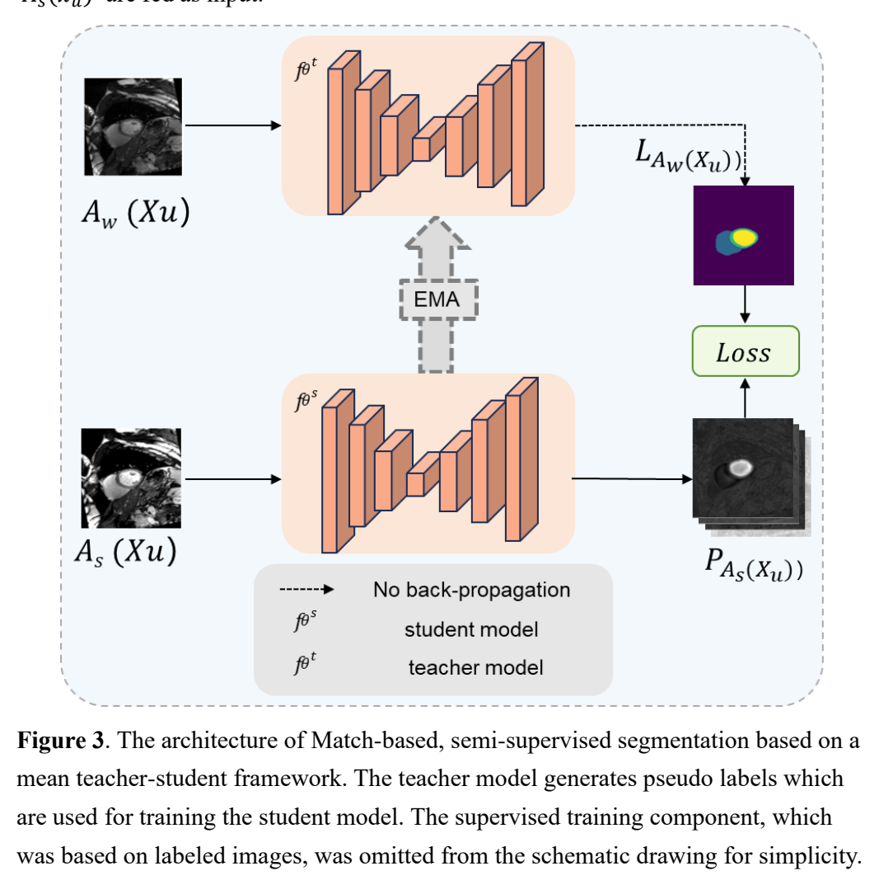
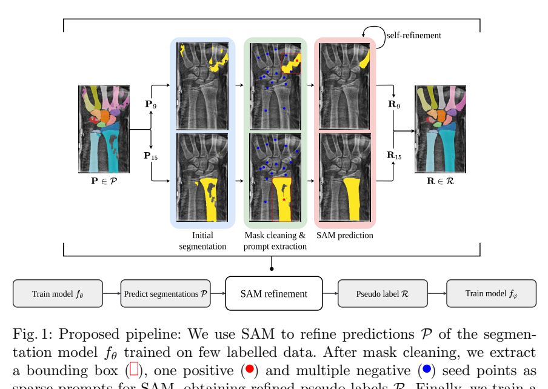

# arXiv 检索结果 / Results

## 1. Contrastive Semi-Supervised Segmentation with Class-wise Patches and Silhouette-Adaptive Consistency
- Authors：Prashant Pandey
- First：2021-06-12T15:43:24+00:00；Latest：2026-11-10T22:27:24+00:00
- Abs：https://arxiv.org/abs/2106.06801v4
- PDF：https://arxiv.org/pdf/2106.06801v4
- Code：https://github.com/prinshul/CSSL, https://huggingface.co/huggingface, https://huggingface.co/docs/hub/spaces
- 解读来源：PDF 全文，共 16 页，16 页可提取文字
### [中文]
**中文翻译**
- 标题：基于类级图像块与轮廓自适应一致性的对比半监督分割
- 摘要：我们提出CSSL，一种用于医学图像分割的对比半监督方法。CSSL从有标注图像和置信伪标签中采样类级图像块，通过带有混合难负样本的监督对比损失分离其嵌入，并利用嵌入聚类的轮廓系数设定特征扰动一致性损失的强度。在MoNuSeg上，图像块嵌入通过对未掩码图像的编码器特征进行掩码池化获得，细胞核边缘构成额外的对比类别，并使用记忆库存储过去的嵌入；在CHAOS上，图像块进行像素掩码且不使用记忆库。CSSL损失被加入弱到强伪标签流程中。我们遵循已发表基线的协议：MoNuSeg上的Self-Loop和CHAOS上的DAFNet。在仅使用50%标签的MoNuSeg上，CSSL在三个标签划分上达到80.87 $\pm$ 0.17的细胞核F1，而Self-Loop为79.10，不含CSSL的相同流程为78.73。在仅使用25%标签的CHAOS T2上，CSSL达到89.01 Dice，而DAFNet为82.0，仅流程为88.94。消融实验表明，对比分支以及在MoNuSeg上的边界类别和特征级池化贡献了大部分改进。代码：https://github.com/prinshul/CSSL

CSSL在弱到强伪标签框架上加入类级patch对比学习与轮廓系数自适应一致性。MoNuSeg 50%标签下核F1为80.87±0.17（配方78.73，Self-Loop 79.10）；CHAOS T2 25%标签下Dice为89.01（配方88.94，DAFNet 82.0）。消融显示对比分支贡献最大，但CHAOS上CSSL与配方基本持平，且多数消融仅单次运行。

# CSSL：类级Patch对比与轮廓系数自适应一致性的半监督分割

## 1. 问题与动机

医学图像像素级标注昂贵，半监督分割希望用部分标注接近全监督精度。现有方法多组合伪标签、扰动一致性以及对比学习，但作者认为已有对比方法多在像素或区域级进行，未充分利用“类级patch”这一局部上下文单元；同时一致性扰动的强度通常是固定的，未与特征空间的实际可分性挂钩。CSSL试图解决两点：(a) 用类级patch嵌入学习更清晰的类间分离，尤其针对细胞核边界粘连；(b) 用嵌入聚类的Silhouette系数动态调节特征扰动一致性强度 [p. 1][p. 3]。

## 2. 方法

### 2.1 基础配方
网络为编码器h与解码器g，EMA教师ξ由学生θ滑动平均得到，衰减m_t=min(0.999,(1+t)/(10+t))。有监督损失为CE与Dice的平均：L_sup=½[CE(f_θ(x),y)+Dice(f_θ(x),y)] [p. 3]。无标签图像经弱视图u_w由教师产生伪标签ŷ=argmax q和置信掩码M=1[max q≥δ]，δ=0.95；两个强视图经独立光度增强和CutMix生成，用掩码Dice损失L_s1、L_s2训练。配方目标L_rec=½L_sup+½L_s1+½L_s2，先进行T0=2000次有监督迭代再开启无标签损失 [p. 3-4]。

### 2.2 类级patch采样
对每张图构建标签图ℓ：有标签图用真值，无标签图用伪标签并将低置信像素设为ignore。64×64窗口以步长32滑动，n_min=25。两种模式：each模式要求n_k(W)≥n_min；prominent模式要求k=argmax n_k′(W)且n_k(W)≥n_min。MoNuSeg用each模式并把背景作为一类；CHAOS用prominent模式覆盖四个器官。每批最多816个patch，按类轮询以保留稀有类 [p. 4]。

### 2.3 两种patch嵌入
像素级掩码：将patch中其他类像素置零后编码，在瓶颈特征上按下采样掩码池化，经两层投影头φ到R^256并L2归一化（式4）。特征级掩码：整图只编码一次，在编码器第ℓ层特征上按窗口内类像素的池化权重m̄_W,k加权池化（式5）。作者主张特征级掩码让编码器只看到真实图像，保留小结构周围上下文，且嵌入与解码器分割所用特征一致；MoNuSeg在1/8分辨率用特征级掩码，CHAOS用像素级掩码，嵌入计算时冻结BN统计量 [p. 4][p. 5, 图2]。

### 2.4 边界类
二值细胞核任务中，距背景≤w=2像素的核像素被重标为第三类（式6），通过(2w+1)×(2w+1)背景指示图max-pool实现；分割目标不变，仅对比标签图改变。作者动机是粘连邻居和边界误差集中在核边缘 [p. 2][p. 5]。

### 2.5 对比损失与难负样本
批次嵌入{(z_i,k_i)}，另设FIFO记忆库Q存最近4096个无梯度嵌入。锚点i的正样本P(i)为同类其他嵌入，负样本N(i)为异类嵌入，均来自批次与Q。按Kalantidis等的方法，对每个锚点用α_t z_i+(1−α_t)z_n混合生成H(i)=min(|N(i)|,256)个难负样本，α_t∼U(0,0.4)，sg停止梯度（式7）。相似度s_ij=z_i^T z_j/τ，τ=0.1，损失为式8：每个锚点对其正样本与全部普通负样本及难负样本做softmax对比。仅当前嵌入作锚点；若批次只有一类，加入256个固定高斯样本作为负样本 [p. 5]。

### 2.6 Silhouette自适应一致性
在批次嵌入（最多1024，子采样）上用曼哈顿距离计算每个嵌入的a_i（同类平均距离）与b_i（最近异类平均距离），Silhouette ω=(1/N)Σ(b_i−a_i)/max(a_i,b_i)（式9）。单批噪声大，用µ=0.99的EMA平滑ω̄_t，映射为噪声水平λ_t=(ω̄_t+1)/2+ε，ε=0.05（式10）。对弱视图的每个编码器特征图（含跳跃连接）按该图自身标准差σ(h^(l))加高斯噪声：h̃^(l)=h^(l)+√λ_t σ(h^(l))ξ（式11）。解码器从扰动特征得到的预测需在置信像素上匹配教师伪标签，L_CR=½[CE_M(g(h̃),ŷ)+Dice_M(g(h̃),ŷ)]（式12）。作者解释：类混合时ω̄≈0，扰动适中；对比损失使类分离后扰动增大，要求解码器在特征支持后才更鲁棒 [p. 6]。

### 2.7 总目标
L=½L_sup+½L_s1+½L_s2+βL_CR+w(t)L_CL，β=0.5，w(t)=w0 exp(−5(1−min(1,(t−T0)/Tr))^2)，w0=0.1，Tr=1000。β=w0=0即精确恢复配方，作为所有比较的对照 [p. 6]。

## 3. 贡献

作者声称的贡献包括：特征级掩码池化、二值任务的边界类、将一致性与对比损失加入完整弱到强配方、MoNuSeg上的FIFO记忆库，以及严格沿用已发表基线协议并用同一代码跑配方对照 [p. 1-2]。我的解读：核心新颖点在于用Silhouette系数把对比嵌入质量与一致性扰动强度耦合，以及类级patch而非像素级对比；但边界类和难负样本混合均来自已有工作，方法层面的主要增量是组合与自适应机制。

## 4. 实验与结果

### 4.1 MoNuSeg
数据30张训练、14张测试H&E图像（1000×1000，40×），按Self-Loop协议50%标签（15张有标签、15张无标签），ResUNet-18随机初始化（14.4M参数），整图测试，最终权重测试。Self-Loop未公开其标注子集，作者用种子0、1、2抽取三个随机子集并全部报告 [p. 7]。指标为核F1（每图核类Dice在14张测试图上平均）。作者专门校准：Self-Loop的“F1”若按前景背景平均或平衡精度读，其自身有监督基线会高5–9分；只有核F1接近其报告的75.87（50%）和79.30（100%），因此采用核F1，并称这是三种读法中最严格的 [p. 8-9, 图4]。

结果（表1）：有监督仅标签76.01；配方78.73±0.95（种子间77.69–79.99）；CSSL 80.87±0.17，三个种子分别80.66、81.07、80.88，相对配方+2.14且3/3种子更高（逐种子增益+2.97、+2.57、+0.89）；相对Self-Loop 79.10高1.77。全监督100%标签参考77.64（单种子），低于CSSL半标签3.23 [p. 8-9]。

### 4.2 CHAOS
CHAOS腹部MR，20名受试者，肝、肾、脾。按DAFNet协议：T1-DUAL（out-phase）全标注源模态，T2-SPIR部分标注目标；三个14/3/3受试者划分；25%标签即4名T2受试者（DAFNet种子采样），所有训练受试者有T1标签，其余10名T2无标签。网络为U-Net 64–1024通道、四次下采样（29.0M参数），输入单张192×192 T2切片。指标为每切片四器官通道池化Dice，再对切片和受试者平均；预测取softmax argmax，而DAFNet代码对每个器官概率分别0.5取整，作者报告两者差异≤0.03分（附录表5）。按DAFNet规则测试最佳验证Dice检查点 [p. 7][p. 9-10]。

结果（表2）：有监督85.87±4.92；配方88.94±2.63；CSSL 89.01±2.37，相对DAFNet 82.0高7.01，相对配方仅+0.08（3个划分中2个更高）。作者明确表示该差异小于划分间波动，CSSL与配方在CHAOS上表现相当；在划分1（有监督最弱79.07）半监督方法约提升6分，CSSL略优 [p. 9-10]。

### 4.3 消融
表3在MoNuSeg种子0和CHAOS划分1上每次移除一个组件，均为单次运行；作者注明配方在MoNuSeg种子间波动2.3分。MoNuSeg全模型80.66：去掉对比损失78.51（+2.15），去掉一致性80.42（+0.24），去掉难负样本80.07（+0.59），固定λ 80.54（+0.12），去掉边界类77.99（+2.67），去掉特征级掩码79.11（+1.55），去掉记忆库81.14（−0.48，即记忆库反而降低测试分）。CHAOS全模型85.67：去掉对比损失78.46（+7.21），去掉一致性86.50（−0.83，即去掉更好），去掉难负样本85.16（+0.51），固定λ 84.99（+0.68）。作者指出MoNuSeg上去掉边界类的损失（2.67）大于去掉整个对比损失（2.15），说明仅用核与背景两类时对比项在该配置下无益；CHAOS上去掉CL但保留CR比配方更差（78.46 vs 85.33），说明无对比项塑形时固定噪声扰动有害 [p. 10-11]。

### 4.4 定性结果
MoNuSeg选取CSSL相对配方增益最大、中位、最小的测试图：最大增益图上监督与配方把大片背景标为核（每图核F1 33.9和41.3），CSSL为79.0；中位和最小增益图上三者差异≤0.6 F1。CHAOS划分1切片上CSSL比配方恢复更多肝和部分脾（切片Dice 43.4 vs 27.1），划分0和2三者接近 [p. 11-13, 图6-7]。

## 5. 评估

支持的结论：在MoNuSeg 50%标签、三个随机子集上，CSSL相对同代码配方稳定提升（3/3种子，均值+2.14），且方差明显更小；对比分支是主要贡献来源，边界类和特征级掩码在MoNuSeg上贡献较大。CHAOS上CSSL大幅超过DAFNet的已发表数字，但作者自己承认这主要来自配方本身（配方已比DAFNet高6.94），CSSL相对配方仅+0.08，不能支持“CSSL在CHAOS上有效”的强主张。

局限与缺失证据：(1) 消融均为单次运行、单一划分，而配方本身跨种子波动可达2.3分，因此+0.24、+0.12、+0.59等小差异不足以判定组件有效；记忆库−0.48同样在噪声范围内。(2) MoNuSeg与Self-Loop的比较依赖“Self-Loop的F1即核F1”的读法，作者承认Self-Loop评估代码不公开，校准只能支持而不能证明该读法；不过与配方的比较使用同一代码，不依赖此假设 [p. 9]。(3) Self-Loop的标注子集未公开，作者用三个随机子集替代，与已发表数字并非同一数据条件。(4) CHAOS仅三个划分、每划分3名测试受试者，标准差达2.37–4.92，+0.08的差异无统计意义。(5) 未报告训练时间、显存或超参数敏感性；未与更多近期半监督方法在同代码下比较。

## 6. 复现

已报告：MoNuSeg用ResUNet-18随机初始化、RGB 256×256裁剪、8+8批、30k迭代（含2k有监督预热）、SGD lr 0.01、momentum 0.9、weight decay 1e-4、多项式衰减power 0.9、bf16、EMA教师、δ=0.95、两个强视图CutMix p=0.5、H&E染色与颜色抖动模糊增强；patch 64×64步长32、n_min=25、每批≤816、each模式含背景；特征级嵌入1/8分辨率、256维两层头；边界w=2；τ=0.1、难负样本1:1≤256、w0=0.1、ramp 1000；记忆库4096；β=0.5、ε=0.05、Silhouette EMA µ=0.99；测试最终权重 [p. 7][p. 16 表4]。CHAOS用U-Net 64–1024、192×192单T2切片、12+12批（有标签中一半T2一半T1）、16k迭代、仿射增强不翻转、每1000次验证、测试最佳验证检查点；像素级掩码、prominent模式、无记忆库、无边界类 [p. 7][p. 16]。

未报告或需自行确定：投影头φ的具体层宽与激活、特征级池化所用具体层ℓ（仅说1/8分辨率）、难负样本与正样本在记忆库中的具体采样细节、优化器对教师更新的同步方式、随机种子以外的数据划分文件、代码虽给出GitHub链接但论文未列依赖版本。复现时应优先固定三个MoNuSeg标签子集与DAFNet的CHAOS划分，并以β=w0=0跑配方对照。

本篇未找到可可靠提取的方法流程图，请查看原文 PDF。

## 2. A SAM-guided and Match-based Semi-Supervised Segmentation Framework for Medical Imaging
- Authors：Guoping Xu, Xiaoxue Qian, Hua Chieh Shao, Jax Luo, Weiguo Lu, You Zhang
- First：2024-11-25T21:41:38+00:00；Latest：2024-11-25T21:41:38+00:00
- Abs：https://arxiv.org/abs/2411.16949v1
- PDF：https://arxiv.org/pdf/2411.16949v1
- Code：https://github.com/apple1986/SAMatch, https://huggingface.co/huggingface, https://huggingface.co/docs/hub/spaces
- 解读来源：PDF 全文，共 27 页，27 页可提取文字
### [中文]
**中文翻译**
- 标题：一种SAM引导的基于Match的医学影像半监督分割框架
- 摘要：本研究提出了SAMatch，一种SAM引导的基于Match的半监督医学图像分割框架，旨在提升数据稀缺场景下的伪标签质量。基于Match的框架虽然有效，但由于缺乏真实标签，难以应对低质量伪标签的问题。SAM在大规模数据集上预训练，能够在多种任务上良好泛化，并协助生成高置信度的提示，随后通过微调的SAM用于精炼伪标签。SAMatch采用端到端训练，允许模型之间进行动态交互。在ACDC心脏MRI、BUSI乳腺超声和MRLiver数据集上的实验表明，SAMatch在仅使用少量标注数据的情况下取得了最先进的结果，Dice分数分别为89.36%、77.76%和80.04%。SAMatch有效解决了半监督分割中的挑战，为数据受限环境下的分割提供了强大的工具。代码和数据可在https://github.com/apple1986/SAMatch获取。

SAMatch 将 Match 式半监督分割（FixMatch/UniMatch）与 SAM/MedSAM 结合：教师模型对弱增强图像预测并自动提取点/框提示，微调后的 SAM 生成高质量伪标签，再监督学生模型，形成端到端交互训练。在 ACDC（1/3 例标注）、BUSI（10/30 例）、MRLiver（1/3/5 例）上取得报告的最佳 Dice（如 ACDC 3 例 89.36%、BUSI 30 例 77.76%、MRLiver 3 例 80.04%），但部分表格数值在正文中不可读，且缺少计算成本与提示质量等分析。

## 1. 问题与动机

半监督分割希望用少量标注加大量无标注数据训练模型。Match 式框架（FixMatch、UniMatch 等）依赖教师模型对弱增强图像产生伪标签，再以一致性损失监督强增强输入的学生模型；但伪标签没有真实标签参照，质量无法保证，弱增强中的噪声或增强策略选择不当会破坏一致性假设 [p. 3-4]。作者将核心问题表述为：训练阶段如何为无标注图像生成高质量伪标签 [p. 4]。

SAM 作为基础分割模型泛化能力强，但需要点/框等提示，且直接用于医学图像效果有限。作者在自建肝脏数据上报告：SAM 用真值点提示 Dice 28.47%，微调后 77.76%；MedSAM 用真值框提示 78.96%，微调后 90.61%（3 例标注微调）[p. 4, Table 1]。因此作者认为 Match 式模型能自动产生较可信的提示，而微调 SAM 能把提示转成高质量掩膜，两者互补 [p. 5, Table 2]。

## 2. 方法

**基础 Match 流程**：对同一无标注图像做弱增强 A_w 与强增强 A_s；教师 f_θt 对 A_w(x_u) 预测，经 softmax 与阈值 T=0.95 得到伪标签 y_u（式 1）；学生 f_θs 对 A_s(x_u) 预测，用 Dice 与交叉熵计算无监督损失 L_u（式 2）；有标注数据计算 L_l（式 3）；总损失 L=L_l+λL_u（式 4），λ 按文献 [28] 自适应更新 [p. 10-11]。教师不反传，权重由学生权重指数滑动平均更新 [p. 12-13]。

**SAMatch 流程**（Figure 4, p. 12）：教师对弱增强无标注图像输出预测掩膜 p_w，从中提取提示 p_tw；弱增强图像与提示一起送入微调后的 SAM 分支，得到精炼伪标签 p_SAM；学生以强增强图像为输入、以 p_SAM 为监督目标计算 L_u；教师继续 EMA 更新。SAM 分支同时用有标注数据及其真值提示进行微调，从而与 Match 网络协同适应目标任务 [p. 12-14]。

**两阶段训练**（Algorithm 1, p. 13）：前 M 步为 warm-up，学生用教师伪标签训练，SAM 用标注数据微调；后 N 步为交互阶段，伪标签改由 SAM 分支产生并监督学生。文中设置为共 60,000 次迭代，warm-up 30,000 次、交互 30,000 次 [p. 15]。

**提示设计**：SAM 用点提示——从教师伪标签置信度 >0.95 的区域随机取 1 个正点、背景取 9 个负点；MedSAM 用框提示——取教师伪标签最大连通区域的边界框。由此形成 Fix-SAM、Fix-MedSAM、Uni-SAM、Uni-MedSAM 四个变体 [p. 15]。

## 3. 贡献

作者主张三点：提出可插拔的统一框架，可组合不同 SAM 与 Match 方法；实现无需人工提示的自动提示生成，并让 SAM 微调与 Match 训练协同；在极少标注下显著优于现有半监督方法 [p. 6]。我的理解是：核心新颖性在于把 SAM 从“伪标签生成器”提升为教师模型的在线助手，并用标注数据同步微调 SAM；但整体仍是已有组件的系统集成，缺少新的损失函数或理论分析。

## 4. 实验与结果

**数据与划分**：ACDC 共 100 例有标注，按 70/10/20 划分训练/验证/测试；半监督设置用 1 或 3 例标注，其余 69/67 例去标签；1 例设置仅用舒张末期扫描；分割 LV/RV/MYO [p. 14]。BUSI 排除 233 例无病灶后剩 547 例，按 330/47/170 划分；半监督用 10 标注+320 无标注，或 30 标注+300 无标注 [p. 14]。MRLiver 为自建 48 例 MRI（T2、T2_SPIR），30/6/12 划分；半监督用 1、3、5 例标注，对应 29、27、25 例无标注 [p. 15]。

**训练设置**：单张 NVIDIA 4090，batch size 8，每批标注/无标注各 50%；SGD，Match 网络学习率 0.01，SAM 网络 5e-5；图像统一缩放至 256×256；除 SAM 分支外均用 U-Net 骨干 [p. 15]。指标为 Dice 与 HD95（式 5-6）[p. 15-16]。

**主要结果**：ACDC 上四个 SAMatch 变体在 1 或 3 例标注下均报告为最佳；3 例标注时接近用 70 例全监督的 UNet；Uni-MedSAM 与其他半监督方法的 Dice/HD95 差异经 Wilcoxon 符号秩检验 p<0.05 [p. 16]。摘要给出 ACDC 3 例标注 Dice 89.36%（20 例测试）[p. 2]，但 Table 3 的具体数值在提供的文本中不可读，无法核对各方法逐项数字 [p. 17]。

BUSI 上作者未用 MedSAM，理由是 MedSAM 训练集包含该数据、可能产生偏倚；Uni-SAM 在 30 例标注下与 330 例全监督仅差 1.2 个百分点；10 与 30 例标注间差距很小；Uni-SAM 与其他方法差异显著（p<0.05），但与 10 例标注的 UniMatch 相比 p=0.22 [p. 19]。摘要报告 30 例标注 Dice 77.76%（170 例测试）[p. 2]；Table 4 数值同样不可读 [p. 19]。

MRLiver 上 FixMatch 结合 SAM/MedSAM 后平均 Dice 约提升 5%/12%，UniMatch 提升约 9%/8%；Uni-MedSAM 与其他方法显著（p<0.05），但与 5 例标注的 Uni-SAM 相比 p=0.39 [p. 20]。摘要报告 3 例标注 Dice 80.04%（12 例测试）[p. 2]；Table 5 数值不可读 [p. 20]。

**可视化与消融**：Figure 5 的类激活图显示 Fix-SAM 更聚焦真值目标且边界过渡更平滑 [p. 17-18]；Figure 6 显示 SAMatch 结果比 FixMatch/UniMatch 更接近真值 [p. 18]；Figure 8 显示 Fix-SAM/Uni-SAM 在肝脏上易过分割，作者归因于点提示约束弱于 MedSAM 的框提示 [p. 21]。这些属于定性证据，未给出对应定量消融。

## 5. 评估

支持的结论：在三个数据集、两种 Match 基线与两种 SAM 变体上，SAMatch 一致改善原 Match 方法，且极少标注下收益明显；统计检验在多数比较中支持 Uni-MedSAM/Uni-SAM 的优越性。局限与缺失证据：作者承认自动提示存在错位（背景被误判为目标），用真值提示与教师提示的 SAM 结果仍有明显差距 [p. 22]；当前为 2D，病灶分割因低对比度和形状变化表现较弱 [p. 23]。此外，论文未报告 SAM 分支带来的训练/推理开销、提示质量指标、SAM 微调数据量对结果的敏感性，也未给出与 SemiSAM 等 SAM 半监督方法的直接实验比较；部分表格数字不可读，无法独立复核具体数值。

## 6. 复现

已报告：数据划分与标注预算 [p. 14-15]；单卡 4090、batch 8、50/50 采样、SGD、学习率 0.01/5e-5、60,000 迭代（30,000 warm-up + 30,000 交互）、256×256 输入、U-Net 骨干 [p. 15]；提示阈值 0.95、1 正 9 负点、最大连通域框 [p. 15]；代码链接 https://github.com/apple1986/SAMatch [p. 2]。未报告：λ 的具体自适应公式与取值、SAM/MedSAM 的具体检查点与微调层、数据增强的完整参数、随机种子与重复次数、推理时间与显存占用、HD95 的单位与实现细节。复现时需自行确定这些细节，并以可读表格或代码核对报告数值。

#### 原论文流程图 · Figure 3 · PDF 第 10 页

Figure 3. The architecture of Match-based, semi-supervised segmentation based on a mean teacher-student framework. The teacher model generates pseudo labels which are used for training the student model. The supervised training component, which was based on labeled images, was omitted from the schematic drawing for simplicity.

[原文来源](https://arxiv.org/pdf/2411.16949v1#page=10)

## 3. GraphCL: Graph-based Clustering for Semi-Supervised Medical Image Segmentation
- Authors：Mengzhu Wang, Jiao Li, Houcheng Su, Nan Yin, Liang Yang, Shen Li
- Comments：9page
- First：2024-11-20T09:24:46+00:00；Latest：2024-11-22T09:18:20+00:00
- Abs：https://arxiv.org/abs/2411.13147v2
- PDF：https://arxiv.org/pdf/2411.13147v2
- Code：https://huggingface.co/huggingface, https://huggingface.co/docs/hub/spaces
- 解读来源：PDF 全文，共 11 页，11 页可提取文字
### [中文]
**中文翻译**
- 标题：GraphCL：基于图的聚类用于半监督医学图像分割
- 摘要：半监督学习（SSL）在医学图像分割（MIS）方面取得了显著进展，特别是在标注数据有限的情况下，大幅提升了数据利用效率。以往的方法主要集中于使用复杂的训练策略来利用未标注数据，但忽视了图结构信息的重要性。与现有方法不同，我们提出了一种基于图的聚类半监督医学图像分割方法（GraphCL），通过在统一的深度模型中联合建模图数据结构。所提出的GraphCL模型具有若干优势。首先，据我们所知，这是首个为半监督医学图像分割（SSMIS）建模数据结构信息的工作。其次，为了获得跨不同图的聚类特征，我们将局部图像特征之间的成对相似度和原始特征同时作为输入进行整合。在三个标准基准上的大量实验结果表明，所提出的GraphCL算法优于最先进的半监督医学图像分割方法。

GraphCL 将双向复制粘贴（BCP）半监督分割框架与图结构建模结合：在编码器中加入结构感知对齐（SA）和基于相关聚类损失（LCC）的 GCN 聚类模块，在 LA、ACDC、Pancreas-NIH 三个数据集上以 5%/10%（Pancreas 为 20%）标注比例取得优于 BCP、SS-Net 等基线的 Dice 与 95HD。消融显示 SA 与 LCC 各自有效，GCN 放在编码器第 5 层最佳；但论文对图构建细节、聚类语义与部分表格数字的呈现存在不一致，需谨慎看待其“首次建模数据结构”的主张。

# GraphCL 论文精读笔记

## 1. 问题与动机

半监督医学图像分割（SSMIS）旨在用少量标注体数据和大量无标注数据训练分割模型。作者指出，现有方法（如 BCP 的双向复制粘贴、TI-ST 的变换不变自训练、ContrastMask 的稠密对比学习）主要依赖复杂训练策略，而忽视了图结构信息 [p. 1–2]。作者进一步认为，由于标注数据极少，标注与无标注数据之间容易出现分布不匹配 [p. 1]。在监督语义分割中已有 GraphNet、A2GNN 等将图像转为图并用 GCN 的工作，但作者称这些方法尚未被引入医学图像分割，且“没有研究从数据结构角度探索 SSMIS” [p. 2]。因此论文的目标是：在统一深度模型中同时建模图数据结构与半监督分割，并用图聚类目标增强特征判别性。

## 2. 方法

### 2.1 整体框架

GraphCL 建立在 teacher-student 的 BCP 框架上 [p. 3]。训练集 S = Sl ∪ Su，Sl 为标注集，Su 为无标注集。对每个 batch，取两张标注图像 (Xlj, Xlk) 和两张无标注图像 (Xum, Xun)，用掩码 M 做双向复制粘贴：

- Xin = Xlj ⊙ M + Xum ⊙ (1−M)（式 3）
- Xout = Xun ⊙ M + Xlk ⊙ (1−M)（式 4）

对应监督信号为式 5–6：Yin 由标注标签 Ylj 与教师伪标签 Ŷum 拼接，Yout 由伪标签 Ŷun 与 Ylk 拼接。学生网络 Ss 输出 Qin、Qout（式 9），损失为式 7–8：Lin 与 Lout 均为 dice+交叉熵组成的 Lseg，其中无标注像素部分乘权重 α。总损失 Lall = Lin + Lout（式 10），教师参数按 Θt(k+1) = λΘt(k) + (1−λ)Θs(k) 做指数移动平均（式 11）[p. 4]。

### 2.2 结构感知对齐（SA）

每个 batch 样本被视为一个图节点。CNN 提取特征 X = CNN(Xbatch)（式 12）；数据结分析器 DSA 输出结构分数 Xsa ∈ R^{w×h}（w 为 batch size，h 为结构特征维度），邻接矩阵 Â = Xsa Xsa^T（式 13）。随后做图卷积 Z = D̂^{-1/2} Â D̂^{-1/2} X W（式 14），其中 D̂ 为度矩阵、W 为可学习权重 [p. 5]。直观上，结构相似的样本在图中连接更强，从而在 batch 内传播上下文信息。

### 2.3 GCN 聚类与 LCC

对每个 3D 体数据提取深层特征 F ∈ R^{B×C×W×H×D}，每个体素作为图节点。边权矩阵 W = F·F^T − Max(F·F^T)/τ（式 15），τ 控制聚类敏感度，τ 越大簇越多 [p. 5]。用单层 GCN 得到 N̂ = GNN(N, W; ΘGNN)（式 16），再经 MLP+softmax 得到簇分配矩阵 S = MLP(N̂; ΘMLP)（式 17）。聚类损失为相关聚类损失 LCC = −Tr(W S S^T)（式 18），鼓励高相似节点同簇、抑制不相似节点相连。最终训练目标为 Lall = Lin + Lout + κ·LCC（式 19）[p. 6]。

需要注意：式 15 中“Max(F·F^T)/τ”的写法在原文中即为如此，但符号含义（逐元素最大值还是全局最大值）未明确说明；式 18 中 W 被“重新定义”以满足相关聚类要求，但重新定义的具体形式未给出。这些是复现时的主要不确定点。

## 3. 贡献

作者声称的贡献有三点 [p. 2]：(1) 提出 GraphCL，将图数据结构建模与 SSMIS 统一到一个网络，并称这是首个在 SSMIS 中建模图数据结构的工作；(2) 设计图聚类目标作为损失函数，优化 SSMIS 中的相关聚类任务；(3) 在三个基准上取得优于 SOTA 的性能。

我的解读：核心新颖点是把 BCP 的实例级复制粘贴与 batch 内样本图（SA）以及体素级特征图聚类（LCC）叠加。但“首个”主张依赖作者对文献的覆盖范围；论文自身也引用了 GraphNet、A2GNN 等图方法，只是称其未用于医学分割。LCC 的形式与相关聚类文献中的迹最大化目标相似，论文未讨论其与已有图聚类损失的关系。

## 4. 实验与结果

### 4.1 数据集与设置

三个数据集：ACDC（心脏 MRI，四类分割）、LA（左心房 MRI）、Pancreas-NIH（胰腺 CT）[p. 6]。指标为 Dice、Jaccard、95HD、ASD。默认超参 α=0.5、κ=0.01、τ=2，固定随机种子。LA 用 NVIDIA A800，Pancreas-NIH 与 ACDC 用 NVIDIA 3090 [p. 6]。

- LA：旋转与翻转增强；SGD，初始学习率 0.01，每 2.5K 迭代衰减 10%；3D V-Net；patch 112×112×80，掩码 M 的零值区域 74×74×53；batch size 8（标注/无标注各半）；预训练 5K、自训练 15K 迭代 [p. 6]。
- ACDC：2D U-Net；patch 256×256，M 零值区域 170×170；batch size 24；预训练 10K、自训练 30K 迭代 [p. 6]。
- Pancreas-NIH：旋转、缩放、翻转增强；四层 3D V-Net；Adam，初始学习率 0.001；patch 96×96×96，M 零值区域 64×64×64；batch size 8；预训练 60、自训练 200 epochs [p. 6]。

### 4.2 主要结果

LA（Table 1）[p. 6]：5% 标注（4 例标注、76 例无标注）下 GraphCL 为 Dice 88.80、Jaccard 80.00、95HD 7.16、ASD 2.10，相比次优 BCP 的 87.07/77.42/8.83/2.15 分别提升 1.73/2.58/1.67/0.05；10% 标注（8/72）下为 90.24/82.31/6.42/1.71，相比 BCP 的 89.39/80.92/7.26/1.76 提升 0.85/1.39/0.84/0.05。

ACDC（Table 2）[p. 7]：5% 标注（3/67）下 GraphCL 为 88.68/80.32/3.12/0.88，相比 BCP 的 86.83/77.64/8.71/2.47 提升 1.37/1.86/3.55/1.40；10% 标注（7/63）下为 89.31/81.33/2.10/0.66，相比 BCP 的 88.84/80.61/4.42/1.38 提升 0.47/0.72/2.32/0.72。作者称 10% 时平均超越次优方法 26.01%、5% 时平均 29.65% [p. 7]，但按表中数值，这一“平均百分比”的计算口径未说明，且与绝对差值不一致，应视为作者表述而非可直接核验的数字。

Pancreas-NIH（Table 3）[p. 7]：20% 标注（12/50）下 GraphCL 为 88.68/80.32/3.12/0.88，相比次优 BCP 的 86.83/77.64/8.71/2.47 提升 2.50/3.79/0.72（ASD 反而从 2.47 变为 0.88，表中标注为下降，但正文只提 Dice、Jaccard、95HD 三项提升）。

### 4.3 消融

Table 4 [p. 8] 在 LA 与 ACDC 上比较 Baseline（BCP）、+SA、+LCC、+SA+LCC。LA 5% 下四者 Dice 依次为 87.07、88.13、88.34、88.80；LA 10% 下为 89.39、90.00、88.79、90.24。ACDC 5% 下为 86.83、88.13、87.80、88.68；ACDC 10% 下为 88.84、89.52、89.53、89.31。可见 SA 单独通常有效，LCC 单独在 LA 10% 与 ACDC 10% 上反而低于 baseline，组合后在多数设置最佳，但 ACDC 10% 的组合（89.31）低于 +SA（89.52）与 +LCC（89.53），与“组合最佳”的叙述不完全一致。

Table 5（Pancreas-NIH）[p. 8]：baseline 81.12/68.81/8.11/2.34，+SA 82.47/70.53/7.15/2.42，+LCC 82.32/70.34/10.56/3.63，+SA+LCC 83.15/71.42/6.87/2.12。LCC 单独使 95HD 与 ASD 变差，组合才改善。

GCN 层位置消融（Table 6）[p. 8]：在 ACDC 10% 下，第 1、2、4、5 层 Dice 分别为 0.030、72.59、88.05、88.68（5% 设置）与 0.008、72.35、89.10、89.31（10% 设置），第 5 层最佳。第 1 层结果接近 0，说明浅层插入 GCN 会破坏训练，但论文未解释原因。

超参敏感性 [p. 8–9]：κ 在 0.01 附近峰值，τ=2 最稳定；τ=6、10 时个别指标更高但波动大。

可视化 [p. 9]：Figure 5 的核密度估计显示 GraphCL 在 5% ACDC 上标注/无标注特征分布对齐最好；Figure 6 显示边界更贴近 GT。这些为定性证据，未给定量指标。

## 5. 评估

支持的结论：在作者设定的 BCP 式 teacher-student 框架和相同数据划分下，加入 SA 与 LCC 在 LA、ACDC、Pancreas-NIH 多数指标上带来一致提升，尤其 95HD 改善明显（如 ACDC 5% 从 8.71 降至 3.12）[p. 7]。消融支持 SA 与 LCC 组合在多数设置有效，但并非所有设置都单调提升。

局限与缺失证据：(1) 论文未报告参数量、训练时间或显存开销，无法判断图模块的代价；(2) 未与图方法（GraphNet、A2GNN）在医学分割上直接对比；(3) 式 15、18 的关键定义不完整，LCC 的“簇”与分割类别之间的关系未说明；(4) 部分表格数字与正文叙述不一致（如 ACDC 平均提升百分比、Pancreas 的 ASD 变化），且 Table 3 与 Table 4 中 Pancreas 的 baseline 数值在不同表中重复出现但列义不同，阅读时需以原表为准；(5) 仅在一个随机种子下报告，未给方差或显著性检验；(6) 结论中“生成更可靠标签、提升图准确性以减少输入图噪声”被列为未来工作 [p. 9]，说明当前图噪声问题尚未解决。

## 6. 复现要点

已报告：三个数据集的 backbone（LA/Pancreas 为 3D V-Net，ACDC 为 2D U-Net）、patch 尺寸、掩码零值区域、batch size、优化器与学习率、预训练/自训练迭代数、α=0.5、κ=0.01、τ=2、固定随机种子、标注比例与划分（LA 4/76 与 8/72；ACDC 3/67 与 7/63；Pancreas 12/50）[p. 6–7]。

未报告或无法辨认：DSA 网络的具体结构（层数、通道）、GCN 的隐藏维度、MLP 结构、式 15 中 Max 的确切含义、式 18 中 W 的重新定义、教师初始化的具体方式、数据预处理与归一化细节、推理时的后处理、代码或超参搜索范围。复现时应优先向作者确认这些点，并在固定种子下重复多次以评估方差。

本篇未找到可可靠提取的方法流程图，请查看原文 PDF。

## 4. SAM Carries the Burden: A Semi-Supervised Approach Refining Pseudo Labels for Medical Segmentation
- Authors：Ron Keuth, Lasse Hansen, Maren Balks, Ronja Jäger, Anne-Nele Schröder, Ludger Tüshaus, Mattias Heinrich
- Venue：MICCAI
- Comments：Presented at MICCAI Workshop on Advancing Data Solutions in Medical Imaging AI 2024; Code and data: https://github.com/multimodallearning/SamCarriesTheBurden
- First：2024-11-19T16:06:21+00:00；Latest：2024-11-19T16:06:21+00:00
- Abs：https://arxiv.org/abs/2411.12602v1
- PDF：https://arxiv.org/pdf/2411.12602v1
- Code：https://github.com/multimodallearning/SamCarriesTheBurden, https://huggingface.co/huggingface, https://huggingface.co/docs/hub/spaces
- 解读来源：PDF 全文，共 13 页，13 页可提取文字
### [中文]
**中文翻译**
- 标题：SAM承担重任：一种精化伪标签的半监督医学分割方法
- 摘要：语义分割是医学影像中的一项关键任务。尽管监督学习技术已被证明能有效完成该任务，但其严重依赖大量标注训练数据。近期提出的Segment Anything Model（SAM）支持基于提示的分割，并能对不熟悉的对象提供零样本泛化能力。在本工作中，我们利用SAM对抽象对象的理解能力进行医学图像分割，为半监督学习提供伪标签，从而减少对大量标注训练数据的需求。我们的方法通过提取边界框和种子点作为提示输入SAM，对由有限标注数据（最多包含43个病例）得到的初始分割进行精化。由此，能够为无标注数据生成稠密分割掩码作为伪标签。结果表明，使用我们的伪标签进行训练，在儿童腕骨和牙科X线片中牙齿分割任务上，Dice分数分别从$74.29\,\%$提升至$84.17\,\%$，以及从$66.63\,\%$提升至$74.87\,\%$。因此，我们的方法优于基于强度的后处理方法、最先进的监督分割方法（nnU-Net）以及半监督均值教师方法。我们的代码已在GitHub上公开。

论文提出一种半监督医学图像分割流程：先用少量标注数据训练U-Net得到初始预测，再对预测做连通域清洗与形态学处理，提取边界框、正/负种子点及上一轮掩码作为SAM提示，生成精炼伪标签，最后用这些伪标签训练新U-Net。在儿童腕骨和牙齿两个数据集上，Dice分别从74.29%提升到84.17%、从66.63%提升到74.87%，并优于nnU-Net、Mean Teacher、MedSAM和Random Walk等基线。作者报告方法受限于每类单实例和初始预测需部分覆盖目标。

# 论文阅读笔记：SAM Carries the Burden

## 1. 问题与动机

论文针对医学图像语义分割中高质量像素级标注昂贵的问题，提出用半监督学习减少对标注数据的依赖。作者关注两个具体场景：儿童腕部X线中的腕骨分割，以及牙科X线中的牙齿分割。这两个任务的难点包括：2D影像中腕骨与牙齿相互重叠；部分类别可能缺失（儿童腕骨因骨化延迟而缺失，牙齿因缺牙而缺失）[p. 2]。

作者的核心观察有两点：其一，即使只有少量标注，监督模型也能学到一定的领域知识（如手部骨骼的构型），但预测往往不够精确；其二，SAM等基础模型具有基于提示的分割能力和对陌生对象的零样本泛化能力，可提供更抽象的对象理解[p. 2]。因此，论文试图把“少量标注模型提供的领域定位”与“SAM的对象理解”结合起来，为无标注数据生成高质量伪标签。

作者指出已有SAM结合半监督的方法在本设置下存在不足：基于CAM的方法需要每类正负样本，要求patch训练且每图包含多数类别；[12]需在每张图相同位置放置种子点，要求数据预对齐；基于一致性选择伪标签的方法[18]只是筛选而非精炼，提升有限；将SAM在线加入Mean Teacher[26]则有错误引导风险[p. 3]。

## 2. 方法

### 2.1 总体流程

设数据集D包含图像I，其中少量子集X有标注(X,S)，其余Y=D\X无标注。作者将数据划分为训练、验证、测试子集，并强调无标注数据量远大于标注数据[p. 3]。流程分五步（图1，[p. 4]）：

1. 在少量标注数据(Xtrain,Strain)上训练分割模型fθ；
2. 对无标注图像I∈Y预测P=fθ(I)，得到(Y,P)；
3. 对P做掩码清洗并提取SAM提示；
4. 用SAM生成精炼结果R=SAM(P)，得到伪标签(Y,R)；
5. 在(Y,R)上训练新分割模型fφ。

### 2.2 掩码清洗与提示提取

SAM接受轴对齐边界框和种子点作为稀疏提示，种子点分正、负，分别表示目标或背景。作者对每个类别ωi的预测二值掩码Pi提取边界框，并以质心作为正种子点；其他类别{ωj|ωj≠ωi}的种子点作为负种子点（图1，[p. 4]）。

由于Pi可能有残余错误，提示提取前必须清洗。首先对每个类别做连通域分析，只保留“预测似然按面积归一化后最高”的连通域C*i：

C*i = argmax_{Ci∈Ci} (Σ_{p̂∈Ci} p̂) / |Ci|，

其中Ci是该类所有像素及其预测似然p̂的连通域集合，|Ci|为面积[p. 4]。随后对保留的连通域做形态学操作，在腐蚀或膨胀之间选择，并搜索不同结构元素和半径，以增强提示提取的鲁棒性[p. 4]。

### 2.3 自精炼

最后一步把SAM上一轮的掩码预测作为稠密提示，与稀疏提示（种子点等）结合，以改善生成分割的均匀性（图1，[p. 5]）。作者在验证集上通过Optuna的TPE优化提示选择（包括是否使用自精炼）以及形态学算子的结构元素和半径U(1,8)[p. 6]。最终验证集上最佳配置为：先做边界框提示，再用正负种子点做自精炼；初始掩码预处理采用各向同性方形结构元素、尺寸8的膨胀，图像尺寸为384×224和224×384[p. 6]。

## 3. 贡献

作者主张的贡献是：提出一种自动提示提取流程，把少量标注模型产生的粗糙掩码转化为SAM提示，从而在半监督设置下生成精炼伪标签；并在两个医学分割任务上证明其优于nnU-Net、Mean Teacher等[p. 2]。

我的解读是：论文的新颖性主要在于“用分割模型的预测自动构造SAM的框、正负点和稠密掩码提示”，而不是改进SAM本身或提出新的半监督损失。其关键设计是掩码清洗和自精炼，前者保证每类只保留一个连通域，后者提升掩码均匀性。作者也明确承认方法受限于每类单实例[p. 8]。

## 4. 实验与结果

### 4.1 数据集与设置

腕部数据来自公开的GRAZPEDWRI-DX[p. 5]。作者只取前视图并将方向统一为左侧，得到约1万张图像、5900名患者；从中选62张覆盖年龄、性别、病理和干扰物分布，由放射科医生标注17块腕骨。按患者划分为43训练、10验证、9测试；无标注子集Y从剩余数据随机采样500张[p. 5]。

牙齿数据为公开牙科X线数据集，共598张图像，最多32颗牙，由12名专家标注；采用450训练、75验证、73测试的自定义划分，其中前45张训练图像作为有标注Xtrain，其余405张作为无标注Y[p. 5]。

评价指标为每张影像的Dice相似系数，再在测试集上平均[p. 5]。

### 4.2 实现细节

分割模型为U-Net（深度4、64通道、31M参数），Adam优化器，加权二元交叉熵损失，初始学习率1e-3，余弦退火在1050次迭代内降低100倍，批大小16；训练需11GB显存，在RTX 2080 Ti上最多2小时。数据增强为高斯分布N(0,0.03)采样的随机仿射变换。SAM和MedSAM均使用现成模型，不做适配或微调[p. 5-6]。

对比方法包括：MedSAM（仅框提示、无自精炼）、Random Walk强度后处理、nnU-Net（加BCE以支持重叠标签，训练100轮、无交叉验证）、SAM ViT+LR-ASPP（冻结ViT，只训练LR-ASPP头和两个残差块）、Mean Teacher（EMA系数0.996），以及将[18]的SAM一致性选择扩展到多标签的Mean Teacher变体（腕部Dice阈值85%、牙齿65%）[p. 6]。

### 4.3 主要结果

表1报告测试集Dice（均值±标准差，%）[p. 7]：

- 全监督nnU-Net：腕部77.6±14.6，牙齿67.5±14.5；
- SAM ViT+LR-ASPP：腕部71.8±6.2，牙齿45.2±3.8；
- U-Net fθ：腕部74.3±14.4，牙齿66.6±7.7；
- U-Net+SAM精炼：腕部80.6±15.9，牙齿75.8±12.2；
- U-Net+MedSAM：腕部70.5±17.3，牙齿69.8±8.3；
- U-Net+Random Walk：腕部74.7±15.0，牙齿67.1±8.0；
- Mean Teacher：腕部79.3±4.7，牙齿62.2±8.1；
- MT+SAM选择：腕部68.3±23.3，牙齿63.0±7.9；
- 无SAM伪标签（P）：腕部74.7±8.7，牙齿58.9±5.6；
- 有SAM伪标签（R）：腕部84.2±8.0，牙齿74.9±9.4。

作者据此报告：相比初始U-Net，SAM精炼伪标签使腕部Dice从74.29%提升到84.17%，牙齿从66.63%提升到74.87%；相比Random Walk和MedSAM，腕部提升6.27%，牙齿提升9.18%[p. 6]。牙齿任务中，45张标注+405张无标注的74.87%与全部450张标注监督训练的74.19±8.59%相当（该数字未列入表1）[p. 7]。

### 4.4 消融与定性结果

腕部消融从1张覆盖所有类别的图像开始，按步长5增加标注量，比较不同方法（图2，[p. 7]）。作者称，无论初始标注量多少，用SAM精炼伪标签训练的U-Net（R）都优于对比方法[p. 7]。

定性结果（图3，[p. 8]）展示一个低对比度、有石膏伪影的腕部测试病例：U-Net为78±10%，Mean Teacher为82±9%，本文方法为86±13%；作者称未精炼伪标签和Mean Teacher存在过分割与掩码不均匀，而本文方法更准确[p. 8]。补充材料还给出牙齿和腕部的最好/最差病例（图4、图5，[p. 12-13]）。

## 5. 评估

支持的结论：在两个数据集和给定划分下，SAM精炼伪标签确实显著优于未精炼伪标签、Random Walk、MedSAM和Mean Teacher；牙齿任务上接近全标注监督性能。消融图2支持“在多种标注预算下均有效”的说法[p. 7]。

作者报告的局限：方法受掩码清洗限制，只适用于每类单实例的语义分割；初始分割必须部分覆盖目标，否则无法提取有效提示[p. 8]。此外，MedSAM因缺少自精炼而表现较差，作者报告自精炼在腕部带来2.21%的Dice提升[p. 8]。

缺失证据或需谨慎之处：论文未报告多次随机种子或统计显著性检验；腕部测试仅9例，牙齿测试73例，方差较大；表1中部分数字的排版在文本中可辨认，但个别小数位需以原文为准。SAM ViT+LR-ASPP的较差表现只能说明该特定冻结编码器+轻量头的组合不足，不能直接否定SAM图像嵌入的全部潜力。作者也未报告推理时间、SAM具体版本/权重及提示优化的搜索空间细节。

## 6. 复现

已报告的可复现要点：U-Net深度4、64通道、31M参数；Adam，加权BCE，学习率1e-3，余弦退火至1e-5量级（降低100倍），1050次迭代，批大小16；随机仿射增强N(0,0.03)；SAM/MedSAM用现成模型不微调；提示与形态学参数用Optuna TPE在验证集优化，半径U(1,8)；最终膨胀结构元素尺寸8；Mean Teacher EMA系数0.996；SAM选择阈值腕部85%、牙齿65%；代码与63例腕部手动分割已公开[p. 5-6]。

未报告或无法从文本确认的细节：SAM的具体模型版本（如ViT-H/L/B）与权重来源；优化时的具体搜索空间和试验次数；nnU-Net的详细配置（仅称除BCE外保持默认）；随机种子与重复次数；推理耗时；牙齿数据中“前45张训练图像”的选取规则。复现时需就这些点向作者代码或补充材料确认。

#### 原论文流程图 · Figure 1 · PDF 第 4 页

Fig.1: Proposed pipeline: We use SAM to refine predictions P of the segmen- tation model f trained on few labelled data. After mask cleaning, we extract θ a bounding box ( ), one positive ( ) and multiple negative ( ) seed points as

[原文来源](https://arxiv.org/pdf/2411.12602v1#page=4)

## 5. DiM: $f$-Divergence Minimization Guided Sharpness-Aware Optimization for Semi-supervised Medical Image Segmentation
- Authors：Bingli Wang, Houcheng Su, Nan Yin, Mengzhu Wang, Li Shen
- Comments：8page
- First：2024-11-19T09:07:26+00:00；Latest：2024-11-19T09:07:26+00:00
- Abs：https://arxiv.org/abs/2411.12350v1
- PDF：https://arxiv.org/pdf/2411.12350v1
- Code：https://huggingface.co/huggingface, https://huggingface.co/docs/hub/spaces
- 解读来源：PDF 全文，共 10 页，10 页可提取文字
### [中文]
**中文翻译**
- 标题：DiM：基于$f$-散度最小化引导的锐度感知优化用于半监督医学图像分割
- 摘要：作为一种缓解数据标注压力的技术，半监督学习（SSL）已引起广泛关注。在医学图像分割这一特定领域，半监督方法（SSMIS）因能够减少对大量精确标注数据的需求而成为研究热点。SSMIS侧重于通过利用少量标注样本和大量未标注样本来增强模型的泛化性能。最新的锐度感知优化（SAM）技术通过降低损失函数的锐度来优化模型，已在SSMIS中取得显著成功。然而，SAM及其变体可能未充分考虑不同数据集之间的分布差异。为解决这一问题，我们提出了一种基于$f$-散度最小化（DiM）的锐度感知优化方法用于半监督医学图像分割。该方法通过微调模型参数的敏感性来增强模型的稳定性，并通过引入$f$-散度来提高模型对不同数据集的适应性。通过降低$f$-散度，DiM方法不仅改善了源数据集与目标数据集之间的性能平衡，还防止了因在源数据集上过拟合而导致的性能下降。

DiM 将 f-散度对齐损失与锐度感知熵最小化（SAEM）结合，用于半监督医学图像分割。在 Fundus 数据集仅 20 个标注样本、Prostate 数据集 40 个标注样本的设置下，DiM 在多个指标上优于 U-Net、UA-MT、FixMatch、CPS、BCP、CauSSL、MiDSS 等基线。消融显示 SAM 与 f-散度各自带来增益，二者组合最佳；JS 散度总体较稳定。但论文未报告方差、显著性检验、超参数敏感性及 f-散度理论保证，部分表格排版混乱，需谨慎解读。

## 1. 问题与动机

论文针对半监督医学图像分割（SSMIS）中的两个问题：标注数据稀缺，以及无标注数据可能来自与标注数据不同的分布（域偏移）。作者指出，现有 SSMIS 方法多从 KL 散度角度设计一致性约束，而 KL 散度对目标分布中接近零的概率值高度敏感，可能产生无穷大散度 [p. 2]。另一方面，SAM 及其变体通过最小化损失函数的锐度提升泛化，但作者认为仅最小化代理损失 Lp(θ) 并不能保证收敛到 SSMIS 所需的平坦极小区域，且 SAM 未显式考虑不同数据集之间的分布差异 [p. 2]。因此，论文提出用 f-散度约束引导 SAM，使模型在源域与目标域之间取得更平衡的性能，并避免对源域过拟合 [p. 1][p. 2]。

## 2. 方法

### 2.1 f-散度特征对齐

设 p_label 与 p_unlabel 分别为标注数据和无标注数据在离散集合 X 上的 logits 分布。对满足 f(1)=0 的凸函数 f，f-散度定义为 [p. 3]：

D_f(p_label‖p_unlabel) = E_{x∼p_unlabel} f(p_label(x)/p_unlabel(x)) + f′(∞) p_label(p_unlabel=0)。

第二项处理无标注分布支撑集为零的点，使散度在支撑集不同时仍可计算。作者将对齐损失写为 L_align = D_f(p_label‖p_unlabel)，通过最小化它让无标注数据的 logits 逼近标注数据，以缓解特征漂移 [p. 3]。论文使用 Jeffrey、Jensen-Shannon（JS）和 Pearson 三种 f-散度变体，其 f(x)、f′(x)、f″(x) 见表 1 [p. 3]；实际计算采用基于 p_unlabel 样本的蒙特卡洛估计并反向传播 [p. 3]。

### 2.2 锐度感知熵最小化（SAEM）

作者用熵作为梯度幅度的代理，只让低熵（高置信）样本参与适应。选择性熵最小化为 [p. 4]：

min_θ S(x)E(x;θ)，S(x)=I{E(x;θ)<E_0}(x)，

其中 E_0 是预设熵阈值。为进一步稳定，定义锐度感知熵目标 [p. 4]：

min_θ E_SA(x;θ)，E_SA(x;θ)=max_{‖ϵ‖_2≤ρ} E(x;θ+ϵ)，

其中 ϵ 是半径 ρ 的欧氏球内扰动。内层最大化按 SAM 方式近似为 ϵ̂(θ)=ρ sign(∇_θE(x;θ)) |∇_θE(x;θ)|/‖∇_θE(x;θ)‖_2 [p. 4]，最终优化 min_θ̃ S(x)E_SA(x;θ)，θ̃⊂θ 为可适应参数 [p. 4]。

### 2.3 总损失

总损失为 [p. 4]：

L_total = L_s + λ(L_in + L_out + λL_sym) + L_align，

其中 L_s 是标注数据的交叉熵与 Dice 损失；L_in 和 L_out 分别对中间样本 u_in、u_out 使用加权交叉熵和 Dice 损失，权重 w_in、w_out 由置信阈值设定以过滤不可靠伪标签 [p. 4]；λ(t)=e^{−5(1−t/t_total)} 是随时间变化的系数 [p. 4]。论文未在正文中给出 L_sym 的明确定义，属于未报告信息。

## 3. 贡献

作者声称的贡献有三点：分析 SAM 类方法的局限并提出 f-散度以保证收敛到平坦区域；首次将 f-散度约束应用于 SAM 范式；在三个 SSMIS 基准上展示优于 SOTA 的性能 [p. 2]。我的解读是：核心工程贡献是把 f-散度对齐项作为额外损失接入 SAM 优化流程，并配合选择性熵最小化；所谓“首次”属于作者主张，论文未提供系统性文献检索证据。

## 4. 实验与结果

### 4.1 数据与设置

Fundus 数据集来自四个医学中心，用于视杯/视盘分割，图像裁剪为 800×800 后缩放并随机裁剪到 256×256 [p. 4]。Prostate 数据集为 T2 加权 MRI，来自三个公开数据集、六个位置，按 4:1 划分训练/测试，2D 切片缩放到 384×384；标注样本取自同一病例的连续切片，最多一个病例重叠，且与无标注样本无切片重叠 [p. 5]。

训练使用 PyTorch 和 NVIDIA RTX 3090；SAM 优化器，基础优化器为 SGD，动量 0.9，权重衰减 0.0001，初始学习率 0.03；batch size 为 8（4 标注 + 4 无标注）；Fundus 训练 30,000 次迭代，Prostate 训练 60,000 次 [p. 5]。测试用学生模型输出 [p. 5]。评价指标为 Dice 系数（DC）、Jaccard 系数（JC）、95% Hausdorff 距离（HD）和平均表面距离（ASD）[p. 5]。除 SIFA 使用 ResNet 块外，所有方法均采用 U-Net 主干 [p. 5]。

### 4.2 对比结果

Fundus 数据集仅用 20 个标注样本。表 2 显示 DiM 在四个域上平均 DC 为 87.56、JC 为 79.52、HD 为 10.57、ASD 为 4.35；MiDSS 对应为 85.85、76.95、9.06、4.40；BCP 为 83.05、73.66、11.05、5.80；FixMatch 为 83.39、73.48、11.77、5.60 [p. 6]。即 DiM 的 DC/JC 最高，但 HD 高于 MiDSS（10.57 vs 9.06），ASD 略低（4.35 vs 4.40）。作者称 DiM 在所有指标上最优 [p. 5]，这与表 2 中 HD 数值不一致，属于需要指出的表述问题。

Prostate 数据集使用 40 个标注样本。表 3 显示 DiM 平均 DC 88.23、JC 78.53、HD 7.83、ASD 3.82；MiDSS 为 88.54、86.43、13.44、6.18（该行 JC 数值与 DC 关系异常，表格排版可能错位）；BCP 为 83.05、73.66、11.05、5.80 [p. 6]。作者称 DiM 在所有指标上最优 [p. 5]，但表 3 中 MiDSS 的 DC 88.54 高于 DiM 的 88.23，且 MiDSS 的 JC 86.43 明显异常，因此该结论不能直接由所给表格支持。

### 4.3 消融

表 4 在 Fundus 域 1 上比较四个配置 [p. 6]：基线（#1）DC 88.27、JC 80.02、HD 7.19、ASD 3.48；加 SAM（#2）88.33、80.22、7.10、3.52；加 f-散度（#3）88.32、80.14、7.22、3.47；二者组合（#4）88.80、80.74、6.81、3.27。组合配置在 DC、JC、HD、ASD 上均最好，说明两个组件有互补增益；但单组件增益很小，且 #2 的 ASD 略差于 #1，#3 的 HD 略差于 #1，证据强度有限。

表 5 比较不同 f-散度策略 [p. 7]。以域 1 为例，基线 Cup/Disc DC 为 83.38/93.15，JS 为 84.68/92.91，Jeffrey 为 82.82/92.57，Pearson 为 83.54/92.94；域 2 基线 73.11/88.88，JS 78.10/89.32，Jeffrey 78.16/90.49，Pearson 78.50/90.07。作者总结 JS 和 Jeffrey 总体较好、JS 在边缘案例更稳定、Pearson 表现均衡 [p. 5-6]。表中不同域、不同指标的最优散度并不一致，例如域 2 的 Cup DC 以 Pearson 最高，Disc DC 以 Jeffrey 最高，因此“JS 总体最优”是作者基于平均或趋势的判断，而非每个单元格都成立。

### 4.4 可视化

图 1 的 t-SNE 显示 DiM 相比 MiDSS 使不同域特征分布更紧凑 [p. 6-7]；图 2 展示 Fundus 分割视觉对比，图 3 展示 Prostate 对比，图 4、图 5 展示验证损失与 Dice 曲线 [p. 7-8]。这些为定性证据，论文未报告对应的定量统计。

## 5. 评估

支持的结论：在给定设置下，DiM 在 Fundus 的 DC/JC 上优于所列基线，消融支持 SAM 与 f-散度组合带来小幅但一致的提升（表 4）。未充分支持的结论：作者称在所有指标上最优，但 Fundus 的 HD 和 Prostate 的 DC 与表内数值不符；论文未报告多次运行的均值/方差、显著性检验、熵阈值 E_0、扰动半径 ρ、λ 的具体调度细节以及 f-散度选择的敏感性分析。此外，f-散度对齐的理论保证、支撑集不同时的估计偏差均未讨论。表格排版存在明显错位，部分数值无法可靠辨认，需以原始 PDF 为准。

## 6. 复现

已报告：U-Net 主干；SAM + SGD（动量 0.9、权重衰减 0.0001、学习率 0.03）；batch 8（4+4）；Fundus 30,000 迭代、Prostate 60,000 迭代；图像尺寸 256×256 与 384×384；Fundus 20 标注样本、Prostate 40 标注样本；λ(t)=e^{−5(1−t/t_total)}；JS 散度用于主实验 [p. 4-5]。未报告：E_0 与 ρ 的取值、L_sym 定义、f-散度蒙特卡洛估计的样本数、数据增强细节、随机种子、硬件以外环境、推理后处理、基线复现或引用来源的具体配置。复现时需先向作者确认这些缺失项，并对表 2、表 3 的数值与排版进行核对。

本篇未找到可可靠提取的方法流程图，请查看原文 PDF。

