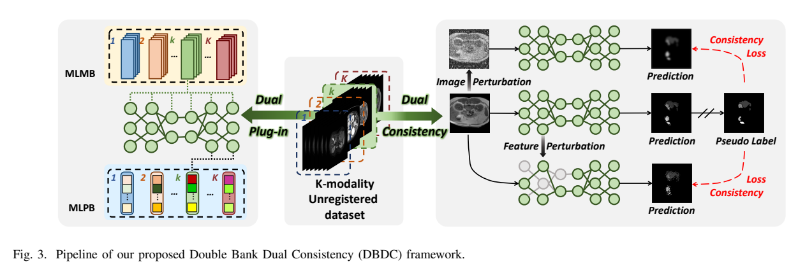

# arXiv 检索结果 / Results

## 1. SP${ }^3$ : Superpixel-propagated pseudo-label learning for weakly semi-supervised medical image segmentation
- Authors：Shiman Li, Jiayue Zhao, Shaolei Liu, Xiaokun Dai, Chenxi Zhang, Zhijian Song
- Comments：10 pages, 7 figures. Under Review
- First：2024-11-18T15:14:36+00:00；Latest：2024-11-18T15:14:36+00:00
- Abs：https://arxiv.org/abs/2411.11636v1
- PDF：https://arxiv.org/pdf/2411.11636v1
- Code：https://huggingface.co/huggingface, https://huggingface.co/docs/hub/spaces, https://github.com/Luoxd1996/WSL4MIS
- 解读来源：PDF 全文，共 12 页，12 页可提取文字
### [中文]
**中文翻译**
- 标题：SP${ }^3$：用于弱半监督医学图像分割的超像素传播伪标签学习
- 摘要：基于深度学习的医学图像分割有助于辅助诊断并加速治疗过程，但模型训练通常需要大规模密集标注数据集。弱半监督医学图像分割是一项重要的应用，因为它仅需少量涂鸦标注和大量未标注数据即可训练模型，极大减少了临床医生对图像进行完整标注的工作量。为应对弱半监督分割（WSSS）中监督信息不足的挑战，提出了一种超像素传播伪标签（SP${}^3$）学习方法，利用超像素中包含的结构信息作为补充信息。具体而言，涂鸦标注被传播至超像素，从而获得用于监督训练的密集标注。由于伪标签的质量受限于低质量标注，通过动态阈值选择的有益超像素被用于细化伪标签。此外，为缓解伪标签中噪声的负面影响，引入超像素级不确定性来指导伪标签监督以实现稳定学习。我们的方法在WSSS设置下在肿瘤和器官分割数据集上均达到最先进性能，仅使用全监督方法约3\%的标注工作量，并获得约80\%的Dice分数。此外，我们的方法在弱监督和半监督设置下均优于八种弱监督和半监督方法。大量实验结果验证了我们的弱半监督分割的有效性和标注效率，可帮助临床医生快速实现器官或肿瘤的自动分割，最终惠及患者。

论文提出SP³（Superpixel-Propagated Pseudo-label）弱半监督医学图像分割框架：用SLIC超像素把稀疏涂鸦扩展为稠密伪标签，以动态阈值筛选高质量超像素精炼伪标签，并用双解码器预测不一致度构造超像素级不确定性来加权伪标签损失。在ACDC（10%/20%标注比例）与BraTS2019（5%/10%）上，Dice分别达到0.7937/0.8186与0.7506/0.8064，优于SOUSA等对比方法；消融显示各模块均有贡献，动态阈值与超像素级不确定性优于固定阈值和像素级不确定性。作者报告标注成本约为全监督的3%。

## 1. 问题与动机

论文针对**弱半监督医学图像分割（WSSS）**：训练集只含少量涂鸦（scribble）弱标注图像和大量无标注图像，目标是训练出接近全监督性能的分割模型[p. 1][p. 4]。作者指出两条既有路线各有不足：纯弱监督依赖区域生长、图方法或CRF扩展涂鸦，耗时且引入标签噪声，常需多阶段训练[p. 2]；半监督依赖伪标签或一致性正则，但伪标签噪声大、可靠性难评估[p. 3]。已有WSSS方法如SOUSA用教师-学生多任务学习统一两类数据，但作者认为多任务学习可能过度依赖大量无标注数据、忽视弱标注引导，造成监督不一致[p. 3]。

作者的核心观察是：超像素内部像素纹理相似、边界常对应灰度梯度，与真实分割的区域/边界结构一致，可补充涂鸦监督的不足；但超像素也可能包含与真值不一致的噪声，因此需筛选“好超像素”，并对伪标签噪声按超像素级不确定性加权[p. 2]。

## 2. 方法

**整体流程**（图2，[p. 3]；算法1，[p. 4]）：先用SLIC对全部图像离线生成超像素；训练时每个batch按比例μ采样弱标注集D_l与无标注集D_u。网络为共享编码器+两个略有差异的解码器（一个带dropout、一个不带），输出P¹、P²。对弱标注图像，用超像素把涂鸦扩展为稠密标签Ỹ，计算部分监督损失L_sup；对两类图像，用(P¹+P²)/2的argmax得到伪标签Ȳ，再经动态阈值筛选的超像素精炼为Ŷ；同时由双预测不一致度计算超像素级不确定性U，加权伪标签损失L_pseu；总损失L_total=L_sup+L_pseu反传更新[p. 4]。

**超像素涂鸦扩展**：若超像素sp_j与涂鸦s_k相交，则sp_j内所有像素标为c_k，否则不赋值（式1）[p. 4]。L_sup为两个分支在扩展区域Ω上的部分交叉熵平均（式2–3）[p. 5]。

**动态阈值伪标签精炼**：伪标签Ȳ=argmax((P¹+P²)*0.5)（式4）。对每个超像素计算主类像素占比ψ(ȳ_j)（式6），若超过阈值T则把整个超像素重标为主类，否则保留原预测（式5）[p. 5]。阈值按类做EMA更新：T_t(c)=λT_{t-1}(c)+(1−λ)(1/B)Σ_b max(ψ(c))，初始τ₀，λ为动量；训练初期阈值低以纳入更多超像素，随后升高过滤噪声[p. 5]。

**超像素级不确定性引导**：u_j为超像素内两预测argmax不一致像素的比例（式8）；权重w_ij=e^{−u_j}（式11），构成权重图W，用于加权Dice损失L_pseu=L_wdice(P¹,Ŷ|U)+L_wdice(P²,Ŷ|U)（式9–10）[p. 5]。

## 3. 贡献

作者声称的贡献有四点[p. 2]：①用超像素补充信息并对弱标注与无标注数据统一做伪标签学习，缓解监督不足与不一致；②动态阈值筛选有益超像素；③超像素级不确定性引导伪标签学习；④在两个公开数据集上取得优越性能并可推广到其他标注高效学习。

我的解读：真正的方法新颖性集中在“超像素同时作为扩展单元、精炼单元和不确定性单元”这一致设计；动态阈值EMA与FreeMatch思路相近，超像素伪标签精炼也见于Thompson等[p. 4]，因此贡献更多是组合与适配，而非全新机制。

## 4. 实验与结果

**数据与设置**：ACDC为100例 cine-MR，5折交叉验证，每折80训练/20测试，涂鸦按文献[58]提供；BraTS2019用335例预处理FLAIR与全肿瘤标签，250训练/25验证/60测试，涂鸦由文献[60]方法模拟[p. 5]。骨干分别为U-Net（2D）与3D U-Net；SGD，动量0.9，权重衰减0.0001，学习率2D 0.01、3D 0.1；NVIDIA 3090[p. 5]。评价指标Dice、JI、95HD、ASD[p. 6]。

**ACDC主结果**（表I，[p. 6]）：10%标注比例下Ours Dice 0.7937±0.0306、95HD 13.11±1.56、ASD 3.89±0.52；20%下Dice 0.8186±0.0439、95HD 7.92±2.79、ASD 2.26±0.75。对比SOUSA为0.7224/0.7703，ICT为0.7010/0.7344，URPC为0.6805/0.7267，S2L为0.6383/0.6657，USTM为0.6814/0.7135；稀疏标注下界0.5232/0.5774，稠密标注上界0.6824/0.7579。作者称Ours超过稠密上界0.1113与0.0607[p. 6]。

**BraTS2019**（表II，[p. 7]）：5%比例Ours Dice 0.7506±0.1810、95HD 32.57±32.63、ASD 10.09±11.02；10%比例Dice 0.8064±0.1592、95HD 15.24±20.85、ASD 4.72±9.22。上界为0.7848/0.8093，作者指出5%时仍差0.0342，10%时接近上界[p. 6]。

**半监督与弱监督推广**：表III（ACDC 20%稠密标注）Ours Dice 0.8751±0.0165，对比UAMT 0.8386、TCSM 0.7695、ICT 0.8743、URPC 0.8611[p. 7]；表IV纯弱监督Ours 0.8751，对比pCE 0.6168、S2L 0.8522、USTM 0.8588、RLoss 0.8743、SS 0.872，全监督FS为0.9013[p. 7]。注意表III与表IV在PDF文本中排版交错，部分数字对应关系需以原表为准。

**消融**（表V，[p. 9]）：ACDC-20%从稀疏标注0.5774/ASD 43.93，加扩展涂鸦0.6362/34.47，加伪标签0.7290/9.33，加不确定性0.7363/7.25，再加无标注数据0.7974/3.53，全模块0.8186/2.26；BraTS-10%对应0.6042→0.6880→0.7185→0.7387→0.7849→0.8064。

**阈值策略**（表VI，[p. 9]）：无超像素精炼0.7503，无阈值0.7290，固定T=0.8为0.7625，EMA阈值T_t为0.8066，类特定T_t(c)为0.8186。**不确定性策略**（表VII）：无U 0.7974，像素级0.8010，KL-SP 0.7946，反向加权Ours_re 0.7326，Ours 0.8186。**超像素数**（表VIII，[p. 10]）：ACDC最优n=350（动态0.8112），BraTS最优n=400（0.8064），动态阈值在各n下均优于固定0.8。**标注成本**（表IX）：ACDC弱半监督为全监督的3.57%，BraTS为3.49%[p. 10]。

## 5. 评估

支持的结论：在报告条件下，SP³在ACDC与BraTS的WSSS设置中优于所比较的8种方法；消融逐步增益支持扩展涂鸦、超像素精炼、不确定性加权与无标注数据各自有效；动态阈值优于固定阈值与无阈值，超像素级不确定性优于像素级与KL-SP。

局限与缺失证据：①BraTS标准差很大（如5% Dice±0.1810），仅单次划分，未报告多次随机种子或显著性检验；②ACDC 5折结果只给均值±标准差，未给逐折；③超像素数、τ₀、λ、μ、dropout率、训练迭代/早停等关键超参未完整报告，τ₀仅在超参实验提到0.5[p. 10]；④表III/IV排版交错，部分基线数字与条件需核对原文；⑤“约80% Dice”与“3%标注成本”是特定数据集与比例下的结论，不能外推；⑥未与更多近期WSSS方法比较，作者也承认WSSS方法稀缺而改编弱/半监督方法[p. 6]。

## 6. 复现

已报告：SLIC（scikit-image）离线生成2D/3D超像素；ACDC n=350、BraTS n=400；U-Net/3D U-Net双解码器（一个带dropout）；SGD lr 0.01（2D）/0.1（3D），动量0.9，权重衰减1e-4；动态阈值τ₀=0.5、固定阈值0.8作为对照；ACDC 5折80/20，BraTS 250/25/60；涂鸦生成引用[58][60]。未报告：batch size、μ具体值、训练轮数/迭代数、λ具体值、dropout率、数据增强、伪标签损失权重、验证选模准则、随机种子与代码链接。复现时应先固定上述未报告项并做敏感性分析，再对齐表I/II的标注比例与折划分。

本篇未找到可可靠提取的方法流程图，请查看原文 PDF。

## 2. Gaze-Assisted Medical Image Segmentation
- Authors：Leila Khaertdinova, Ilya Pershin, Tatiana Shmykova, Bulat Ibragimov
- Venue：NeurIPS
- Comments：16 pages, 4 figures, Accepted to AIM-FM Workshop @ NeurIPS'24
- First：2024-10-23T14:38:57+00:00；Latest：2024-11-17T14:41:36+00:00
- Abs：https://arxiv.org/abs/2410.17920v2
- PDF：https://arxiv.org/pdf/2410.17920v2
- Code：https://huggingface.co/huggingface, https://huggingface.co/docs/hub/spaces, https://github.com/leiluk1/gaze-based-segmentation
- 解读来源：PDF 全文，共 15 页，15 页可提取文字
### [中文]
**中文翻译**
- 标题：注视辅助的医学图像分割
- 摘要：患者器官的标注是多种诊断和治疗流程（如放疗计划）中的关键环节。人工标注极其耗时，而利用现代图像分析技术实现的自动化标注尚未达到足以临床采用的水平。本文研究了利用人类注视作为分割校正的交互输入进行半监督医学图像分割的思路。具体而言，我们微调了医学图像分割一切模型（MedSAM），这是一个使用多种提示类型作为半自动分割校正附加输入的公开方案。我们使用阅读腹部图像时的人类注视数据作为提示来微调MedSAM。该模型在公开的WORD数据库上进行了验证，该数据库包含16个腹部器官的120例CT扫描。结果表明，注视辅助的MedSAM优于最先进的分割模型。具体而言，对于16个腹部器官，nnUNetV2、ResUNet、原始MedSAM以及我们的注视辅助MedSAM模型的平均Dice系数分别为85.8%、86.7%、81.7%和90.5%。

该论文提出一种基于注视点的医学图像交互式分割方法：以MedSAM为基础，仅微调提示编码器和掩码解码器，将合成注视点序列作为点提示输入，并在WORD数据集（120例CT、16个腹部器官）上验证。在合成注视点实验中，最佳策略为20个点、80%位于参考掩码内、20%位于掩码外，平均Dice达90.54%，高于nnUNetV2（85.80%）、ResUNet（86.67%）和原始MedSAM（81.71%）。但在真人（1名代理放射科医生）实验中，注视辅助方法平均Dice为0.854（随机累积20点策略），低于MedSAM边界框提示的0.884，且平均耗时9.7秒对5.7秒。作者结论需结合这一差异理解。

# 论文阅读笔记：Gaze-Assisted Medical Image Segmentation

## 1. 问题与动机

论文关注医学图像分割中人工标注耗时、自动分割精度仍不足以临床采用的问题，探索用人类注视（gaze）作为交互提示来修正分割掩码。作者指出，交互式分割（如SAM/MedSAM）通常依赖鼠标点击或边界框，而注视是一种更自然、可能更快的交互方式，尤其适合CT/MRI这类包含大量切片的三维数据[p. 2]。

现有不足：作者称当时仅有一项注视辅助的医学交互分割工作（GazeSAM），其仅使用单个注视点、基于原始SAM，未探索多注视点、注视点离开感兴趣区域（ROI）以及如何删除多余区域等问题[p. 3]。本文因此研究任意长度注视点序列、固定前景标签以及注视自然抖动下的MedSAM适配。

## 2. 方法

### 2.1 问题定义

三维CT图像 X ∈ R^{H×W×D} 被转换为二维切片处理，掩码 Y ∈ {0,1}^{H×W×D}。注视数据为每个时间戳 t 的坐标 (x_t, y_t)。目标是利用注视点序列 G_T 实时提升分割质量：Q(M(X, G_T)) > Q(M(X, G_{T'}))，其中 Q 为质量指标，M 为注视辅助分割模型，T' < T 表示较早的注视序列[p. 3-4]。

### 2.2 模型与微调

框架以MedSAM为基础，保留其图像编码器、提示编码器和掩码解码器结构。作者仅微调提示编码器和掩码解码器，其余组件冻结[p. 4, p. 6]。注视坐标作为点提示送入提示编码器，生成掩码[p. 4, Fig. 2]。

关键设计是合成注视点生成：
- 初始尝试仅用参考掩码内的点微调，但推理时精度差，作者认为模型对ROI外区域过于敏感[p. 4]。
- 最终采用80%的点位于参考分割掩码内、20%位于掩码外的分布[p. 4]。
- 另一种基于掩码差异的策略：70%的点位于基础预测与真值的差异区域，20%位于真值掩码内，10%位于真值外[p. 5]。
- 作者比较了随机点与模拟扫视/注视动态的点，最终选择随机坐标生成，认为其更能反映真实注视波动[p. 4]。

点标签策略：SAM要求点标签为前景（1）、背景（0）或非点（-1）。作者尝试了随机前景/背景、无标签嵌入、固定标签为1三种策略，发现性能相当，最终采用固定前景标签[p. 5]。

交互式微调流程（Fig. 3）：先用真值掩码内的点提示生成基础预测，再根据基础预测与真值的差异生成“掩码修正点”，将这些点作为提示输入同一模型得到最终预测[p. 5-6]。作者还提出可将上一轮预测掩码作为额外输入与注视点一起送入提示编码器，以增强鲁棒性[p. 6]。

### 2.3 交互式分割与工作站

作者开发了模拟放射科工作站，配备LG 10-bit显示器（3840×2160，7.21 px/mm）和Tobii Eye Tracker 4C（90 Hz），在隔离房间内进行实验。软件顺序显示图像、记录带时间戳的注视点，并与交互式分割模型通信更新掩码；整个流程通过单个Enter键控制[p. 6]。

## 3. 贡献

作者声称的贡献包括：提出基于序列注视信息的CT分割实时修正方法；引入并评估多种MedSAM微调选项（使用模拟注视流的合成提示）；通过人类参与者和医学专家实验证明方法优于鼠标点击和边界框，并分析放射科医生的眼动与耗时[p. 2]。

我的解读：核心新颖点在于将注视点序列作为MedSAM的点提示进行轻量微调，并系统比较了合成注视点分布与选择策略。但“优于边界框”的结论在真人实验中并未得到支持（见下文），作者在摘要和结论中的表述与表2结果存在张力。

## 4. 实验与结果

### 4.1 数据与训练设置

使用WORD数据集，作者称包含150例CT扫描、16个腹部器官[p. 6]；摘要则称120例CT扫描[p. 1]，两者不一致。CT被转为二维切片，每张切片预处理为仅含单一解剖结构；使用WORD官方测试集评估[p. 6]。由于资源限制，模型仅在约5%切片的随机样本上微调[p. 6]。

训练细节：NVIDIA GTX 3090 Ti GPU，AdamW优化器，初始学习率5e-5，每5个epoch验证损失无改善则学习率减半，训练200个epoch，早停耐心10个epoch[p. 6]。点提示数量测试了20点、50点和1-20随机点数；随机点数时用非点标签（-1）填充[p. 6]。

### 4.2 合成注视点实验

- 累积策略：20个注视点，不同分布下，最高平均DSC为0.9，条件是所有点位于参考掩码内[p. 7, Table 4]。
- 线性组合策略：固定分布（20%真值内、70%差异区、10%外部），α从0.1到0.9，最高DSC 0.89在α=0.6，最低0.86在α=0.9[p. 7]。
- 随机点数模型、5次迭代：最高平均DSC对应分布为20%真值内、70%差异区、10%外部，每次迭代选2个点[p. 8, Table 5]。

### 4.3 基准比较

最佳模型用20个点训练，80%在参考掩码内、20%在外；测试同样用20个生成点。原始MedSAM用基于真值掩码的Otsu方法生成边界框[p. 8]。

Table 1报告16个器官的DSC（%）[p. 7]：
- 平均：nnUNetV2 85.80 ± 5.27，ResUNet 86.67 ± 4.81，MedSAM 81.71 ± 9.39，本文方法90.54 ± 5.20。
- 本文方法在多数器官上领先，如十二指肠86.53对MedSAM 80.07、肾上腺80.28对62.74；但在食道（87.11对88.94）和直肠（90.34对92.54）上低于MedSAM。

### 4.4 真人实验

由1名代理放射科医生完成两部分实验：注视辅助交互分割与MedSAM边界框分割[p. 8]。

Table 2（20点提示模型）[p. 8]：
- 随机累积20点（points）：平均DSC 0.854。
- 固定点有放回（fix rep）：0.764。
- 固定点累积（fix accum）：0.831。
- 线性组合（linear）：0.820。
- 每次累积2点（accum 2 p）：0.861。
- MedSAM边界框：0.884。

Table 3（带上一轮预测掩码的模型）[p. 9]：随机累积20点平均0.745，固定点有放回0.601，固定点累积0.745。

耗时：注视辅助方法平均9.7 ± 4.9秒，MedSAM边界框5.7 ± 3.1秒[p. 9]。

### 4.5 消融证据

合成实验表明注视点分布显著影响性能：点越集中在真值掩码内，DSC越高（Table 4中100%真值内为0.90010，0%真值内为0.07115）[p. 13]。但真人实验中，最佳合成策略（80/20）对应的随机累积策略（0.854）仍低于边界框（0.884），说明合成分布与真实注视行为之间存在差距。

## 5. 评估

支持的结论：在合成注视点条件下，微调后的MedSAM在WORD测试集上平均DSC高于nnUNetV2、ResUNet和原始MedSAM[p. 7]。注视点分布和选择策略对性能有明显影响[p. 7-9]。

未支持的结论：作者在摘要和结论中称注视辅助MedSAM优于现有方法，但真人实验中边界框MedSAM平均DSC更高（0.884对0.854或0.861），且注视方法更慢（9.7秒对5.7秒）[p. 8-9]。作者也承认仅1名参与者、仅逐切片分割，未使用三维操作[p. 9]。此外，训练仅用约5%切片，可能限制泛化；WORD数据集规模在摘要与正文中不一致（120 vs 150例）[p. 1, p. 6]。

## 6. 可复现性

已报告：WORD数据集及官方测试集；MedSAM仅微调提示编码器和掩码解码器；AdamW、学习率5e-5、200 epoch、早停10、学习率每5 epoch减半；20/50/1-20点提示；合成点分布80/20或70/20/10；Tobii Eye Tracker 4C 90 Hz、LG 3840×2160显示器；代码链接https://github.com/leiluk1/gaze-based-segmentation[p. 1, p. 6]。

未报告或不清楚：约5%切片的具体抽样方式与切片总数；50点提示的完整结果；真人实验中每位器官的切片数量（文中写“X CT slices”）；注视点生成的具体随机种子；MedSAM边界框的Otsu方法细节；统计显著性检验。Table 5中部分数字排版疑似错位（如“0.804651”“0.826512”），无法可靠辨认对应条件[p. 14]。

本篇未找到可可靠提取的方法流程图，请查看原文 PDF。

## 3. Synergy-Guided Regional Supervision of Pseudo Labels for Semi-Supervised Medical Image Segmentation
- Authors：Tao Wang, Xinlin Zhang, Yuanbin Chen, Yuanbo Zhou, Longxuan Zhao, Tao Tan, Tong Tong
- First：2024-11-07T07:41:04+00:00；Latest：2024-11-13T05:52:23+00:00
- Abs：https://arxiv.org/abs/2411.04493v2
- PDF：https://arxiv.org/pdf/2411.04493v2
- Code：https://huggingface.co/huggingface, https://huggingface.co/docs/hub/spaces
- 解读来源：PDF 全文，共 9 页，9 页可提取文字
### [中文]
**中文翻译**
- 标题：协同引导的伪标签区域监督用于半监督医学图像分割
- 摘要：半监督学习因其利用大量无标签数据增强模型鲁棒性的潜力而受到广泛关注。伪标签是半监督学习中广泛使用的策略。然而，现有方法常受噪声污染影响，可能削弱模型性能。为应对这一挑战，我们提出了一种新颖的协同引导伪标签区域监督（SGRS-Net）框架。基于均值教师网络，我们采用混合增强模块增强无标签数据。通过评估增强前后的协同性，我们将伪标签策略性地划分为不同区域。此外，我们引入区域损失评估模块来评估每个划分区域的损失。在LA数据集上进行的大量实验表明，该框架优于最先进技术，凸显了其高效性和实用性。

SGRS-Net 在 mean-teacher 框架下，用 Mix Augmentation 生成混合无标注样本，并以学生网络对原图与混合图的预测一致性（熵阈值 τ=0.296）把伪标签划分为忽略区 Δ、一致区 Ω 和不一致区 Θ；Ω 用常规 CE+Dice 一致性损失，Θ 用带标签平滑的噪声鲁棒损失，Δ 不参与损失。在 LA、Pancreas-CT、BraTS2019 三个数据集、5%/10% 标注预算下，Dice 分别达到 89.70%/90.76%、77.20%/80.55%、80.62%/85.67%，多数指标优于 8 个对比方法；消融显示 SE&RLE 与 MA 均有贡献，但部分表格排版混乱、若干数字与正文表述不完全一致，需谨慎解读。

## 1. 问题与动机

半监督医学图像分割希望用少量标注数据和大量无标注数据提升模型泛化能力。伪标签是常用手段：先用标注数据训练模型，再对无标注数据生成伪标签并迭代训练[p. 1]。作者指出，伪标签相对真实标签存在固有误差，部分伪标签接近 GT，部分则被噪声污染；随着迭代训练，噪声会损害模型鲁棒性[p. 1]。已有的噪声鲁棒损失虽能一定程度抑制噪声，但对高质量伪标签也做噪声抑制可能导致过度平滑、降低精度[p. 1]。因此论文要解决的问题是：**如何在充分利用伪标签监督信号的同时，按伪标签可靠性分区处理，减少噪声污染**。

## 2. 方法

整体流程见 Figure 1 [p. 3]：教师网络对无标注图像 D_U 预测并取 ArgMax 得到伪标签 Y（式 1–2）[p. 2]；Mix Augmentation（MA）把 D_U 与有标注图像 D_L 线性混合得到 D_M（式 3–4），其中 λ = max[Beta(α,α), 1−Beta(α,α)]，α 为随机超参数[p. 2]。学生网络分别处理 D_L、D_U、D_M，得到 P_L、P_U、P_M[p. 2]。

Synergy Evaluation（SE）模块先对 P_U、P_M 做 Softmax（式 5），计算像素级熵 Ent(p) = −Σ_j p_j log p_j（式 6）；熵超过阈值 τ 的区域记为 Δ（式 7）[p. 3]。在非 Δ 区域中，若 P_U 与 P_M 的 ArgMax 类别一致则记为 Ω，不一致则记为 Θ（式 8–9）[p. 3]。直观上，Δ 是模型不确定区域，Ω 是增强前后一致的可信区域，Θ 是低熵但类别不一致、可能含噪声的区域。

Regional Loss Evaluation（RLE）按区域施加不同损失[p. 3–4]：
- 有标注数据用 L_sup = CE(P_L, GT) + Dice(P_L, GT)（式 10–12）。
- Ω 区域用 L_con = L_c^Ω(P_U,Y) + L_c^Ω(P_M,Y)，即对原图与混合图预测分别与 Y 计算 CE+Dice（式 13–14）。
- Θ 区域用噪声鲁棒损失 L_NR：CE 部分对标签做平滑，引入 ε/C·log(p[i,j]) 项（式 15）；Dice 分母加 η 平滑（式 16）；总区域损失为 CE 与 Dice 之和（式 17–18）。
- Δ 区域不参与损失。

总损失 L = L_sup + λ(t)·(L_con + L_NR)（式 19），λ(t) 为时间相关高斯 warm-up 函数（式 20），t_warm 为最大 warm 步数[p. 4]。教师参数由学生参数经指数移动平均更新（Figure 1 说明）[p. 3]。

## 3. 贡献

作者声称的贡献有三点[p. 1–2]：提出 SGRS-Net 框架；提出 SE 与 RLE 模块以在利用伪标签的同时抑制噪声；在三个公开数据集上验证，尤其在 5% 标注数据下表现突出。我的解读是：核心新颖点在于**用 Mix Augmentation 前后预测的一致性作为伪标签可靠性判据**，并把伪标签分成“忽略/一致/不一致”三类分别施以不同损失；这不同于仅做一致性正则或仅用不确定性筛选伪标签的做法。但论文没有给出与“仅用熵筛选”或“仅用一致性筛选”的严格对照，因此各设计要素的独立增益主要来自组件消融而非机制层面的拆解。

## 4. 实验与结果

**数据集与划分**：LA 数据集 100 例增强 MR，80 训练/20 验证，未使用后处理[p. 4]；Pancreas-CT 82 例 3D 腹部 CT，随机 60 训练/20 测试，HU 裁剪至 −125~275[p. 4]；BraTS2019 335 例胶质瘤，使用 FLAIR 模态，250 训练/25 验证/60 测试[p. 4]。

**训练设置**：PyTorch，Nvidia RTX 3090 24GB；3D patch 大小 LA 为 112×112×80，Pancreas-CT 与 BraTS2019 为 96×96×96；batch size 4（2 有标注 + 2 无标注）；backbone 为 V-Net；SGD，学习率 1e-2，weight decay 1e-4；LA 与 Pancreas-CT 训练 15k 迭代，BraTS2019 训练 60k 迭代；τ=0.296，ε=0.2，η=20[p. 4]。指标为 Dice、Jaccard、95HD、ASD；对比 8 个 SOTA：DTC、URPC、SS-Net、MC-Net+、CAML、Co-BioNet、BCP、MCF，使用官方代码与结果[p. 4]。

**LA 结果**（Table 2）[p. 5]：5% 标注（4 例标注/76 例无标注）下，SGRS-Net Dice 89.70%、Jaccard 81.40%、95HD 6.68、ASD 1.75；CAML 为 87.34%，BCP 为 88.02%。10% 标注（8/72）下 Dice 90.76%、Jaccard 83.13%、95HD 6.08、ASD 1.87；全监督 V-Net（80 例）Dice 91.62%[p. 5]。作者称 5% 结果比 CAML 提升 2.36%，且接近 10% 标注对比方法的上界[p. 4–5]。

**Pancreas-CT 结果**（Table 3）[p. 6]：5% 标注（3/59）下 Dice 77.20%、Jaccard 63.45%、95HD 12.34、ASD 3.81；MCF 为 63.65%，作者称提升 9.55%[p. 5]。10% 标注（6/56）下 Dice 80.55%、Jaccard 67.88%、95HD 6.00、ASD 2.50；全监督 V-Net（62 例）Dice 83.76%[p. 6]。注意正文一处写 10% 下 Dice 为 80.62%[p. 5]，而 Table 3 显示 80.55%[p. 6]，存在不一致。

**BraTS2019 结果**（Table 4）[p. 7]：5% 标注（12/238）下 Dice 80.62%、Jaccard 70.21%、95HD 14.58、ASD 3.64；CAML 79.34%，作者称提升 1.28%[p. 5]。10% 标注（25/225）下 Dice 85.67%、Jaccard 76.05%、95HD 9.33、ASD 2.76；BCP 84.35%，作者称提升 1.32%[p. 5]。全监督 V-Net（250 例）Dice 88.58%[p. 7]。

**消融**：Table 5 组件消融（LA，10% 标注）[p. 7]：baseline 75.18% Dice；加 MA 80.43%；加 MT 87.45%；加 SE&RLE 88.61%；全模块 90.76%（Jaccard 83.13、95HD 6.08、ASD 1.87）。Table 6 区域损失消融[p. 6–7]：仅用 L_con 处理整个 Y 时 5% 标注 Dice 88.61%，而 Ω 用 L_con、Θ 用 L_NR 时 89.70%，说明排除 Δ 并区分 Θ 有增益；表中还列出多种 L_con/L_NR 组合，但排版错乱，部分数字难以可靠对应。Table 7 增强方式对比[p. 6–7]：5% 标注下 Flip.H 88.69%、Flip.V 88.96%、MA 89.70%；10% 标注下 MA 90.76%，Flip.H 90.06%、Flip.V 90.31%。τ 敏感性见 Figure 4 [p. 6–7]：τ 过小导致过多区域被忽略、监督减少；τ 过大增加伪标签不确定性；τ=0.296 表现最好。

## 5. 评估

支持的结论：在作者报告的设置下，SGRS-Net 在三个数据集、5%/10% 标注预算下多数指标优于对比方法，尤其 Pancreas-CT 5% 的 Dice 提升较大；组件消融支持 MA、MT、SE&RLE 各自带来增益；区域损失消融支持“忽略 Δ、对 Θ 用鲁棒损失”的设计。

局限与缺失证据：论文只在一个 backbone（V-Net）和一个 τ 值上做主要实验，未报告跨 backbone、跨 τ 的完整敏感性数值表；未报告训练随机种子、重复实验的均值/方差，因此无法判断提升的统计稳定性；Table 2、3、4、6、7 的排版在提供的文本中严重错乱，部分行列对应关系无法辨认，例如 Table 6 中不同损失组合与 Dice 的对应需谨慎；正文与表格在 Pancreas-CT 10% Dice（80.62% vs 80.55%）上不一致[p. 5–6]；作者未报告推理时间、参数量或显存开销；也未与“仅用熵筛选伪标签”等更简单基线做机制级对照。

## 6. 复现

已报告的可复现要点：V-Net backbone；SGD，lr=1e-2，weight decay=1e-4；batch size 4（2 标注 + 2 无标注）；patch 尺寸 LA 112×112×80、Pancreas-CT/BraTS2019 96×96×96；迭代数 LA/Pancreas-CT 15k、BraTS2019 60k；τ=0.296、ε=0.2、η=20；MA 的 α 为随机超参数但未给具体分布参数[p. 2, p. 4]；λ(t) 的 t_warm 未给具体数值[p. 4]；教师 EMA 衰减系数未报告[p. 3]；数据预处理细节（除 HU 裁剪和 patch 提取外）未完整报告；代码称在 Supplementary Material 中，但正文未给出链接[p. 1]。未报告项需在复现时自行设定并做敏感性验证。

本篇未找到可可靠提取的方法流程图，请查看原文 PDF。

## 4. UnSegMedGAT: Unsupervised Medical Image Segmentation using Graph Attention Networks Clustering
- Authors：A. Mudit Adityaja, Saurabh J. Shigwan, Nitin Kumar
- First：2024-11-04T10:42:21+00:00；Latest：2024-11-04T10:42:21+00:00
- Abs：https://arxiv.org/abs/2411.01966v1
- PDF：https://arxiv.org/pdf/2411.01966v1
- Code：https://github.com/mudit-adityaja/UnSegMedGAT, https://huggingface.co/huggingface, https://huggingface.co/docs/hub/spaces
- 解读来源：PDF 全文，共 4 页，4 页可提取文字
### [中文]
**中文翻译**
- 标题：UnSegMedGAT：使用图注意力网络聚类的无监督医学图像分割
- 摘要：监督分类的数据密集型特性促使研究人员关注无监督方法，尤其是在医学图像分割等标注数据稀缺的问题上。基于视觉Transformer（ViT）在计算机视觉领域的最新进展，我们提出了一种使用预训练Dino-ViT的无监督分割框架。在所提出的方法中，我们利用图像内在的图结构来实现医学图像分割性能的显著提升。为此，我们引入了一种基于模块度的损失函数，并结合图注意力网络（GAT），以有效捕捉图像内在的图拓扑结构。我们的方法达到了最先进的性能，甚至显著超越或媲美现有的（半）监督技术，如MedSAM——一种用于医学图像的分割一切模型。我们使用两个具有挑战性的医学图像数据集ISIC-2018和CVC-ColonDB进行了验证。这项工作强调了无监督方法在标注数据稀缺场景下推进医学图像分析的潜力。代码的GitHub仓库可在[https://github.com/mudit-adityaja/UnSegMedGAT]获取。

论文提出无监督医学图像分割框架UnSegMedGAT：用预训练DINO-ViT提取图像块特征并构图，经阈值剪枝后用并行GAT与全连接层输出软聚类，以模块度损失训练；在ISIC-2018与CVC-ColonDB上报告mIoU/Dice，ISIC-2018优于MedSAM，ColonDB不及MedSAM；另有共享参数预训练的UnSegMedGATc在ColonDB上提升明显。

## 1. 问题与动机

论文关注标注数据稀缺条件下的医学图像分割。作者指出，UNet、SegNet、DeepLab等监督方法依赖大量标注，医学场景中标注成本高且受隐私限制；MedSAM虽在大规模医学数据上训练，但作者称其存在模态不平衡，在ISIC-2018上表现明显下降[p. 1]。因此，作者希望利用预训练ViT特征与图像内在图结构，在无需标签的情况下完成分割。

## 2. 方法

### 2.1 特征提取与构图
输入图像尺寸为s×t、通道数d，经预训练small DINO-ViT（不微调）切成p×p图像块，得到n=st/p²个节点；从最后一个Transformer块的key层取每个块的特征，维度为C_in[p. 1]。实验中p=8、C_in=384[p. 3]。

节点特征f构成图G，邻接矩阵由特征相似度阈值化得到：A_ij=1当(f f^T)_ij>τ，否则为0；τ为用户设定参数，实验中取0.3[p. 1][p. 3]。图1展示了流程：ViT块特征→构图→阈值选边→GAT聚合→FCN聚类→模块度损失训练→推理时用edge refinement细化掩码[p. 2]。

### 2.2 GAT与多头注意力
每个节点i的特征h_i∈R^F，注意力系数α_ij由共享注意力机制计算，使用LeakyReLU、可学习权重W和向量a，并对邻居N(i)做softmax[p. 2]。节点输出为邻居特征加权和再经非线性σ。多头注意力将Z个头输出拼接[p. 2]。

### 2.3 并行GAT与聚类输出
模型采用R条并行GAT序列，第r条含t_r个GAT层、输出m_r维；各序列输出经第一层FCN投影到M维，求和后再经第二层FCN映射到k维，softmax得到软聚类分配C∈[0,1]^{n×k}[p. 2]。实验最优设置为R=2、t_1=t_2=2、m_1=128、m_2=64、M=64[p. 3]。

### 2.4 损失函数
模块度矩阵B=A−dd^T/(2m)，d为度向量，m为边数。模块度Q=1/(2m)Σ_ij(A_ij−d_i d_j/(2m))δ(c_i,c_j)[p. 2]。由于最大化Q为NP难，采用松弛形式Q̄=1/(2m)Tr(C^T B C)[p. 3]。最终损失L=−1/(2m)Tr(C^T B C)+(√k/n)||Σ_i C_i−1||_F，第二项为软分配正则，促使各簇规模均衡[p. 3]。

### 2.5 训练策略
每个图像单独优化，初始学习率10⁻³、衰减因子10⁻²、Adam、60 epochs[p. 3]。但后文又称ISIC-2018最优需300 epochs、ColonDB为60 epochs[p. 3]，两处存在不一致。作者还提出UnSegMedGATc：前T0个epoch所有图像共享参数，后T1个epoch逐图独立优化；ISIC-2018取T0=5、T1=5，ColonDB取T0=15、T1=55[p. 3]。

## 3. 贡献

作者声称的贡献包括：将模块度与注意力机制结合用于无监督医学分割；用多级GAT集成做图聚类；在ISIC-2018上超过MedSAM，在CVC-ColonDB上超过现有无监督方法[p. 1]。我的理解是，核心工程贡献在于把DINO-ViT块特征图、阈值化邻接与模块度聚类损失组合成逐图优化流程；UnSegMedGATc的共享参数预训练是额外训练策略，并非全新网络结构。

## 4. 实验与结果

数据集为ISIC-2018皮肤镜图像与CVC-ColonDB结肠镜图像[p. 3]。评价指标为二值化后的mIoU与Dice[p. 3]。基线包括MedSAM、MinCutPool、GDISM、DSM、ViT-Kmeans，表中还列出UnSeGArmaNet与UnSegGNet[p. 3][p. 4]。

表I报告平均(mIoU, Dice)：ISIC-2018上UnSegMedGATc为(74.76,85.17)，UnSegMedGAT为(73.75,84.34)，UnSeGArmaNet为(73.16,83.16)，UnSegGNet为(73.94,84.12)，MedSAM为(61.36,73.06)，MinCutPool为(72.31,83.24)，DSM为(72.2,81.71)，ViT-Kmeans为(68.6,78.37)。ColonDB上UnSegMedGATc为(65.1,77.31)，UnSegMedGAT为(57.21,70.76)，UnSeGArmaNet为(59.35,72.58)，UnSegGNet为(55.67,69.18)，MedSAM为(70.29,80.50)，MinCutPool为(56.09,69.71)，DSM为(47.46,63.50)，ViT-Kmeans为(51.84,67.23)[p. 4]。

作者称UnSegMedGAT在ISIC-2018显著优于MedSAM，并解释MedSAM因模态不平衡在皮肤镜数据上较弱；在ColonDB上MedSAM因训练含大量息肉数据而表现更好[p. 3]。激活函数消融比较SiLU、SeLU、ReLU，称SiLU在两个数据集上最佳[p. 3]。但论文未给出各激活函数的数值表，也未报告方差、显著性检验或每类结果。

## 5. 评估

支持的结论：在报告设置下，UnSegMedGATc在ISIC-2018的mIoU/Dice高于表中所有基线；UnSegMedGATc在ColonDB上高于其他无监督基线，但仍低于MedSAM。作者关于“显著超过或匹配MedSAM”的表述需按数据集区分：ISIC-2018支持超过，ColonDB不支持超过。

局限与缺失证据：论文仅4页，未说明数据集划分、图像数量、预处理、标签使用方式（是否仅用于评测）、推理时edge refinement的具体参数[p. 2]；未报告运行时间、参数量、内存；未给出消融的完整数值；表I中GDISM未出现数值，可能未报告或表格不可辨认[p. 4]。此外，训练epoch描述存在60与300的不一致[p. 3]，影响复现。

## 6. 复现

已报告：DINO-ViT small、patch 8、C_in=384；τ=0.3；R=2、t_r=2、m_1=128、m_2=64、M=64；Adam、初始学习率10⁻³、衰减10⁻²；SiLU激活；ISIC-2018 300 epochs、ColonDB 60 epochs；UnSegMedGATc的T0/T1分别为5/5与15/55[p. 3]。未报告：batch size（逐图优化下含义需明确）、数据增强、图像分辨率、k的取值、阈值τ的敏感性、edge refinement细节、硬件与随机种子。代码链接在摘要中给出，但正文未说明实现细节。

本篇未找到可可靠提取的方法流程图，请查看原文 PDF。

## 5. Double Banking on Knowledge: Customized Modulation and Prototypes for Multi-Modality Semi-supervised Medical Image Segmentation
- Authors：Yingyu Chen, Ziyuan Yang, Ming Yan, Zhongzhou Zhang, Hui Yu, Yan Liu, Yi Zhang
- First：2024-10-23T05:19:20+00:00；Latest：2024-10-23T05:19:20+00:00
- Abs：https://arxiv.org/abs/2410.17565v1
- PDF：https://arxiv.org/pdf/2410.17565v1
- Code：https://huggingface.co/huggingface, https://huggingface.co/docs/hub/spaces
- 解读来源：PDF 全文，共 10 页，10 页可提取文字
### [中文]
**中文翻译**
- 标题：知识双库：面向多模态半监督医学图像分割的定制调制与原型
- 摘要：基于多模态（MM）半监督学习（SSL）的医学图像分割近来因其能够利用多模态数据并减少对标注图像的依赖而受到越来越多的关注。然而，现有方法面临若干挑战：（1）复杂的网络设计阻碍了向模态数超过两个的场景的可扩展性。（2）仅关注模态不变表示而忽略模态特有特征，导致多模态学习不完整。（3）利用生成式方法利用未标注数据对半监督学习而言可能不可靠。为解决这些问题，我们提出了双库双一致性（DBDC），一种用于医学图像分割的新型多模态半监督方法。针对挑战（1），我们提出了一种模态全一分割网络，可容纳任意数量模态的数据，消除了对模态数量的限制。针对挑战（2），我们设计了两个可学习的插件库，即模态级调制库（MLMB）和模态级原型库（MLPB），以同时捕获模态不变和模态特有的知识。这些库使用我们提出的模态原型对比学习（MPCL）进行更新。此外，我们设计了模态自适应加权（MAW）来动态调整每个模态的学习权重，确保平衡的多模态学习，因为不同模态以不同速率学习。最后，针对挑战（3），我们引入了一种双一致性（DC）策略，在图像和特征两个层面强制一致性，而不依赖生成式方法。我们在三个开源数据集上使用2至4模态分割任务评估了我们的方法，大量实验表明我们的方法优于最先进的方法。

论文提出 DBDC 框架，用于多模态半监督医学图像分割。核心包括：基于 U-Net 的模态全一网络，通过 MLMB（模态级调制库）学习模态不变特征、MLPB（模态级原型库）学习模态特有特征，并用 MPCL（模态原型对比学习）更新两库；MAW（模态自适应加权）按学习速度与性能动态平衡各模态损失；DC（双一致性）在图像扰动和特征扰动层面利用未标注数据，不依赖生成模型。在 2 模态心脏（MM-WHS CT/MR）和 4 模态腹部（BTCV CT + CHAOS T2/T1 in-phase/T1 out-phase）数据集上，各模态 20% 训练数据有标签。心脏数据集平均 DSC 84.56、HD95 4.21，优于 SUMML（75.17/6.28）和 MASS（74.76/6.18）；腹部数据集平均 DSC 87.61、HD95 4.62，优于最佳单模态 SSL 基线 EVIL（81.50/14.06）。消融显示 MLMB 用于编码器、瓶颈、解码器时 DSC 从 60.73 升至 87.61；MPCL 各损失逐步加入使 DSC 从 81.88 升至 87.61。作者报告主要局限是 MLPB 显著增加 FLOPs，且数据集最多 4 个模态。

# DBDC：面向多模态半监督医学图像分割的双库双一致性方法

## 1. 问题与动机

论文针对多模态（MM）半监督医学图像分割（SSL）中的三个问题 [p. 1]：

- **可扩展性差**：现有 MM-SSL 方法（如 SUMML、MASS）通常为 2 模态设计，依赖多个独立网络、生成模型或配准网络；模态数增加时复杂度快速上升 [p. 2]。
- **多模态学习不完整**：已有方法偏重模态不变特征（如 MASS 的共享解码器），忽视模态特有特征，导致表示不全面 [p. 2]。
- **无标签数据利用不可靠**：SUMML 依赖 CycleGAN 生成图像的质量，MASS 依赖可学习配准网络的精度；在模态差异大（如 CT 与 MR）时性能受限 [p. 2]。

作者主张用统一 U-Net 式网络、两个可学习插件库和双一致性策略同时解决上述问题，并支持任意数量模态 [p. 2]。

## 2. 方法

### 2.1 模态全一网络

网络 M 基于标准 U-Net，所有卷积层跨模态共享；MLMB 与 MLPB 作为插件，按输入模态选择对应参数 [p. 3]。

**MLMB（模态级调制库）**：为每个模态、每个调制层学习均值与方差，对特征做归一化式调制：

MLMB_i(z_i,k)=γ_{i,k}·(z_i−μ_{i,k})/sqrt(σ²_{i,k}+ε)+β_{i,k} [p. 3, Eq.1]

其中 z_i 为第 i 层特征，γ、β 为仿射参数，μ、σ² 为模态 k 的均值与方差，ε 防数值不稳定。均值初始为 0、方差初始为 1，训练中用 EMA 更新，动量 α=0.99 [p. 3, Eq.2–3]。

**MLPB（模态级原型库）**：将解码器各层拼接成多尺度特征，经 3 层 1×1 卷积投影为 D=64 维像素嵌入 I_k∈R^{D×N}，N=H×W [p. 3]。每个模态有 C 个类原型 P_k=[p_{kc}]_{c=1}^C。原型通过在线聚类分配 L_k 优化：最大化 Tr(L_k^T P_k^T I_k)，约束每个像素只分配一个原型、每个原型平均被选 N/C 次；用 Sinkhorn-Knopp 迭代求解 [p. 4, Eq.4–6]。原型按 EMA 更新：p_{kc}=α·p_{kc}+(1−α)·ī_{kc}，α=0.99 [p. 4, Eq.7]。

**MPCL（模态原型对比学习）**：包含四项损失 [p. 4]：
- 原型分割损失 L_pseg = ½L_dice(s_k,y_lk)+½L_ce(s_k,y_lk)，s_k=⟨I_k,P_k⟩ 为余弦相似度 [Eq.8]；
- 模态对比损失 L_mc = −⟨I_k,P_k⟩+⟨I_k,P_{j≠k}⟩，拉近本模态原型、推远其他模态原型 [Eq.9]；
- 原型对比损失 L_pc，使像素嵌入靠近所属类原型、远离其余 C−1 个原型，温度 τ [Eq.10]；
- 原型距离损失 L_pd=(1−i_k^T p_{kc})²，压缩同类像素特征 [Eq.11]。

总损失 L_MPCL=(L_pseg+L_mc+L_pc+L_pd)/4 [p. 5, Eq.12]。

### 2.2 MAW（模态自适应加权）

权重与学习速度成反比、与错误率成正比：ω_{k,t}=(1/S_{k,t}^β)·(1−P_{k,t})，β=0.2 [p. 5, Eq.13]。S_{k,t} 用 Population Stability Index 衡量，基于固定 τ=20 个 epoch 内 DSC 正负变化次数 d+、d− 的比值 [Eq.14–16]；P_{k,t} 为 λ_{k,t} 在 τ 个 epoch 上的累积。学习快的模态权重小，学习慢的权重大 [p. 5]。

### 2.3 双一致性（DC）

对未标注数据同时施加图像扰动一致性与特征扰动一致性 [p. 5]：

L_dc^k=L_ipc^k+L_fpc^k [Eq.17]

L_ipc^k=L_ce(M(x̂_uk;k),Y)+δL_MPCL(M(x̂_uk;k),Y) [Eq.18]

L_fpc^k=L_ce(M̌(x_uk;k),Y)+δL_MPCL(M̌(x̂_uk;k),Y) [Eq.19]

其中 x̂_uk 为图像扰动后的未标注数据，Y 为未扰动预测生成的伪标签，M̌ 为特征扰动网络（随机丢弃编码器神经元），δ=0.1 [p. 5]。

总损失：L_total=Σ_k ω_k[L_sup(x_lk,y_lk)+λL_dc(x_uk)] [p. 5, Eq.22–23]。L_sup 含交叉熵、Dice 和 δL_MPCL [Eq.21]；λ 用高斯 ramp-up，λ_max=1.0 [p. 5]。

## 3. 贡献

作者声称的贡献 [p. 2]：
1. 首个支持任意数量模态的 MM-SSL 全一网络；
2. 两个插件库分别学习模态不变与模态特有特征，配合 MPCL；
3. MAW 平衡各模态学习速度；
4. 不依赖生成模型的双一致性策略。

我的解读：核心工程价值在于把模态相关参数从共享主干中解耦为可插拔库，使模态数增加时只增加少量参数（作者报告每增加一个模态仅多 0.05M 参数 [p. 9]），但 MLPB 带来显著 FLOPs 增长。

## 4. 实验与结果

### 4.1 数据与设置

- **心脏数据集**：MM-WHS 的 CT 与 MR，各 20 例 3D 扫描，重采样为 192×192 2D 图像；70%/10%/20% 划分训练/验证/测试；SSL 下随机取 20% 训练数据有标签 [p. 6]。
- **腹部数据集**：4 模态——CT 来自 BTCV（50 例），T2、T1 in-phase、T1 out-phase 来自 CHAOS（各 40 例）；重采样为 256×256；同样 70/10/20 划分，20% 训练数据有标签 [p. 6]。
- **训练**：100 epochs，Adam，初始学习率 1e-4，多项式调度；单张 NVIDIA GTX 3090；输入随机裁剪 128×128；测试用滑动窗口；指标 DSC 与 HD95 [p. 6]。
- **基线**：单模态 SSL 的 MT、UAMT、CPS、ICT、EVIL；MM-SSL 的 SUMML、MASS；迁移学习的 VarDA、RAM-SDIR [p. 6]。

### 4.2 主要结果

**心脏 2 模态（Tab. I, p. 6）**：
- 本文方法：CT DSC 87.37/HD95 3.30，MR DSC 81.74/HD95 5.11，平均 DSC 84.56/HD95 4.21；
- SUMML：平均 75.17/6.28；MASS：平均 74.76/6.18；
- 上界 UNet（全监督）：平均 87.43/3.81；下界 UNet（20% 标签）：64.30/14.36；
- 作者称平均 DSC 比 SUMML 和 MASS 高近 10 点，MR 上比 SUMML 高 15 点 [p. 6]。

**腹部 4 模态（Tab. II, p. 7）**：
- 本文方法平均 DSC 87.61/HD95 4.62；
- 最佳单模态 SSL 基线 EVIL 平均 81.50/14.06；CPS 79.87/11.91；ICT 80.06/12.77；
- 上界 92.14/3.01，下界 74.39/17.10；
- 分模态：T2 92.10/4.34，T1 ip 86.85/2.91，T1 op 85.63/2.60，CT 85.86/8.61。

### 4.3 消融

- **MLMB 层级（Tab. IV, p. 7）**：不用 MLMB 时 DSC 60.73/HD95 33.95；仅编码器 83.52/6.58；编码器+瓶颈 84.93/6.91；编码器+瓶颈+解码器 87.61/4.62。
- **MPCL 损失（Tab. III, p. 7）**：无任何损失 81.88/8.85；加 L_ipc 83.61/7.39；加 L_fpc 84.21/7.80；加 L_mc 85.25/6.75；加 L_pc 86.02/5.61；加 L_pd 87.61/4.62。作者称各组件带来约 4 点 DSC 提升 [p. 9]。
- **MAW**：Tab. I 中 w/o MAW 平均 83.97/4.19，加入后 84.56/4.21；Tab. II 中 w/o MAW 86.67/7.65，加入后 87.61/4.62。作者称平均 DSC 和 HD95 分别提升约 1 点和 3 点 [p. 9]。
- **模态数分析（Fig. 8, p. 10）**：在腹部数据上比较 2、3、4 模态组合；作者报告随模态数增加各模态性能提升，T2 与 T1 out 提升超过 3 点 [p. 9]。
- **参数与计算量**：本文 5.34M 参数、20.03 FLOPs（心脏）/35.58 FLOPs（腹部）；SUMML 25.02M/23.46；MASS 0.72M/61.44 [p. 6–7]。作者指出 MLPB 显著增加 FLOPs [p. 9]。

## 5. 评估

**有支持的结论**：在作者设定的 20% 标签、2 与 4 模态、非配准数据条件下，DBDC 的平均 DSC 与 HD95 优于所列基线；MLMB 层级越深收益越大；MPCL 各损失与 DC 各分量均有逐步增益；MAW 改善模态间平衡。

**作者报告的局限**：MLPB 显著增加 FLOPs，未来需降低计算成本；受隐私与专业标注限制，数据集最多 4 个模态，更多模态留待未来 [p. 9]。

**缺失或不充分证据**：
- 未报告多次随机种子或均值±方差，单次结果难以判断显著性；
- 未与更多近期 MM-SSL 方法比较；
- 未报告标签比例（如 5%、10%）的敏感性；
- 未给出 MAW 中超参数 β、τ 的敏感性分析；
- 未报告推理时间；
- 部分表格数字与正文表述存在细微不一致（如正文称 MAW 提升 HD95 约 3 点，Tab. I 中 4.19→4.21 仅 0.02），需以表格为准。

## 6. 复现

已报告：U-Net 主干；D=64；α=0.99；δ=0.1；β=0.2；τ=20 epochs；λ_max=1.0；100 epochs；Adam，lr=1e-4，多项式调度；128×128 随机裁剪；单张 GTX 3090；滑动窗口测试；20% 标签；70/10/20 划分 [p. 3–6]。

未报告：batch size、具体数据增强、Sinkhorn 迭代次数与 φ 取值、伪标签置信度阈值、EMA 教师更新细节（若使用）、代码链接、随机种子、推理耗时。复现时需自行确定这些设置。

#### 原论文流程图 · Figure 3 · PDF 第 5 页

Fig.3. PipelineofourproposedDoubleBankDualConsistency(DBDC)framework.

[原文来源](https://arxiv.org/pdf/2410.17565v1#page=5)

