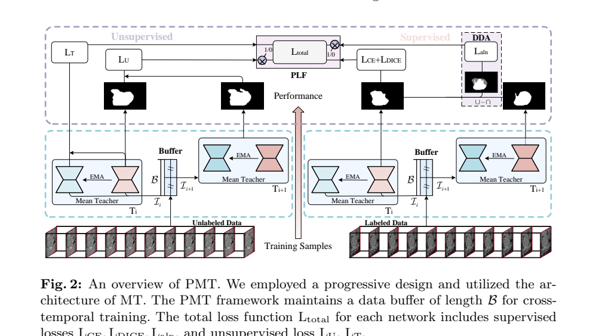
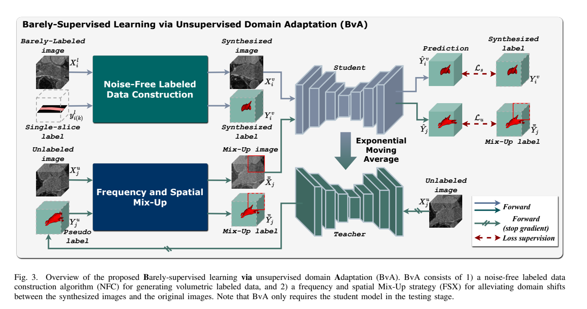

# arXiv 检索结果 / Results

## 1. PMT: Progressive Mean Teacher via Exploring Temporal Consistency for Semi-Supervised Medical Image Segmentation
- Authors：Ning Gao, Sanping Zhou, Le Wang, Nanning Zheng
- Comments：Accepted by ECCV2024
- First：2024-09-08T15:02:25+00:00；Latest：2024-09-15T10:32:46+00:00
- Abs：https://arxiv.org/abs/2409.05122v2
- PDF：https://arxiv.org/pdf/2409.05122v2
- Code：https://github.com/Axi404/PMT, https://huggingface.co/huggingface, https://huggingface.co/docs/hub/spaces
- 解读来源：PDF 全文，共 17 页，17 页可提取文字
### [中文]
**中文翻译**
- 标题：PMT：通过探索时间一致性实现渐进式平均教师用于半监督医学图像分割
- 摘要：半监督学习已成为医学图像分割领域广泛采用的技术。现有工作要么侧重于构建一致性约束，要么侧重于生成伪标签以提供高质量监督信号，其主要挑战在于如何保持模型能力的持续提升。本文提出一种简单而有效的半监督学习框架，称为渐进式平均教师（PMT），用于医学图像分割，其目标是通过在训练过程中学习鲁棒且多样的特征来生成高保真伪标签。具体而言，我们的PMT采用标准平均教师来惩罚当前状态的一致性，并利用两组MT架构进行协同训练。两组MT架构分别进行长时间更新，以通过迭代差异产生的性能差距来维持稳定的模型多样性。此外，采用差异驱动的对齐正则化器来加速滞后模型与领先模型表示能力的对齐。进一步地，采用一种简单而有效的伪标签过滤算法，便于评估模型并选择模型在高性能运行时输出的高保真伪标签用于协同训练。在两种不同模态（即CT和MRI）数据集上的实验结果表明，我们的方法在多个维度上优于最先进的医学图像分割方法。代码可在https://github.com/Axi404/PMT获取。

PMT 在医学图像分割中把标准 Mean Teacher（EMA 教师+一致性）与两套同构 MT 的渐进式协同训练结合：通过迭代差形成稳定的模型性能差，从而持续产生多样伪标签。配套两个机制：PLF 以当前最落后模型（CPM）在标注数据上的 Dice 损失为阈值筛选伪标签；DDA 只在 PLF 允许时，对模型预测差异区域施加对齐损失，加速落后模型追赶。LA 数据集 5%/10% 标签下 Dice 为 89.47/90.81，Pancreas-NIH 10%/20% 下为 81.00/83.22，均报告优于 UA-MT、SASSNet、DTC、BCP、MCF。消融显示 PLF、DDA、MT 各自带来增益，但 MT 在 Dice 上仅较 PLF+DDA 提升 0.38，且 95HD 略变差；正则权重在 20.0/10.0 附近较稳，过大明显退化。

# PMT 论文精读笔记

## 1. 问题与动机

半监督医学图像分割通常依赖两类技术：一致性正则（如 Mean Teacher 的 EMA 教师约束学生输出）与伪标签生成（用当前模型给无标注数据打标签）。作者认为现有方法在“持续提供高质量监督信号、并让模型能力持续提升”上不足：一致性方法侧重稳健特征，伪标签方法侧重判别能力，而迭代式统一框架（如 MCF 用异构网络动态生成伪标签）仍面临前向传播中伪标签多样性不足、反向传播中模型能力提升受限的问题 [p. 2–3]。

作者的出发点是“迭代次数与性能正相关”：若让多个同构模型在训练进度上错开，就能利用不同训练阶段的模型状态形成性能差，从而获得既稳健又多样的伪标签 [p. 2–3]。图 1（p. 2）用示意方式表达该动机：标准 MT 维持当前迭代内教师-学生一致性，PMT 额外维持不同迭代学生之间的差异。

## 2. 方法

### 2.1 总体流程

训练数据含少量标注集 $D_L=\{(x_i^L,y_i^L)\}_{i=1}^{N}$ 与大量无标注集 $D_U=\{(x_i^U)\}_{i=N+1}^{N+M}$，$N\ll M$，$x_i\in R^{H\times W\times D}$，$y_i\in\{0,1\}^{H\times W\times D}$。每个 batch 由等比例标注与无标注数据组成，分别送入两个同构网络 $f_i,f_{i+1}$ 得到 $\hat Y_i,\hat Y_{i+1}$ [p. 5–6]。默认网络数为 2，但框架可扩展为多个 [p. 5]。

每个学生配一个结构相同、不参与梯度训练的教师，参数按 EMA 更新：$\theta_{teacher}=\alpha\theta_{teacher}+(1-\alpha)\theta_{student}$，$\alpha$ 为衰减率 [p. 6]。

### 2.2 渐进式（cross-temporal）训练

用 $I_i$ 记录第 $i$ 个模型的迭代数，维护长度 $B$ 的数据缓冲，使相邻模型迭代差满足 $\mathrm{Lar}(I,i)-\mathrm{Lar}(I,i+1)=B(n-1)$，其中 $\mathrm{Lar}(I,i)$ 是 $I$ 中第 $i$ 大的数 [p. 6]。每轮训练“最落后”的模型（CPM）从缓冲区取数据训练，直到领先最先进模型 $B/n$ 次；由此形成静态迭代间隔与稳定性能差 [p. 6]。

### 2.3 伪标签筛选 PLF

PLF 用标注阶段的表示能力近似无标注阶段的能力：每轮在标注数据上推理所有模型，以 Dice 损失衡量性能，以 CPM 的性能为阈值，剔除性能低于 CPM 的模型所生成的伪标签；通过与否记为 $P(f_i,f_{i+1})\in\{0,1\}$ [p. 7]。保留下来的伪标签经锐化：$Y_U=\frac{P_s^{1/T}}{P_s^{1/T}+(1-P_s)^{1/T}}$，$P_s$ 为“好学生”输出，$T$ 为超参 [p. 7]。无监督损失为 $L_U=\mathrm{MSE}(\hat Y_{U_c},Y_U)$，即 CPM 预测与筛选后伪标签的 MSE [p. 7]。

### 2.4 差异驱动对齐 DDA

DDA 针对模型预测不一致的区域。先对多网络 softmax 二值输出取并集减交集得到差异掩码：$M_{diff}=\bigcup_i \mathrm{BINA}(\hat Y_{L_i})-\bigcap_i \mathrm{BINA}(\hat Y_{L_i})$ [p. 8]。再计算预测与真值的 MSE：$M_{dist}=\mathrm{MSE}(\hat Y_{L_i},Y_L)$ [p. 8]。对齐损失为掩码区域内的平均误差：$L_{aln}=\frac{\sum(M_{diff}\cdot M_{dist})}{\sum M_{diff}}$ [p. 8]。

关键设计：DDA 只在 PLF 允许其他模型提供伪标签时生效，即只让落后模型向表现更好的模型对齐；若 CPM 本身是当前最佳模型，则不反向指导其他模型 [p. 6–8]。作者解释这是为了避免传统一致性正则“方向不确定”的风险 [p. 8]。

### 2.5 损失函数

总损失 $L_{total}=L_s+\lambda_1 P(f_i,f_{i+1})L_U+\lambda_2 L_T$ [p. 8]。监督项 $L_s=CE+DICE+\beta P(f_i,f_{i+1})L_{aln}(M_{diff},M_{dist})$，$\beta=0.5$ [p. 9]。$L_T$ 为 MT 一致性损失：学生预测与教师锐化伪标签之间的 MSE [p. 9]。$\lambda_1,\lambda_2$ 采用两个独立高斯 warm-up 函数，随迭代上升并在固定迭代后停止增长，经验设为 $\hat\lambda_1=20.0$、$\hat\lambda_2=10.0$ [p. 9]。

## 3. 贡献

作者声称的贡献有三点：(1) 提出渐进式 Mean Teacher 框架；(2) 提出 DDA 正则以快速对齐落后与领先网络的表示能力；(3) 提出简单有效的 PLF 伪标签筛选算法 [p. 3]。

我的解读：核心新颖点不在 MT 本身，而在“用迭代差制造并维持模型多样性”的训练调度，以及把 PLF 作为 DDA 的门控条件——二者耦合使对齐只发生在可信方向上。这更像训练策略/调度层面的创新，而非新的网络结构或新的分割目标。

## 4. 实验与结果

### 4.1 设置

骨干为 3D VNet [p. 9]。SGD，weight decay 0.0001，momentum 0.9，初始学习率 0.01，每 2500 次迭代除以 10，共 6000 次迭代；batch size 4，其中标注数据 2 例 [p. 9]。推理时取两个网络输出的平均 [p. 9]。硬件为 NVIDIA A40 48GB，Ubuntu 20.04，PyTorch 1.11.0 [p. 9]。

LA 数据集：100 例 3D 钆增强 MRI，分辨率 $0.625^3$ mm³；按目标裁剪，训练随机裁到 $112\times112\times80$，推理滑窗同尺寸、步长 $18\times18\times4$ [p. 10]。Pancreas-NIH：82 例腹部 3D CT，CT 窗 $[-120,240]$ HU，以胰腺为中心裁剪并外扩 25 voxels，训练随机裁到 $96\times96\times96$，推理滑窗步长 $16\times16\times16$ [p. 10]。两数据集均按 80%/20% 划分训练/测试，标注比例基于训练集 [p. 10]。指标为 Dice、Jaccard、95HD、ASD [p. 10]。

### 4.2 消融

LA、10%（8 例）标注下 [p. 11, Table 1]：基线（非渐进双 VNet 协同）Dice 88.28、Jaccard 79.31、95HD 7.59、ASD 2.34；加 PLF 后 89.90/81.73/6.14/1.72；加 DDA 后 90.43/82.60/5.98/1.66；PLF+DDA 后 90.43/82.60/5.49/1.49；再加 MT 后 90.81/83.23/5.61/1.50。可见 PLF 与 DDA 各自有效，DDA 对 Dice 增益更大；MT 主要提升 Dice/Jaccard（+0.38/+0.63），但 95HD 从 5.49 变为 5.61、ASD 从 1.49 变为 1.50，边缘指标未改善。

正则强度消融 [p. 11, Table 2]：在 $\hat\lambda_1\in\{2,20,200\}$、$\hat\lambda_2\in\{1,10,100\}$ 的九组中，20.0/10.0 取得最佳 Dice 90.81、ASD 1.50；$\hat\lambda_2=100$ 时明显退化（如 20.0/100.0 时 Dice 88.00、95HD 9.05），200.0/100.0 最差（Dice 83.80、95HD 16.44）。作者据此称一定范围内对参数不敏感 [p. 11]。

### 4.3 对比结果

LA [p. 12, Table 3]：5%（4 例）下 PMT 为 Dice 89.47、Jaccard 81.04、95HD 6.45、ASD 1.86；BCP 为 88.02/78.72/7.90/2.15；UA-MT 82.26/70.98/13.71/3.82；SASSNet 81.60/69.63/16.16/3.58；DTC 81.25/69.33/14.90/3.99；VNet 52.55/39.60/47.05/9.87；MCF 该行数值未给出（表中记为“-”）[p. 12]。10%（8 例）下 PMT 90.81/83.23/5.61/1.50，BCP 89.62/81.31/6.81/1.76，MCF 88.71/80.41/6.32/1.90，DTC 87.51/78.17/8.23/2.36，UA-MT 86.28/76.11/18.71/4.63，SASSNet 85.22/75.09/11.18/2.89，VNet 82.74/71.72/13.35/3.26 [p. 12]。作者称 5% 时较此前最佳 Dice +1.45、Jaccard +2.32、95HD −1.45、ASD −0.29；10% 时 +1.19/+1.92/−1.20/−0.26 [p. 12]。

Pancreas-NIH [p. 14, Table 4]：10%（6 例）下 PMT 81.00/68.33/6.36/1.62，BCP 73.83/59.24/12.71/3.72，DTC 69.21/54.06/17.21/5.95，SASSNet 68.78/53.86/19.02/6.26，UA-MT 66.34/53.21/17.21/4.57，VNet 55.60/41.74/45.33/18.63；MCF 该行未给出数值 [p. 14]。20%（12 例）下 PMT 83.22/71.52/7.60/1.89，BCP 82.91/70.97/6.43/2.25，DTC 78.27/64.75/8.36/2.25，SASSNet 77.66/64.08/10.93/3.05，UA-MT 76.10/62.62/10.84/2.43，MCF 75.00/61.27/11.59/3.27，VNet 72.38/58.26/19.35/5.89 [p. 14]。作者称 10% 时 Dice +7.17、Jaccard +9.09、95HD −6.35、ASD −2.10；20% 时 Dice +0.31、Jaccard +0.55、ASD −0.36 [p. 13]。注意 20% 时 PMT 的 95HD 为 7.60，劣于 BCP 的 6.43，因此“所有四项指标均优”的表述与该表数值不一致 [p. 13–14]。作者还说明胰腺更难，将 $\hat\lambda_1$ 加倍以提升性能 [p. 13]。

## 5. 评估

有支持的结论：在 LA 与 Pancreas-NIH 的给定划分和标注预算下，PMT 的 Dice/Jaccard 优于所列基线；消融支持 PLF、DDA 与渐进设计各自有贡献；权重在 20.0/10.0 附近表现最好。

需谨慎之处：(1) 消融只在 LA 10% 上做，未报告胰腺或 5% 预算下的组件消融 [p. 10–11]；(2) MT 的增益较小且边缘指标未改善，作者未讨论 [p. 11]；(3) 对比表中 MCF 在 LA 5% 与 Pancreas 10% 行缺失数值，无法核对其在该条件下的表现 [p. 12, p. 14]；(4) 20% 胰腺上 95HD 不如 BCP，与正文“四项指标均优”的表述冲突 [p. 13–14]；(5) 未报告随机种子、重复实验次数、均值/方差或显著性检验，单次结果无法判断稳定性；(6) 未报告 EMA 衰减率 $\alpha$、锐化温度 $T$、缓冲长度 $B$ 的具体取值，也未给出其敏感性分析 [p. 6–9]；(7) 未报告参数量、训练时间或显存开销，双 MT 架构的成本不明。

## 6. 复现

已报告：VNet 骨干；SGD（lr 0.01，每 2500 迭代 ÷10，共 6000 迭代，weight decay 1e-4，momentum 0.9）；batch size 4、标注 2；$\beta=0.5$；$\hat\lambda_1=20.0$、$\hat\lambda_2=10.0$（胰腺将 $\hat\lambda_1$ 加倍）；LA 输入 $112\times112\times80$、滑窗步长 $18\times18\times4$；胰腺输入 $96\times96\times96$、步长 $16\times16\times16$；80/20 划分；推理取两网络平均 [p. 9–10, p. 13]。

未报告：$\alpha$、$T$、$B$、warm-up 中 $t_{max}$ 与停止增长的具体迭代、数据增强细节、优化器之外的初始化、随机种子与重复次数、MCF 缺失数值的原因。代码链接在摘要中给出（https://github.com/Axi404/PMT），但正文未说明其与论文设置是否完全一致。

#### 原论文流程图 · Figure 2 · PDF 第 5 页

Fig.2: An overview of PMT. We employed a progressive design and utilized the ar- chitecture of MT. The PMT framework maintains a data buffer of length B for cross- temporal training. The total loss function L for each network includes supervised total

[原文来源](https://arxiv.org/pdf/2409.05122v2#page=5)

## 2. Lagrange Duality and Compound Multi-Attention Transformer for Semi-Supervised Medical Image Segmentation
- Authors：Fuchen Zheng, Quanjun Li, Weixuan Li, Xuhang Chen, Yihang Dong, Guoheng Huang, Chi-Man Pun, Shoujun Zhou
- Comments：5 pages, 4 figures, 3 tables
- First：2024-09-12T06:52:46+00:00；Latest：2024-09-12T06:52:46+00:00
- Abs：https://arxiv.org/abs/2409.07793v1
- PDF：https://arxiv.org/pdf/2409.07793v1
- Code：https://github.com/lzeeorno/Lagrange-Duality-and-CMAformer, https://huggingface.co/huggingface, https://huggingface.co/docs/hub/spaces
- 解读来源：PDF 全文，共 5 页，5 页可提取文字
### [中文]
**中文翻译**
- 标题：拉格朗日对偶与复合多头注意力Transformer用于半监督医学图像分割
- 摘要：医学图像分割是语义分割在医疗保健中的关键应用，通过专门的计算机视觉技术已取得显著进展。尽管基于深度学习的医学图像分割对于辅助医学诊断至关重要，但缺乏多样化的训练数据导致了长尾问题。此外，大多数先前的混合CNN-ViT架构在结合卷积神经网络不同层中的各种注意力方面能力有限。为解决这些问题，我们提出了一种拉格朗日对偶一致性（LDC）损失，与边界感知对比损失相结合，作为半监督学习的整体训练目标，以缓解长尾问题。此外，我们引入了CMAformer，一种协同ResUNet和Transformer优势的新型网络。CMAformer中的交叉注意力模块有效整合了空间注意力和通道注意力，以实现多尺度特征融合。总体而言，我们的结果表明，CMAformer结合特征融合框架和新的一致性损失，在半监督学习集成中展现出强大的互补性。我们在多个公开医学图像数据集上取得了最先进的结果。示例代码可在：\url{https://github.com/lzeeorno/Lagrange-Duality-and-CMAformer}获取。

论文提出CMAformer混合CNN-Transformer分割网络，在残差块中引入patch嵌入与通道注意力，在Transformer块中改进层归一化与跳跃连接，并在编解码器间加入基于空洞卷积的空间注意力；同时提出Lagrange对偶一致性损失（LDC），与边界感知对比损失组合成半监督目标。在Synapse多器官数据集上平均Dice为87.39，超过nnFormer的86.57；在LiTS2017上平均Dice为95.62，使用50%标签的半监督版本为95.27。消融显示ViT块+交叉注意力约提升10.98%，加入LDC后进一步提升。但LDC的推导与优化细节、超参数选择依据、半监督数据划分等报告不充分。

# 论文阅读笔记：Lagrange Duality and Compound Multi-Attention Transformer for Semi-Supervised Medical Image Segmentation

## 1. 问题与动机

论文针对医学图像分割中的两个问题：一是标注数据稀缺导致的长尾问题，即常见病灶样本多、罕见病灶样本少，模型难以兼顾小目标与稀有类别[p. 1]；二是现有混合CNN-ViT架构对卷积网络不同层中多种注意力的结合能力有限，Transformer组件往往只使用少量层，未能充分利用长程依赖[p. 1]。作者希望同时从网络结构和半监督训练目标两方面改进。

## 2. 方法

### 2.1 CMAformer整体结构

CMAformer以残差块为基本单元，结合ResUNet与Transformer。整体架构见图1[p. 2]。在残差块内，特征图先做patch embedding，划分为p×p patch；为保留位置信息，将每个patch的2D坐标映射到展平表示。由于下采样会改变特征图形状，作者用SENet式通道注意力把patch位置信息重映射到特征通道上[p. 2]。残差块主分支经卷积与批归一化后与输入相加，再经两层卷积和ReLU下采样[p. 2]。

Transformer块包含多头自注意力（MSA）和MLP。作者做了两处修改：其一，不对MSA整体输出做层归一化，而是仅对查询矩阵Q单独做层归一化，以稳定梯度；其二，在MSA输出送入MLP前，将Q直接加到MSA输出上，以减少信息损失并更好建模长程依赖[p. 2]。MSA公式为 softmax(QK^T/√d_k + P)V，其中P为相对位置编码，d_k为key维度[p. 3]。

在编码器与解码器之间，作者加入空间注意力块，受ASPP启发，用空洞卷积融合不同尺度的特征图[p. 3]。输入Transformer块前，特征图被reshape为[B, H×W, C]，MLP使用GELU激活[p. 3]。

### 2.2 交叉注意力

在Transformer解码器之后设置交叉注意力层：输入特征图分为query与key-value两部分，query来自当前层输出，key-value可来自同层不同通道或不同层特征图；三者经线性变换投影到统一特征空间，计算query与key的相似度得到注意力权重，再对value加权求和[p. 2]。作者称该机制使模型能动态融合不同特征图的信息，并与通道注意力结合以整合多尺度上下文[p. 2]。图2展示了CMA Block[p. 2]，但正文未给出其逐模块细节。

### 2.3 Lagrange对偶一致性损失（LDC）

作者将BCE-Dice损失改写为一致性损失：

L_con = −(1/N) Σ[α y_i log(p_i) + (β1 y_i1 p_i1/(y_i1+p_i1) + β2 y_i2 p_i2/(y_i2+p_i2))]，

其中α、β1、β2为权重因子，β1与β2经验设为[0.314±1e−5, 0.685±1e−5][p. 3]。随后引入Lagrange乘子处理四类约束：输出值上下界、输出值之和限制、模型参数向量L2范数限制、非负约束，构造Lagrangian：

L(p,w,μ+,μ−,λ,η,ζ)=Σ(p_i−μ−_i)+(μ+_i−p_i)+λ(Σp_i−S)+η(C−|w|_2^2)+Σζ_i(−p_i)[p. 3]。

作者称用KKT条件求解，可更有效优化一致性损失，尤其改善小目标如肿瘤的分割[p. 3]。但正文未说明该Lagrangian如何转化为可微训练损失、乘子如何更新、与L_con的数值关系，也未给出约束参数S、C的取值。

### 2.4 总体训练目标

总损失为 L_total = λ·L_sup + β·L_contrast + γ·L_con[p. 3]。L_sup为标注数据的标准MSE损失；L_contrast为引用的无监督边界感知对比目标，基于InfoNCE，对教师与学生网络输出的 signed distance map（SDM）投影头做对比，τ为温度超参数，负样本从mini-batch中随机选取[p. 3]。λ、β、γ为平衡超参数，但正文未报告其取值。

## 3. 贡献

作者声称的贡献有三点：提出CMAformer，融合ResUNet与Transformer并通过交叉注意力在多尺度上融合空间与通道注意力；提出LDC损失，用Lagrange乘子将BCE-Dice重构为凸优化一致性损失以缓解长尾问题；在多个公开数据集上超过多数SOTA模型[p. 1]。

我的解读：网络部分的实际新颖点主要是残差块内patch嵌入+通道注意力、Transformer块中仅对Q做层归一化及Q到MLP的跳跃连接、以及编解码器间的空洞卷积空间注意力；交叉注意力本身并非全新机制。LDC的“凸优化”表述在文中缺少完整推导与可复现的优化流程，其作为一致性损失的有效性更多由消融结果间接支持，而非由理论分析直接证明。

## 4. 实验与结果

### 4.1 数据集与设置

实验使用LiTS2017肝脏肿瘤分割数据集与Synapse多器官分割数据集[p. 4]。数据按80%/15%/5%划分为训练/验证/测试集[p. 4]。实现基于PyTorch、Ubuntu 22.04，单张NVIDIA GeForce RTX 4090 GPU；初始学习率0.001，poly衰减；优化器SGD，动量0.99，权重衰减3e−5[p. 4]。其余训练细节称遵循nnFormer与UNETR的设置[p. 4]。

### 4.2 Synapse多器官分割

表I比较了ViT+CUP、TransUNet、SwinUNet、Swin UNETR、TransClaw U-Net、LeViT-UNet-384s、CoTr、UNETR、nnFormer与CMAformer[p. 3]。CMAformer平均Dice为87.39，高于nnFormer的86.57；在Aorta（93.21）、Gallbladder（72.03）、Kidney(Right)（86.62）、Liver（97.78）、Pancreas（83.81）、Spleen（92.19）、Stomach（86.92）上领先，但Kidney(Left)为86.55，略低于nnFormer的86.57[p. 3]。作者称约10轮平均超过此前先进模型[p. 4]，但未说明“10轮”的具体含义与方差。

### 4.3 LiTS2017肝脏肿瘤分割

表II中，CMAformer平均Dice为95.62，Liver为97.89，Tumor为93.34；半监督版本CMAformer-SSL仅用50%标注数据，平均95.27，Liver 96.32，Tumor 94.21[p. 4]。对比ResUnet++（82.62）、ResT-V2-B（90.91）、TransUNet（90.65）、Swin UNETR（94.41）、nnFormer（93.10），CMAformer在平均与Tumor上最高；但Swin UNETR的Liver为97.10，低于CMAformer的97.89，而CMAformer-SSL的Liver 96.32低于Swin UNETR[p. 4]。作者称半监督版本在肿瘤分割上超过前沿方法[p. 4]。图3与图4分别展示LiTS2017与Synapse的分割结果及3D重建渲染[p. 3][p. 4]，但正文未给出这些图的定量补充。

### 4.4 消融实验

表III在LiTS2017上消融ViT Block、Cross Attention与LDC Loss[p. 4]。仅ViT Block：平均83.29，Liver 85.64，Tumor 80.93；ViT Block+Cross Attention：92.44/95.94/88.94；仅LDC Loss（无ViT Block、无Cross Attention）：93.50/96.57/90.43；三者全用：95.62/97.89/94.21[p. 4]。作者称半监督框架带来约12.25%提升，Cross Attention与ViT Block结合带来约10.98%提升[p. 4]。需注意“仅LDC Loss”一行同时缺少ViT Block与Cross Attention，因此该行不能单独分离LDC的贡献；且表中未标明各行是否均处于半监督设置，作者对12.25%提升的归属表述不够清晰。

## 5. 评估

支持的结论：在报告的数据划分与训练设置下，CMAformer在Synapse平均Dice和LiTS2017平均Dice/Tumor Dice上优于所列基线；消融显示ViT Block、Cross Attention与LDC组合使用优于任一子集。

局限与缺失证据：LDC的Lagrange对偶推导不完整，KKT求解如何嵌入端到端训练未说明；β1、β2的“经验”取值缺乏敏感性分析；λ、β、γ未报告；半监督实验中标注/未标注数据的具体划分、教师网络更新方式、对比损失温度τ等未给出；未报告参数量、推理速度、多次运行的均值与方差；Synapse上Kidney(Left)未超过nnFormer，作者对此未作讨论；表III的消融设计不能干净地分离LDC的独立贡献。

## 6. 复现

已报告：数据集为LiTS2017与Synapse；划分80/15/5；PyTorch、Ubuntu 22.04、单张RTX 4090；初始学习率0.001，poly衰减；SGD，动量0.99，权重衰减3e−5；β1、β2设为[0.314±1e−5, 0.685±1e−5][p. 3][p. 4]。代码链接在摘要中给出。

未报告：λ、β、γ取值；LDC中S、C及乘子更新规则；半监督的标注比例分配细节（仅称50%标注）；教师-学生架构与EMA设置；τ取值；patch大小p；Transformer层数、通道数、batch size、训练轮数；数据预处理与评价实现细节。复现时需向作者确认或自行调参。

本篇未找到可可靠提取的方法流程图，请查看原文 PDF。

## 3. Rethinking Barely-Supervised Volumetric Medical Image Segmentation from an Unsupervised Domain Adaptation Perspective
- Authors：Zhiqiang Shen, Peng Cao, Junming Su, Jinzhu Yang, Osmar R. Zaiane
- First：2024-05-16T02:46:19+00:00；Latest：2024-09-04T06:09:15+00:00
- Abs：https://arxiv.org/abs/2405.09777v3
- PDF：https://arxiv.org/pdf/2405.09777v3
- Code：https://github.com/Senyh/BvA, https://huggingface.co/huggingface, https://huggingface.co/docs/hub/spaces
- 解读来源：PDF 全文，共 10 页，10 页可提取文字
### [中文]
**中文翻译**
- 标题：从无监督域适应视角重新审视弱监督体积医学图像分割
- 摘要：本文研究一个极具挑战性的问题：弱监督体积医学图像分割（BSS）。BSS训练数据集由两部分组成：1）弱标注标注集，其中每个标注图像仅包含单切片标注；2）无标注集，包含大量无标注体积图像。最先进的BSS方法采用基于配准的范式，利用切片间图像配准将单切片标注传播为体积伪标签，构建完全标注的标注集，进而应用半监督分割方案。然而，该范式存在一个关键局限：由图像配准生成的伪标签不可靠且含噪。受此启发，我们提出新视角：不在半监督学习框架内解决BSS，而是将BSS表述为无监督域适应问题。为此，我们提出一种新颖的BSS框架——通过无监督域适应的弱监督学习（BvA），作为主流配准范式的替代方案。具体而言，我们首先设计一种新颖的无噪声标注数据构建算法（NFC），用于切片到体积的标注数据合成。然后，我们引入频率与空间Mix-Up策略（FSX）以缓解域偏移。大量实验表明，我们的方法为BSS提供了一种有前景的替代方案。值得注意的是，所提方法在仅含一张弱标注图像的左心房分割数据集上训练，达到81.20%的Dice分数，比最先进方法高出61.71%。代码见https://github.com/Senyh/BvA。

该论文将仅含单切片标注的体数据分割（BSS）重新表述为无监督域适应（UDA）问题，提出BvA框架：用NFC从单切片标注合成无噪声的体数据图像-标签对作为源域，用FSX（频域Mix-Up与空间Mix-Up）缓解合成图像与原始图像间的域偏移。在LA和BraTS数据集上，BvA在5%/10% barely-labeled设置下DSC显著优于PLN、DeSCO、SPSS等配准范式方法，例如LA 5%时DSC 87.40%（PLN 66.46%），BraTS 5%时58.42%（PLN 5.41%）。消融显示NFC、FX、SX各自带来增益，顺序堆叠优于随机堆叠。作者还发现多图单切片标注比单图多切片标注更有效。

# 论文阅读笔记：从无监督域适应视角重新思考仅单切片标注的体医学图像分割

## 1. 问题与动机

论文研究 barely-supervised volumetric medical image segmentation（BSS）：训练集由两部分组成——一个 barely-annotated 标注集，其中每张标注体数据仅含一个切片的标注；以及大量无标注体数据 [p. 1]。核心难点在于如何从单切片标注中挖掘体数据级别的监督信息。

现有 SOTA 方法采用基于配准的范式：用层间图像配准把单切片标注逐层传播成体伪标签，从而把 BSS 转成半监督学习（SSL）问题 [p. 1–2]。作者指出该范式的关键缺陷是配准生成的伪标签不可靠、含噪，会削弱从 barely-annotated 图像中提取准确监督信号的能力 [p. 2]。作者用 PLN 和 DeSCO 在 LA 与 BraTS 上的初步实验说明：在每数据集仅 1–2 个标注切片时性能很差，脑肿瘤任务更差 [p. 2, Fig. 2(c)]。因此作者提出：不依赖逐切片配准伪标签，而是把 BSS 表述为 UDA 问题——源域为从单切片合成出的体数据图像-标签对，目标域为原始图像（含标注与无标注图像）[p. 2]。

## 2. 方法

### 2.1 整体框架 BvA

BvA 基于 mean-teacher 范式：学生模型 f(·;θ) 用梯度更新，教师模型 f(·;θ′) 的参数按 EMA 更新，θ′_t = αθ′_{t−1} + (1−α)θ_t [p. 4]。训练流程见 Algorithm 1 [p. 4]：每轮先用 NFC 合成体数据图像-标签对；教师模型对合成图像和原始无标注图像做无梯度前向；执行频域与空间 Mix-Up；学生模型对原始标注图像、合成图像和扰动图像前向；计算 L_s 与 L_u 后更新学生与教师。测试阶段仅需学生模型 [p. 4, Fig. 3]。

### 2.2 NFC：无噪声标注数据构造

NFC 的直觉是：切片内的 patch 间相似性类似于体数据的层间连续性 [p. 2, p. 5]。给定单标注切片 x_li(k) 及其标签 y_li(k)，三步构造体数据 [p. 5, Fig. 4]：

1) 用滑动窗口把切片划分为 patch：{x_pij ∈ R^{Hp×Wp} | j ∈ [1,d]} = Divide(x_li(k), [k,s])（式1）。窗口大小 k、步长 s，d = ((Hs−k)/s+1)×((Ws−k)/s+1) 为每切片 patch 总数 [p. 5]。
2) 沿深度维顺序堆叠 patch：X_pi = Stack({x_pij | j ∈ [1,d]})（式2）。
3) 将裁剪体数据 resize 到原体数据的高宽：X_vi = Resize(X_pi, [Hs,Ws])（式3）。

对标签 y_li(k) 施加相同操作（文中省略对应公式）[p. 5 脚注2]。作者给出的超参选择准则：较大的 k 保证 patch 与对应切片相似，合适的 s 保证 patch 数量足以构造深度接近原体数据的图像 [p. 5]。

### 2.3 FSX：频域与空间 Mix-Up

作者假设一个泛化良好的模型应在源域和目标域上、在图像风格与内容（形状）的小扰动下表现平滑 [p. 5]。FSX 据此设计两个扰动：

- 频域 Mix-Up（FX）：混合原始图像 X_uj 与合成图像 X_vi 的振幅分量：A(X) = (1−α)(1−Ω)A(X_uj) + αΩA(X_vi)（式4），其中 α 控制混合强度，Ω 是中心矩形二值掩码，用于确定振幅谱的混合范围 [p. 5]。再用混合振幅与原相位做逆傅里叶变换得到风格扰动图像：X̃_vi = F^{-1}[A(X) exp(jP(X_vi))] [p. 5]。
- 空间 Mix-Up（SX）：采用 CutMix [12]，X̄_j = X_uj × M + X_vi × (1−M)（式5），M 为随机二值掩码；对应分割图也做相同混合：Ȳ_i = Ȳ_uj × M + Ȳ_vi × (1−M)，其中 Ȳ_uj、Ȳ_vi 分别为 X_uj、X_vi 的伪标签 [p. 6]。作者特别指出空间 Mix-Up 不保语义，因此必须同时对图像和分割图执行 [p. 5, Fig. 5]。

### 2.4 训练目标

总损失 L = L_s + L_u（式6）[p. 6]。监督损失 L_s = L_seg(f(X_li;θ), y_li(k)) + L_seg(f(X_vi;θ), Y_vi)（式7），分别对应原始单切片标注和 NFC 合成的体数据标签。无监督损失 L_u = L_seg(f(X̃̄_j;θ), Ȳ̃_j)（式8），即扰动图像预测与混合伪标签之间的一致性正则 [p. 6]。L_seg 为 Dice loss [p. 6]。

## 3. 贡献

作者声称的贡献有三点 [p. 3]：(1) 首次把 BSS 表述为 UDA 问题，为配准范式提供替代方案；(2) 提出 NFC 在无需图像配准的情况下构造体数据图像-标签对，并基于新的平滑性假设设计 FSX 缓解合成图像与原始图像间的域偏移；(3) 在 LA 和 BraTS 上平均提升约 20% 和 50% DSC。

我的解读：NFC 本质上是一种基于 patch 重排的数据合成增广，其“无噪声”指标签来自真实单切片标注而非配准传播，但合成图像与真实体数据在解剖连续性上并不等价；FSX 则是把频域风格扰动与 CutMix 内容扰动组合成一致性正则，属于 UDA 中常见的扰动一致性思路。论文的新意更多在问题表述与 NFC 的具体构造，而非单个组件的全新性。

## 4. 实验与结果

### 4.1 数据集与设置

LA：100 例钆增强 MRI，按 [1] 划分为 70 训练 / 10 验证 / 20 测试（7:1:2）[p. 6]。BraTS：369 例四模态 MRI（FLAIR、T1、T1Gd、T2），258/37/74 划分（7:1:2）[p. 6]。

实现细节：NVIDIA Quadro RTX 6000（24G）、PyTorch 1.11.0、CUDA 11.3；AdamW 优化器，恒定学习率 1e−4，训练 500 epochs；EMA 衰减 α=0.99；V-Net 骨干；Dice loss；随机裁剪 80×112×112（D×H×W）；NFC 窗口大小 k 设为原切片尺寸的一半、步长 s=8 [p. 6]。评价指标为 DSC 和 ASD [p. 6]。

标注预算：5% 与 10% 的整个训练集，BSS 下为单切片标注，SSL 下为完整体标注 [p. 6]。注意配准类方法仅在 BSL 设置下报告，因为其在 SSL 设置下配准模块失效、退化为普通 mean-teacher [p. 6]。

### 4.2 主要结果

LA（Table I [p. 7]）：BvA 在 BSS 5% 下 DSC 87.40%、ASD 2.37；10% 下 88.81%、1.76。对比 PLN 66.46%/13.34（5%）、75.48%/7.66（10%）；DeSCO 66.84%/14.03、76.21%/6.60；SPSS 68.49%/12.44、80.50%/7.37。SSL 设置下 BvA 为 90.72%/1.58（5%）与 91.49%/1.40（10%），优于 UniMatch 的 88.73%/2.72 与 89.82%/2.36 [p. 7]。

BraTS（Table II [p. 7]）：BvA 在 BSS 5% 下 DSC 58.42%、ASD 3.83；10% 下 60.47%、3.18。PLN 仅 5.41%/54.09 与 7.44%/57.84；DeSCO 5.15%/57.16 与 7.40%/54.18；SPSS 20.89%/38.37 与 17.26%/40.71。SSL 设置下 BvA 66.64%/1.75 与 67.76%/1.79，UniMatch 为 60.29%/2.34 与 63.96%/1.76 [p. 7]。作者称相对 UniMatch 在 SSL 下提升 6.36% 和 3.80% DSC [p. 6]。

摘要中“仅一个 barely-labeled 图像达到 81.20% Dice、超过 SOTA 61.71%”对应 Fig. 2(c-d) 的极端设置 [p. 1–2]，但正文表格未给出该单图设置的完整数值表，具体对比条件需以图为准。

### 4.3 消融

LA 5% 下（Table III [p. 8]）：Baseline（MT）67.06%/12.74；+NFC 72.96%/6.17；+NFC+FX 85.49%/3.21；+NFC+SX 79.53%/3.65；完整 BvA 87.40%/2.37。说明 NFC 主要改善 ASD，FX 与 SX 分别带来 12.53% 和 6.57% 的 DSC 增益（相对 +NFC 基线）[p. 7–8]。

超参：Fig. 7 [p. 8] 显示 k=1/4、s=8 时 DSC 最佳为 87.40%，但正文又称最终设置 k 为原切片一半、s=8 [p. 6, p. 8]，两处表述存在不一致，需注意。

堆叠策略（Table IV [p. 9]）：顺序堆叠 87.40%/2.37（5%）、88.81%/1.76（10%）；随机堆叠 83.63%/6.78、85.28%/6.23；带噪声堆叠 81.35%/7.45、84.22%/6.39。支持“保留层间连续性”的设计动机。

标注策略（Fig. 8 [p. 8]）：比较 1、2、4、8 个标注切片；多图单切片标注随数量增加提升显著，单图多切片在 LA 上提升有限（切片冗余高），在 BraTS 上因肿瘤异质性提升更明显；总体多图单切片更有效 [p. 8]。

定性结果 Fig. 6 [p. 7] 显示 BvA 在 LA 与 BraTS 5% 下优于 PLN、DeSCO，作者归因于配准噪声的负面影响。

## 5. 评估

支持的结论：在报告的两个数据集与 5%/10% 预算下，BvA 的 DSC/ASD 明显优于配准类 BSS 方法与所列 SSL 方法；消融支持 NFC、FX、SX 各自有正贡献；顺序堆叠优于随机/噪声堆叠。

局限与缺失证据：论文未报告多次运行的均值/方差或显著性检验；未给出单图极端设置（81.20%）的完整表格与基线条件；未分析 NFC 合成图像与真实体数据的分布差异度量；未报告失败案例或计算开销；超参 k 的最终取值在正文与图注间存在不一致；配准类方法在 SSL 设置下未报告（作者解释为模块失效），因此跨设置比较需谨慎。此外，“无噪声”仅指标签来源，合成图像本身仍是近似。

## 6. 复现

已报告：LA/BraTS 划分 7:1:2；V-Net；AdamW，lr=1e−4，500 epochs；EMA α=0.99；裁剪 80×112×112；NFC 步长 s=8、窗口 k 为切片尺寸的一半（Fig. 7 又称最佳 k=1/4）；Dice loss；DSC/ASD 指标；5%/10% 预算；代码链接 https://github.com/Senyh/BvA [p. 1, p. 6, p. 8]。

未报告或需自行确定：batch size、Mix-Up 强度 α 与掩码 Ω 的具体采样方式、教师/学生初始化、数据预处理与归一化细节、BraTS 三类的具体聚合方式、随机种子与重复次数、NFC 中 k 的最终取值冲突如何解决。复现时应优先以代码仓库为准，并对上述未报告项做敏感性记录。

#### 原论文流程图 · Figure 3 · PDF 第 4 页

Fig. 3. Overview of the proposed Barely-supervised learning via unsupervised domain Adaptation (BvA). BvA consists of 1) a noise-free labeled data construction algorithm (NFC) for generating volumetric labeled data, and 2) a frequency and spatial Mix-Up strategy (FSX) for alleviating domain shifts betweenthesynthesizedimagesandtheoriginalimages.NotethatBvAonlyrequiresthestudentmodelinthetestingstage.

[原文来源](https://arxiv.org/pdf/2405.09777v3#page=4)

## 4. Robust Semi-supervised Multimodal Medical Image Segmentation via Cross Modality Collaboration
- Authors：Xiaogen Zhou, Yiyou Sun, Min Deng, Winnie Chiu Wing Chu, Qi Dou
- First：2024-08-14T07:34:12+00:00；Latest：2024-09-04T03:22:05+00:00
- Abs：https://arxiv.org/abs/2408.07341v2
- PDF：https://arxiv.org/pdf/2408.07341v2
- Code：https://huggingface.co/huggingface, https://huggingface.co/docs/hub/spaces, https://github.com/med-air/CMC
- 解读来源：PDF 全文，共 10 页，10 页可提取文字
### [中文]
**中文翻译**
- 标题：通过跨模态协作的鲁棒半监督多模态医学图像分割
- 摘要：多模态学习利用来自不同模态的互补信息，从而提升医学图像分割的性能。然而，现有的多模态学习方法严重依赖来自各模态的大量良好标注数据，以实现准确的分割性能。由于此类数据在临床环境中往往难以获得，这种依赖常常构成挑战。此外，不同成像模态之间固有的解剖学错位进一步增加了提升分割性能的难度。为解决这一问题，我们提出了一种新颖的半监督多模态分割框架，对稀缺标注数据和错位模态具有鲁棒性。我们的框架采用一种新颖的跨模态协作策略来提炼与各模态内在相关的模态无关知识，并将该信息整合到统一的融合层中进行特征融合。借助通道级语义一致性损失，我们的框架从特征层面确保跨模态的模态无关信息对齐，从而增强其对多模态场景中错位的鲁棒性。此外，我们的框架有效整合了对比一致性学习以规范解剖结构，促进半监督分割任务中未标注数据上的解剖层面预测对齐。在心脏、腹部多器官和甲状腺相关眼病分割这三个任务上，我们的方法与其他多模态方法相比取得了有竞争力的性能。在涉及稀缺标注数据和错位模态的场景中，它还表现出卓越的鲁棒性。

论文提出一种半监督多模态医学图像分割框架，通过跨模态协作（CMC）策略、通道级语义一致性损失（CSC）和对比解剖一致性损失（CAC）来应对标注稀缺与模态错位。在 AMOS（10% 标注）上，CT 平均 Dice 76.3、MRI 84.3；TAO 上 T1 平均 76.9、T1c 平均 75.7，均高于所列基线。消融显示三个组件逐步带来提升，但部分实验细节（如 MS-CMRSeg 的具体数值、ASSD 补充表）未在正文中完整报告。

# 论文阅读笔记：基于跨模态协作的鲁棒半监督多模态医学图像分割

## 1. 问题与动机

论文针对多模态医学图像分割中两个现实问题：一是多模态标注数据稀缺，二是不同模态之间存在解剖错位（misalignment）。作者指出，现有多模态方法要么依赖大量配准良好的多模态标注数据，要么在潜空间融合预对齐模态 [p. 2]；而现有半监督方法多局限于单模态输入，或仅在不同模态间最小化一致性损失，难以应对模态间强度分布和外观差异 [p. 2]。作者进一步指出，已有模态协作方法未在特征融合阶段约束底层解剖结构，而这对保持对齐很关键 [p. 2]。因此，论文目标是构建一个对少量标注和模态错位都鲁棒的半监督多模态分割框架。

## 2. 方法

整体流程见图 1 [p. 3]：两个模态特定编码器分别提取特征，经跨模态协作策略融合并对齐，再由两个解码器输出预测，并用对比一致性学习约束无标注数据。

**输入与编码器。** 记有标注数据为 \(D_l=\{(x^a_{l,i},y^a_i)\}\cup\{(x^b_{l,i},y^b_i)\}\)，无标注数据为 \(D_u=\{(x^a_{u,j})\}\cup\{(x^b_{u,j})\}\)，且 \(N\ll M\) [p. 3]。模态 a、b 分别输入模态特定编码器 \(E_a\)、\(E_b\)，编码器由 SAM-Med3D [10] 预训练编码器微调而来；每个 ViT 块内插入 adapter，adapter 为两个不同核大小的 3D 卷积层构成的瓶颈结构 [p. 4]。编码输出为独特语义特征 \(F^a_{ds}=E_a(x^a_i)\)、\(F^b_{ds}=E_b(x^b_i)\) [p. 4]。

**通道级语义一致性（CSC）损失。** 为对齐两模态通道级特征，作者定义：
\[L_{CSC}=\min_{E_a,E_b}\sum_c -\log\frac{\exp(\mathrm{Sim}((F^a_{ds})_c,(F^b_{ds})_c))}{\sum_c\exp(\mathrm{Sim}((F^a_{ds})_c,(F^b_{ds})_c))}\]
其中 c 为通道索引，Sim 为余弦相似度 [p. 4]。该损失用于减轻模态特定外观特征的影响。

**模态无关感知（MIA）模块。** 在特征对齐后，MIA 模块整合模态感知注意力、3D 卷积层和融合层，将各模态特征 \(F^a_{mia}\)、\(F^b_{mia}\) 在融合层合并为融合特征 [p. 4]。

**监督损失。** 两个解码器 \(D_a\)、\(D_b\) 由预训练基础模型解码器 [6] 微调。监督损失为：
\[L_{Sup}=\min \mathbb{E}[L_{CE}(D_a(E_a(x^a_{l,i})),y^a_i)+L_{Dice}(D_b(E_b(x^b_{l,i}),y^b_i))]\]
即交叉熵与 Dice 损失 [p. 4]。

**对比解剖相似一致性（CAC）损失。** 对无标注数据，用 Dice 系数相似度 \(Sim_{Dice}\) 衡量两模态预测的解剖相似性：
\[L_{CAC}=\min\sum_j -\log\frac{\exp(Sim_{Dice}(D_a(E_a(x^a_{u,j})),D_b(E_b(x^b_{u,j}))))}{\sum_{j=1}^{M}\exp(Sim_{Dice}(D_a(E_a(x^a_{u,j})),D_b(E_b(x^b_{u,j}))))}\]
[p. 5]。

**总损失与训练设置。** 总损失 \(L_{total}=L_{Sup}+\alpha L_{CSC}+\beta L_{CAC}\)，其中 \(\alpha=0.1\cdot e^{-5(1-t/t_{max})}\) 为 ramp-up，\(\beta=0.1\cdot e^{-5(t/t_{max})}\) 为 ramp-down [p. 5]。优化器为 Adam，初始学习率 \(10^{-5}\)，输入 96×96×96 体素，batch size 4 [p. 5]。

## 3. 贡献

作者声称的贡献包括：提出对稀缺标注和错位模态鲁棒的半监督多模态框架；提出跨模态协作策略，通过 CSC 损失蒸馏模态无关知识并在统一融合层融合；引入对比一致性学习在无标注数据上对齐解剖结构预测 [p. 1–2]。我的理解是，方法的新意主要在于把通道级特征对齐（CSC）与预测级解剖一致性（CAC）组合进一个半监督多模态框架，并借助 SAM-Med3D 的 3D 基础模型编码器提升特征学习能力；但 CSC 与 CAC 的形式与已有对比/一致性学习较为接近，核心增量更偏向组合与适配。

## 4. 实验与结果

**数据集与划分。** MS-CMRSeg [11]：45 例心肌病心脏 MRI，含 LGE、T2w、BSSFP 三模态，配准配对；使用 40 对 LGE/BSSFP 训练、5 对测试验证 [p. 5]。AMOS [5]：300 CT 与 60 MRI，15 个腹部器官，CT/MRI 不配对；作者从 200 CT 训练图像中随机选 40 张，加 40 张 MRI 构成新训练集；从 100 CT 测试图像中随机选 20 张，加 20 张 MRI 构成新测试验证集 [p. 5]。TAO：私有数据集 100 例，含 T1 与 T1c，因平面分辨率不同而不配对；随机选 80 对训练、20 对测试验证 [p. 6]。

**训练与评估设置。** 单张 RTX 3090 时使用 CLIP-Driven Universal Model [6] 预训练权重作为骨干；多 GPU 时使用 SAM-Med3D [10] 预训练权重 [p. 6]。使用 10% 和 20% 标注比例训练，指标为 Dice 和 ASSD [p. 6]。基线包括全监督 V-Net [7]、多模态 EFCD [4] 与 mmFormer [14]、半监督多模态 UMML [18] 与 CML [13] [p. 6–7]。

**AMOS 10% 标注结果（Dice）。** 表 1 报告：CT 上本文方法 Avg. 76.3，CML 75.4、mmFormer 74.8、UMML 71.5、EFCD 70.4、Sup 65.7；MRI 上本文 Avg. 84.3，CML 82.9、mmFormer 78.6、UMML 76.4、EFCD 73.8、Sup 70.4 [p. 6]。分器官看，CT 的 Liver 为 80.7，略低于 CML 的 81.2；MRI 的 R.Kidney 为 79.5，低于 CML 的 81.1 [p. 6]。

**TAO 10% 标注结果（Dice）。** T1 上本文 Avg. 76.9，CML 75.5、mmFormer 73.1、UMML 71.6、EFCD 70.4、Sup 64.5；T1c 上本文 Avg. 75.7，CML 74.1、mmFormer 71.9、UMML 69.6、EFCD 67.1、Sup 64.3 [p. 6]。分结构中，T1 的 IOM 为 78.4，低于 CML 的 79.7；T1c 的 IR 为 79.1，略低于 CML 的 79.3 [p. 6]。

**MS-CMRSeg。** 正文仅以图 2 展示不同标注比例下 Dice 对比，并称本文方法在 BSSFP 和 LGE 上均优于对比方法 [p. 7]；ASSD 结果放在补充材料表 3，正文未给出具体数值 [p. 7]。因此无法从正文核对该数据集的具体数字。

**消融。** 表 2 在 AMOS 上逐步加入组件：基线（仅模态特定编码器）CT Spleen/Liver 70.4/76.7、MRI 73.3/74.4，ASSD CT 4.41/4.12、MRI 4.38/4.16；加 CMC 后 Dice 72.9/78.5、75.9/76.2，ASSD 4.17/3.85、3.87/3.73；再加 CCL 后 Dice 73.4/79.2、76.2/77.3，ASSD 3.58/3.47、3.49/3.38；完整模型 Dice 74.8/80.7、78.4/79.6，ASSD 3.42/3.38、3.23/3.17 [p. 8]。图 3(c) 在 TAO 上比较有无 CMC 策略，图 3(d) 在 MS-CMRSeg 上比较单模态与多模态训练，称多模态（BSSFP±LGE）优于单模态 [p. 8–9]。

## 5. 评估

支持的结论：在 AMOS 与 TAO 的 10% 标注设置下，表 1 的数字支持本文方法平均 Dice 高于所列基线；消融表 2 支持 CMC 与 CCL 逐步提升 Dice 并降低 ASSD。作者将 AMOS 上的优势部分归因于 Transformer 分块嵌入与位置编码、CSC 通道对齐和 MIA 融合 [p. 7]，这属于作者解释而非单独验证的因果结论。

局限与缺失证据：正文未报告 MS-CMRSeg 的具体 Dice/ASSD 数值，仅指向补充材料 [p. 7]；未给出 20% 标注比例的详细表格；未报告参数量、推理时间、显存占用；未说明 CSC 与 CAC 的单独消融（表 2 中 CMC 与 CCL 是顺序加入，CSC 与 MIA 未拆开）；未报告多次随机种子或统计检验；TAO 为私有数据，复现受限。此外，表 1 中部分标准差较大（如 TAO T1c IOM 77.4±8.1），但正文未讨论稳定性。

## 6. 复现

已报告：编码器为 SAM-Med3D 预训练编码器微调，ViT 块内加双 3D 卷积 adapter；解码器由预训练基础模型解码器微调；Adam，学习率 \(10^{-5}\)，输入 96×96×96，batch size 4；损失权重按给定 ramp 公式；AMOS 与 TAO 的划分如第 4 节；10% 与 20% 标注比例；指标 Dice 与 ASSD；代码链接 https://github.com/med-air/CMC [p. 1, 4–6]。

未报告或需查代码：训练 epoch 数 \(t_{max}\)、数据预处理与增强、推理时的模态组合方式、单/多 GPU 骨干切换的具体规则、ASSD 计算细节、MS-CMRSeg 的 T2w 是否参与、以及表 1 中未列出的器官（AMOS 共 15 个器官但表 1 只列 4 个）的完整结果 [p. 5–6]。这些信息在正文中缺失，复现时需以代码或补充材料为准。

本篇未找到可可靠提取的方法流程图，请查看原文 PDF。

## 5. GuidedNet: Semi-Supervised Multi-Organ Segmentation via Labeled Data Guide Unlabeled Data
- Authors：Haochen Zhao, Hui Meng, Deqian Yang, Xiaozheng Xie, Xiaoze Wu, Qingfeng Li, Jianwei Niu
- Comments：Accepted by ACM MM2024, 10 pages, 5 figures
- First：2024-08-09T07:46:01+00:00；Latest：2024-09-02T08:45:47+00:00
- Abs：https://arxiv.org/abs/2408.04914v2
- PDF：https://arxiv.org/pdf/2408.04914v2
- Code：https://github.com/kimjisoo12/GuidedNet, https://huggingface.co/huggingface, https://huggingface.co/docs/hub/spaces
- 解读来源：PDF 全文，共 10 页，10 页可提取文字
### [中文]
**中文翻译**
- 标题：GuidedNet：通过标注数据引导未标注数据的半监督多器官分割
- 摘要：半监督多器官医学图像分割有助于医生改进疾病诊断和治疗规划，并减少器官标注所需的时间和精力。现有的最先进方法使用真实标签训练标注数据，并使用伪标签训练未标注数据。然而，这两个训练流程是分离的，未能体现标注数据与未标注数据之间的相互关系。为解决这一问题，我们提出了一种名为GuidedNet的半监督多器官分割方法，该方法利用标注数据中的知识来指导未标注数据的训练。本研究的主要目标是提高未标注数据伪标签的质量，并增强网络对小型和复杂器官的学习能力。一个关键概念是，标注数据和未标注数据中在特征空间上彼此接近的体素特征更可能属于同一类别。在此基础上，设计了三维一致高斯混合模型（3D-CGMM），利用标注数据的特征分布来校正生成的伪标签。此外，我们引入了知识迁移交叉伪监督（KT-CPS）策略，利用从标注数据中获得的先验知识来指导未标注数据的训练，从而提高小型和复杂器官的分割精度。在两个公开数据集FLARE22和AMOS上的大量实验表明，GuidedNet能够达到最先进的性能。我们提出模型的源代码可在https://github.com/kimjisoo12/GuidedNet获取。

GuidedNet 针对半监督多器官分割中伪标签训练与标注数据训练相互分离的问题，提出用标注数据特征分布校正伪标签的 3D-CGMM，以及按器官学习难度重加权伪监督损失的 KT-CPS。在 FLARE22 与 AMOS 上，10% 和 50% 标注比例下均报告了优于 CPS、DHC、MagicNet 等九个基线的平均 Dice/Jaccard；消融显示两组件单独有效、组合最佳，但部分表格数字与正文表述存在不一致，需谨慎解读。

## 1. 问题与动机

论文关注半监督多器官腹部 CT 分割：标注体数据昂贵，未标注数据易得。作者指出，现有 CPS 类方法把标注数据（用真值监督）与未标注数据（用伪标签监督）的训练流分开，伪标签质量只依赖未标注数据和网络自身，没有利用标注数据与未标注数据在特征空间中的关系 [p. 2]。作者还强调多器官任务不能只处理小器官类别不平衡，器官复杂度同样重要：例如胃（Sto）体积在 FLARE22 中排第二，但 Dice 仅排第十一 [p. 2]。图 2 进一步展示：当某类标注与未标注特征中心欧氏距离较小时，该类 Dice 通常较高 [p. 2]。

## 2. 方法

**整体框架。** GuidedNet 基于 CPS：两个结构相同、初始化不同的 3D 分割网络 model A 与 model B 处理同一输入；标注数据受真值监督，未标注数据由另一网络的伪标签交叉监督 [p. 3]。训练集 S=S_l∪S_u，S_l={(x_i,y_i)}，S_u={x_i}，通常 M≫N [p. 3]。总损失为 L=L_sup+λ_u L_kt-cps+λ_g L_cgmm，其中 λ_u=0.1 并采用 CPS 的 ramp-up，λ_g=0.3 [p. 3–4]。监督损失 L_sup 对标注批 B_l 中两个网络的预测分别计算 Dice 与交叉熵的平均，即 L_s=½(L_Dice+L_ce) [p. 3, Eq.1]。

**3D-CGMM。** 对每个类别 k，用标注体素在分类层前特征 f(x) 上的均值初始化高斯中心 μ_k（Eq.3），并用预测分数 P_k 加权计算方差 σ_k（Eq.4）[p. 4]。每个体素按高斯密度 N(x|μ_k,σ_k)（Eq.5）和均匀类先验经贝叶斯规则得到后验 P(x|k)（Eq.6），再取 argmax 得到 CGMM 预测 G（Eq.7）[p. 5]。作者不用 EM，而用四项损失训练 3D-CGMM：真值损失 L_gt（Eq.8）、CGMM 预测与网络概率图之间的自监督损失 L_self（Eq.9）、拉大不同高斯中心距离的最大化损失 L_max（Eq.10）、以及两个网络 CGMM 预测之间的 MSE 一致性损失 L_cons（Eq.11）；L_train=L_self+L_gt+L_max+λ_c L_cons（Eq.12）[p. 5]。随后，CGMM 对未标注数据生成的 Ĝ 作为额外监督信号，以交叉熵 L_rectify 校正网络伪标签（Eq.13），L_cgmm=L_train+L_rectify（Eq.14）[p. 5]。

**KT-CPS。** 对标注批，统计每个器官预测与真值匹配的体素数 N_k，计算比例 R_k=N_k/max_k N_k（Eq.16），再取对数归一化权重 w_k=max log R_k / log R_k（Eq.17），并用动量 m=0.99 的 EMA 平滑（Eq.18）[p. 5]。KT-CPS 损失把两个网络的交叉伪监督按对方器官权重加权，在标注与未标注混合批 B=B_l∪B_u 上计算（Eq.19）[p. 5]。其设计意图是让难分的小/复杂器官获得更高损失权重。

## 3. 贡献

作者声称三点贡献：用 3D-CGMM 以标注特征分布生成 CGMM 预测来校正伪标签；设计 KT-CPS 将标注先验迁移到未标注训练并增强小/复杂器官学习；在两个公开数据集上验证有效性 [p. 3]。我的理解是：核心新颖点在于把标注数据的类条件特征分布作为伪标签的额外监督源，而 KT-CPS 更接近一种基于标注集器官难度的动态损失重加权；两者都建立在 CPS 双网络框架上，属于对伪标签训练流的增强而非全新范式。

## 4. 实验与结果

**数据与设置。** FLARE22 含 13 类（含背景）和 2000 个未标注 3D CT；标注数据按 6:2:2 划分，构造 50%（42 标注/42 未标注）与 10%（42 标注/378 未标注）两种训练集 [p. 6]。AMOS 含 300 例、15 个腹部器官（比 FLARE22 多膀胱和前列腺/子宫），同样 6:2:2 划分，标注比例 10% 与 50% [p. 6]。预处理包括 LPI 方向标准化、HU 裁剪至 [−325,325]、体素间距标准化为 [1.25,1.25,2.5]、0.5/99.5 百分位 min-max 归一化 [p. 6]。训练用随机裁剪 64×128×128、随机翻转，batch size 8（4 标注+4 未标注），SGD（weight decay 0.0001、momentum 0.9），20000 次迭代，初始学习率 0.1，多项式衰减 (1−iter/max_iter)^0.9；推理用 64×160×160 patch、32×80×80 步长的滑窗；两张 A100 [p. 6]。指标为 Dice 与 Jaccard，所有方法重复三次报告均值±SD，按验证集选权重、测试集比较 [p. 6]。

**FLARE22 结果。** 50% 标注下 GuidedNet 报告 mean Dice 83.12±0.33、Jaccard 72.47±0.38；10% 标注下为 83.64±0.42、73.08±0.38 [p. 6, Table 1]。正文称 50% 时比其它半监督方法高 1.90%–7.27%（Dice）和 3.39%–8.74%（Jaccard）[p. 7]。按表中数值，50% 下次优为 DHC 80.23、MagicNet 80.16，GuidedNet 83.12 的领先约 2.89 个百分点，与正文区间下限不完全吻合；10% 下次优 MagicNet 80.79，领先约 2.85 个百分点，也与正文“1.90%–7.27%”的表述存在出入，需以原表为准。器官层面，作者称最小器官 LAG 的 Dice 比其他半监督方法高 7.44%–26.51%，最复杂器官 Sto 高 1.68%–16.07% [p. 7]；表中 10% 时 LAG 为 67.77、Sto 为 83.19。

**AMOS 结果。** 10% 标注（18/162）下 GuidedNet 报告 Dice 69.19±0.17、Jaccard 56.97±0.15；50%（90/90）下为 72.94±0.09、61.53±0.12 [p. 7, Table 2]。正文称相比 Sup only，18 与 90 标注样本分别提升 23.95% 和 11.65% Dice [p. 7]；表中 Sup only 为 45.24 与 61.29，对应差值约 23.95 与 11.65，吻合。正文又称 10% 下比当时最佳方法高 3.38% Dice、2.10% Jaccard，50% 下高 3.85% Dice、3.20% Jaccard [p. 7]；按表中 10% 次优 CLD 65.81/54.00，差值为 3.38/2.97，Jaccard 与正文 2.10 不一致；50% 次优 CLD 69.09/57.99，差值为 3.85/3.54，Jaccard 亦与正文 3.20 不一致。

**消融。** 在 FLARE22 的 42 标注/378 未标注设置下：CPS 基线 mean Dice 79.32±0.46、Jaccard 68.14±0.61；仅加 KT-CPS 为 81.28±0.24/70.45±0.60；仅加 3D-CGMM 为 82.00±0.16/71.31±0.16；两者合用为 83.64±0.42/73.08±0.38 [p. 8, Table 3]。正文称 KT-CPS 与 3D-CGMM 单独带来 1.96% 与 2.68% Dice 提升，合用比基线高 3.96% 与 4.44% [p. 8]；按表计算单独提升约 1.96 与 2.68，合用比基线高约 4.32 与 4.94，正文数字与表值不完全一致。3D-CGMM 损失消融：仅 L_gt 为 81.29±0.95/70.76±1.11；加 L_self 为 83.08±0.17/72.48±0.23；加 L_max 为 83.02±0.21/72.29±0.19；再加 L_cons 为 83.64±0.42/73.08±0.38 [p. 8, Table 4]。超参方面，λ_g=0.3 最佳；解码器第 4 层特征用于 3D-CGMM 效果最好，越浅层越差，作者归因于高维 GMM 过度抽象导致过拟合或不稳定 [p. 8, Fig.5]。

## 5. 评估

支持的结论：在作者设定的两种标注预算下，GuidedNet 在 FLARE22 与 AMOS 上均取得表中最高平均 Dice/Jaccard；消融支持 3D-CGMM 与 KT-CPS 各自有增益且组合最佳；器官级结果支持小/复杂器官改善的主张，但需注意正文百分比与表格数值的若干不一致。局限与缺失证据：论文未报告参数量、训练时长、显存或推理速度；未与更强的最新 SSL 方法做统计显著性检验；3D-CGMM 的方差计算依赖预测分数 P_k，其可靠性在训练早期可能不足，论文未分析；KT-CPS 权重基于标注批统计，标注极少时 N_k 的稳定性未讨论；正文对 AMOS 的“current top-ranked method”表述与表中 CLD/MagicNet 的排名关系不够清晰。此外，Table 1/2 中部分器官列（如 GuidedNet 行）在文本抽取中数字粘连，个别数值无法逐项核对，应以原 PDF 表格为准。

## 6. 复现

已报告：两数据集划分 6:2:2；FLARE22 标注/未标注组合 42/42 与 42/378，AMOS 18/162 与 90/90；预处理参数；随机裁剪 64×128×128、随机翻转；batch 8（4+4）；SGD，weight decay 0.0001，momentum 0.9；20000 迭代；初始 lr 0.1，多项式衰减指数 0.9；λ_u=0.1 带 ramp-up，λ_g=0.3，动量 m=0.99；滑窗 patch 64×160×160、步长 32×80×80；两张 A100；三次重复取均值±SD [p. 3–6]。未报告：λ_c 的具体取值、3D-CGMM 特征维度与具体层定义、EMA 更新的是权重还是统计量之外的细节、优化器 betas/eps（SGD 不适用）、数据增强的翻转概率与裁剪策略细节、随机种子、验证集早停准则、代码级实现差异。复现时应优先核对原 PDF 中 Table 1–4 的完整数字，因为文本抽取存在列错位与数字粘连。

本篇未找到可可靠提取的方法流程图，请查看原文 PDF。

