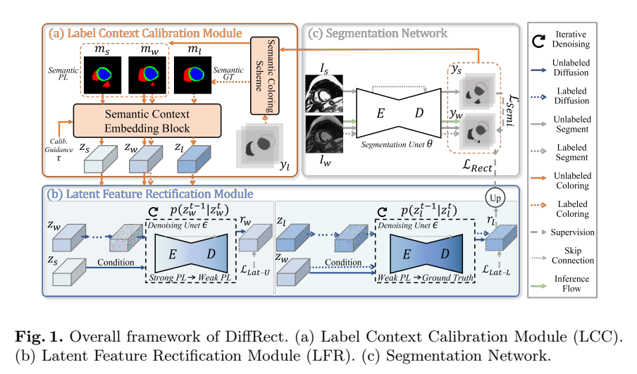
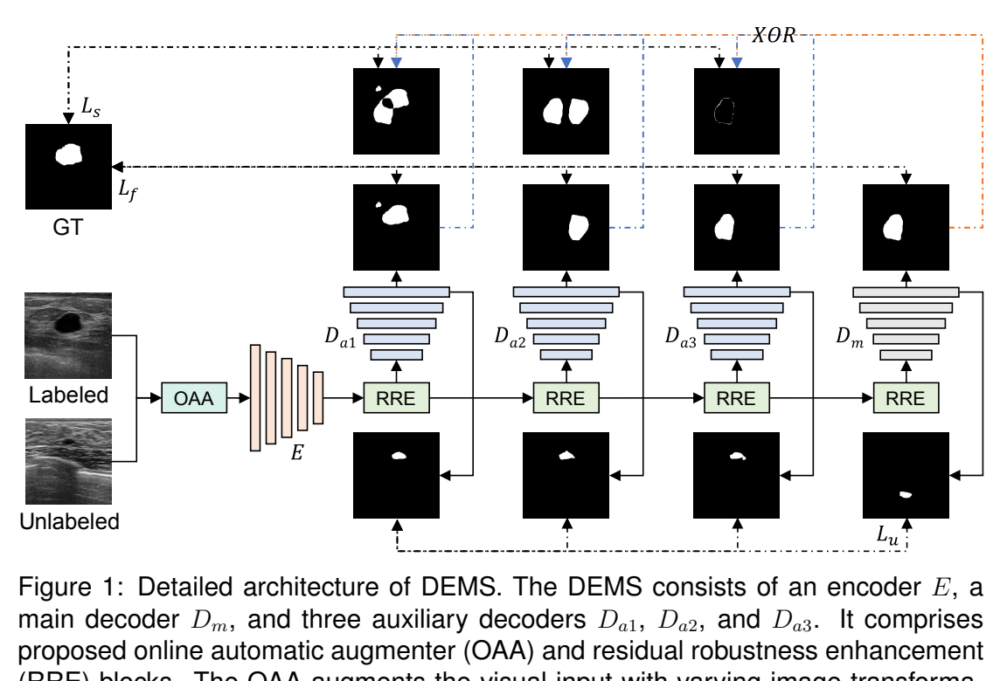
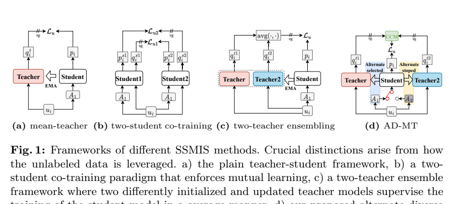
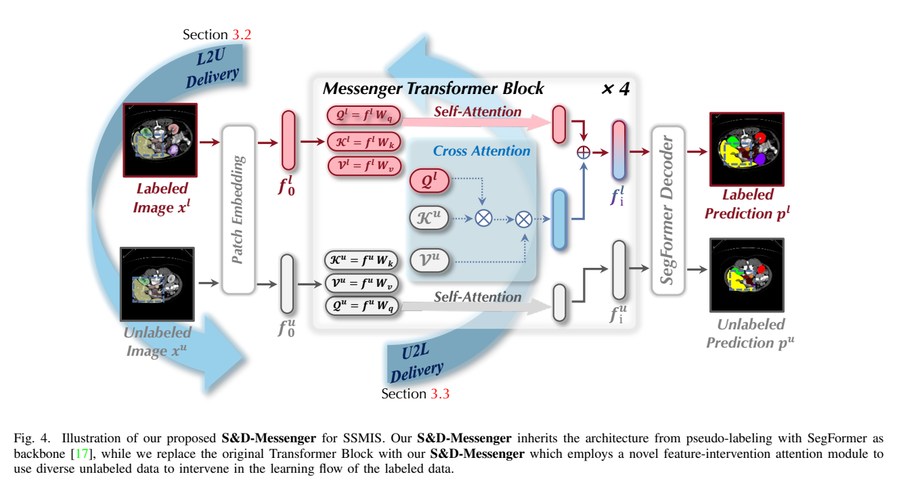

# arXiv 检索结果 / Results

## 1. DiffRect: Latent Diffusion Label Rectification for Semi-supervised Medical Image Segmentation
- Authors：Xinyu Liu, Wuyang Li, Yixuan Yuan
- Venue：MICCAI 2024
- Comments：MICCAI 2024
- First：2024-07-13T15:27:31+00:00；Latest：2024-07-13T15:27:31+00:00
- Abs：https://arxiv.org/abs/2407.09918v1
- PDF：https://arxiv.org/pdf/2407.09918v1
- Code：https://github.com/CUHK-AIM-Group/DiffRect, https://huggingface.co/huggingface, https://huggingface.co/docs/hub/spaces, https://github.com/HiLab-git/SSL4MIS
- 解读来源：PDF 全文，共 11 页，11 页可提取文字
### [中文]
**中文翻译**
- 标题：DiffRect：用于半监督医学图像分割的潜在扩散标签校正
- 摘要：半监督医学图像分割旨在利用有限的标注数据和丰富的未标注数据进行准确分割。然而，现有的半监督方法高度依赖自生成伪标签的质量，容易产生错误监督和确认偏差。同时，它们在潜在空间中捕捉标签分布方面存在不足，对未标注数据的泛化能力有限。为解决这些问题，我们提出了一种用于半监督医学图像分割的潜在扩散标签校正模型（DiffRect）。DiffRect首先利用标签上下文校准模块（LCC），通过学习伪标签中类别间的相关性来校准类别间的偏差关系，然后在潜在空间上应用潜在特征校正模块（LFR），通过潜在扩散来构建并对齐不同层级的伪标签分布。它利用去噪网络学习从粗到细、从细到精确的连续分布传输。我们在三个公开数据集上评估了DiffRect：ACDC、MS-CMRSEG 2019和Decathlon Prostate。实验结果表明了DiffRect的有效性，例如，在仅有1%标注扫描可用的ACDC上，它达到了82.40%的Dice分数，在Dice上比之前的最先进方法高出4.60%，甚至可与全监督性能相媲美。代码发布于\url{https://github.com/CUHK-AIM-Group/DiffRect}。

DiffRect 针对半监督医学图像分割中伪标签质量差和潜在空间标签分布未对齐的问题，提出标签上下文校准模块（LCC）与潜在特征矫正模块（LFR）。LCC 用语义着色方案将伪标签映射到 RGB 空间，并以 Dice 系数作为校准引导嵌入，学习类别间关系；LFR 用条件 DDPM 在潜在空间建模“强伪标签→弱伪标签→真实标签”的连续分布传输，生成矫正后的伪标签用于监督。在 ACDC 1%/5%/10%、MS-CMRSEG 2019 20%、Decathlon Prostate 10% 标签预算下，DiffRect 均报告优于 UAMT、FixMatch、CPS、ICT、MCNetV2、INCL 等基线；例如 ACDC 1% 验证集 Dice 82.40%，比 INCL 高 4.60 个百分点。消融显示语义着色、校准引导、S2W 与 W2G 传输均有贡献。

## 1. 问题与动机

论文关注半监督医学图像分割：只有少量体素级标注，却有大量未标注扫描。作者将现有方法的问题归为两类 [p. 2]：

- **依赖风险（Reliance Risk）**：自训练类方法用模型自己生成的伪标签迭代更新，伪标签错误会在迭代中被保留并放大，形成确认偏差；同时现有方法没有充分利用伪标签中的类别间相关性，标签质量对扰动设计和网络结构敏感。
- **分布错配（Distribution Misalignment）**：一致性正则类方法主要在输出掩码层面施加一致性或辅助监督，缺少对潜在空间语义和底层标签分布的建模，导致对未标注数据的泛化有限。

作者认为，VAE/GAN 类分布建模存在模式坍塌以及生成与分割任务冲突的问题，因此转向 DDPM，用扩散模型在潜在空间建模伪标签质量分布之间的连续传输 [p. 2]。

## 2. 方法

### 2.1 条件 DDPM 预备

前向扩散对干净特征 z0 加噪，闭式采样为 q(zt|z0)=N(zt; √αt z0, (1−αt)I)，其中 αt 为噪声调度变量 [p. 3, Eq.1]。反向过程以条件 ρ 为输入，按 z_{t−1} ← (1/√αt)(zt − (√(1−αt)/√(1−ᾱt)) ε(zt,t,ρ)) + σt η 逐步去噪，η∼N(0,I) 保证随机性 [p. 3, Eq.3]。论文把该框架扩展到伪标签的潜在空间。

### 2.2 标签上下文校准模块 LCC

输入是分割网络给出的 one-hot 伪标签 y_s（强扰动）与 y_w（弱扰动），尺寸 H×W×C。LCC 先用**语义着色方案（SCS）**把每个类别映射到一组 RGB 颜色，得到 m(h,w)=f(y(h,w))，即 H×W×3 的语义伪标签；颜色集 MC 由 C 个 RGB 三元组构成，并尽量最大化类别间颜色差异以避免语义混淆 [p. 3–4, Eq.4]。

随后，语义上下文嵌入块 B_sem 把语义伪标签嵌入到 R^{H/16×W/16×256} 的潜在特征 z_s、z_w、z_l。嵌入时还拼接**校准引导（CG）** τ_u 与 τ_l，并用正弦嵌入编码 [p. 4, Eq.5]。τ 由不同质量掩码之间的 Dice 系数计算：τ_u=Dice(y_s,y_w)，τ_l=Dice(y_w,y_l) [p. 4, Eq.6]。作者主张 Dice 引导同时度量伪标签质量并把该信息注入学习过程。

### 2.3 潜在特征矫正模块 LFR

LFR 用潜在扩散建模标签质量分布的传输，结构见 Fig.1(b) [p. 4]。对未标注数据，先由 LCC 得到强、弱语义上下文嵌入 z_s 与 z_w；前向过程从 z_w 出发加噪到 z_w^T，闭式形式为 z_w^T=√ᾱT z_w+√(1−ᾱT)η，调度采用 cosine [p. 5, Eq.7]。

反向过程训练去噪 U-Net ε 学习从粗粒度分布 p(z_s)（强伪标签）到细粒度分布 p(z_w)（弱伪标签）的传输，称为 **S2W（strong-to-weak）**；反向马尔可夫链以 z_s 为条件 [p. 5, Eq.8]。未标注数据的潜在损失为 L_Lat-U=E_{z_w,t}[‖z_w−r_w‖²]，其中 r_w=ε(z_w^T,z_s,t) 是 z_w 的重建 [p. 5, Eq.9]。

对标注数据，类似地以 z_w 为条件、从加噪的 z_l^T 恢复 z_l，学习从弱伪标签分布 p(z_w) 到真实标签分布 p(z_l) 的 **W2G（weak-to-ground truth）** 传输 [p. 5, Eq.10]；损失为 L_Lat-L=E_{z_l,t}[‖z_l−r_l‖²]，r_l=ε(z_l^T,z_w,t) [p. 6, Eq.11]。

推理矫正时，从高斯噪声 r_l^T∼N(0,I) 出发，以弱伪标签特征 z_w 为条件逐步反向去噪，单步更新为 r_l^{t−1} ← (1/√αt)(r_l^t − (√(1−αt)/√(1−ᾱt)) ε(r_l^t,t,z_w)) + σt η [p. 6, Eq.12]；最终上采样得到矫正伪标签 y_r=Upsample(r_l)，作为更精确的监督信号 [p. 6]。

### 2.4 损失函数

总损失为 L_DiffRect = L_Seg|Semi + L_Rect + L_Lat|Semi + λ1 L_Lat-U + λ2 L_Lat-L [p. 6, Eq.13]。其中 L_Seg|Semi 与 L_Lat|Semi 沿用 [27] 的半监督损失；L_Rect 是弱伪标签 y_w 与矫正伪标签 y_r 之间的交叉熵加 Dice：L_Rect=CE(y_w,y_r)+Dice(y_w,y_r) [p. 6, Eq.14]。λ1、λ2 为平衡系数，但论文未报告其具体取值。推理阶段只把输入送入分割网络，不增加额外推理成本 [p. 6]。

## 3. 贡献

作者声称的贡献是：识别半监督分割中的依赖风险与分布错配；提出 LCC 通过语义着色和 Dice 校准引导学习类别间关系；提出 LFR 用潜在扩散建模粗到细、细到精确的连续分布传输；并在三个公开数据集上取得显著领先 [p. 1, p. 9]。

我的解读：核心新颖点在于把“伪标签矫正”从输出掩码层面移到潜在空间，并用条件 DDPM 串联强伪标签、弱伪标签和真实标签三个质量层级；Dice 引导作为显式质量信号嵌入条件，是相对普通扩散矫正的额外设计。但论文没有与同样使用扩散做半监督分割的工作做直接对比，因此“扩散用于标签矫正”本身的相对增益无法从现有实验单独分离。

## 4. 实验与结果

### 4.1 设置

三个公开数据集：ACDC、MS-CMRSEG 2019、Decathlon Prostate [p. 1]。ACDC 测试 1%、5%、10% 标签比例，MS-CMRSEG 2019 用 20%，Decathlon Prostate 用 10% [p. 7]。所有方法在相同设置下训练，NVIDIA 4090 GPU，30k 迭代 [p. 6]。B_sem 用四个阶段、每阶段两个 3×3 卷积加 BN 和 LeakyReLU，再 2× 下采样到 H/16×W/16；去噪 U-Net 上下采样 4×，每阶段两个 3×3 卷积，多尺度图像特征以拼接方式嵌入 [p. 7]。弱扰动为随机翻转和旋转；强扰动为随机高斯模糊以及对比度、锐度、亮度增强 [p. 7]。

### 4.2 主要结果

ACDC 验证集（Tab.1）[p. 7]：
- 1%：DiffRect Dice 82.40、Jaccard 71.96、HD95 10.04、ASD 2.90；INCL 为 77.80/66.13/11.69/3.22；MCNetV2 为 57.49/43.29/31.31/10.97。作者称相对 MCNetV2 在 1%/5%/10% 下 Dice 提升 24.91/7.99/4.21 个百分点，Jaccard 提升 28.67/9.93/5.51 个百分点 [p. 7]。
- 5%：DiffRect 86.95/78.08/4.07/1.23；INCL 85.43/75.76/6.37/1.37。
- 10%：DiffRect 90.18/82.72/1.38/0.48；INCL 88.28/80.09/1.67/0.49；全监督 U-Net 为 91.48/84.87/1.12/0.34 [p. 7]。

ACDC 测试集：1% 时 DiffRect 71.85/61.53/5.79/2.12，INCL 67.01/56.22/13.43/3.35；5% 时 DiffRect 82.46/71.76/7.18/1.94，INCL 80.64/70.78/5.29/1.42；10% 时 DiffRect 89.27/81.13/3.85/1.00，全监督 91.65/84.95/1.14/0.50 [p. 7]。注意 5% 测试集上 DiffRect 的 HD95 与 ASD 略差于 INCL，并非所有指标全面领先。

MS-CMRSEG 2019 20%：DiffRect Dice 86.78、Jaccard 77.13、HD95 6.39mm、ASD 1.85mm；作者称比 INCL 分别高 2.45、3.21、3.56mm、0.76mm [p. 7–8]。Decathlon Prostate 10%：论文正文只称“仍显示有说服力的结果”，具体数字位于 Tab.3，但该表在提供的文本中不可辨认，无法可靠转录 [p. 8]。

### 4.3 消融

Tab.4 [p. 8]：FixMatch 基线 69.67 Dice/58.34 Jaccard；加 LCC 后 78.28/66.97（+8.61/+8.63）；去掉语义着色方案（SCS）降到 73.83/61.83；去掉校准引导（CG）下降 2.16 Dice；在 LCC 基础上加 LFR 提升 4.12 Dice 和 10.42mm HD95；去掉 S2W 下降 2.43 Dice；去掉 W2G 后 Dice 降到 78.57。作者据此主张每个子组件必要 [p. 8]。

Tab.5 比较校准引导选择 [p. 8]：Dice 82.40/71.96/10.04/2.90，Jaccard 82.37/71.82/11.33/2.87，Both 81.67/71.45/10.28/2.47，Fixed 80.34/69.67/14.97/4.47，Random 80.60/69.99/13.15/3.75。Dice、Jaccard、Both 相近且优于固定值和随机值，支持“可靠校准方向”的说法。

## 5. 评估

支持的结论：在报告的数字范围内，DiffRect 在 ACDC 三个标签比例和 MS-CMRSEG 2019 20% 上多数指标优于所列基线；消融较一致地表明 SCS、CG、S2W、W2G 各自有贡献。

限制与缺失证据：
- Decathlon Prostate 的具体结果表在文本中不可辨认，无法核验其“compelling results”的强度 [p. 8]。
- 未报告 λ1、λ2 的取值、扩散时间步 T、噪声调度具体参数、学习率、批大小、分割网络具体结构等复现关键细节 [p. 6–7]。
- 未与其它扩散式半监督分割方法直接比较，难以判断增益来自扩散建模还是整体框架。
- 消融只在单一数据集/标签比例上报告（从 Tab.4 上下文看应为 ACDC 1%），跨数据集稳定性未知 [p. 8]。
- 作者称“even rivals fully supervised performance”，但 ACDC 1% 验证集 82.40 对全监督 91.48 仍有明显差距，该表述应理解为接近而非持平 [p. 1, p. 7]。

## 6. 复现

已报告：30k 迭代、单张 4090、B_sem 四阶段结构与通道 256、去噪 U-Net 4× 上下采样、弱/强扰动类型、各数据集标签比例、ACDC 按 [20] 的划分协议 [p. 6–7]。

未报告或无法确认：λ1/λ2、T、cosine 调度的具体参数、优化器与学习率、批大小、输入 patch 尺寸、分割网络细节、预训练权重、随机种子与重复次数、推理时采样步数。复现时需向作者代码或补充材料查询这些项；论文正文不足以完整复现。

#### 原论文流程图 · Figure 1 · PDF 第 4 页

Fig.1. Overall framework of DiffRect. (a) Label Context Calibration Module (LCC). (b) Latent Feature Rectification Module (LFR). (c) Segmentation Network.

[原文来源](https://arxiv.org/pdf/2407.09918v1#page=4)

## 2. Segmenting Medical Images with Limited Data
- Authors：Zhaoshan Liua, Qiujie Lv, Chau Hung Lee, Lei Shen
- Comments：Neural Networks Accepted
- First：2024-07-12T11:41:18+00:00；Latest：2024-07-12T11:41:18+00:00
- Abs：https://arxiv.org/abs/2407.09189v1
- PDF：https://arxiv.org/pdf/2407.09189v1
- Code：https://github.com/NUS-Tim/DEMS, https://huggingface.co/huggingface, https://huggingface.co/docs/hub/spaces
- 解读来源：PDF 全文，共 35 页，35 页可提取文字
### [中文]
**中文翻译**
- 标题：有限数据下的医学图像分割
- 摘要：尽管计算机视觉已被证明在医学图像分割中具有价值，但其应用仍面临数据集规模有限以及有效利用未标注图像较为复杂等挑战。为应对这些挑战，我们提出了一种新颖的基于一致性半监督方法，称为数据高效医学分割器（DEMS）。DEMS采用编码器-解码器架构，并集成了所开发的在线自动增强器（OAA）和残差鲁棒性增强（RRE）模块。OAA通过多种图像变换增强输入数据，从而多样化数据集以提高泛化能力。RRE丰富特征多样性并引入扰动，为不同解码器创建多样化输入，从而提供增强的变异性。此外，我们引入敏感损失以进一步增强不同解码器之间的一致性并稳定训练过程。在我们自己的数据集和三个公开数据集上的大量实验结果证实了DEMS的有效性。在极端数据短缺场景下，我们的DEMS在dice分数上分别比U-Net和表现最佳的最先进方法提高了16.85\%和10.37\%。鉴于其卓越的数据效率，DEMS可在小数据条件下推动医学分割取得显著进展。项目主页可访问：https://github.com/NUS-Tim/DEMS。

论文提出半监督分割框架 DEMS，用在线自动增强器 OAA、残差鲁棒增强块 RRE 和多解码器一致性损失（含二值 XOR 敏感损失）提升小样本医学超声分割。四个数据集上多数设置优于 U-Net 与 MGCC 等基线；SNGT 20% 标签时 DSC 54.59%，比 U-Net 高 16.85 个百分点、比 MGCC 高 10.37 个百分点。但 BUSI 40% 标签时 MGCC 的 DSC 略高 0.35 个百分点，说明优势并非全面。

# DEMS：有限数据下的医学图像分割阅读笔记

## 1. 问题与动机

作者关注医学图像分割中标注数据稀缺、未标注图像大量闲置的问题，并以超声图像为主要场景，理由是超声存在斑点噪声、图像质量低且数据量小 [p. 1][p. 12]。论文将现有做法分为三类：传统数据增强依赖经验设计；GAN 增强存在合成质量不稳定、训练开销大、依赖数据规模等问题；自动增强则计算成本高、流程复杂并可能造成模型混淆 [p. 2][p. 4][p. 5]。在半监督方面，均值教师（MT）方法受教师网络性能约束、模型差异性有限；多解码器或 GAN 类方法也面临变异性和训练稳定性不足 [p. 3][p. 5][p. 6]。因此作者希望用较低额外成本同时提升数据多样性和多解码器一致性。

## 2. 方法

### 2.1 总体结构

DEMS 采用 U-Net 式编码器-解码器：一个编码器 E、一个主解码器 Dm 和三个辅助解码器 Da1–Da3；辅助解码器只在训练阶段使用 [p. 7][p. 8]。编码器含五个卷积块，前四个块后接最大池化；每个卷积块为两层 3×3 卷积、批归一化和 GELU。解码器含四个上采样阶段，每阶段由上采样块、特征拼接层和卷积块组成 [p. 10]。

### 2.2 在线自动增强器 OAA

OAA 基于 MedAugment 改造。MedAugment 原本是离线自动增强，含 N=4 个增强分支及一个保留原图的分支，每分支执行 M=[2,3] 个变换，变换从像素空间 Ap（亮度、对比度、色调分离、锐度、高斯模糊、高斯噪声）和空间空间 As（旋转、水平/垂直翻转、缩放、x/y 平移、x/y 剪切）采样，采样策略 Π 含四个子策略，增强幅度上限 MA 和概率 PA 由增强等级 L 控制 [p. 8][p. 9]。OAA 将多分支合并为单主分支，实现输入与增强输出的一对一映射；去掉保留原图的分支；对 Ap 采用有放回采样以增加组合多样性；每个 epoch 重新采样变换，使同一图像在不同训练阶段获得不同增强 [p. 9]。算法 1 给出 L=5、PA=0.2L、幅度在 MA 内均匀采样的流程 [p. 9]。作者称 OAA 可一行代码接入现有增强管线 [p. 9]。

### 2.3 残差鲁棒增强块 RRE 与连接结构

RRE 块包含残差连接、深度卷积 DwConv、逐点卷积 PwConv 和特征扰动注入 FPI；FPI 注入特征噪声、特征 dropout 和普通 dropout [p. 10]。图 3 展示 RRE 有两个输入-输出端口，并给出编码器与不同解码器之间的连接：第一个 RRE 块从 f1–f5 全部编码器输出接收输入，后续块同时接收 f1–f4 与前序块输出；主解码器与辅助解码器的跳跃连接输出端口不同，使每个解码器输入经历不同数量的卷积或不同扰动 [p. 10][p. 11]。图 1 为整体架构，图 3 为 RRE 与连接结构；本文仅依据图注和正文说明，未对图像内容作额外判读 [p. 7][p. 10]。

### 2.4 损失函数

融合损失 Lf 对每个解码器计算：Lf = 0.5·LBCE(ŷ,y) + LDSC(ŷ,y)，其中 BCE 关注像素级准确率，Dice 关注预测与真值的重叠 [p. 11]。敏感损失 Ls 针对主解码器与任一辅助解码器的二值预测做 XOR：Ls = (1/N)Σ_i [(ŷm,i>T) ⊕ (ŷa,i>T)]，阈值 T=0.5；其直觉是两个解码器二值结果不一致的区域很可能有一方出错，因此惩罚该“敏感区域”面积 [p. 11]。无监督损失 Lu 用均方误差计算主解码器与辅助解码器概率输出的差异：Lu = Σ_i (ŷm,i−ŷa,i)^2 [p. 11]。总损失对四个解码器的 Lf 取平均得到 L̄f，对三组解码器对的 Ls、Lu 取平均得到 L̄s、L̄u；最终 L = L̄f + λ(L̄s+L̄u)，λ 采用高斯预热函数，随训练步数 t 从较小值逐渐升至 1，以降低早期训练不稳定 [p. 12]。

## 3. 贡献

作者声称的贡献有三点：提出 DEMS 半监督分割框架；提出 OAA 与 RRE，并引入敏感损失增强多解码器一致性和训练稳定性；在自有及三个公开数据集上验证优势，尤其在极端数据短缺时更明显 [p. 3]。我的理解是：OAA 的新意主要在于把 MedAugment 的离线多分支增强改为在线单分支一对一增强，工程上较轻；RRE 与多解码器连接设计更接近对多解码器一致性的结构化增强；敏感损失用硬二值 XOR 作为一致性项，与常用的软概率 MSE 形成互补。这些属于方法组合与设计层面的创新，论文未提供与 MedAugment 在线化版本的直接消融对比。

## 4. 实验与结果

### 4.1 数据与设置

使用四个超声数据集：自有 SNGT（221 张，管状结构二值分割）、BUS（163 张）、BUSI（780 张，使用良性与恶性图像）、DDTI（637 张）[p. 12][p. 13]。训练/验证按 7:3 划分；半监督方法使用 20% 与 40% 标注图像，其余为未标注图像；图像和掩码预处理为 224×224 [p. 13]。优化器 SGD，基础学习率 0.01，动量 0.9，权重衰减 0.0001，余弦退火；λ 每 150 次迭代更新；批大小 8，最大训练迭代 20000；报告三次独立运行的均值与标准差 [p. 13]。评价指标为 DSC、IoU、SEN、PRE、PA [p. 13]。

### 4.2 主要结果

SNGT 20% 标签（30 张）时，DEMS 的 DSC 为 54.59±0.44%，U-Net 为 37.74±2.50%，MGCC 为 44.22±0.01%，即相对 U-Net 提升 16.85 个百分点、相对 MGCC 提升 10.37 个百分点；40% 标签（61 张）时 DEMS 为 59.66±0.21%，U-Net 47.47±0.92%，MGCC 53.76±0.80% [p. 14]。作者提醒 SNGT 中管状目标远小于背景，PA 普遍很高（约 99.3%）不能单独说明分割质量 [p. 14]。

BUS 20% 标签（22 张）时 DEMS DSC 76.14±0.03%，MGCC 72.35±0.88%；40% 标签（45 张）时 DEMS 83.03±1.42%，MGCC 82.99±1.05%，二者接近 [p. 15]。BUSI 20% 标签（90 张）时 DEMS DSC 76.01±0.54%，MGCC 75.10±0.70%；40% 标签（180 张）时 DEMS 79.17±0.19%，MGCC 79.52±0.66%，MGCC 反超 0.35 个百分点，且 MGCC 的 IoU、PRE、PA 也略高 [p. 18]。DDTI 20% 标签（89 张）时 DEMS DSC 73.90±0.69%，MGCC 67.71±0.77%；40% 标签（178 张）时 DEMS 77.78±0.66%，MGCC 76.53±0.72%，但 MGCC 的 PRE 为 78.99%，比 DEMS 的 78.12% 高 0.87 个百分点 [p. 20]。

### 4.3 补充分析与消融

作者用 60%、80% 标签训练 DEMS，并与 100% 标签训练的 U-Net 比较，称 DEMS 在所有数据集上超过该“上界”：最高 DSC 分别超过 68%、87%、82%、80%（SNGT、BUS、BUSI、DDTI）；在较小的 SNGT 和 BUS 上仅用 40% 标签即超过上界，在较大的 BUSI 和 DDTI 上分别需 80% 和 60% 标签 [p. 18][p. 20]。跨数据集实验从 BUS 训练、BUSI 测试：20% 标签时与同数据集性能接近；40% 标签时 DSC、IoU、PRE、PA 分别下降约 9%、9%、13%、1%，SEN 约升 1%；80% 标签时差距缩小到约 5%、6%、9%、1%，SEN 约升 3% [p. 22][p. 25]。Bland-Altman 分析报告平均差异接近 0%，最大/最小平均差异为 BUSI 的 1.05% 与 SNGT 的 0.22%，标准差最高/最低为 BUSI 的 5.41% 与 SNGT 的 0.63% [p. 22]。计算效率方面，多数方法训练约 2 小时，MGCC 约 10 小时，DEMS 在合理时间内取得最高指标 [p. 25]。

消融在 SNGT 80% 标签上进行 [p. 25]。完整 DEMS 的 DSC 为 68.50±1.64%；去掉 OAA、RRE、Lsen 分别降至 63.50±1.32%、62.06±1.41%、58.42±0.29%，对应下降 4.90、3.38、1.67 个百分点；三者全去掉为 56.65±0.71%，下降 11.85 个百分点 [p. 25][p. 27]。仅保留 OAA 的变体 PRE 最高（72.32%），但 DSC、IoU、SEN 分别低 5.00、4.64、6.19 个百分点 [p. 27]。作者说明去掉 OAA 时仍加入随机旋转和随机翻转，因为完全去掉增强会使性能急剧恶化、无法比较 [p. 25]。

## 5. 评估

支持的结论：在四个超声数据集、20%/40% 标签设置下，DEMS 多数指标优于 U-Net 和所列半监督基线；在 SNGT 小数据场景优势最大；消融显示三个组件各自有贡献，组合贡献更大。需要注意：BUSI 40% 标签时 MGCC 的 DSC 略高，DDTI 40% 标签时 MGCC 的 PRE 更高，因此“全面优于 SOTA”的表述应限定条件。作者自述局限是敏感损失针对二值分割，多目标分割需拆成多个二值任务，可能增加推理时间并带来重叠目标处理问题 [p. 27]。论文未报告多目标分割实验、未给出 OAA 与离线 MedAugment 的直接对比、未报告参数量或显存等成本细节；跨数据集只做了 BUS→BUSI 一个方向。图表中的部分表格在文本中排版交错，但正文数字与表格行可对应；未报告的信息不作推测。

## 6. 复现要点

已报告：四个数据集及划分比例 7:3；20%/40% 标签预算；224×224 输入；SGD（lr=0.01、momentum=0.9、weight decay=0.0001）与余弦退火；批大小 8；最大 20000 次迭代；λ 每 150 次迭代更新；三次运行取均值与标准差；OAA 的 L=5、PA=0.2L、M=[2,3] 及 Ap/As 变换列表 [p. 9][p. 13]。未报告或无法从正文确认：具体随机种子、数据划分文件、辅助解码器与 RRE 的通道数/层数细节、预热函数中 λ 的初始具体取值（仅给出公式）、推理时是否只用主解码器（正文称辅助解码器仅训练使用，但未明确推理融合方式）、代码版本与依赖。复现时应优先以作者 GitHub 项目为准，并对上述未报告项做显式记录。

#### 原论文流程图 · Figure 1 · PDF 第 7 页

Figure 1: Detailed architecture of DEMS. The DEMS consists of an encoder E, a main decoder D , and three auxiliary decoders D , D , and D . It comprises m a1 a2 a3 proposed online automatic augmenter (OAA) and residual robustness enhancement

[原文来源](https://arxiv.org/pdf/2407.09189v1#page=7)

## 3. Alternate Diverse Teaching for Semi-supervised Medical Image Segmentation
- Authors：Zhen Zhao, Zicheng Wang, Longyue Wang, Dian Yu, Yixuan Yuan, Luping Zhou
- Venue：ECCV 2024
- Comments：code:https://github.com/ZhenZHAO/AD-MT, accepted by ECCV 2024
- First：2023-11-29T02:44:54+00:00；Latest：2024-07-12T11:23:31+00:00
- Abs：https://arxiv.org/abs/2311.17325v2
- PDF：https://arxiv.org/pdf/2311.17325v2
- Code：https://github.com/ZhenZHAO/AD-MT, https://huggingface.co/huggingface, https://huggingface.co/docs/hub/spaces
- 解读来源：PDF 全文，共 17 页，17 页可提取文字
### [中文]
**中文翻译**
- 标题：用于半监督医学图像分割的交替多样化教学
- 摘要：半监督医学图像分割研究已显示出在有限标注数据下训练模型的潜力。然而，当前主流的基于教师-学生的方法可能遭受确认偏差。为应对这一挑战，我们提出AD-MT，一种教师-学生框架下的交替多样化教学方法。它涉及一个学生模型和两个不可训练的教师模型，这两个教师模型以交替方式周期性和随机地进行动量更新。为缓解来自多样化监督的确认偏差，AD-MT的核心在于两个提出的模块：随机周期交替（RPA）更新模块和冲突对抗模块（CCM）。RPA通过互补数据批次、不同数据增强和随机切换周期来安排交替多样化更新过程，以鼓励从不同教学视角进行多样化推理。CCM采用基于熵的集成策略，鼓励模型从教师之间一致和冲突的预测中学习。实验结果表明，我们的AD-MT在各种半监督设置下的2D和3D医学分割基准上具有有效性和优越性。

AD-MT 针对半监督医学图像分割中教师-学生框架的确认偏差问题，提出单学生、双不可训练教师的交替多样化教学框架。RPA 模块让两名教师按随机周期交替进行 EMA 更新，并使用互补的无标注数据批次与不同强增强（T1 用 color-jitting，T2 用 copy-paste）；CCM 模块用基于熵的教师集成与置信度阈值，把一致预测和冲突预测都转化为学生监督。在 LA、ACDC、Pancreas 三个基准上，AD-MT 在 5%/10% 或 10%/20% 标注设置下多数指标优于 BCP 等 SOTA，且无需 BCP 的额外预训练；消融显示 RPA 与 CCM 各自带来增益，冲突直接丢弃最差。

## 1. 问题与动机

论文关注半监督医学图像分割（SSMIS）：标注像素级医学图像昂贵，因此希望用少量标注数据加大量无标注数据训练分割模型 [p. 1]。作者指出，当前主流是基于一致性正则的教师-学生框架（如 Mean-Teacher），用弱/强增强制造预测差异并让 EMA 教师为无标注数据提供伪标签；但单一模型产生的伪标签必然含噪甚至错误，导致确认偏差（confirmation bias）[p. 2]。

作者把已有缓解路线分为两类并指出不足：一是多学生协同训练（图 1b），通过额外学生互相监督增加多样性，但增加训练参数与开销，且放弃 EMA 稳定性，仅靠不同初始化/学习率难以产生足够差异 [p. 2]；二是多教师集成（图 1c），学生迭代更新多个教师以避免额外训练成本，但教师更新策略未被仔细设计以制造多样性，且通常只取平均、只学一致预测，很少利用教师间冲突 [p. 2-3]。因此本文要解决的是：在不增加可训练参数和额外约束的前提下，产生足够多样的教师监督，并显式利用冲突预测 [p. 3]。

## 2. 方法

### 2.1 总体框架

数据含标注集 X 与无标注集 U，|X|≪|U|。每个迭代取标注批 Bx={(xi,yi)} 和无标注批 Bu={ui} [p. 5]。框架如图 3 所示 [p. 5]：只有一个可训练学生 θs；两个教师 θt1、θt2 不可训练，由学生权重的 EMA 交替更新。学生先在标注数据上用监督损失 Lx 训练，ℓ 为 Dice 与交叉熵的平均 [p. 6]：

Lx = (1/|Bx|) Σ_i (1/(H×W)) Σ_j ℓ(ŷ_i(j), y_i(j))，其中 ŷ_i=f(x_i;θs)，j 为像素/体素，H×W 为分辨率 [p. 6]。

对无标注实例 ui，用弱增强 a(·)（随机裁剪与翻转）得到两个教师和学生的预测：q_t1=f(a(ui);θt1)、q_t2=f(a(ui);θt2)、q_s=f(a(ui);θs) [p. 6]。CCM 函数 φ 把这些预测与高置信阈值 τ 合成为最终伪标签 q_i=φ(q_t1,q_t2,q_s,τ) [p. 6]。学生再对强增强后的无标注数据 Am(ui) 预测 p_i=f(Am(ui);θs)，m∈{1,2} 对应两名教师轮次的两套强增强 [p. 6]。无标注一致性损失为：

Lu = (1/|Bu|) Σ_i (1/(H×W)) Σ_j ℓ(p_i(j), q_i(j)) [p. 6]。

总损失 L=Lx+λt·Lu，λt 随迭代调整一致性损失权重 [p. 6]。推理时只用学生模型 [p. 8]。

### 2.2 RPA：随机周期交替更新

RPA 的目标是让两个教师尽可能不同，同时几乎不增加训练成本 [p. 7]。包含三点：

- 交替更新：每个迭代只更新两名教师中的一个；一个完整 epoch 内两个教师由不同且互补的无标注批次更新，从而互补学习 [p. 7]。
- 不同增强：T1 轮次用 color-jitting，T2 轮次用 copy-paste，进一步扩大差异 [p. 7]。
- 随机切换周期：给定最大周期 Tmax，每次切换时按 T_m←random.randomint(0,Tmax) 随机生成各教师的交替周期（以迭代计）[p. 7]。作者认为这既增加教师多样性，又避免两种强增强同时施加带来的过度扰动风险 [p. 7]。

### 2.3 CCM：冲突对抗模块

CCM 不直接丢弃两个教师的冲突预测，而是让学生也从分歧中学习 [p. 8]。首先计算两个教师预测的熵：H_t1=−Σ_c q_t1 log2 q_t1，H_t2 同理 [p. 8]。然后做熵加权集成：ψ_i=(w1·q_t1+w2·q_t2)/(w1+w2)，其中 w1=e^{−H_t1}，w2=e^{−H_t2} [p. 8]。

最终伪标签按式 (9) 生成 [p. 8]：当 q_t1≠q_t2 且集成预测熵 H_ψi(j) 大于学生预测熵 H_qsi(j) 时，若学生预测最大置信度 ≥τ，则取学生预测 q_s(j)；否则若集成预测最大置信度 ≥τ，则取 ψ_i(j)。指示函数 1(·) 只保留高置信预测 [p. 8]。直观上，冲突处比较教师集成与学生谁更“确定”，用低熵一方监督；一致处则用教师集成。作者称随着训练推进学生逐渐接近教师，因此该策略在训练后期尤其有益 [p. 7-8]。

## 3. 贡献

作者声称的贡献有三点 [p. 3]：提出 AD-MT 交替多样化教师-学生方法以缓解确认偏差；设计 RPA 扩大两个教师的多样性，设计 CCM 同时利用一致与冲突预测；在不引入额外约束和额外训练成本的情况下，在 2D/3D SSMIS 基准上取得新 SOTA。

我的解读：核心新颖点不在“双教师”本身，而在两个细节的组合——教师更新被随机周期与互补批次/增强刻意“去同步”，以及冲突不再被丢弃而是用熵比较学生与教师集成来决定监督源。与 BCP 相比，作者强调 AD-MT 是端到端、无需额外预训练阶段 [p. 3, p. 10-11]；但“无额外训练成本”主要指无可训练参数增加，双教师的前向与 EMA 维护仍有计算开销，论文未给出显式 FLOPs/时间对比。

## 4. 实验与结果

### 4.1 数据与设置

采用三个基准 [p. 8-9]：Pancreas-NIH（82 例增强腹部 CT 3D 数据）、LA（100 例 3D 钆增强 MRI）、ACDC（100 例心脏 MR 2D 数据）。3D 训练随机裁剪为 Pancreas 112×112×80、LA 96×96×96；ACDC 缩放到 256×256 并归一化到 [0,1] [p. 9]。指标为 Dice、Jaccard、95HD、ASD，Dice/Jaccard 越高越好，95HD/ASD 越低越好 [p. 9]。

实现细节 [p. 10]：2D 用 U-Net，3D 用 V-Net；ACDC 批大小 24（12 标注+12 无标注），训练 30,000 迭代；LA 与 Pancreas 批大小 4（2+2），训练 15,000 迭代；SGD，初始学习率 0.01，按 (1−iter/max_iter)^0.9 多项式衰减，动量 0.9，权重衰减 0.0001；两教师随机初始化，EMA 参数 0.99；默认最大损失权重 λu=2.0，最大周期 Tmax=0.5 epoch。

### 4.2 与 SOTA 比较

LA（表 1）[p. 9-10]：5%（4 例标注）下 AD-MT Dice 89.63、Jaccard 81.28、95HD 6.56、ASD 1.85；BCP 为 88.02/78.72/7.90/2.15，且 BCP 需额外预训练。10%（8 例）下 AD-MT Dice 90.55、Jaccard 82.79、95HD 5.81、ASD 1.70；BCP 为 89.62/81.31/6.81/1.76。作者称 5% 设置下比 BCP 高 1.61% Dice、2.56% Jaccard，并比 MC-Net+ 高 6% 以上 Dice [p. 10]。

ACDC（表 2）[p. 9, p. 11]：5%（3 例）下 AD-MT Dice 88.75、Jaccard 80.41、95HD 1.48、ASD 0.50；BCP 为 87.59/78.67/1.90/0.67。10%（7 例）下 AD-MT Dice 89.46、Jaccard 81.47、95HD 1.51、ASD 0.44；BCP 为 88.84/80.62/3.98/1.17。作者称 5% 下比 BCP 高 1.16% Dice，并比无预训练的端到端方法高 20% 以上 Dice [p. 11]。

Pancreas（表 3）[p. 10-11]：10%（6 例）下 AD-MT Dice 80.21、Jaccard 67.51、95HD 7.18、ASD 1.66；BCP 为 73.83/59.24/12.71/3.72，作者称高 6.38% Dice。20%（12 例）下 AD-MT Dice 82.61、Jaccard 70.70、95HD 4.94、ASD 1.38；BCP Dice 82.91 略高，但 AD-MT 的 95HD/ASD 最低 [p. 11]。

### 4.3 消融

组件消融（表 4，ACDC 5% 标注，3 例）[p. 11]：仅 T1 平均 Dice 86.83、95HD 2.65；仅 T2 为 86.22/2.43；T1+T2+RPA（仅平均两教师）为 87.88/2.03；完整 AD-MT 为 88.75/1.48。作者据此认为 RPA 带来超过 1% 的平均 Dice 提升，CCM 进一步提升并降低 95HD [p. 12]。

阈值 τ（表 5）[p. 12]：ACDC 上 τ 从 0.7 到 0.95，Dice 从 86.58 升到 88.75；LA 上 τ=0.75 时最高 89.63，继续升高到 0.95 则降到 86.94。默认 2D 用 0.95、3D 用 0.75 [p. 12-13]。

切换周期（图 4）[p. 13]：在 ACDC 5% 标注下比较固定与随机周期，随机策略一致优于固定策略；作者解释固定策略下较大 Tmax 会让性能差距大的模型之间做集成，降低集成效果。

集成策略（表 6，ACDC 5%）[p. 13]：冲突直接丢弃 Dice 86.69；平均集成 87.88；熵集成 88.11；CCM 88.75。该消融支持“学习冲突优于丢弃冲突”，并显示 CCM 优于仅用教师的集成。

定性结果（图 5）[p. 13-14]：作者展示 LA 与 ACDC 5% 标注下的分割示例，称 AD-MT 更接近真值，例如能识别连通区域、在 ACDC 上避免 SS-Net 的 RV 误分割；并指出矢状面三分类比冠状面更难。

## 5. 评估

支持的结论：在作者报告的三个数据集与相应标注比例下，AD-MT 的 Dice/Jaccard 多数优于所列基线，且 95HD/ASD 在多数设置最低；消融较一致地表明 RPA 与 CCM 各自有增益，冲突丢弃是最差策略。这些结果支持“多样化教师更新+利用冲突”在给定设置下有效。

局限与缺失证据：第一，所有比较数字来自论文表格，未报告重复实验的均值/方差或显著性检验，无法判断提升是否稳定。第二，表 1-3 的排版在文本中较拥挤，部分基线行与数据集列的对应关系需谨慎阅读；例如表 1 中同时出现 Left atrium 与 ACDC 列，本文按作者正文引用的数字转述，未对无法辨认的表格结构做额外推断。第三，未报告计算开销（训练时间、显存、教师前向成本），因此“无额外训练成本”仅能理解为无可训练参数增加。第四，未报告与 BCP 在相同预训练条件下的对照，BCP 的额外预训练使其比较并非完全同条件。第五，RPA 的随机周期分布、互补批次的具体划分方式、color-jitting/copy-paste 的具体参数未详细给出。第六，结论主要基于三个医学分割基准，跨模态/跨任务的泛化证据有限。

## 6. 复现

已报告的可复现要点：U-Net（2D）/V-Net（3D）；ACDC 批 24（12+12）、30,000 迭代；LA/Pancreas 批 4（2+2）、15,000 迭代；SGD，初始 lr 0.01，多项式衰减指数 0.9，动量 0.9，权重衰减 1e-4；教师 EMA 0.99；λu=2.0；Tmax=0.5 epoch；τ 默认 2D 0.95、3D 0.75；T1 用 color-jitting、T2 用 copy-paste；弱增强为随机裁剪与翻转 [p. 6, p. 10, p. 12-13]。代码链接在首页给出 [p. 1]。

未报告或需自行确定的细节：两教师的具体初始化方式（仅说随机初始化）、随机周期 randomint(0,Tmax) 在 Tmax=0.5 epoch 时的整数边界与单位换算、互补无标注批次的采样规则、强增强的具体强度参数、λt 的迭代依赖函数形式、ACDC 的类别划分与 LA/Pancreas 的预处理细节、优化器之外的训练硬件与随机种子。上述信息在正文中未明确给出，复现时需参考作者代码或自行设定。

#### 原论文流程图 · Figure 1 · PDF 第 2 页

Fig.1: Frameworks of different SSMIS methods. Crucial distinctions arise from how the unlabeled data is leveraged. a) the plain teacher-student framework, b) a two- studentco-trainingparadigmthatenforcesmutuallearning,c)atwo-teacherensemble framework where two differently initialized and updated teacher models supervise the

[原文来源](https://arxiv.org/pdf/2311.17325v2#page=2)

## 4. S&D Messenger: Exchanging Semantic and Domain Knowledge for Generic Semi-Supervised Medical Image Segmentation
- Authors：Qixiang Zhang, Haonan Wang, Xiaomeng Li
- Comments：10 pages, under review of IEEE Transcations on Medical Imaging
- First：2024-07-10T15:39:47+00:00；Latest：2024-07-10T15:39:47+00:00
- Abs：https://arxiv.org/abs/2407.07763v1
- PDF：https://arxiv.org/pdf/2407.07763v1
- Code：https://huggingface.co/huggingface, https://huggingface.co/docs/hub/spaces
- 解读来源：PDF 全文，共 10 页，10 页可提取文字
### [中文]
**中文翻译**
- 标题：S&D Messenger：交换语义与领域知识用于通用半监督医学图像分割
- 摘要：半监督医学图像分割（SSMIS）已成为应对医学领域耗时人工标注挑战的一种有前景的解决方案。然而，在实际场景中，数据集内往往存在领域变化，从而衍生出半监督医学领域泛化（Semi-MDG）和无监督医学领域自适应（UMDA）等场景。本文旨在开发一个掌握全部三项任务的通用框架。我们注意到三个场景中一个关键的共同挑战：用于分割性能的显式语义知识和用于泛化性的丰富领域知识分别仅存在于有标签集和无标签集中。这种差异阻碍了现有方法在半监督设置下有效理解这两类知识。为应对这一挑战，我们开发了语义与领域知识信使（S&D Messenger），它促进有标签集与无标签集之间的直接知识传递，从而使模型在每个单独的学习流程中理解二者。配备我们的S&D Messenger后，一种朴素的伪标签方法在SSMIS、UMDA和Semi-MDG任务的六个基准数据集上相比为特定任务设计的最先进方法分别取得了巨大提升（+7.5%）、（+5.6%）和（+1.14%）。

论文提出 S&D Messenger，通过双向知识传递解决半监督医学图像分割中标注集仅含语义知识、无标注集仅含域知识的割裂问题。L2U 将带标注前景块粘贴到无标注图像及伪标签中；U2L 用通道级交叉注意力以无标注特征正则化标注特征。在 SegFormer-B5 伪标签基线上，Synapse 20% 标注 Dice 达 68.38%（+7.5%），MMWHS UMDA 平均 91.46%（+5.6%），M&Ms 2%/5% 标注 Semi-MDG 平均 88.04%/88.47%（+1.14%）。消融显示两模块互补，但部分表格数字与正文表述存在不一致，需谨慎解读。

# S&D Messenger 论文精读笔记

## 1. 问题与动机

半监督医学图像分割（SSMIS）利用少量标注和大量无标注数据训练模型。实际场景常伴随域偏移，衍生出两个任务：无监督医学域适应（UMDA，源域有标注、目标域无标注）和半监督医学域泛化（Semi-MDG，多源域仅部分标注、测试于未见域）[p. 1]。作者指出，现有方法（包括 GenericSSL [13]）在 SSMIS 上提升明显，但在 UMDA 和 Semi-MDG 上提升有限甚至下降：GenericSSL 在 UMDA 上仅 +4.9% Dice，在 Semi-MDG 上为 -2.15% Dice [p. 2, Fig. 1a]。

作者将根因归结为“知识割裂”：显式语义知识（来自像素级标注）只存在于小标注集，而丰富的域知识（跨域特征变化）只存在于大无标注集；现有方法将两个学习流分开，模型在每个流中只接触单一知识，倾向优先学习易获得的语义监督，忽视域知识，导致泛化不足 [p. 1–2, Fig. 2]。作者还观察到，将 SegFormer 等 Transformer 主干直接用于现有 SSMIS 方法时，UMDA 性能反而下降更明显，原因是 Transformer 在标注有限时更易过拟合 [p. 2, Fig. 1b]。

## 2. 方法

### 2.1 基线

给定小标注集 {(x_l^i, y_i)} 和大无标注集 {x_u^i}，N_l << N_u。基线为 SegFormer [17] + 朴素伪标签 [5]：标注流用 ground truth 监督，无标注流用当前模型预测的伪标签监督。损失为像素级交叉熵：

L = L_s + L_u = (1/N_l) Σ L_CE(f(x_l^i), y_i) + (1/N_u) Σ L_CE(f(x_u^j), ŷ_j)  (Eq. 1) [p. 4]

### 2.2 L2U 知识传递

对每个无标注样本 x_u^i，随机选一个标注样本 (x_l^j, y_j)，切出包含多类前景的 patch p，粘贴到无标注图像，同时把对应像素标注粘贴到伪标签 ŷ_i 中（Eq. 2）。无标注损失改为对混合样本 (x_u'^j, ŷ'_j) 计算交叉熵（Eq. 3）[p. 4–5]。其作用是给无标注流注入精确语义监督，补偿其语义缺失。

### 2.3 U2L 知识传递

在编码器每个 Transformer block 中，将标注特征 f_l 投影为 query，无标注特征 f_u 投影为 key/value：Q, K, V = f_l W_Q, f_u W_K, f_u W_V，其中 W_Q/K/V ∈ R^{C×2C}。通道级交叉注意力为：

f̂_l = Attention(Q^T, K^T, V^T) = softmax[ψ(Q^T K)] V^T  (Eq. 4)

ψ(·) 为 instance normalization [48]。输出为 f̃_l = [α × f̂_l + (1-α) f_l] W_O（Eq. 5），W_O ∈ R^{2C×C}，α 为系数 [p. 5]。作者称，在正则化前 f_l 先经过通道级自注意力；无标注流也做通道级自注意力得到 f̃_u。推理时交叉注意力简化为自注意力，测试数据复制后分别走两个流 [p. 5]。图 4（p. 4）展示了用 S&D-Messenger 替换原 Transformer block 的架构，其 caption 说明该模块采用“feature-intervention attention”让无标注数据干预标注学习流；本文仅依据 caption 与正文，未解析图像内容。

## 3. 贡献

作者主张的贡献有三点：(1) 指出先前方法在 UMDA/Semi-MDG 表现差的主因是标注流与无标注流分离，各自只拥有语义知识或域知识；(2) 提出 S&D-Messenger 实现双向知识交换，并可惠及任意 Transformer 框架（如 SAM）的标签高效训练；(3) 在六个数据集上验证，报告 Synapse +7.5% Dice、MMWHS +5.6% Dice、M&Ms +1.14% Dice [p. 3]。

我的解读：核心创新是架构层面的双向知识注入，而非新的半监督损失或域泛化正则；L2U 与 BCP [1] 的 copy-paste 形式相似，作者也主动区分动机与框架（BCP 用于 mean-teacher，本文用于纯 Transformer 并为 U2L 提供更稳健的无标注特征）[p. 3]。

## 4. 实验与结果

### 4.1 设置

六个数据集：SSMIS 用 Synapse [49]、LASeg [50]、AMOS [51]；UMDA 用 MMWHS [52]；Semi-MDG 用 M&Ms 和 SCGM [53] [p. 6]。指标为 Dice 和平均表面距离 ASD；LASeg 另报 Jaccard 和 HD95 [p. 6]。实现：PyTorch 2.1.0，单张 NVIDIA H800，SGD + 多项式调度，lr = lr_init·(1 - i/I)^0.9，batch size 16，SegFormer-B5 主干，伪标签基线 [p. 6]。s 与 α 的最优值通过 Tab. XI 消融考察 [p. 6, p. 9]。

### 4.2 SSMIS

Synapse 20% 标注（Tab. I, p. 5）：本文 Avg. Dice 64.46±0.7、ASD 2.21±0.4；采用 [13] 的类不平衡设计后为 68.38±0.6、ASD 2.16±0.6。对比 GenericSSL 60.88±0.7、AllSpark 60.68±0.6、DHC 48.61±0.9。作者称 68.38% 相对先前方法提升 7.5% Dice [p. 6]。LASeg 10% 标注（Tab. II, p. 7）：本文 Dice 91.46、Jaccard 83.55、95HD 5.02、ASD 1.33；作者称比次优 GenericSSL 高 1.15% Dice、1.15 Jaccard、0.53% 95HD [p. 6]。AMOS 结果见 Tab. III（p. 7），正文未给出具体数字，表格在提供文本中难以完整辨认，故不转述。

### 4.3 UMDA

MMWHS MR→CT 与 CT→MR 两设置（Tab. IV, p. 7）。正文称本文在 MR→CT 上仅比全监督上界低 0.5% Dice，且在 AA 等困难类上甚至超过上界 [p. 6]。但提供文本中 Tab. IV 排版错乱，具体数值无法可靠对应；摘要与贡献段报告 UMDA 平均 +5.6% Dice [p. 1, p. 3]。

### 4.4 Semi-MDG

M&Ms 2% 与 5% 标注（Tab. V, p. 8）：本文平均 Dice 88.04 与 88.47；对比 EPL 84.52/85.72、IS2Net 86.67/87.33、StyleMatch 79.10/82.67 [p. 8]。作者称在 2% 和 5% 设置下分别领先 1.18 和 1.87 Dice [p. 7]。SCGM（Tab. VI, p. 8）正文未给具体数字，表格难以完整辨认。定性上，Fig. 5（p. 6）与 Fig. VII 展示更准确平滑的分割；Fig. VIII 的 t-SNE 显示本文比 EPL 更能缩小源域与目标域距离 [p. 7]。

### 4.5 消融

Tab. X（p. 9）在 Synapse 20%/40% 与 M&Ms 2%/5% 上比较基线、仅 L2U、仅 U2L 和完整模型。Synapse 20%：基线 25.51，仅 L2U 59.47，仅 U2L 85.02，完整 86.50；40%：25.81 / 72.54 / 85.52 / 87.04。M&Ms 2%：58.11 / 37.69 / 61.15 / 64.46；5%：72.40 / 40.55 / 64.93 / 68.07。该表显示 U2L 是主要增益来源，L2U 单独在 M&Ms 上反而低于基线，但两者组合最佳；作者据此称两模块均显著提升分割与泛化 [p. 7, p. 9]。需注意，正文对消融的描述较笼统，且表中 M&Ms 5% 完整模型 68.07 与 Tab. V 的 88.47 不一致，可能为不同设置或排版问题，提供文本无法确认。

Tab. IX（p. 8）比较 CNN 与 Transformer 主干：在 2% M&Ms 上，BCP 71.57→64.33、EPL 82.35→79.95、StyleMatch 74.51→72.33、Meta 66.01→62.77，均下降；本文为 86.50（表中仅列 Transformer 值）。Synapse 20% 上 GenericSSL 60.88→57.39、DHC 40.07→42.07、SimiS 41.07→34.55、CLD 66.01→38.63，本文 68.38。作者据此论证增益并非仅来自 Transformer，而是知识传递缓解了 Transformer 的过拟合 [p. 7–8]。

## 5. 评估

支持的结论：在报告的数字与条件下，双向知识传递确实使朴素伪标签基线在三个任务上超过任务专用 SOTA；消融支持 U2L 贡献最大、L2U 与之互补；主干消融支持“Transformer 单独使用会掉点、本文可缓解”的论点。

局限与缺失证据：(1) 提供文本中 Tab. II–VI 排版严重错乱，部分数字无法与行列可靠对应，本文只转述正文明确陈述或可辨认的数值；(2) 正文称 UMDA 提升 5.6%，但 Tab. IV 具体数值不可读，无法独立核验；(3) 消融表与主表存在数值不一致（如 M&Ms 5%），作者未解释；(4) 未报告计算开销、参数量、训练迭代数、学习率初值、s 与 α 的具体最优值（仅指向 Tab. XI，而该表在文本中不可读）；(5) 未讨论 L2U 随机 patch 选择的方差或多次运行稳定性（表中仅部分给出标准差）；(6) 结论中“可惠及 SAM”为展望，无实验支持 [p. 9]。

## 6. 复现

已报告：PyTorch 2.1.0；单张 H800；SGD；多项式调度 lr = lr_init·(1 - i/I)^0.9；batch size 16；SegFormer-B5；伪标签基线；L2U 按 Eq. 2 随机选标注样本并粘贴前景 patch；U2L 按 Eq. 4–5 在编码器每个 block 做通道级交叉注意力，ψ 为 instance normalization；推理时交叉注意力退化为自注意力并复制测试数据 [p. 4–6]。

未报告或不可辨认：lr_init、最大迭代数 I、s 与 α 的具体取值、数据预处理与划分细节、伪标签置信度阈值（若使用）、对比方法的复现配置、随机种子与重复次数。复现时应优先以 Tab. X 的消融设置校准两模块，并注意主表与消融表的数值差异需向作者确认。

#### 原论文流程图 · Figure 4 · PDF 第 4 页

Fig. 4. Illustration of our proposed S&D-Messenger for SSMIS. Our S&D-Messenger inherits the architecture from pseudo-labeling with SegFormer as backbone[17],whilewereplacetheoriginalTransformerBlockwithourS&D-Messengerwhichemploysanovelfeature-interventionattentionmoduleto usediverseunlabeleddatatointerveneinthelearningflowofthelabeleddata.

[原文来源](https://arxiv.org/pdf/2407.07763v1#page=4)

## 5. Shape-aware synthesis of pathological lung CT scans using CycleGAN for enhanced semi-supervised lung segmentation
- Authors：Rezkellah Noureddine Khiati, Pierre-Yves Brillet, Aurélien Justet, Radu Ispas, Catalin Fetita
- Comments：14 pages, 7 figures
- First：2024-05-14T12:45:49+00:00；Latest：2024-07-09T13:32:24+00:00
- Abs：https://arxiv.org/abs/2405.08556v2
- PDF：https://arxiv.org/pdf/2405.08556v2
- Code：https://github.com/noureddinekhiati/Semi-supervised-lung-segmentation, https://huggingface.co/huggingface, https://huggingface.co/docs/hub/spaces
- 解读来源：PDF 全文，共 14 页，14 页可提取文字
### [中文]
**中文翻译**
- 标题：使用CycleGAN进行病理肺CT扫描的形状感知合成以增强半监督肺分割
- 摘要：本文研究病理肺分割问题，这是医学图像分析中的一个重大挑战，在周围性混浊（严重纤维化和实变）病例中尤为突出，因为肺组织与周围区域存在纹理相似性。为克服这些挑战，本文强调使用CycleGAN进行非配对图像到图像转换，以提供一种能够生成与现有真实标注相匹配的虚假病理图像的增强方法。尽管先前研究已采用CycleGAN，但它们往往忽视形状变形这一挑战，而形状变形对于准确的医学图像分割至关重要。我们的工作引入了一种创新策略，融入额外的损失函数。具体而言，提出一种基于肺周围的L1损失，其形状被约束为在从健康域到病理域的过渡中保持不变。肺周围基于健康域中可用的真实肺掩膜导出。此外，应用预处理步骤（如基于肋骨/椎骨位置的裁剪）来细化CycleGAN的输入，确保网络聚焦于肺区域。这对于避免无关偏差（如缩放效应偏差）至关重要，此类偏差可能使注意力偏离主要任务。该方法通过采用U-Net模型以半监督方式增强肺分割过程，该模型使用即时数据增强进行训练，其中包含由CycleGAN模型生成的合成病理组织。本研究的初步结果展示了显著的定性和定量改进，为该领域的病理肺分割树立了新的基准。我们的代码可在https://github.com/noureddinekhiati/Semi-supervised-lung-segmentation获取

论文提出一种形状感知的CycleGAN数据增强方法：在健康→病理翻译时，用基于健康肺掩膜的外部区域L1损失约束肺形状不变，并采用肋骨裁剪预处理；生成的合成病理图像以0.5概率在线增强U-Net训练。在仅40例U-Net训练数据和150张CycleGAN切片条件下，CycleGAN+U-Net在COVID挑战集（33例）Dice 93.91、Subset-333（333层）93.07、ILD168（17例）97.98、Radiopedia（10例）97.77，与在231例病理数据上训练的R231模型相当或略优；但缺少无L1损失、无裁剪、无高斯模糊等关键消融，且部分测试集真值来源与统计口径存在不确定性。

# 论文阅读笔记：基于CycleGAN的形状感知病理肺CT合成与半监督肺分割

## 1. 问题与动机

论文针对病理肺分割，尤其是外周致密影（严重纤维化、实变）导致肺组织与周围结构纹理相似、边界模糊的问题[p. 1]。传统区域生长在严重病变下失效，改进随机游走仍需专家修正，成本高[p. 2]。另一方面，同时包含健康与病理肺及其掩膜的大规模标注数据难以获得，限制了深度学习分割模型的训练[p. 2]。

作者选择的数据增强思路是：在已有健康肺掩膜的近健康CT中合成病理组织，从而以半监督方式训练U-Net，使其学会在病理存在时仍能识别肺[p. 2]。已有工作[10]用标准CycleGAN把病理图翻译为“健康”图再分割，但作者指出该方向没有形状保持保证，其复现也暴露了该局限[p. 2]。因此本文的核心动机是：在健康→病理的CycleGAN翻译中显式约束肺形状不变，使合成图与健康域真值掩膜保持匹配，从而可用于分割增强[p. 2-3]。

## 2. 方法

### 2.1 数据与预处理

CycleGAN训练使用两个域：健康域为COVALUNG数据集中人工选取的150张轴位切片，来自57例新冠随访、已康复的近健康受试者；病理域来自SILICOVILUNG回顾性间质性肺病队列，选取严重外周致密影切片，且该数据集无标注[p. 2]。

预处理目的是消除不同数据集间的缩放偏差，避免CycleGAN学习“缩放效应”而非病理纹理。流程为：先用灰度形态学重建填充肺区并二值化，取最大连通域得到身体区域；再在高阈值下提取肋骨等致密结构，形态学开运算去噪；最后计算肋骨包围盒并裁剪原图，裁剪图缩放到256×256用于CycleGAN训练[p. 2-3]。图1（第3页）展示了该裁剪流程；图2（第4页）展示修改后的CycleGAN架构，仅画出健康→病理方向。

### 2.2 形状感知CycleGAN

架构沿用CycleGAN：生成器G把健康域X映射到病理域Y，生成器F做反向映射；判别器Dx区分真实X与F生成的X，Dy区分真实Y与G生成的Y[p. 3]。

关键设计是肺周围区域L1损失。设健康图Ihealthy、生成病理图Igenerated、健康域肺掩膜M，则肺周围区域定义为：

- Shealthy = (1 − M) ⊙ Ihealthy
- Sgenerated = (1 − M) ⊙ Igenerated
- LL1 = (1/N) Σ |Shealthy(i) − Sgenerated(i)|

其中⊙为逐元素乘，N为感兴趣区域像素数[p. 3]。该损失只作用于肺掩膜之外，约束健康→病理翻译时肺外部结构不被改变，从而间接保持肺形状。

总损失为两个对抗损失、循环一致性损失、L1形状损失和两个身份损失之和，权重分别为δ、λ、γ[p. 3]。对抗损失采用MSE，循环一致性采用L1，均遵循原CycleGAN[p. 3-4]。但作者经验发现身份损失会使图像几乎不变、阻碍健康→病理转换，因此将其移除[p. 4]。最终δ=10、λ=1；λ的选取见附录C：λ≥2时病理纹理生成减弱，λ=0时肺形状被改变，故取1[p. 13]。训练100轮，测试集每域500张，评价以定性为主[p. 4]。优化器为Adam，学习率2×10⁻⁴，批大小1，32位浮点[p. 13-14]。

作者报告健康→病理方向能保持肺形状（图3，第5页）；反向病理→健康方向因无形状约束，无法可靠“清除”病理，故不用于分割阶段[p. 4]（图4，第8页）。

### 2.3 分割模型

U-Net使用原始架构并保持各级特征数，卷积块后加批归一化，解码器加dropout=0.2[p. 5]。输入同样经肋骨裁剪。训练时以0.5概率在线应用CycleGAN合成病理图，并在合成图之后立即施加5×5高斯模糊，以增加轮廓梯度学习难度[p. 5]。损失为Dice-Focal，gamma=2；优化器SGD，初始学习率0.01、动量0.9、权重衰减0.01，循环退火学习率在0.01–0.1间指数变化，梯度裁剪范数1，训练100轮[p. 5, p. 14]。

分割训练数据为COVALUNG的57例，按患者划分训练/验证/测试=0.7/0.1/0.2，每例最多200张标注切片，仅保留5%非肺切片[p. 4]。但结果部分称U-Net post-COVID基线仅用40例训练[p. 6]，与57例按0.7划分约40例训练相符。

## 3. 贡献

作者主张的新颖点有三：一是用健康域肺掩膜定义肺周围区域并施加L1损失，约束健康→病理翻译中的形状；二是基于肋骨的裁剪预处理以消除缩放偏差；三是将形状感知CycleGAN与U-Net结合，在少量原生数据下实现半监督病理肺分割[p. 1-2]。

我的解读：方法层面的真正新增主要是肺周围L1项和裁剪预处理；CycleGAN、U-Net、Dice-Focal均为已有组件。论文标题强调“shape-aware”，但形状约束是间接的（只约束掩膜外区域），并非直接对肺轮廓或掩膜做对抗/一致性约束。

## 4. 实验与结果

### 4.1 测试集与基线

定量测试集包括：COVID-2019挑战集33例（其真值仅为COVID病灶掩膜，完整肺掩膜由另一“正常肺分割可靠模型”生成）；Subset-333为其中333张严重实变切片；ILD168的17例（纤维化、GGO、肺气肿等）；Coronacases-Radiopedia前10例[p. 5]。基线为：仅用COVALUNG训练的U-Net post-COVID；加入117例ILD168数据训练的U-Net extended；V-Net（patch 64，仅Radiopedia与COVID挑战集可测）；R231（231例专有病理数据训练）；以及本文CycleGAN+U-Net[p. 6]。

### 4.2 主要数字

表1（第6页）平均Dice：

- ILD168（251层/17例）：U-Net post-COVID 84.78，U-Net extended 96.93，R231 98.19，CycleGAN+U-Net 97.98；V-Net记为“/”。
- Radiopedia（2581层/10例）：83.67、85.55、V-Net 84.35、R231 98.29、本文97.77。
- Subset-333（333层/33例）：80.23、83.16、V-Net“/”、R231 91.88、本文93.07。
- COVID挑战集（2219层/33例）：74.78、88.60、V-Net 86.20、R231 93.69、本文93.91。

逐病例表2–4（第10–12页）显示本文模型在多数病例接近R231，在部分高病理比例病例上更高，例如A-0214（病理82.93%）本文94.21 vs R231 84.18，A-0557（90.91%）84.14 vs 78.41，A-0407（80.00%）87.54 vs 84.79；但R231在A-0643（77.19%）为95.94而本文89.30，说明并非全面占优。Radiopedia的R231因数据为8位、模型要求16位HU而无法评估，表中为“/”[p. 12]。

### 4.3 消融与证据强度

论文没有报告去掉肺周围L1损失、去掉肋骨裁剪、去掉高斯模糊或改变增强概率的定量消融。唯一与L1权重相关的证据是附录C的定性比较（图7，第13页）：λ=0改变肺形状，λ≥2病理纹理生成减弱，λ=1平衡[p. 13]。这支持“λ=1是经验折中”，但不能量化形状约束对Dice的贡献。因此，“形状感知带来分割提升”主要是间接论证：与无病理增强的U-Net post-COVID相比提升明显，但该对比同时改变了数据量与增强策略，不能单独归因于形状损失。

## 5. 评估

支持的结论：在作者设定的条件下，用少量健康数据加合成病理增强的U-Net，在多个病理测试集上明显优于仅用健康数据训练的U-Net，并与大规模专有数据训练的R231大致相当[p. 6]。

限制与缺失证据：第一，COVID挑战集完整肺掩膜由另一模型生成，并非人工真值，可能影响绝对Dice[p. 5]。第二，R231在Radiopedia不可评估，跨数据集比较不完整[p. 12]。第三，缺少关键消融，无法分离L1形状损失、裁剪和高斯模糊各自的贡献。第四，CycleGAN评价以定性为主，仅用每域500张测试图，未报告FID等生成指标[p. 4]。第五，病理域SILICOVILUNG无标注，合成病理的病理真实性没有定量验证。第六，分割训练/验证/测试按患者划分，但CycleGAN的150张健康切片与分割训练患者是否重叠未明确说明，存在潜在泄漏风险。第七，表1中V-Net在ILD168和Subset-333为“/”，原因仅说明测试数据需完整3D，未给出更多细节[p. 6]。

## 6. 复现

已报告：CycleGAN输入256×256、100轮、Adam 2×10⁻⁴、批大小1、δ=10、λ=1、无身份损失、32位浮点[p. 4, p. 13-14]；U-Net用SGD初始0.01、动量0.9、权重衰减0.01、循环学习率0.01–0.1、100轮、dropout 0.2、批归一化、梯度裁剪1、Dice-Focal gamma=2、合成增强概率0.5、5×5高斯模糊[p. 5, p. 14]；硬件NVIDIA RTX-A6000、CUDA 11.7[p. 14]；代码链接见摘要。

未报告或无法确认：U-Net的输入尺寸与批大小、Dice-Focal的具体权重组合、数据划分随机种子、CycleGAN与分割训练集的患者级重叠情况、推理时的后处理、R231运行参数（除windowing 1500/-500 HU外）[p. 9]。复现时应先按论文流程实现肋骨裁剪与肺周围L1，再以患者为单位严格划分数据，并补做去掉L1与裁剪的消融以验证核心主张。

本篇未找到可可靠提取的方法流程图，请查看原文 PDF。

