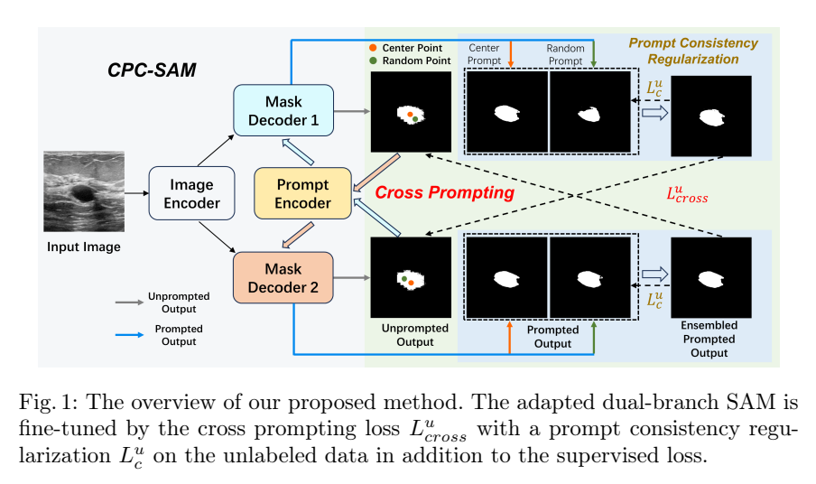
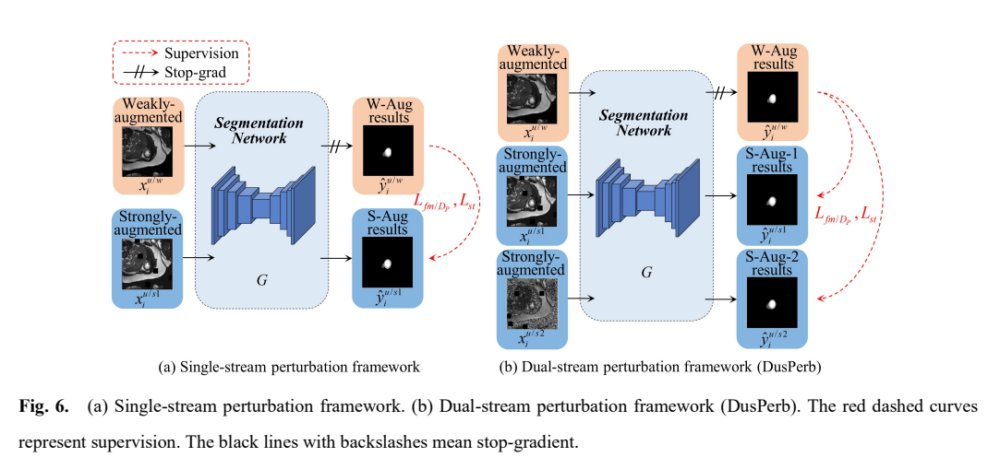

# arXiv 检索结果 / Results

## 1. Cross Prompting Consistency with Segment Anything Model for Semi-supervised Medical Image Segmentation
- Authors：Juzheng Miao, Cheng Chen, Keli Zhang, Jie Chuai, Quanzheng Li, Pheng-Ann Heng
- Venue：MICCAI 2024
- Comments：Accepted at MICCAI 2024
- First：2024-07-07T15:43:20+00:00；Latest：2024-07-07T15:43:20+00:00
- Abs：https://arxiv.org/abs/2407.05416v1
- PDF：https://arxiv.org/pdf/2407.05416v1
- Code：https://huggingface.co/huggingface, https://huggingface.co/docs/hub/spaces, https://github.com/JuzhengMiao/CPC-SAM
- 解读来源：PDF 全文，共 11 页，11 页可提取文字
### [中文]
**中文翻译**
- 标题：交叉提示一致性与Segment Anything模型用于半监督医学图像分割
- 摘要：半监督学习（SSL）在医学图像分割中取得了显著进展。为实现有效的SSL，模型需要能够高效地从有限的标注数据中学习，并有效利用大量未标注数据中的知识。视觉基础模型（如Segment Anything Model，SAM）的最新发展已展现出显著的适应性和更高的样本效率。为将基础模型的能力应用于SSL，我们提出了一种用于半监督医学图像分割的交叉提示一致性与Segment Anything模型方法（CPC-SAM）。我们的方法采用SAM独特的提示设计，并在双分支框架内创新性地提出交叉提示策略，以在两个解码器分支之间自动生成提示和监督，从而能够有效地从稀缺的标注数据和有价值的未标注数据中学习。我们进一步设计了一种新的提示一致性正则化，以降低提示位置敏感性，并增强不同提示下的输出不变性。我们在两个医学图像分割任务上验证了我们的方法。在不同标注数据比例和模态下的大量实验表明，我们提出的方法优于最先进的SSL方法，在乳腺癌分割任务上Dice提升超过9%。

论文提出CPC-SAM：在双分支SAM上做半监督医学图像分割。核心是用一个分支的无提示输出生成点提示去提示另一分支，并用提示输出反向监督无提示输出（交叉提示损失）；同时设计提示一致性正则，让中心点与随机点提示的输出趋于一致，以缓解SAM对提示位置敏感的问题。在BUSI（10/431标注）上DSC 71.20%，比最强基线高约9.3个百分点；在ACDC（1/70标注）上DSC 85.56%。消融显示交叉提示与PCR均有增益，但部分实验细节（如训练迭代数表述、部分图的具体数值）报告不充分。

## 1. 问题与动机

半监督医学图像分割（SSL）通常假设模型能从少量标注中快速学到可泛化的判别信息，并有效利用大量无标注数据。作者认为现有SSL方法主要聚焦后者（伪标签、一致性正则），而忽视了“从少量标注中快速学习”这一关键点[p. 2]。为此，作者引入在自然图像大规模预训练的SAM，利用其少样本迁移能力，并直接在半监督流程中微调SAM[p. 2–3]。

作者指出，已有将SAM用于医学SSL的工作（SamDSK、Li等、SemiSAM）多把SAM当作静态伪标签生成器，未针对医学域差距微调；Chen等虽将SAM微调纳入SSL循环，但只用少量标注微调，未充分利用无标注数据[p. 2]。本文试图同时解决两点：微调SAM以适应目标域，并利用SAM特有的提示机制从无标注数据中学习。

## 2. 方法

### 2.1 架构与问题设定

给定标注集 L={(x_i,y_i)} 与无标注集 U={x_i}，目标是训练一个可直接推理的分割模型。作者直接在半监督设定下微调SAM，并将其改造为双分支结构：共享图像编码器 E 与提示编码器 P，其上接两个结构相同但权重初始化不同的掩码解码器 D1、D2，以制造输出多样性[p. 3]。无显式提示时使用默认稠密提示嵌入（可学习并微调），推理时同样使用该默认提示进行自动分割[p. 4]。

### 2.2 交叉提示（Cross Prompting）

对无标注图像 x，分支D1在默认提示下输出无提示预测 p^u1 = D1(E(x), P(None))。从 p^u1 中取目标类别最大连通区域的中心点或随机点作为点提示 Pt2，送入D2得到提示输出 p̂^u2 = D2(E(x), P(Pt2))；对称地可得 p^u2 与 p̂^u1[p. 4]。

关键设计是用“另一分支的提示输出”监督“本分支的无提示输出”，以避免同分支自监督带来的确认偏差。交叉提示损失为对称的Dice+CE：
L_cross^u = ½[L_dice(p^u1, p̂^u2)+L_ce(p^u1, p̂^u2)] + ½[L_dice(p^u2, p̂^u1)+L_ce(p^u2, p̂^u1)]（式1）[p. 5]。

作者给出的直觉是：给定合适提示时SAM输出应比无提示输出更准确，因此提示输出可作为更可靠的伪标签；与直接互监督的CPS相比，提示相当于一次细化步骤[p. 5]。

### 2.3 提示一致性正则（PCR）

由于无标注场景下由粗掩码生成的点提示位置方差大，而SAM对提示位置敏感，作者希望增强输出对提示的不变性[p. 5]。具体做法：对无提示预测 p^u2 的每个语义类取最大连通域，分别选中心点与随机点，得到两个提示输出 p̂^u1,c 与 p̂^u1,r；以二者集成 p̂^u1 = ½(p̂^u1,r + p̂^u1,c) 作为更可靠引导，约束随机点输出向集成结果靠拢：
L_c^u = ½[L_dice(p̂^u1,r, p̂^u1)+L_ce(p̂^u1,r, p̂^u1)] + ½[L_dice(p̂^u2,r, p̂^u2)+L_ce(p̂^u2,r, p̂^u2)]（式2）[p. 5]。
集成结果同时作为式1中的监督信号；PCR只施加于随机点输出，因为中心点输出经验上更稳定[p. 5–6]。

### 2.4 总损失

标注数据上除无提示输出的监督外，还对四个提示输出（两分支的中心点与随机点）施加监督：L_s = L_ls(p^l1,y)+L_ls(p^l2,y)+L_ls,p(p^l1,c,y)+L_ls,p(p^l2,c,y)+L_ls,p(p^l1,r,y)+L_ls,p(p^l2,r,y)（式3），其中 L_ls=0.8L_dice+0.2L_ce（沿用SAMed），L_ls,p=0.5L_dice+0.5L_ce[p. 6]。总损失 L_total = L_s + λ1 L_cross^u + λ2 L_c^u，λ1=0.4、λ2=0.05[p. 6]。

图1（第4页）给出整体流程：双分支SAM在标注数据上受监督损失约束，在无标注数据上受交叉提示损失与PCR约束。需说明：本文仅依据图注与正文描述，未解析图像内容。

## 3. 贡献

作者主张的新颖点有三：(1) 在双分支SAM框架内提出交叉提示策略，自动生成提示并跨分支监督，从而同时利用少量标注与大量无标注数据；(2) 提出提示一致性正则，降低提示位置敏感性、增强输出不变性；(3) 在两个医学分割任务、不同标注比例与模态上验证优于SOTA，BUSI上Dice提升超过9%[p. 1, p. 3]。

我的解读：方法的新意主要在于把SAM的“提示”从推理接口转化为半监督训练中的伪标签细化与一致性约束工具；双分支+跨分支监督本身与CPS类方法同源，作者也明确与CPS对比[p. 5]。因此贡献更偏向机制组合与针对SAM提示敏感性的正则设计，而非全新的SSL范式。

## 4. 实验与结果

### 4.1 数据与设置

BUSI：647张乳腺超声图像（437良性、210恶性），按类别随机划分，训练/验证/测试为431/86/130[p. 6]。ACDC：200例 cine MRI（100名患者），三类结构（右心室腔、心肌、左心室腔），按患者划分70/10/20[p. 6]。

实现：PyTorch，NVIDIA A40；ViT_B版SAM；图像编码器每个Transformer块的query与value头加LoRA（r=4），提示编码器与两个解码器全参数训练；加载图像编码器与提示编码器预训练权重，两个解码器随机初始化；点提示嵌入数扩展到语义类别数；采用渐进上采样提高掩码解码器输出分辨率；输入512×512、归一化到[0,1]；数据增强为[-20°,20°]随机旋转与随机翻转；AdamW，10000 epochs（原文如此，未说明是迭代还是epoch，属可疑/未澄清表述），最大学习率0.001，warmup 5000次迭代，沿用SAMed的warmup与指数衰减；λ1=0.4、λ2=0.05；batch size BUSI为6、ACDC为12，各含一半标注数据[p. 6]。指标：DSC、JC、95HD、ASD；DSC/JC单位为%，HD95/ASD在BUSI为像素、ACDC为毫米[p. 6]。

### 4.2 对比结果

基线包括UAMT、CPS、URPC、MC-Net+、DCNet、BCP、UniMatch、SemiSAM，以及全监督U-Net、SAMed和零样本SAM-point[p. 7]。

BUSI 10/431标注：CPC-SAM DSC 71.20、JC 61.15、HD95 100.22、ASD 37.86；最强对比BCP为61.81 DSC，SAMed为65.09，SemiSAM仅43.43[p. 7]。作者称提升超过9.3% DSC。BUSI 20/431：CPC-SAM DSC 72.41，BCP 65.54，SAMed 67.28[p. 7]。

ACDC 1/70标注：CPC-SAM DSC 85.56、JC 75.74、HD95 9.19、ASD 2.84；UniMatch 84.47、BCP 68.39、SAMed 75.01[p. 7]。ACDC 3/70：CPC-SAM DSC 87.95、HD95 5.80、ASD 1.54；BCP 87.57、UniMatch 87.31[p. 7]。作者称在两个标注比例下均取得全部指标最优；并指出SemiSAM在ACDC上显著退化，可能因未微调难以分割环形心肌结构[p. 8]。

分支差异：ACDC 1标注患者上D1、D2与集成的DSC分别为85.59%、85.47%、85.56%，差异很小[p. 8]。

### 4.3 消融

表2（ACDC）[p. 8]：仅标注训练DSC 77.26；加入无标注+交叉提示（未说明是否用中心点）为80.20；再加中心点交叉提示为84.75；再加PCR为85.56（JC 75.74、HD95 9.19、ASD 2.84）。作者称引入无标注数据比仅标注提升超过2.9% DSC，PCR再提升0.81% DSC[p. 8]。

表3（ACDC）[p. 8]：中心点/随机点数0/2、1/1、1/5、1/10对应DSC 84.95、85.56、84.46、84.23；随机点增多性能下降，作者推测随机点可能落在真实目标外[p. 8]。

图3与图4（第8页）分别展示不同一致性约束与不同架构（单解码器SAM、两个独立SAM）的效果；正文仅称单分支结果较差，可能因自训练确认偏差更严重[p. 8–9]。图中具体数值在正文未完整给出，无法从文本辨认，故不引用。

## 5. 评估

支持的结论：在给定设置下，CPC-SAM在BUSI与ACDC的低标注比例上优于所列SSL基线，尤其BUSI 10标注时优势明显；消融支持交叉提示与PCR各自带来增益。

局限与缺失证据：(1) 仅在两个数据集、两种模态上验证，泛化性有限；(2) 训练“10000 epochs”表述不清，且未报告随机种子、重复实验方差，无法判断显著性；(3) 表2第一行与后续行的“SSL”勾选含义在文本中未完全解释，交叉提示是否始终使用中心点需结合表3理解；(4) 图3、图4的具体数值未在正文报告，无法核验；(5) 未报告推理耗时、显存或与SAMed的计算成本对比；(6) 作者未讨论失败案例或提示生成失败时的行为。

## 6. 复现要点

已报告：ViT_B SAM；LoRA仅用于图像编码器q/v头，r=4；提示编码器与双解码器全参训练；解码器随机初始化；点提示嵌入扩展到类别数；渐进上采样；512×512输入；旋转±20°与翻转；AdamW，lr=0.001，warmup 5000迭代，指数衰减；λ1=0.4、λ2=0.05；BUSI batch 6、ACDC batch 12（各半标注）；BUSI 431/86/130划分，ACDC 70/10/20患者划分；代码链接见摘要[p. 1, p. 6]。

未报告/需自行确定：总训练迭代数与“10000 epochs”的确切含义；LoRA的具体rank作用范围之外是否冻结其他参数；优化器其余超参（weight decay等）；随机点采样的具体分布与每类点数；连通域后处理阈值；验证集模型选择准则；硬件以外的时间成本；多次运行的均值与方差。

#### 原论文流程图 · Figure 1 · PDF 第 4 页

Fig.1: The overview of our proposed method. The adapted dual-branch SAM is fine-tuned by the cross prompting loss Lu with a prompt consistency regu- cross larization Lu on the unlabeled data in addition to the supervised loss.

[原文来源](https://arxiv.org/pdf/2407.05416v1#page=4)

## 2. Leveraging Task-Specific Knowledge from LLM for Semi-Supervised 3D Medical Image Segmentation
- Authors：Suruchi Kumari, Aryan Das, Swalpa Kumar Roy, Indu Joshi, Pravendra Singh
- Comments：Under Review
- First：2024-07-06T14:23:16+00:00；Latest：2024-07-06T14:23:16+00:00
- Abs：https://arxiv.org/abs/2407.05088v1
- PDF：https://arxiv.org/pdf/2407.05088v1
- Code：https://huggingface.co/huggingface, https://huggingface.co/docs/hub/spaces
- 解读来源：PDF 全文，共 12 页，12 页可提取文字
### [中文]
**中文翻译**
- 标题：利用LLM的任务特定知识进行半监督3D医学图像分割
- 摘要：传统的监督式3D医学图像分割模型需要体素级标注，这需要巨大的人力、时间和成本。半监督学习（SSL）通过利用有限的标注样本和更大数量的未标注训练样本进行学习，解决了监督学习的这一局限。然而，最先进的SSL模型仍难以充分利用从未标注样本中学习的潜力。为促进从未标注数据中进行有效学习，我们提出了LLM-SegNet，它利用大型语言模型（LLM）将任务特定知识整合到我们的协同训练框架中。该知识有助于模型全面理解感兴趣区域（ROI）的特征，最终实现更高效的分割。此外，为进一步减少错误分割，我们提出了一种统一分割损失函数。该损失函数不仅优先关注模型在前景或背景像素预测上具有信心的区域，还有效处理模型预测置信度不高的区域，从而减少错误分割。在公开的Left Atrium、Pancreas-CT和Brats-19数据集上的实验表明，LLM-SegNet相比最先进方法具有更优性能。此外，我们进行了多项消融研究，以证明LLM-SegNet所利用的各模块和损失函数的有效性。

LLM-SegNet 将 ChatGPT-4 生成的器官描述文本经 BERT 与 MLP 编码为文本特征，与 V-Net/U-Net 编码器瓶颈处的图像特征相加，嵌入双模型协同训练框架；同时提出统一分割损失 USL，按伪标签置信度在 NLL 与 MSE 之间切换。在 LA、Pancreas-CT、BraTS-19 三个数据集上，5%/10%、10%/20%、10%/20% 标注比例下 Dice 均超过所比较的 SOTA，例如 LA 10% 标注 Dice 91.45、Pancreas 20% 标注 83.66、BraTS-19 10% 标注 85.95。消融显示文本特征权重 β 与 USL 均有贡献，但 LLM 文本生成细节、阈值 t1/t2 取值及部分训练细节未充分报告。

# LLM-SegNet 论文精读笔记

## 1. 问题与动机

论文针对半监督 3D 医学图像分割：体素级标注成本高，现有半监督方法虽利用少量标注加大量无标注数据，但仍难以充分挖掘无标注样本的潜力 [p. 1]。作者认为现有协同训练依赖两个视图的互补性，而视图构造困难；一致性正则方法对分布偏移敏感；自训练易累积自身偏差 [p. 2–3]。另一方面，LLM 具备医学知识与语言推理能力，但已有 LLM 医学影像工作多依赖视觉-语言预训练，且 3D 图像-文本配对数据稀缺；若把 3D 图像切片逐张送入 LLM 生成文本，训练与测试开销大且高度依赖 LLM 推理 [p. 1]。因此作者提出：不让 LLM 看图像，而是直接用 LLM 生成任务相关的文本描述，将其作为先验注入 CNN 协同训练框架，并设计统一分割损失以更好利用无标注数据 [p. 2]。

## 2. 方法

### 2.1 总体框架

输入 3D 体积 X∈R^{W×H×L}，目标是预测逐体素类别图，K 为类别数；X_ann 为有标注集，X_unann 为无标注集 [p. 3]。LLM-SegNet 采用两个同架构网络 Model A（参数 α）与 Model B（参数 β）协同训练，优化目标为 α*,β* = argmin_{α,β}{L_s(X_ann;α,β)+L_u(X_unann;α,β)} [p. 3, 式(1)]。

每个 batch 含相同数量的标注与无标注图像；输入加均匀噪声 η∼U(−0.2,0.2)，得到预测 ŷ_α=f_α(x+η)、ŷ_β=f_β(x+η) [p. 3, 式(2)]。为增加两模型多样性，对无标注图像施加 CutMix：Model A 看原图，Model B 看 CutMix 图；为保证无监督损失一致性，Model A 的伪标签也做相同 CutMix 变换 [p. 3–4]。

有监督损失 L_s 为两模型各自与真值的 Dice 与交叉熵之和 [p. 3, 式(3)]。无监督损失 L_u 为双向伪标签损失：L_u=Σ_{x∈X_unann}[USL(ŷ_α,ỹ_β)+USL(ŷ_β,ỹ_α)] [p. 4, 式(5)]。伪标签 ỹ_α 在 MSE 情形取 softmax(ŷ_α)，否则取 argmax(ŷ_α) [p. 4, 式(4)]。

### 2.2 LLM 任务知识注入

作者用 ChatGPT-4 针对具体数据集生成描述性文本 t，提示词要求生成 15 条、每条至少 60 词的关键特征，覆盖器官形状、结构、前景/背景、解剖标志、强度特征与周围结构等；表 1 给出 LA 与 Pancreas 的示例回答 [p. 4–5, 表 1]。文本经 BERT tokenizer 得到词嵌入，再经 MLP 得到文本特征 z=MLP(BERT(t))，并调整尺寸以匹配图像特征 [p. 4–5, 式(6)]。

融合方式为在编码器瓶颈处将文本特征加到图像特征上：M(x)=D(E(x)+β*·z)，其中 E、D 为编码器与解码器，β 为平衡图像与文本特征的参数 [p. 5, 式(7)]。图 1 展示从提示词到 LLM 文本、BERT tokenizer 与词嵌入的流程 [p. 2, 图 1]；图 2 展示整体框架，包括有监督损失、USL 以及文本与图像特征联合训练 [p. 4, 图 2]。

### 2.3 统一分割损失 USL

作者指出 NLL 对错误分类惩罚重、倾向自信判别，MSE 对标签噪声较不敏感 [p. 5]。USL 对 Model A 定义为：USL(ŷ_α,ỹ_β)=I(ŷ'_β>t1)·NLL(ŷ'_α,ỹ_β)+I(ŷ'_β<t2)·NLL(1−ŷ'_α,1−ỹ_β)+I(t2<ŷ'_β<t1)·MSE(ŷ_α,ỹ_β) [p. 5, 式(8)]。其中 ŷ'_α=φ(ŷ_α)、ŷ'_β=φ(ŷ_β) 为 softmax 输出；指示函数 I 在伪标签最大概率超过 t1 时取 max(ŷ'_β)，低于 t2 时取 1−min(ŷ'_β)，处于中间区间时取 1，否则取 0 [p. 5, 式(9)–(11)]。t1、t2 为经验设定的阈值，但正文未给出具体数值 [p. 5]。

## 3. 贡献

作者主张的贡献有两点：(1) 首次在简单协同训练框架中利用 LLM 生成的任务特定知识提升半监督 3D 医学图像分割，且因不向 LLM 输入图像，训练与测试均不受 LLM 推理瓶颈限制，文本知识在训练和测试阶段都可使用 [p. 2]；(2) 提出 USL，兼顾高置信区域与低置信区域 [p. 2, p. 5]。

我的解读：核心新颖性在于“离线生成文本先验 + 瓶颈特征相加”这一轻量融合方式，而非新的网络结构；USL 本质是按伪标签置信度在 NLL 与 MSE 间做门控组合。论文未与视觉-语言预训练方法做直接实验比较，因此“不受 LLM 推理瓶颈限制”的效率优势属于设计论证，缺少运行时或参数量证据 [p. 2]。

## 4. 实验与结果

### 4.1 数据与设置

LA 数据集：100 例 3D 钆增强 MR，按先前工作划分为 80 训练/20 验证；训练随机取 112×112×80 体素 patch，测试滑窗步长 18×18×4；标注比例 5% 与 10% [p. 5–6]。Pancreas-CT：82 例腹部增强 CT，62 训练/20 评估；训练 patch 96×96×96，测试滑窗步长 16×16×16；标注比例 10% 与 20% [p. 6]。BraTS-2019：335 例胶质瘤 MRI，四模态；250 训练/25 验证/60 测试；训练 patch 96×96×96，测试滑窗步长 64×64×64；标注比例 10% 与 20% [p. 6]。

实现：单张 NVIDIA A5000，固定随机种子；LA 与 Pancreas 用 V-Net，BraTS-19 用 U-Net；SGD，LA/BraTS 初始学习率 5×10^{-2}、动量 0.9、权重衰减 10^{-4}，Pancreas 初始学习率 2.5×10^{-2}、动量 0.9、权重衰减 10^{-4} [p. 6–7]。评价指标为 Dice、Jaccard、95HD、ASD，前两者区域型、后两者边界型 [p. 7]。

### 4.2 主要结果

LA（表 2）：5% 标注（4 例标注/76 例无标注）下，本文 Dice 88.63、Jaccard 79.53、95HD 7.62、ASD 2.07，较次优分别提升 0.61、0.81、降低 0.28、0.02；10% 标注（8/72）下 Dice 91.45、Jaccard 84.31、95HD 4.66、ASD 1.62，较次优提升 1.59、2.63、降低 2.15、0.12 [p. 6, 表 2]。对比方法包括 UA-MT、SASSNet、DTC、URPC、SS-Net、BCP、ACTION++、DMD、MLRPL 等 [p. 6]。

Pancreas（表 3）：10% 标注（6/56）下 Dice 77.36、Jaccard 63.65、95HD 7.13、ASD 1.58，较次优提升 1.43、0.95、降低 1.94；20% 标注（12/50）下 Dice 83.66、Jaccard 72.14、95HD 4.66、ASD 1.27，较次优提升 2.13、2.79、降低 2.15、0.06 [p. 7, 表 3]。

BraTS-19（表 4）：10% 标注（25/225）下 Dice 85.95、Jaccard 76.71、95HD 7.62、ASD 1.74，较次优提升 1.66、1.97、降低 1.95、0.19；20% 标注（50/200）下 Dice 86.69、Jaccard 77.57、95HD 6.83、ASD 1.71，较次优提升 1.22、1.25、降低 0.93、0.29 [p. 8, 表 4]。定性结果见图 3（LA 10%）、图 4（Pancreas 20%）、图 5（BraTS-19 10%）[p. 6–8]。

### 4.3 消融

β 的影响（表 5）：Pancreas 20% 标注下 β=1 时 Dice 83.66、Jaccard 72.14、95HD 4.66、ASD 1.27；β=0.1 时 83.11/71.32/9.37/2.48；β=0.001 时 90.49/82.73/5.93/1.94（该行数值在文本中排列较乱，需谨慎解读）；β=2 时 83.70/72.16/7.54/2.18。LA 10% 标注下 β=0.01 时 90.88/83.37/5.03/1.72，β=0.1 时 91.45/84.31/4.66/1.62，β=0.18 时 83.11/71.32/9.37/2.48（表 5 排版错位，部分数值对应关系无法可靠辨认）[p. 9, 表 5]。作者据此为 Pancreas 选 β=1，BraTS-19 也取 β=1 [p. 8–9]。

文本 vs 视觉响应：图 6 显示直接让 ChatGPT-4 对 2D 切片生成二值掩码效果差，而本文方法重叠率更高，用以论证应使用文本知识而非 LLM 直接分割 [p. 9, 图 6]。

有监督损失（表 6，Pancreas 20%）：CE 83.08/71.34/5.22/1.64，DICE 82.30/70.23/5.89/1.71，CE+DICE 83.66/72.14/4.66/1.27，说明两者结合最佳 [p. 9, 表 6]。

无监督损失（表 7，Pancreas 12:50 设置）：MSE 80.16/67.32/8.93/2.31，NLL 83.33/71.62/10.26/3.59，USL 83.66/72.14/4.66/1.27；作者称 USL 在四项指标上优于 NLL，Dice/Jaccard 提升较小，但 95HD 与 ASD 显著下降，说明边界更准 [p. 9–10, 表 7]。

## 5. 评估

支持的结论：在三个公开数据集、两种标注预算下，LLM-SegNet 的 Dice/Jaccard 均高于表中对比方法，边界指标总体也更低；消融支持文本特征与 USL 各自有贡献 [p. 6–10]。

局限与缺失证据：(1) 未报告 t1、t2 的具体取值及敏感性分析 [p. 5]；(2) LLM 文本生成的具体温度、重复次数、是否人工筛选未说明，表 1 仅给示例 [p. 4–5]；(3) β 消融表 5 排版混乱，部分数值与条件对应不清，且 Pancreas 上 β=0.001 的异常高值未被作者解释 [p. 9]；(4) 未与视觉-语言预训练方法或“LLM 直接分割”做定量比较，图 6 仅为定性示例 [p. 9]；(5) 未报告参数量、训练时长、LLM 调用成本等效率证据 [p. 2]；(6) 表 2–4 中部分基线（如 ACTION++ 的 Jaccard/95HD 标为 NA）不完整，跨方法比较需谨慎 [p. 6–8]。

## 6. 复现要点

已报告：三个数据集的划分、patch 尺寸、滑窗步长、标注比例、骨干网络（V-Net/U-Net）、优化器与学习率/动量/权重衰减、单卡 A5000、固定种子、β 取值（Pancreas 与 BraTS-19 为 1，LA 为 0.1）、有监督损失为 CE+Dice、无监督损失为 USL [p. 5–9]。

未报告或无法辨认：USL 阈值 t1/t2 数值；LLM 提示词之外的生成参数与文本筛选流程；BERT 与 MLP 的具体结构、文本特征维度；β 在 LA 上是否还有更细扫描；训练迭代次数/早停策略；CutMix 的具体比例参数；表 5 部分数值的对应关系 [p. 4–9]。复现时应先固定上述已报告设置，再对 t1/t2 与 CutMix 参数做敏感性实验，并明确记录 LLM 文本生成配置。

本篇未找到可可靠提取的方法流程图，请查看原文 PDF。

## 3. Semi-Supervised Segmentation via Embedding Matching
- Authors：Weiyi Xie, Nathalie Willems, Nikolas Lessmann, Tom Gibbons, Daniele De Massari
- Comments：13 pages, MIDL2024 oral
- First：2024-07-05T16:49:21+00:00；Latest：2024-07-05T16:49:21+00:00
- Abs：https://arxiv.org/abs/2407.04638v1
- PDF：https://arxiv.org/pdf/2407.04638v1
- Code：https://huggingface.co/huggingface, https://huggingface.co/docs/hub/spaces
- 解读来源：PDF 全文，共 13 页，13 页可提取文字
### [中文]
**中文翻译**
- 标题：基于嵌入匹配的半监督分割
- 摘要：深度卷积神经网络广泛应用于医学图像分割，但训练需要大量标注图像。标注三维医学图像耗时且成本高昂。为克服这一限制，我们提出一种新颖的半监督分割方法，在训练中主要利用未标注图像和少量标注图像。我们的方法通过评估预测不确定性，从教师模型对未标注体素的预测中识别可靠预测。这些体素作为伪标签用于训练学生模型。在教师模型产生不可靠预测的体素处，利用标注图像中的参考体素，基于体素级嵌入对应关系进行伪标签生成。我们将该方法应用于CT图像中的髋骨自动分割，仅用4例CT扫描即取得显著效果。所提方法获得95百分位Hausdorff距离（HD95）为3.30、IoU为0.929，超越了现有方法的最佳HD95（4.07）和IoU（0.927）。

该论文提出一种基于嵌入匹配的半监督分割方法：在不确定性感知的均值教师框架下，对教师模型高置信体素使用伪标签，对低置信（高不确定性）体素则通过学生嵌入与标注图像中目标/背景参考体素嵌入的最近邻相似度进行标签传播，并加入熵最小化以增强嵌入空间可分性。在950例髋部CT数据上，仅用50个标注3D patch训练时，方法达到IoU 0.929、HD95 3.30 mm，优于DTC（0.927、4.07 mm）等半监督方法；但全监督上限为IoU 0.948、HD95 1.92 mm，且定性结果显示金属伪影和局部解剖变异仍会造成错误。

# 论文阅读笔记：Semi-Supervised Segmentation via Embedding Matching

## 1. 问题与动机

论文针对三维医学图像分割中标注成本高的问题，提出半监督分割框架，使用少量标注图像和大量未标注图像训练。作者以髋骨（骨盆与股骨头）CT分割为应用场景，指出人工标注三维CT耗时且昂贵 [p. 1]。

现有半监督方法主要有两类：一致性训练和伪标签。作者认为，基于不确定性或置信度筛选伪标签的做法会丢弃不可靠预测体素，造成信息损失；而这些高不确定性体素往往位于目标边界等关键区域 [p. 2]。因此，论文的目标是：不仅利用可靠预测，还为不可靠预测体素生成伪标签，从而覆盖未标注图像的全部区域 [p. 2, p. 8]。

## 2. 方法

### 2.1 总体框架

框架建立在不确定性感知均值教师（UAMT）之上，使用两个结构相同的3D U-Net作为学生和教师网络；为适应计算预算，卷积滤波器数量比原始3D U-Net减半。学生网络用随机梯度下降训练，教师网络通过学生权重的滑动平均更新 [p. 2]。每个训练批次随机采样相同数量的标注和未标注图像 [p. 3]。

标注图像上的损失为交叉熵与Dice损失组合；未标注图像上的半监督损失由教师伪标签监督。各损失项权重通过高斯ramp-up函数逐步增加：

ramp_up(T,s)=s·exp[−5.0(1.0−T/T_N)^2]  (1)

其中s为损失项成熟时的缩放因子，T为当前迭代，T_N为总迭代数 [p. 3]。

### 2.2 基于不确定性分析的伪标签

教师模型在随机dropout和高斯输入噪声下进行M次随机前向传播，计算每个体素的预测熵，并对M次结果取平均，得到密集不确定性图H_x^t [p. 3]。伪标签取教师softmax概率的argmax：ŷ_t=argmax_c p_t(y=c|x) [p. 4]。

当前迭代的熵阈值按λ_T=[0.75+ramp_up(T,0.25)]·ln(2)计算 [p. 4]。不确定性分析损失L_UA为仅在H_x^t<λ_T的体素上计算的BCE损失，并用指示函数1(·)屏蔽不可靠预测 [p. 4]。学生输入加入比教师更强的随机噪声，遵循weak-strong一致性训练 [p. 4]。

### 2.3 最近邻伪标签

针对高不确定性体素，作者提出基于体素级嵌入对应的标签传播。具体流程如下 [p. 4–5]：

1. 对标注图像(x_L,y)，利用真实分割y找到目标表面，随机选取k个体素组成目标体素集和背景体素集，分别靠近表面内侧和外侧。
2. 使用教师网络输出层1×1×1卷积之前的密集特征图，得到目标嵌入f_t^{L+}∈R^{C×k}和背景嵌入f_t^{L−}∈R^{C×k}，C为嵌入维度。
3. 对学生网络在未标注图像上的嵌入f_s^U∈R^{C×H×W×D}，计算其与两组参考嵌入的余弦相似度，并在k个参考嵌入上聚合，得到密集相似度图K(f_t^{L+},f_s^U)和K(f_t^{L−},f_s^U)。
4. 为降低离群点影响，重复l次，每次重新采样不同的k个体素，形成最近邻分类器集成；对l个密集相似度图取平均。
5. 若某体素嵌入与目标嵌入的相似度高于与背景嵌入的相似度，则伪标签为目标类，即ŷ_nn=1[K(f_t^{L+},f_s^U)>K(f_t^{L−},f_s^U)]。

最近邻匹配损失L_NN仅在H_x^t≥λ_T的体素上计算BCE，即教师预测不可靠的区域。ŷ_nn的计算被切断梯度，避免学生模型同时参与反向传播和伪标签生成 [p. 5]。

### 2.4 最近邻分类器的熵最小化

由于目标表面附近标注可能不一致、体素强度模糊，嵌入空间中的特征可能混杂，导致相似度图难以区分。作者加入熵最小化损失：

L_EN=−(p_⊕ log p_⊕ + p_⊖ log p_⊖)

p_⊕=e^{K(f_t^{L+},f_s^U)}/(e^{K(f_t^{L+},f_s^U)}+e^{K(f_t^{L−},f_s^U)})，p_⊖=1−p_⊕  (4)

该损失等价于对通道拼接后的两个相似度图做softmax，最小化最近邻分类器的预测熵，从而最大化分类决策边界间隔 [p. 5]。

### 2.5 总损失

总损失L=L_S+L_U，其中L_U=w_UA·L_UA+w_PS·(L_NN+L_EN)。w_UA按ramp_up(T,0.25)变化，w_PS按ramp_up(T,0.125)变化，最终权重分别为0.25和0.125 [p. 5]。

## 3. 贡献

作者声称的贡献有两点：一是引入通过嵌入对应进行标签传播的新方案；二是提出端到端半监督分割框架，可对未标注图像所有区域进行伪标签 [p. 2]。

我的理解是：方法的核心增量在于用嵌入空间最近邻分类器替代“丢弃高不确定性体素”的策略，并用熵最小化改善嵌入可分性；整体框架仍明显依赖UAMT的均值教师和不确定性估计，属于对现有伪标签流程的扩展而非全新范式。

## 4. 实验与结果

### 4.1 数据与划分

数据来自950名接受机器人辅助全髋关节置换术的受试者，术前CT由两名专家标注：标注者1生成初始分割，标注者2审核并可能修改，形成最终真值 [p. 12]。扫描随机划分为350例训练、100例验证、500例测试 [p. 6, p. 12]。

图像预处理为各向同性1 mm间距，强度按3D patch统计的均值和标准差归一化。训练集采样6266个3D patch，验证集1174个，测试集1200个；测试patch来自同一受试者且重叠和随机性最小 [p. 6]。测试集从6个表面偏差评分（SDS）组各采样200个patch，SDS基于手工分割与统计形状模型分割之间的HD95，用于反映解剖变异和分割难度 [p. 12–13]。

半监督训练将训练集分为5个子集：50、150、300、1000、2500个标注patch，分别来自4、10、21、71、180例CT；其余patch作为未标注数据。例如Subset 50有50个标注patch，其余6216个patch无参考分割参与半监督训练 [p. 6]。

### 4.2 训练设置与基线

所有对比模型均使用同一3D U-Net，除输出层外所有卷积层Dropout率为0.15。基线为仅用各子集标注图像全监督训练的单个3D U-Net [p. 7]。优化器为Adam，初始学习率10^-4，β1=0.9，β2=0.99；He初始化；教师滑动平均衰减0.99。最近邻分类k=16，集成分类器数l=5，不确定性分析前向传播次数M=5。所有模型训练40个epoch，以验证集最低Hausdorff表面距离选择模型。教师输入高斯噪声尺度0.01，学生输入0.02 [p. 7]。

对比方法包括MT、UAMT、CCT、MTC、DTC；使用Wilcoxon符号秩检验判断差异显著性（p<0.05）[p. 7]。

### 4.3 主要结果

表1报告IoU和HD95（mm）。在50个标注patch条件下，提出方法IoU 0.929、HD95 3.30；全监督基线IoU 0.894、HD95 9.45；次优半监督方法DTC为IoU 0.927、HD95 4.07 [p. 6–7]。在150、300、1000、2500个标注patch下，提出方法IoU分别为0.931、0.939、0.947、0.947，HD95分别为2.99、2.45、1.95、1.94 [p. 6]。使用全部6266个标注patch的全监督方法达到IoU 0.948、HD95 1.92 [p. 7]。

作者称提出方法在各子集整体分割性能上优于其他方法 [p. 7]。需要注意，表1中部分方法在6266条件下的单元格为“-”，即未报告 [p. 6]。

### 4.4 消融实验

附录A在50个标注图像条件下消融损失项，L_UA始终保留。结果：仅L_UA时IoU 0.918、HD95 6.39；加L_NN后0.925、3.94；加L_NN和L_EN后0.929、3.30；加L_EN但不加L_NN时0.927、3.56 [p. 11]。作者据此认为L_EN和L_NN均显著提升性能，L_EN单独作用更明显，可优化嵌入空间分离 [p. 11]。

附录B测试相似度核与聚合算子。均值+余弦取得最佳HD95 3.30、IoU 0.929；均值+欧氏为IoU 0.930、HD95 3.73；最大+欧氏为0.930、3.67；最大+余弦为0.927、3.63 [p. 12]。作者称各组合IoU差异不显著，但HD95在最大+余弦时显著更低；并称所有结果在表面距离上显著优于表1的SOTA方法 [p. 11]。

### 4.5 定性结果

图2展示50、150、300、1000、2500个标注patch训练结果与真值、全监督基线的比较。作者观察到，仅用50和150个标注patch时，分割结果可能偏离参考标准，尤其在金属伪影等分布外样本中；方法会忽略金属植入物造成的暗扇形伪影，因为此类样本在数据中少见、标注样本包含伪影的概率小 [p. 7–8]。使用≤300个标注样本时，方法可能无法捕捉解剖和病理变异，表现为第3行病例中髋臼与股骨头间隙的过度分割；使用1000及以上标注图像时这些区域明显改善 [p. 7–8]。

## 5. 评估

支持的结论：在作者设定的髋骨CT分割任务和50–2500个标注patch预算下，嵌入匹配伪标签与熵最小化确实改善了IoU和HD95，尤其50 patch时HD95从基线9.45降至3.30、从DTC的4.07降至3.30 [p. 6–7]。消融实验支持L_NN和L_EN各自及组合带来增益 [p. 11]。

作者报告的局限：方法仍需足够标注量以覆盖解剖/病理变异和成像伪影；与全监督方法仍有明显性能差距 [p. 8]。定性结果显示金属伪影和局部解剖结构仍存在一致错误 [p. 7–8]。

缺失证据：论文未报告推理时间、计算开销、超参数敏感性之外的嵌入维度C具体取值、k和l的进一步消融、不同随机种子方差、跨中心/跨设备外部验证；表1中部分基线在6266条件下的结果缺失 [p. 6]。此外，方法依赖教师嵌入质量，但未系统分析教师错误传播的影响。

## 6. 复现

已报告的可复现设置：3D U-Net（滤波器数减半）、Dropout 0.15（输出层除外）、Adam（lr=10^-4，β1=0.9，β2=0.99）、He初始化、教师滑动平均衰减0.99、40 epochs、k=16、l=5、M=5、教师噪声0.01、学生噪声0.02、损失权重w_UA=0.25、w_PS=0.125、熵阈值λ_T=[0.75+ramp_up(T,0.25)]·ln(2)、相似度核余弦、聚合算子均值 [p. 2–7, p. 11–12]。

未报告或无法从正文确认：3D patch的具体空间尺寸、批大小、嵌入维度C、数据增强细节、测试集评估是否按受试者级别聚合、训练总迭代数T_N与epoch的换算、硬件环境、代码/模型是否公开。复现时需将这些标为未报告信息，不能自行假设。

本篇未找到可可靠提取的方法流程图，请查看原文 PDF。

## 4. AstMatch: Adversarial Self-training Consistency Framework for Semi-Supervised Medical Image Segmentation
- Authors：Guanghao Zhu, Jing Zhang, Juanxiu Liu, Xiaohui Du, Ruqian Hao, Yong Liu, Lin Liu
- First：2024-06-28T04:38:12+00:00；Latest：2024-06-28T04:38:12+00:00
- Abs：https://arxiv.org/abs/2406.19649v1
- PDF：https://arxiv.org/pdf/2406.19649v1
- Code：https://github.com/GuanghaoZhu663/AstMatch, https://huggingface.co/huggingface, https://huggingface.co/docs/hub/spaces
- 解读来源：PDF 全文，共 34 页，34 页可提取文字
### [中文]
**中文翻译**
- 标题：AstMatch：用于半监督医学图像分割的对抗自训练一致性框架
- 摘要：半监督学习（SSL）在医学图像分割中已展现出相当大的潜力，主要利用一致性正则化和伪标签。然而，许多SSL方法只关注低层次一致性，而忽视了伪标签可靠性的重要性。因此，在本工作中，我们提出了一种对抗自训练一致性框架（AstMatch）。首先，我们设计了一种对抗一致性正则化（ACR）方法，以增强知识迁移并在不同扰动强度下加强预测一致性。其次，我们应用特征匹配损失进行对抗训练，以纳入高层次一致性正则化。此外，我们提出了金字塔通道注意力（PCA）和高效通道与空间注意力（ECSA）模块，以提高判别器的性能。最后，我们提出了一种自适应自训练（AST）方法，以确保伪标签的质量。所提出的AstMatch已在三个公开数据集上与前沿SSL方法进行了广泛评估。在不同标注比例下的实验结果表明，AstMatch优于其他现有方法，达到了新的最先进性能。我们的代码将发布于 https://github.com/GuanghaoZhu663/AstMatch。

AstMatch 在 FixMatch 弱-强一致性框架上引入两个判别器：分割判别器 DS 用判别器分数替代固定置信阈值筛选伪标签，扰动判别器 DP 约束同一无标签图像在弱/强扰动下的预测一致性；并用特征匹配损失稳定对抗训练，ECSA/PCA 增强判别器。自适应自训练 AST 将高置信伪标签直接自训练，低置信伪标签经双向 CutMix 与有标签数据混合后使用。在 ACDC、LA、Pancreas-NIH 三个数据集、5%/10% 或 10%/20% 标注比例下，报告指标优于所列 SSL 基线；消融显示 ACR 与 st/low 贡献较大，但部分数据集上 ACR 单独使用反而降低 95HD/ASD，且缺少参数量、训练时间与统计显著性报告。

# AstMatch 论文精读笔记

## 1. 问题与动机

论文针对半监督医学图像分割（SSMIS）。作者指出，一致性正则与伪标签是两类主流 SSL 手段，但二者相互制约：增强扰动可制造预测分歧，却会提高伪标签不确定性；而 FixMatch 式方法只用弱增强预测的固定置信阈值筛选伪标签，未考虑训练状态变化，且多数方法只做像素级低层一致性，忽略高层一致性 [p. 2][p. 6-7]。作者还批评 MC Dropout 需多次前向、训练耗时 [p. 6]。因此目标是：在统一网络中同时提高预测分歧与伪标签质量，并兼顾高层一致性。

## 2. 方法

### 2.1 总体框架

AstMatch 由一个分割网络 G 和两个结构相同的判别器 DS、DP 组成 [p. 6]。训练集含 N 个有标签样本与 M 个无标签样本，类别数为 K [p. 6]。

### 2.2 对抗一致性正则 ACR

先对有标签数据 (x_l, y_l) 和无标签图像 x_u 做几何弱增强（随机旋转、翻转、裁剪），得到 x_l^w、x_u^w；再对 x_u^w 独立施加两组 RandAugment 与 Cutout，得到双流强增强 x_u^s1、x_u^s2 [p. 7]。四个输入送入 G，得到对应预测。有标签监督损失为交叉熵与 Dice 之和：L_S = (1/N)Σ[L_CE(y_l^w, ŷ_l^w)+L_Dice(y_l^w, ŷ_l^w)]/2 [p. 7, 式(1)]。

DS 的输入是“图像与 softmax 预测沿通道拼接”：有标签对 (ŷ_l^w © x_l^w) 标为 1，无标签弱增强对 (ŷ_u^w © x_u^w) 标为 0；DP 则把无标签弱增强预测标为 1，两个强增强预测标为 0，从而判别同一图像在不同扰动强度下的预测差异 [p. 7-8, 式(2)(3)]。G 与判别器交替训练：当 DS 无法区分预测与真值、DP 无法区分弱/强预测时，说明 G 的分割质量与扰动一致性较好 [p. 8]。

### 2.3 特征匹配损失与判别器结构

为稳定 GAN 训练并引入高层一致性，作者加入两个特征匹配损失 L_fm/DS 与 L_fm/DP，用判别器第 k 层中间特征的 MAE 衡量差异：前者比较无标签预测与有标签真值特征，后者比较弱增强与两个强增强预测的特征 [p. 8, 式(4)(5)]。关键设计是 FM 损失只用于优化 G，判别器仅作特征提取器，不最大化该损失 [p. 9]。

判别器中引入 ECSA 与 PCA。ECSA 由改进 ECA 通道注意力和空间注意力组成：通道分支对全局平均池化与最大池化结果做核大小为 k 的 1D 卷积，k 由通道数自适应确定；空间分支对通道维最大/平均池化结果拼接后做 7×7×7 3D 卷积 [p. 9-10, 式(6)-(10), Fig. 2(a), p. 9]。PCA 在 PPM 的 1×1×1、2×2×2、3×3×3、4×4×4 四个层级后接 3D 卷积降维至 1/4，并在每层后加改进 ECA；作者明确不在 PCA 中用空间注意力，因为池化后空间尺寸过小，强调局部区域可能丢失关键特征 [p. 11, Fig. 2(b), p. 9]。

### 2.4 自适应自训练 AST

以 DS 输出分数作为预测质量置信度（预测应为 0、真值应为 1）。高于阈值 γ 的高质量预测直接生成伪标签并做自训练，损失 L_st/high 同时监督两个强增强预测 [p. 11-12, 式(11)]。低于阈值的不丢弃，而是按 BCP 思路构造零中心掩码 M，做双向 CutMix：有标签弱增强图像与无标签强增强图像互相混合，监督信号也由伪标签与真值双向混合得到；伪标签先取 argmax 并保留最大连通分量以去除离群体素 [p. 12-13, 式(12)-(15)]。最终 G 的总损失为 L_G = L_S + L_fm/DS + L_fm/DP + λ_st(L_st/high + L_st/low)，λ_fm 与 λ_st 为权重 [p. 13, 式(16)]。

## 3. 贡献

作者声称的贡献有三点：用两个判别器实现 ACR，分别负责伪标签筛选与弱/强扰动一致性；引入 FM 损失及 ECSA/PCA 增强判别器；提出 AST 分别处理高、低质量伪标签 [p. 2-3]。我的理解是：核心新颖性更多在“用判别器分数替代 FixMatch 固定阈值”以及“低置信样本经双向 CutMix 后仍参与训练”的组合；双判别器与 ASE-Net 的思路相近，论文也引用了 ASE-Net [p. 4]，但未与其直接实验比较。作者强调 AstMatch 不向分割网络添加新模块，因而可作为强基线 [p. 3]。

## 4. 实验与结果

### 4.1 数据与设置

ACDC：100 例 cine MR，3 类（RV、Myo、LV），2D U-Net，70/10/20 划分训练/验证/测试，输入 256×256，5%（3 例）与 10%（7 例）标注 [p. 13]。LA：100 例 3D 钆增强 MR，3D V-Net，80 训练/20 验证，输入 112×112×80，5%（4 例）与 10%（8 例）标注 [p. 14]。Pancreas-NIH：82 例腹部 CT，3D V-Net，输入 96×96×96，10%（6 例）与 20%（12 例）标注 [p. 14]。

训练在单张 RTX 4090 上；分割网络用 SGD，基础学习率 0.05、动量 0.9、权重衰减 5e-4；判别器用 Adam，学习率 1e-4、betas (0.9, 0.99)；poly 学习率策略；λ_fm=0.1、λ_st=1.0、γ=0.6；ACDC 训练 30k 迭代、batch 24、β2=0.3；LA 与 Pancreas 训练 15k、batch 8、β3=0.3；每批含有标签与无标签数据等量 [p. 15]。指标为 DSC、JA、95HD、ASD [p. 15]。

### 4.2 主要比较结果

ACDC 5% 标注：AstMatch DSC 89.12%、JA 81.00%、95HD 1.68 mm、ASD 0.52 mm；第二名 BCP 为 87.59%、78.67%、1.90 mm、0.67 mm。10% 标注：AstMatch 90.47%、83.15%、1.62 mm、0.49 mm，BCP 为 88.84%、80.62%、3.98 mm、1.17 mm [p. 16, Table 1]。作者称 10% 下与全监督 70 例 U-Net（DSC 91.66%、JA 84.94%、95HD 4.33 mm、ASD 0.90 mm）DSC/JA 可比且 95HD/ASD 更低 [p. 16-17]。

LA 5%：AstMatch 90.30%、82.38%、5.66 mm、1.76 mm；BCP 88.02%、78.72%、7.90 mm、2.15 mm。10%：AstMatch 91.09%、83.70%、6.02 mm、1.49 mm；BCP 89.62%、81.31%、6.81 mm、1.76 mm [p. 17, Table 2]。作者称 5% 下相对近期 SSL 方法提升超过 2.28% DSC、3.66% JA、2.24 mm 95HD、0.39 mm ASD [p. 18]。

Pancreas 10%：AstMatch 83.75%、72.27%、4.12 mm、1.37 mm；BCP 80.87%、68.16%、8.26 mm、2.63 mm。20%：AstMatch 83.81%、72.35%、6.64 mm、2.18 mm；BCP 82.91%、70.97%、6.43 mm、2.25 mm [p. 19, Table 3]。注意 20% 下 AstMatch 的 95HD 与 ASD 略差于 BCP，作者仍称 DSC/JA 超过全监督 62 例 V-Net（80.27%、67.35%）[p. 18-19]。

### 4.3 消融

ACDC 5%：基线 U-Net 52.33% DSC；仅 ACR 73.64%；ACR+st/high 75.13%；ACR+st/low 88.45%；三者全用 89.12% [p. 20, Table 4]。LA 5%：基线 39.27%；仅 ACR 79.62%；ACR+st/high 83.62%；ACR+st/low 89.36%；全用 90.30% [p. 20, Table 5]。Pancreas 10%：基线 60.00%；仅 ACR 62.65%，且 95HD 从 23.46 升至 25.23 mm、ASD 从 5.78 升至 8.97 mm；ACR+st/high 66.84%；ACR+st/low 82.41%；全用 83.75% [p. 21, Table 6]。这些结果支持 st/low 贡献最大，但也显示 ACR 单独在 Pancreas 上边界指标变差。

其他消融：DusPerb 在 ACDC 5% 下比单流提升 0.54% DSC、0.74% JA，降低 0.30 mm 95HD、0.12 mm ASD [p. 22, Table 7]。GAN 损失：仅 SGAN 79.74% DSC，SGAN+FM 81.25%，仅 FM 89.12% [p. 23, Table 8]。自训练策略：无 ST 73.64%，FixMatch ST 85.30%，AST 89.12% [p. 23, Table 9]。ECSA/PCA 在 LA 5% 上：无模块 87.27%，加 ECSA 88.11%，加 PCA 89.35%，两者 90.30% [p. 26, Table 11]。CutMix 方向：In 86.28%、Out 85.79%、双向 89.12% [p. 25, Table 10]。强增强：仅 RandAugment 82.41%，仅 Cutout 81.37%，两者 83.75% [p. 27, Table 12]。超参图显示 γ 在较宽范围 DSC 均高于 87.59%，β2 变化引起最大 0.68% DSC 差异 [p. 24, Fig. 7]。

## 5. 评估

支持的结论：在三个数据集、报告设置下，AstMatch 的 DSC/JA 一致高于所列基线；消融支持 AST 与双向 CutMix 的有效性，FM 损失对稳定训练有明显作用。需要注意：部分基线数字来自原论文而非同一复现（ACDC 的 MC-Net+、SS-Net、BCP；Pancreas 20% 的 CoraNet、BCP），比较公平性受限 [p. 15][p. 18]。作者未报告参数量、推理/训练时间、多次运行的均值方差或显著性检验；ACR 在 Pancreas 单独使用时边界指标下降，说明其收益依赖后续自训练。论文承认判别器未针对器官形状定制，也未在分割网络中引入 Transformer 等模块 [p. 28]。此外，Table 12 正文写“5% labeled ratio”，但表题与实验设置是 Pancreas 10%，存在不一致 [p. 27]。

## 6. 复现

已报告：三个数据集划分与标注比例、2D U-Net/3D V-Net、输入尺寸、优化器与学习率、poly 策略、λ_fm=0.1、λ_st=1.0、γ=0.6、ACDC 30k/batch 24/β2=0.3、LA 与 Pancreas 15k/batch 8/β3=0.3、每批有/无标签等量、单卡 RTX 4090 [p. 13-15]。未报告：判别器各层通道数与具体结构超参（仅 Fig. 2(c) 图示）、RandAugment/Cutout 的具体强度与概率、EMA 或 warm-up 是否存在、随机种子与重复次数、NMS 的具体参数、代码尚未发布（仅给出将公开的链接）[p. 1][p. 9][p. 17]。复现时应先按 Algorithm 1 实现 G 与两个判别器的交替更新，并注意 FM 损失只回传 G [p. 14]。

#### 原论文流程图 · Figure 6 · PDF 第 22 页

Fig. 6. (a) Single-stream perturbation framework. (b) Dual-stream perturbation framework (DusPerb). The red dashed curves represent supervision. The black lines with backslashes mean stop-gradient.

[原文来源](https://arxiv.org/pdf/2406.19649v1#page=22)

## 5. FRCNet Frequency and Region Consistency for Semi-supervised Medical Image Segmentation
- Authors：Along He, Tao Li, Yanlin Wu, Ke Zou, Huazhu Fu
- Venue：MICCAI 2024
- Comments：MICCAI 2024 Early Accept
- First：2024-05-26T13:51:27+00:00；Latest：2024-05-26T13:51:27+00:00
- Abs：https://arxiv.org/abs/2405.16573v1
- PDF：https://arxiv.org/pdf/2405.16573v1
- Code：https://huggingface.co/huggingface, https://huggingface.co/docs/hub/spaces
- 解读来源：PDF 全文，共 10 页，10 页可提取文字
### [中文]
**中文翻译**
- 标题：FRCNet频率与区域一致性用于半监督医学图像分割
- 摘要：有限的标注数据阻碍了深度学习在医学领域的应用。临床实践中存在大量未被有效利用的无标注数据，半监督学习（SSL）是利用这些无标注数据的一种有前景的方法。然而，现有的SSL方法忽略了频域和区域级信息，而这对位于低频且尺度变化显著的病灶区域十分重要。本文引入了两种用于半监督医学图像分割的一致性正则化策略，包括频域一致性（FDC）以辅助频域中的特征学习，以及多粒度区域相似性一致性（MRSC）以进行多尺度区域级局部上下文信息的特征学习。借助所提出的FDC和MRSC，我们能够以有效且高效的方式利用它们强大的特征表示能力。我们在两个数据集上进行了全面的实验，结果表明我们的方法取得了较大的性能提升，并超过了其他最先进的方法。

FRCNet在Mean Teacher框架上增加两个仅训练期使用的正则：频域一致性FDC（DCT分块、低/高频分别过Transformer后融合，MSE对齐师生频域特征）与多粒度区域相似性一致性MRSC（在{16,24,32}粒度上用线性插值得到区域特征并比较师生区域相似矩阵），另保留像素级MSE。SegFormer-B4骨干、512×512、90轮、AdamW、学习率0.0005、批大小10；在Kvasir-SEG与ISIC 2016的10%/20%标签设置下报告3次运行均值，10%时Dice为88.77%/90.77%，20%时为90.62%/92.44%，均优于所列SOTA。消融显示低频分量作用更大、线性插值最佳、MaxPool严重失败；推理时可移除FDC/MRSC。

## 1. 问题与动机

论文针对半监督医学图像分割：标注像素级数据昂贵，而未标注数据充足。作者认为现有SSL方法主要有两点不足：(1) 多在RGB域做一致性，忽略频域；作者称多数病灶强度平坦、属于低频信号，仅用RGB域难以显式利用频率信息 [p. 2]；(2) 多聚焦像素级一致性，缺少区域级语义一致性，难以应对尺度变化大的病灶 [p. 2]。因此提出频域一致性(FDC)与多粒度区域相似性一致性(MRSC)，并以Mean Teacher(MT)为基框架组成FRCNet [p. 2]。

## 2. 方法

**总体框架。** 训练集含M个有标注样本Dl={(xi,yi)}与N个无标注样本Du={xj}，N≫M [p. 2]。学生Fs含带adapter的Transformer编码器、解码器、分割头、MRS与FEM模块；教师Ft由EMA更新 [p. 3]。学生输出包括分割预测P、频域特征F、区域特征Z [p. 3]。有标注数据用交叉熵与Dice监督：Lsup=1/(2|Dl|)Σ[Lce(yi,Psi)+Ldice(yi,Psi)] [p. 3, 式(1)]。训练时只微调分割头、adapter、FEM与MRS参数以节省参数 [p. 3]。

**FDC。** 取Transformer编码器最后阶段的RGB特征X∈R^{h×w×d}，用DCT变换到频域，再切成p×p的patch，p=2，得到Fraw∈R^{(h/p)×(w/p)×c}，c=p·p·d [p. 3]。随后按通道拆成低频Fl与高频Fh（各c/2通道），分别送入两个独立Transformer块Φ1、Φ2，并加可学习位置嵌入Epos_l、Epos_h：F'l=Φ1(Fl+Epos_l)，F'h=Φ2(Fh+Epos_h) [p. 4, 式(2)]；再用第三个Transformer块Φ3沿通道拼接融合：F=Φ3([F'l,F'h]) [p. 4]。频域一致性损失为师生频域特征的MSE：Lfdc=(1/|Du|)Σ||Ftj−Fsj||_2^2 [p. 4, 式(3)]。FEM结构见Fig.1右侧 [p. 3]。

**MRSC。** 取解码器最后阶段输出作为区域特征Zt、Zs∈R^{h'×w'×c'} [p. 4]。经区域投影Ψg与展平Γ得到R=Γ(Ψg(Z))∈R^{g×g×c'}，每个元素对应原图一个局部区域；Ψg可用线性插值或池化实现，作者默认线性插值 [p. 4–5, 式(4)]。计算区域相似矩阵A=RR^T∈R^{g²×g²}，再最小化师生相似矩阵差异：Lmrsc=(1/|Du|)Σ_{xj}Σ_{g∈G}||Atj,g−Asj,g||_2^2 [p. 5, 式(5)]。默认粒度G={16,24,32} [p. 5]。另有像素级MSE：Lpix=(1/|Du|)Σ||Ptj−Psj||_2^2 [p. 5, 式(6)]。总损失L=Lsup+λ(Lfdc+Lmrsc+Lpix)，λ为时间相关的高斯升温函数 [p. 5, 式(7)]。

## 3. 贡献

作者主张：(1) 提出FDC与MRSC两种一致性正则，可从充足无标注数据学习以缓解标注不足；(2) 方法即插即用，可与其他SSL方法结合，且推理时FDC与MRSC可安全移除、降低推理复杂度；(3) 在两个数据集上大幅超过SOTA [p. 2]。我的解读：核心新颖点是把DCT频域分块+Transformer增强引入师生一致性，以及用区域相似矩阵替代纯像素一致性；但“即插即用”与“降低推理复杂度”在文中仅作声明，未给出与其他SSL框架组合的实验或推理耗时数据。

## 4. 实验与结果

**数据与设置。** Kvasir-SEG含1000张胃肠息肉图像，随机80%训练、20%测试 [p. 5]；ISIC 2016含900张训练、379张测试皮肤镜图像 [p. 5]。指标为像素准确率Acc、MAE、Dice、IoU [p. 5]。骨干为预训练SegFormer-B4，adapter为AdaptFormer；AdamW，weight decay 0.0001、momentum 0.9，训练90轮，学习率0.0005，图像与标签缩放至512×512，批大小10，单张RTX 3090、PyTorch [p. 5]。对比方法用相同骨干重实现，报告3次运行均值 [p. 6]。

**主要结果（Table 1）。** 10%标签：Kvasir-SEG上FRCNet为MAE 3.51、Acc 96.49、Dice 88.77、IoU 82.61，比第二名ST++（Dice 86.23、IoU 80.41）高2.54与2.20个百分点；ISIC 2016上为MAE 4.59、Acc 95.41、Dice 90.77、IoU 84.70，比第二名BCP（Dice 89.02、IoU 82.93）高1.75与1.77个百分点 [p. 6–7]。20%标签：Kvasir-SEG为MAE 2.78、Acc 97.22、Dice 90.62、IoU 85.01；ISIC 2016为MAE 3.70、Acc 96.30、Dice 92.44、IoU 86.73 [p. 7]。表中还列出100%监督SegFormer-B4：Kvasir-SEG Dice 91.79、IoU 86.86；ISIC 2016 Dice 92.88、IoU 87.31 [p. 7]。作者据此称20%标签时结果已非常接近监督结果 [p. 6]。定性上Fig.2显示其他方法漏掉小病灶细节或病灶边缘分割不全，FRCNet对不同形状尺度更稳健 [p. 6]。

**消融（Table 2，Kvasir-SEG 10%）。** MT基线MAE 4.03、Acc 94.97、Dice 83.45、IoU 76.32；仅低频Llowfdc为3.98/95.45/86.01/79.62；仅高频Lhighfdc为4.10/95.21/85.89/78.91；完整Lfdc为3.98/95.98/86.84/80.93；仅Lmrsc为3.95/95.84/86.17/79.74；Lfdc+Lmrsc为3.51/96.49/88.77/82.61 [p. 8]。作者据此称低频分量作用更大（病灶与周围正常区颜色纹理相近、属低频），高低频互补；MRSC带来Dice与IoU均超1.60个百分点提升且不引入可训练参数；二者结合比基线高5个百分点以上 [p. 6–7]。Fig.3称FDC使病灶区域响应更突出、决策边界更准确 [p. 8]（仅据图注与正文，未直接读图）。

**粒度与投影（Table 3，Kvasir-SEG 10%）。** 粒度{16}为3.89/95.72/87.69/81.56；{16,24}为3.67/96.13/88.04/82.02；{16,24,32}为3.51/96.49/88.77/82.61；{16,24,32,48}为3.34/96.33/88.23/82.21，故默认三粒度最佳 [p. 8]。投影方式：线性插值3.51/96.49/88.77/82.61；AvgPool 3.69/96.11/88.01/82.01；MaxPool 13.50/86.50/37.81/25.45；Conv 4.01/96.02/87.43/81.63 [p. 8]。作者解释MaxPool只关注最大值、忽略响应小但仍重要的区域，卷积效果尚可但增加参数 [p. 8]。

## 5. 评估

支持的结论：在给定两个数据集、10%/20%标签、相同SegFormer-B4骨干与3次运行均值条件下，FRCNet优于所列对比方法；消融支持低频分量与MRSC各自有效、二者互补，以及线性插值优于AvgPool/MaxPool/Conv。局限与缺失证据：(1) 仅两个2D数据集，未验证3D或多中心数据；(2) 未报告参数量、训练/推理耗时或显存，无法核实“高效”与“降低推理复杂度”的量化程度；(3) “即插即用、可与其他SSL方法结合”无组合实验；(4) 未报告方差/显著性检验，仅称3次均值；(5) λ的具体升温参数、EMA衰减率、有无数据增强、随机种子等未在正文给出；(6) 结论称“减少约80%标注成本”是作者基于20%标签接近监督结果的推断，并非直接测量。

## 6. 复现

已报告：SegFormer-B4预训练骨干+AdaptFormer adapter；AdamW(weight decay 0.0001, momentum 0.9)，90 epochs，lr 0.0005，输入512×512，batch size 10，单RTX 3090，PyTorch；DCT后patch p=2；FEM为三个Transformer块（低/高频各一、融合一）加可学习位置嵌入；MRSC粒度{16,24,32}、线性插值投影；总损失Lsup+λ(Lfdc+Lmrsc+Lpix)，λ为高斯升温；仅微调分割头、adapter、FEM、MRS；教师EMA更新 [p. 3–5]。未报告：λ的高斯升温起止与上限、EMA衰减系数、优化器betas、数据增强与预处理细节、标签划分随机种子、对比方法的具体超参、推理时移除模块后的实际速度、代码链接。复现需自行设定这些细节并注意Table 1中100%行与10%/20%行的对应关系在文本中未逐项说明。

本篇未找到可可靠提取的方法流程图，请查看原文 PDF。

