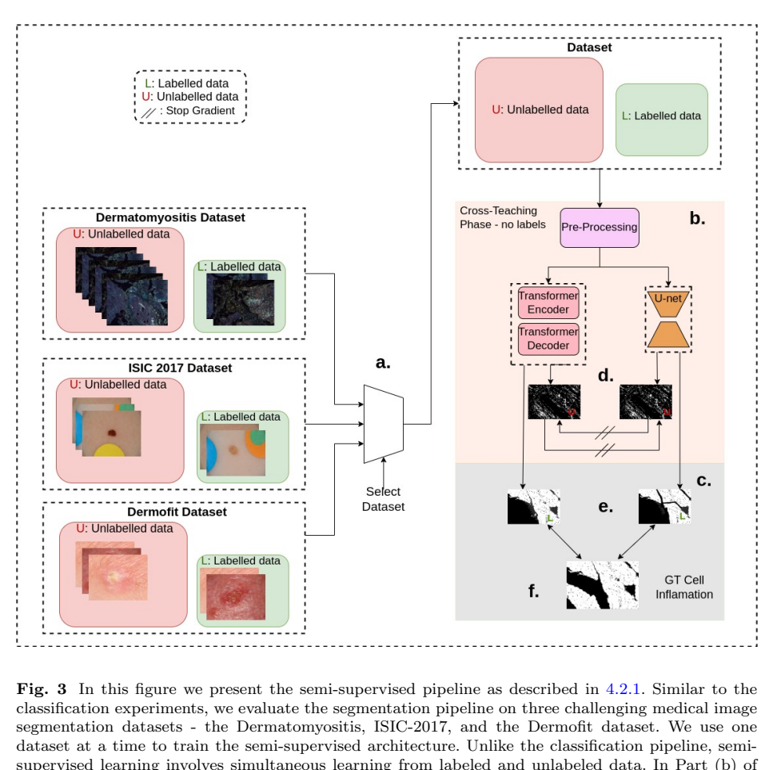
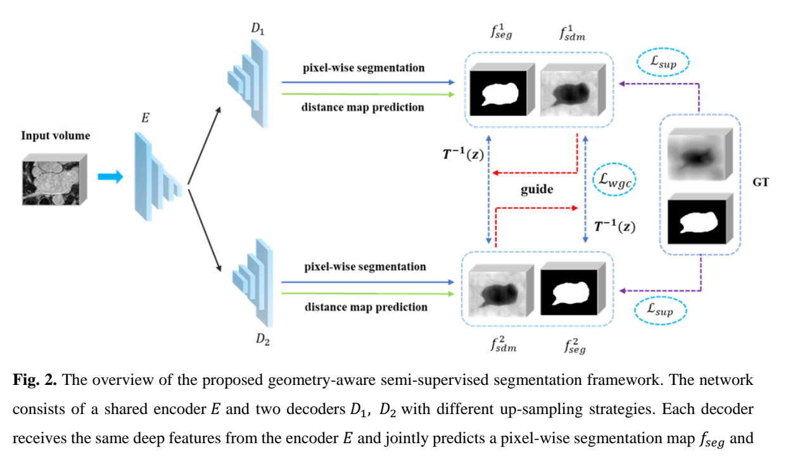

# arXiv 检索结果 / Results

## 1. ASLseg: Adapting SAM in the Loop for Semi-supervised Liver Tumor Segmentation
- Authors：Shiyun Chen, Li Lin, Pujin Cheng, Xiaoying Tang
- First：2023-12-13T08:31:26+00:00；Latest：2024-05-20T11:55:42+00:00
- Abs：https://arxiv.org/abs/2312.07969v2
- PDF：https://arxiv.org/pdf/2312.07969v2
- Code：https://huggingface.co/huggingface, https://huggingface.co/docs/hub/spaces
- 解读来源：PDF 全文，共 5 页，5 页可提取文字
### [中文]
**中文翻译**
- 标题：ASLseg：在循环中适配SAM用于半监督肝脏肿瘤分割
- 摘要：肝脏肿瘤分割对于计算机辅助诊断、手术规划和预后评估至关重要。然而，获取并维护具有密集标注的大规模数据集具有挑战性。半监督学习（SSL）是应对这些挑战的常用技术。最近，Segment Anything Model（SAM）在一些医学图像分割任务中表现出良好性能，但在肝脏肿瘤分割中表现不佳。本文提出了一种名为ASLseg的新型半监督框架，能够有效地将SAM适配到SSL设置中，并结合肝脏肿瘤的领域特定知识和通用知识。具体而言，在特定SSL范式下训练的分割模型将生成的伪标签作为提示提供给微调后的SAM。然后使用适配网络对SAM预测进行细化并生成更高质量的伪标签。最后，选择可靠的伪标签来扩展标记集以进行迭代训练。在LiTS数据集上的大量实验证明了我们的ASLseg具有压倒性的性能。

ASLseg 将半监督分割模型、微调后的医学 SAM 与适配网络串联成三阶段迭代流程：先用 SSL 模型生成伪标签并取前景点作为 SAM 提示，再用适配网络精炼 SAM 输出，最后按 Dice 相似度阈值 0.9 筛选可靠伪标签扩充标注集。LiTS 上仅用 10% 标注数据时，报告 DSC 74.28、JAC 0.65、SE 77.57、SP 94.73、PRE 75.50，优于文中列出的九种 SSL 方法；全监督 U-Net 的 DSC 为 76.16。消融显示 SS+MS+AN 组合最优，但表格排版混乱、部分数字难以可靠对应，且缺少迭代轮数、SAM 提示敏感性等关键证据。

## 1. 问题与动机

论文针对肝脏肿瘤分割中密集标注成本高、公开数据有限的问题，采用半监督学习（SSL）利用大量无标注腹部 CT。作者指出两类常见 SSL 策略——一致性正则化与自训练——都受伪标签质量限制，性能仍明显落后于全监督模型 [p. 1]。另一方面，SAM 具有强泛化与边缘感知能力，但作者认为现有医学 SAM 缺少肝脏肿瘤的领域知识，单独预测难以令人满意；而特定数据集上训练的 SSL 模型虽更懂肿瘤特征，输出仍不可靠 [p. 1]。因此核心问题是：如何把 SAM 的通用知识与 SSL 模型的领域知识结合，生成更可靠的伪标签，缩小半监督与全监督的差距 [p. 1-2]。

## 2. 方法

### 2.1 总体流程

ASLseg 是三阶段框架（Fig. 1，[p. 2]）：
- **Stage I**：用特定 SSL 范式在标注数据与无标注数据上训练分割模型 S_S，并对无标注图像预测伪标签。
- **Stage II**：用带肿瘤的标注数据微调医学 SAM M_S；推理时从 Stage I 伪标签的前景区域随机取一个点作为单点正提示，让 M_S 重新分割无标注图像。
- **Stage III**：用预训练的适配网络 AN 精炼 SAM 预测；再将精炼结果与 S_S 预测按 Dice 相似度比较，超过阈值 β 的伪标签连同无标注图像加入标注集，迭代重训 [p. 2-3]。

### 2.2 半监督目标

训练集记为 D_ssl={D_l, D_u}，标注集含 N_t 个有肿瘤和 N_nt 个无肿瘤样本，无标注集含 M_t 与 M_nt 个对应样本。总损失为
L = L_s + λ·L_u，
其中 L_s 为监督损失，L_u 为无监督损失，λ 平衡二者 [p. 2]。论文以 R-Drop 为例：同一输入两次前向得到 S_S1 与 S_S2，加入对称 KL 散度
L_KL = ½[D_KL(S_S1||S_S2)+D_KL(S_S2||S_S1)]，
并与两次交叉熵 L_ce 组合为 L_s = L_ce + α·L_KL；α 控制 KL 项权重 [p. 2]。作者称 R-Drop 在其内部比较中表现最好，因此选作 ASLseg 的 SSL 组件 [p. 3]。

### 2.3 医学 SAM 微调与提示

医学 SAM 仅用有肿瘤的标注切片 D_sam={(X_i,Y_i)} 微调，采用随机与迭代点击采样策略学习肿瘤区域特征；推理时从 SSL 伪标签前景随机取单点作为提示 [p. 2]。作者说明若改用多点、框或交互提示会产生不同输出，框架可推广到其他提示形式，但将其列为未来工作 [p. 3]。

### 2.4 适配网络

适配网络 AN 采用 U-Net，输入为原图与伪标签的通道拼接 Z_k=concat(x_k, ŷ_k)，输出精炼分割。训练数据由真实标注掩码经随机增强合成：加背景噪声、覆盖前景区域、弹性变换、膨胀、腐蚀等，每项以 0.4 概率随机执行；还加入全黑掩码模拟网络漏检为零的情形（Fig. 2，[p. 3]）。监督损失为
L_seg = L_Dice(Y, AN(Z_k)) + γ·L_ce(Y, AN(Z_k))，
γ 平衡 Dice 与交叉熵 [p. 3]。

### 2.5 伪标签筛选

用 Dice 系数评价 S_S 与 AN 预测的相似度，阈值 β=0.9；高相似度伪标签及对应无标注图像加入标注集，与半监督模型一起重训，迭代至最佳性能 [p. 3-4]。

## 3. 贡献

作者声称的贡献有三点 [p. 2]：(1) 提出 ASLseg，把 SAM 适配进半监督流程，结合 SSL 领域知识与 SAM 通用知识；(2) 设计一系列模拟分割网络预测错误的数据增强，训练用于伪标签精炼的适配网络；(3) 在 LiTS 上广泛实验，证明优于对比方法。

我的解读：方法的新意主要在于工程化组合与“合成错误伪标签训练精炼器”这一设计，而非新的半监督损失或 SAM 结构；论文未与“直接用 SAM 伪标签”或“仅用适配网络”做充分解耦，因此各组件独立贡献的量化证据有限。

## 4. 实验与结果

### 4.1 数据与设置

使用 LiTS 数据集，CT 强度截断至 [-82,198] HU 并归一化，转为切片：6548 张有肿瘤、1683 张无肿瘤；每张 512×512，像素少于 100 的肿瘤被排除。训练/测试按 8:2 划分，训练集中 10% 用于验证；训练集与测试集中有肿瘤切片比例均为 80% [p. 3]。SSL 模型训练集含 6707 张切片（10% 标注、90% 无标注），测试集 1524 张。医学 SAM 微调从 10% 标注数据中选 80% 有肿瘤切片作训练，从半监督测试集中选 80% 有肿瘤切片作测试 [p. 3]。

所有方法统一 U-Net 骨干、SGD、初始学习率 0.01、多项式调度、batch size 16、训练 27000 次迭代 [p. 3]。医学 SAM 采用 Medical SAM Adapter 架构；适配网络为 U-Net，batch size 8，训练 200 次迭代；β=0.9；使用 PyTorch 与 NVIDIA GTX 2080Ti [p. 3-4]。

### 4.2 对比结果

Table 1 报告 10% 标注下与九种 SSL 方法及全监督 U-Net 的比较 [p. 4]。由于 PDF 文本中表格列发生错位，部分数字与方法的对应关系无法可靠辨认；可确认的作者报告为：ASLseg 的 DSC 74.28±0.27、JAC 0.65±0.27、SE 77.57±0.28、SP 94.73±0.22、PRE 75.50±0.29；全监督 FS 的 DSC 76.16±0.28、JAC 0.67±0.27、SE 74.56±0.29、SP 91.37±0.27、PRE 81.27±0.28。R-Drop 一行为 DSC 72.16±0.29、JAC 0.62±0.28、SE 71.95±0.31、SP 90.99±0.28、PRE 77.07±0.30。其余方法（MT、UAMT、DCT、CCT、CPS、URPC、EM、ICT）的数字在文本中交错排列，不能逐项可靠归属，故不在此复述。作者结论是 ASLseg 在四个指标上优于九种 SSL 方法，并强调其 SE 与 SP 较高，而全监督虽精度最高但需要数倍训练数据且误检/漏检更不可接受 [p. 4]。

### 4.3 消融

Table 2 消融 SS、MS、AN 三要素 [p. 4]。文本中同样存在列错位：可辨认的组合包括 SS+MS 为 DSC 72.83±0.28、JAC 0.63±0.27、SE 75.76±0.30、SP 93.68±0.24、PRE 74.67±0.28；SS+MS+AN 为 DSC 74.28±0.27、JAC 0.65±0.27、SE 77.57±0.28、SP 94.73±0.22、PRE 75.50±0.29；另有 SS+AN 为 DSC 74.15±0.28、JAC 0.65±0.28、SE 76.67±0.28、SP 94.02±0.23、PRE 76.00±0.29。仅 SS 的数值在文本中难以确认。作者称加入两个阶段后 DSC 进一步提升并显著降低假阳性与假阴性 [p. 4]。可视化对比见 Fig. 3 [p. 4]，但论文未给出图像层面的定量分析。

## 5. 评估

支持的结论：在作者构建的 LiTS 10% 标注划分上，ASLseg 的 DSC 高于文中可辨认的 SSL 基线（如 R-Drop 72.16、SS+MS 72.83），且 SE/SP 较高；消融支持“SAM+适配网络”相对仅 SSL 有增益。

局限与缺失证据：(1) 表格排版导致多数基线数字无法可靠核对，削弱“优于九种方法”的可验证性；(2) 未报告迭代轮数、每轮新增伪标签数量、β 敏感性、SAM 提示类型/位置敏感性；(3) 适配网络训练仅 200 次迭代，未说明其数据规模与收敛情况；(4) 未与“SAM 伪标签直接使用”“仅适配网络精炼 SSL 伪标签”等强消融对照，组件贡献难以完全分离；(5) 全监督 DSC 76.16 仍高于 ASLseg 74.28，作者以临床误检代价解释，但未提供统计检验或置信区间之外的显著性分析；(6) 仅单一数据集、单一 10% 标注预算，泛化性证据有限。

## 6. 复现

已报告：LiTS；HU 截断 [-82,198] 并归一化；512×512；排除小于 100 像素肿瘤；8:2 划分、训练内 10% 验证；SSL 训练 6707 张（10% 标注）、测试 1524 张；U-Net 骨干、SGD、lr=0.01、多项式调度、batch 16、27000 迭代；Medical SAM Adapter 微调；适配网络 U-Net、batch 8、200 迭代；合成增强概率 0.4；β=0.9；PyTorch、GTX 2080Ti [p. 3-4]。

未报告或无法辨认：R-Drop 的 λ、α 具体取值；SAM 微调的学习率、迭代数与优化器；适配网络的 γ、学习率；合成增强各操作的具体参数；迭代重训的总轮数与停止准则；每轮筛选后的标注集规模；随机种子与重复次数（表中 ± 值含义未说明）；Table 1/2 中多数基线数字的逐项对应关系。复现时需就上述缺失项向作者确认或自行设定并明确标注。

本篇未找到可可靠提取的方法流程图，请查看原文 PDF。

## 2. Shifting to Machine Supervision: Annotation-Efficient Semi and Self-Supervised Learning for Automatic Medical Image Segmentation and Classification
- Authors：Pranav Singh, Raviteja Chukkapalli, Shravan Chaudhari, Luoyao Chen, Mei Chen, Jinqian Pan, Craig Smuda, Jacopo Cirrone
- Venue：Singh, P., Chukkapalli, R., Chaudhari, S. et al. Shifting to machine supervision: annotation-efficient semi and self-supervised learning for automatic medical image segmentation and classification. Sci Rep 14, 10820 (2024)
- Comments：Seventeen pages (incl. references), five figures, and one table. Accepted and published in Scientific Reports 14.1 (2024): 10820
- First：2023-11-17T04:04:29+00:00；Latest：2024-05-17T17:42:30+00:00
- Abs：https://arxiv.org/abs/2311.10319v6
- PDF：https://arxiv.org/pdf/2311.10319v6
- Code：https://huggingface.co/huggingface, https://huggingface.co/docs/hub/spaces
- 解读来源：PDF 全文，共 18 页，18 页可提取文字
### [中文]
**中文翻译**
- 标题：转向机器监督：面向自动医学图像分割与分类的标注高效半监督与自监督学习
- 摘要：临床治疗的进步日益受到监督学习技术局限性的制约，而监督学习严重依赖大量标注数据。标注过程不仅成本高昂，还需要临床专家投入大量时间。为解决这一问题，我们提出了S4MI（医学影像自监督与半监督）流程，这是一种利用自监督和半监督学习进展的新方法。这些技术参与不需要标注的辅助任务，因此与全监督方法相比，简化了机器监督的扩展。我们的研究在三个不同的医学影像数据集上对这些技术进行基准测试，以评估其在分类和分割任务中的有效性。值得注意的是，我们观察到自监督学习在所有评估数据集的分类中显著超越了监督方法的性能。尤为突出的是，半监督方法在分割中表现出更优的结果，在所有数据集上使用少50%的标签的情况下超越了全监督方法。秉承为科学界做贡献的承诺，我们已将S4MI代码公开，以便更广泛地应用和进一步发展这些方法。

S4MI 流程在三个医学影像数据集上比较了自监督（DINO、CASS）、半监督（CNN-Transformer 交叉教学）与全监督/迁移学习。分类任务中，CASS 在多数骨干和标签比例下优于 DINO 与 ImageNet 迁移学习；分割任务中，半监督方法在 50% 标签下超过 100% 标签的全监督方法（作者报告三个数据集均如此），但 ISIC-2017 在 10% 标签时全监督略优。结果以 5 个随机种子的均值与 95% 置信区间报告，分割指标为 IoU，分类为 F1/Recall。

# S4MI：面向医学图像分割与分类的标注高效半监督与自监督学习——详细阅读笔记

## 1. 问题与动机

医学图像深度学习依赖大量专家标注，而标注受隐私、成本与专家时间限制，且无法像自然图像那样众包[pp. 1–2]。数据集规模小，从零训练效果差，因此常用 ImageNet 预训练加目标域微调的迁移学习；但医学图像与自然图像域差异大，迁移收益受限[p. 2]。作者主张转向“机器监督”：用无标签辅助任务预训练，再用少量标签微调，以降低标注依赖并可能超过全监督基线[p. 3]。

## 2. 方法

### 2.1 分类流程

比较三类初始化：ImageNet 全监督迁移学习；DINO 自监督；CASS 自监督[p. 4]。DINO 通过同一图像的非对称增强副本构造正对，最大化嵌入相似度；CASS 则用 CNN 与 Transformer 两种架构处理同一图像，以“架构不变性”构造正对，并联合训练两个编码器[p. 4, p. 7]。作者称 CASS 中 CNN 关注局部、Transformer 关注全局，因此二者嵌入应对齐[p. 7–8]。

训练设置：自监督预训练 100 个 epoch，随后带标签微调 50 个 epoch；微调使用 10% 与 100% 两种标签比例，且“每张图像的标签数不变，只减少使用的图像-标签对比例”[p. 4, p. 6]。骨干包括 ResNet-50 与 ViT-B/16；分类指标为 F1（Dermatomyositis 为多标签分类，Dermofit 与 ISIC-2017 为多类）[p. 4, p. 7]。

### 2.2 分割流程

**全监督基线**：采用 Singh 与 Cirrone 的方法，ResNet-34 骨干的 U-Net，使用图像-掩码对训练[p. 6]。

**半监督方法**：采用 Luo 等的 CNN-Transformer 交叉教学框架[p. 11]。两个分割网络为从零训练的 U-Net 和预训练 Swin Transformer U-Net，同时更新。U-Net 的监督损失为 Dice 与交叉熵的平均：

L_Supervised = ½[DICE(pred_U-Net, L) + CrossEntropy(pred_U-Net, L)]

对无标签数据 U，用 Transformer 预测的 argmax 作为伪标签 U_sudo = argmax(pred_Transformer)，U-Net 的无监督损失为 L_Unsupervised = DICE(pred_U-Net, U_sudo)；最终损失为二者之和[p. 11–12]。批次为 16，其中 8 张有标签、8 张无标签；在 100% 标签比例下改为 15 张有标签、1 张无标签，以近似全监督同时保留交叉教学损失[p. 5]。

**无监督方法**：PiCIE，利用光度变换不变性与几何变换等变性进行像素聚类，训练时不用任何标签，标签仅用于验证与测试[p. 5, pp. 12–13]。作者将优化器从 Adam 改为 SGD（学习率 1e-4），并加入 StepLR，原因是 Adam 下模型有时退化为把所有像素预测为前景或背景；批大小 64 或 128，训练 50 epoch，ResNet-34 特征提取器[p. 5]。

### 2.3 共同实现与预处理

所有模型用 PyTorch，单张 NVIDIA RTX-8000（64 GB RAM、3 CPU 核）；Adam，初始学习率 3.6e-4，权重衰减 1e-5，余弦退火，最大 50 次迭代，最小学习率 3.4e-4；批大小 16；数据增强含随机旋转、随机翻转，并缩放至 224×224 以适配 Swin 的 patch 要求[p. 6]。随机划分 70%/10%/20%（训练/验证/测试），ISIC-2017 按文献 [15] 的 57%/8.5%/34% 划分[p. 6]。三通道数据集对 RGB 红通道做归一化[p. 6]。Dermatomyositis 原图 1408×1876，切成 480×480 并补边，每样本 12 个子图，再缩至 224×224；Dermofit 与 ISIC-2017 用双线性插值到 480×480 再缩至 224×224[p. 6]。所有实验用 5 个不同种子重复，报告 95% 置信区间均值[p. 6]。

## 3. 贡献

作者声称的贡献是提出 S4MI 流程，将自监督与半监督方法系统用于医学图像分类与分割，并在三个数据集上基准测试，证明机器监督可减少标注且不牺牲甚至提升性能；同时开源代码[p. 1–3, p. 15]。我的解读：本文主要是“基准比较与流程整合”，DINO、CASS、交叉教学和 PiCIE 均来自已有工作，新颖性更多在于跨任务、跨数据集的系统性对照与标签比例扫描，而非新算法。

## 4. 实验与结果

### 4.1 数据集

- Dermatomyositis：198 张 RGB 图，来自 7 名患者，352×469；多标签分类（TFH-1、TFH-217、TFH-Like、B cells、others），指标 F1[p. 4]。
- Dermofit：1,300 张，10 类皮肤病变，尺寸 205×205 至 1020×1020[p. 4]。
- ISIC-2017：2,000 张 JPEG，3 类（Melanoma、Seborrheic Keratosis、Benign Nevi），指标 Recall[p. 4]。

### 4.2 分类结果（表 1，p. 9）

表 1 报告 F1（ISIC 为 Recall），含 10% 与 100% 标签。关键数字：

- Dermatomyositis，ResNet-50：DINO 0.8237/0.84252（10%/100%），CASS 0.8158/0.8650，ImageNet 迁移 0.819/0.83895。
- Dermatomyositis，ViT-B16：DINO 0.8445/0.8639，CASS 0.8717/0.8894，ImageNet 迁移 0.8356/0.8420。作者特别指出 CASS+ViT 仅用 10% 标签（0.8717）即超过 100% 标签的迁移学习（0.8420），DINO 在 10% 标签下与全监督相当[p. 7]。
- Dermofit，ResNet-50：DINO 0.3749/0.6775，CASS 0.4367/0.7132，ImageNet 0.33/0.6341；ViT-B16：DINO 0.332/0.4810，CASS 0.3896/0.4667，ImageNet 0.299/0.456。
- ISIC-2017，ResNet-50：DINO 0.322/0.6407，CASS 0.343/0.599，ImageNet 0.288/0.5774；ViT-B16：DINO 0.291/0.5571，CASS 0.321/0.588，ImageNet 0.277/0.5322。

作者结论：CASS 在几乎所有数据集和骨干上优于 DINO 与迁移学习，例外是 ISIC-2017 的 ResNet-50 上 DINO 优于 CASS[p. 7]。表注也称自监督预训练在所有情况下优于 ImageNet 迁移学习[p. 9]。

### 4.3 显著性图

作者用梯度类显著性图比较 DINO 与 CASS 训练的 ResNet-50 和 ViT-B/16 在 ISIC-2017 上的关注区域，称多数图与病理区域不对齐，但 CASS 比 DINO 更聚焦相关病理[p. 7–8]。这是定性观察，未报告定量指标。

### 4.4 分割结果（图 5，p. 14）

指标为 IoU，比较全监督、半监督与无监督（PiCIE，0% 标签）在四个标签比例下的表现[p. 10–11]。作者报告：半监督在所有数据集的所有标签比例上持续优于迁移学习，唯一例外是 ISIC-2017 的 10% 标签，此时二者接近[p. 13]；三个数据集上，半监督用 50% 标签均超过 ImageNet 迁移学习的 100% 标签[p. 13, p. 14]。Dermofit 上半监督在任何标签比例下都优于全监督[p. 14]。Dermatomyositis 上无标签 PiCIE 与 10% 标签的全监督/半监督接近；半监督与全监督在 50%–70% 标签区间收敛[p. 14]。ISIC-2017 在 10% 标签时全监督起初优于半监督，超过 10% 后半监督反超[p. 14–15]。

需要说明：图 5 的具体 IoU 数值在正文中未以表格列出，正文只给出趋势描述；我无法从文本中读出各柱的具体数值，因此不在此编造。

### 4.5 消融与证据强度

本文的“消融”主要体现在标签比例扫描（分类 10%/100%，分割 0%/10%/50%/100% 等）与骨干/方法对照（DINO vs CASS vs 迁移学习；全监督 vs 半监督 vs 无监督）。这些对照支持“减少标签仍可保持或提升性能”的方向性结论，但缺少对预训练 epoch 数、损失权重、伪标签阈值等超参数的消融。

## 5. 评估

支持的结论：在作者设定的三个数据集与实现下，自监督分类普遍优于 ImageNet 迁移学习；CASS 多数情况优于 DINO；半监督分割在 50% 标签下可超过 100% 标签的全监督基线。

局限与缺失证据：
- 数据集较小且模态有限（皮肤病变与病理切片），Dermatomyositis 为私有数据，泛化性证据有限[p. 16]。
- 分割结果仅以图 5 呈现，正文未给逐项数值与置信区间，难以复核具体差距[p. 14]。
- 分类表 1 中部分单元格的置信区间写法不一致（如 ISIC 的 ±0.091），但文本可读。
- 未报告计算成本、预训练数据规模、伪标签质量分析，也未与更多半监督分割基线比较。
- 显著性图结论为定性，未量化。

## 6. 复现

已报告：PyTorch；单张 RTX-8000；Adam，lr 3.6e-4，weight decay 1e-5，余弦退火（最大 50 次迭代，最小 lr 3.4e-4）；批大小 16；224×224 输入；随机旋转/翻转；70/10/20 划分（ISIC 按 57/8.5/34）；5 个种子；分类预训练 100 epoch、微调 50 epoch；半监督批内 8 有标签+8 无标签（100% 时 15+1）；PiCIE 用 SGD lr 1e-4、StepLR、50 epoch、批 64/128[p. 5–6]。

未报告或无法从文本确定：DINO/CASS 的具体增强参数与温度系数；半监督损失中监督与无监督项的加权系数（文中写为求和，未给权重）；伪标签是否经过置信度过滤；PiCIE 的聚类数设置；各数据集的具体训练迭代数；图 5 的逐点 IoU 数值。代码已开源但链接在文本中显示为“link”，未给出可解析 URL[p. 2]。

#### 原论文流程图 · Figure 3 · PDF 第 10 页

Fig. 3 In this figure we present the semi-supervised pipeline as described in 4.2.1. Similar to the classificationexperiments,weevaluatethesegmentationpipelineonthreechallengingmedicalimage segmentation datasets - the Dermatomyositis, ISIC-2017, and the Dermofit dataset. We use one dataset at a time to train the semi-supervised architecture. Unlike the classification pipeline, semi-

[原文来源](https://arxiv.org/pdf/2311.10319v6#page=10)

## 3. Leveraging Fixed and Dynamic Pseudo-labels for Semi-supervised Medical Image Segmentation
- Authors：Suruchi Kumari, Pravendra Singh
- Comments：Under Review
- First：2024-05-12T11:30:01+00:00；Latest：2024-05-12T11:30:01+00:00
- Abs：https://arxiv.org/abs/2405.07256v1
- PDF：https://arxiv.org/pdf/2405.07256v1
- Code：https://huggingface.co/huggingface, https://huggingface.co/docs/hub/spaces
- 解读来源：PDF 全文，共 10 页，10 页可提取文字
### [中文]
**中文翻译**
- 标题：利用固定和动态伪标签进行半监督医学图像分割
- 摘要：半监督医学图像分割因其能够利用未标注数据而受到越来越多的关注。当前最先进的方法主要依赖于协同训练框架内的伪标签。这些方法依赖单一伪标签进行训练，但这些标签不如标注数据的真实标签准确。仅依赖一个伪标签往往导致次优结果。为此，我们提出了一种新方法，其中对同一未标注图像使用多个伪标签来从无标注数据中学习：传统的固定伪标签和新引入的动态伪标签。通过将同一未标注图像的多个伪标签纳入协同训练框架，我们的方法提供了一种更稳健的训练方法，提高了模型性能和泛化能力。我们在三个半监督医学基准分割数据集上验证了我们的新方法：左心房数据集、胰腺CT数据集和Brats-2019数据集。在不同标注数据比例下，我们的方法在多个医学基准分割数据集上显著优于最先进的方法。我们还进行了多项消融实验，以证明我们方法中使用的各个组件的有效性。

该论文提出在协同训练框架中为同一无标注图像同时使用固定伪标签和动态伪标签，以缓解单一伪标签噪声导致的次优问题。动态伪标签由相对固定裁剪图像平移σ像素的四个额外裁剪图像中随机选一生成临时伪标签，再通过COM操作融合固定伪标签的非重叠区域与临时伪标签的重叠区域。在LA、Pancreas-CT和Brats-2019三个数据集上，方法在5%/10%、10%/20%、10%/20%标注比例下均报告了优于对比方法的Dice、Jaccard、95HD和ASD。消融显示动态损失和CutMix各有贡献，β=4、α=0.5、σ=5为选定超参数。

# 论文阅读笔记：Leveraging Fixed and Dynamic Pseudo-labels for Semi-supervised Medical Image Segmentation

## 1. 问题与动机

论文针对半监督医学图像分割中伪标签质量不足的问题。作者指出，当前先进方法多在协同训练（co-training）框架内使用伪标签，但通常只依赖单一伪标签；由于伪标签不可避免地含有噪声、精度不及真实标注，仅依赖一个伪标签会导致次优结果，并可能触发确认偏差（对错误伪标签过拟合）[p. 1]。现有应对策略包括高置信度阈值过滤和不确定性过滤，但前者可能使某些像素在整个训练过程中都未被学习，后者仅保留低不确定性预测参与损失[p. 1]。作者的核心动机是：与其只用一个伪标签，不如为同一无标注图像提供多个伪标签，把学习负担分散到多个伪标签上，从而在协同训练中引入更多变化和多样性[p. 2]。

## 2. 方法

### 2.1 整体框架

方法包含两个结构相似的子网 SN1 和 SN2，共享协同训练框架。每个子网的损失由监督损失和无监督损失组成。监督部分对标注数据使用交叉熵损失与Dice损失，分别对两个子网计算，见式(1)(2)[p. 3]。无监督部分让两个子网互相使用对方的伪标签：一个子网的预测经锐化函数 S 得到软伪标签，另一个子网以MSE损失向其学习[p. 3]。

### 2.2 固定伪标签与动态伪标签

固定伪标签路径：将固定裁剪图像 x_uf 输入一个子网得到预测，另一个子网对同一 x_uf 的预测经锐化得到固定伪标签，二者计算MSE损失，即 L_ufix，见式(3)(5)[p. 4]。

动态伪标签路径是论文的核心设计。设原图 I 尺寸为 H×W×L，固定裁剪图像 x_uf 尺寸为 H′×W′×L′，且 H>H′、W>W′、L>L′[p. 4]。除 x_uf 外，再从原图裁剪四个额外图像 c_d1 至 c_d4，它们分别相对 x_uf 的坐标在左水平、右水平、上垂直、下垂直方向平移 σ 像素，形式化定义见式中的 CROP 操作[p. 4]。随后用 RAND 操作从四个裁剪图像中随机选一个作为动态裁剪图像 x_ud，这一随机选择为无监督损失引入随机性[p. 4]。

由于额外裁剪图像相对 x_uf 平移了 σ 像素，两个子网预测与临时伪标签之间的重叠区域并不完全一致。为此作者使用 COM(.) 操作生成动态伪标签：非重叠区域取自固定伪标签，重叠区域取自临时伪标签[p. 2][p. 4]。图2展示了固定与动态伪标签策略的整体流程，包括监督损失、固定损失、动态损失以及COM操作[p. 5]。动态无监督损失 L_udyn 为预测与动态伪标签之间的MSE，见式(4)(6)[p. 4]。

### 2.3 总损失与多样性机制

子网总损失为 L_SN1 = α L_lsup,SN1 + L_ufix,SN1 + β L_udyn,SN1，子网2同理，见式(7)(8)[p. 4]。α 控制监督损失贡献，β 控制动态无监督损失贡献。

为增强两个子网之间的多样性，作者引入CutMix：从一对无标注图像 x_up、x_uq 生成随机掩码 M，按式(9)(10)混合得到 x_ucutp 和 x_ucutq[p. 5]。CutMix后的无标注图像只送入一个子网，另一个子网接收原始图像；图3展示了该CUT操作[p. 6]。作者称该策略增强子网多样性并促进更有效的协同训练[p. 5]。

## 3. 贡献

作者声称的贡献是：提出一种简单而有效的方法，在协同训练框架中为同一无标注图像同时使用传统固定伪标签和新提出的动态伪标签，从而提升模型性能与泛化能力；并在三个医学分割基准上验证其优于现有方法，同时通过消融展示各组件有效性[p. 1][p. 9]。

我的解读：论文的新颖性主要在于动态伪标签的构造方式——通过平移裁剪产生多个候选裁剪图像、随机选一生成临时伪标签，再用COM操作与固定伪标签融合。这本质上是一种输入层面的扰动与伪标签区域融合策略，而非新的网络结构或新的理论框架。CutMix的使用借鉴自已有工作[p. 4]，因此方法贡献更偏向组合式创新。

## 4. 实验与结果

### 4.1 数据集与预处理

LA数据集：100例3D钆增强MR图像，各向同性分辨率0.625×0.625×0.625；训练时随机裁剪为112×112×80，推理时滑窗尺寸相同、步长18×18×4；报告5%和10%标注比例[p. 6]。Pancreas-CT：82例3D腹部增强CT，分辨率512×512，层厚1.5–2.5 mm；62例训练、20例评估；按软组织结构窗[−120, 240] HU裁剪；训练裁剪96×96×96，推理步长16×16×16；报告10%和20%标注比例[p. 6]。Brats-2019：335例胶质瘤MRI，四种模态T1、T1Gd、T2、T2-FLAIR；250例训练、25例验证、60例评估；训练裁剪96×96×96，测试滑窗步长64×64×64；报告10%和20%标注比例[p. 6]。

### 4.2 训练设置

所有实验使用固定随机种子，在NVIDIA A5000 GPU上运行。BraTS-19使用U-Net骨干，LA和Pancreas-CT使用V-Net骨干[p. 6]。LA和Brats-19使用SGD，初始学习率5×10⁻²，动量0.9，权重衰减10⁻⁴；Pancreas使用SGD，初始学习率2.5×10⁻²，动量0.9，权重衰减10⁻⁴[p. 6–7]。LA训练12k迭代，Pancreas和Brats19训练15k迭代；批大小为4，包含两个无标注块和两个标注块[p. 7]。评价指标为Dice、Jaccard、95HD和ASD[p. 7]。

### 4.3 主要结果

LA 5%标注：Ours Dice 89.55、Jaccard 81.18、95HD 5.48、ASD 1.99；作者称相对第二好方法分别提升1.53%、2.46%、2.42和0.16[p. 5][p. 8]。LA 10%标注：Ours Dice 91.07、Jaccard 83.67、95HD 4.96、ASD 1.65；相对第二好分别提升1.17%、1.99%、1.85和0.09[p. 5][p. 8]。

Pancreas 10%标注：Ours Dice 79.06、Jaccard 66.04、95HD 7.70、ASD 1.50；作者称相对第二好分别提升3.13%、3.92%、1.372和0.042[p. 6][p. 8]。Pancreas 20%标注：Ours Dice 83.71、Jaccard 72.19、95HD 4.87、ASD 1.22；相对第二好分别提升2.18%、2.84%、1.942和0.112[p. 6][p. 8]。

Brats-2019 10%标注：Ours Dice 85.71、Jaccard 76.35、95HD 8.15、ASD 1.83；相对第二好分别提升1.42%、1.61%、1.42和0.1[p. 6][p. 8]。Brats-2019 20%标注：Ours Dice 86.65、Jaccard 77.72、95HD 7.32、ASD 1.70；相对第二好分别提升1.18%、1.4%、0.44和0.3[p. 6][p. 8]。作者强调这些结果均未使用后处理[p. 8]。

### 4.4 消融实验

组件消融在Pancreas 20%标注、β=4下进行[p. 6]。仅监督损失：Dice 71.52、Jaccard 57.68、95HD 18.12、ASD 5.41。加入固定伪标签损失和CutMix：Dice 81.28、Jaccard 68.82、95HD 10.13、ASD 2.67，作者称相比仅监督损失Dice提升超过9%[p. 6][p. 8]。仅CutMix和动态损失（无固定损失）：Dice 82.99、Jaccard 71.26、95HD 5.82、ASD 1.35；作者称动态损失单独相比固定伪标签损失在Dice、Jaccard、95HD、ASD上分别提升2.12%、2.98%、4.66和0.76[p. 6][p. 8]。同时使用固定和动态损失：Dice 83.71、Jaccard 72.19、95HD 4.87、ASD 1.22。去掉CutMix（两个子网接收相同无标注图像）：Dice 83.40、Jaccard 71.80、95HD 5.47、ASD 1.91，作者称最佳Dice降低0.72个百分点[p. 6][p. 8]。

β消融（Pancreas 20%）：β=1时Dice 83.30、Jaccard 71.62、95HD 7.04、ASD 1.91；β=2时83.44、71.85、5.25、1.57；β=3时83.54、72.00、5.06、1.29；β=4时83.71、72.19、5.47、1.22；β=5时83.67、72.21、4.71、1.35[p. 7]。作者选择β=4用于Pancreas，LA用β=0.1，Brats-19用β=1.0[p. 9]。α消融见图5，作者称α=0.5更合适并固定用于所有实验[p. 9]。σ消融在{2,5,10}中进行，作者选择σ=5[p. 9]。

定性结果：图4展示Pancreas 20%标注下不同方法与真实标签的对比，作者称本方法重叠更好、假分割更少[p. 7][p. 8]。图7展示LA数据集上有无动态伪标签损失的迭代分割可视化，作者称使用动态损失的结果更好[p. 8][p. 9]。

## 5. 评估

支持的结论：在三个数据集、多个标注比例下，完整方法在报告指标上优于所列对比方法；消融实验支持固定损失、动态损失和CutMix各自带来增益，尤其是动态损失单独使用时相比固定损失有明显提升。

局限与缺失证据：论文未报告多次运行的均值与方差，仅称使用固定随机种子，因此无法判断提升的统计显著性[p. 6]。未报告参数量、推理时间或计算开销。未与所有对比方法在完全相同骨干和训练细节下重新实现，部分对比结果引用自其他论文。α和σ的消融仅以图5、图6呈现，正文未给出具体数值表[p. 7][p. 9]。动态伪标签的COM操作细节在正文中描述较简，未给出伪代码或区域融合的精确像素级定义。此外，方法在三个数据集上使用不同β值，超参数选择依赖数据集，泛化到新数据集时需额外调参。

## 6. 复现

已报告的可复现设置：LA和Pancreas用V-Net、Brats-19用U-Net；SGD优化器；LA/Brats学习率5×10⁻²、Pancreas 2.5×10⁻²；动量0.9；权重衰减10⁻⁴；LA 12k迭代、Pancreas和Brats 15k迭代；批大小4（两个标注块、两个无标注块）；LA裁剪112×112×80、推理步长18×18×4；Pancreas裁剪96×96×96、推理步长16×16×16；Brats裁剪96×96×96、测试步长64×64×64；α=0.5；σ=5；β在Pancreas为4、LA为0.1、Brats为1.0[p. 6–7][p. 9]。

未报告或无法从正文确认的细节：锐化函数S的具体形式与温度参数；COM操作的精确定义；CutMix掩码的采样分布与patch尺寸；数据划分的具体病例编号；是否使用早停或学习率衰减策略；对比方法的完整超参数。复现时需注意这些缺失项。

本篇未找到可可靠提取的方法流程图，请查看原文 PDF。

## 4. Semi-supervised Medical Image Segmentation via Geometry-aware Consistency Training
- Authors：Zihang Liu, Chunhui Zhao
- Comments：26 pages, 5 figures
- First：2022-02-12T17:07:17+00:00；Latest：2024-05-10T06:04:38+00:00
- Abs：https://arxiv.org/abs/2202.06104v2
- PDF：https://arxiv.org/pdf/2202.06104v2
- Code：https://huggingface.co/huggingface, https://huggingface.co/docs/hub/spaces
- 解读来源：PDF 全文，共 26 页，26 页可提取文字
### [中文]
**中文翻译**
- 标题：基于几何感知一致性训练的半监督医学图像分割
- 摘要：监督式深度学习方法在医学图像分割中的性能往往受限于标注数据的稀缺。作为一项有前景的研究方向，半监督学习通过利用无标注数据信息来辅助学习过程，从而缓解这一困境。本文提出了一种新颖的几何感知半监督学习框架用于医学图像分割，该框架是一种基于一致性的方法。考虑到难以分割的区域主要位于目标边界附近，我们引入了一个辅助预测任务来学习全局几何信息。基于几何约束，通过指数加权策略在模型训练中强调模糊边界区域，以更好地利用有标注和无标注数据。此外，设计了一个双视图网络，从不同视角执行分割并降低预测不确定性。所提方法在公开的左心房基准数据集上进行了评估，在使用10%标注图像时将全监督方法的Dice提高了8.7%，在使用20%标注图像时提高了4.3%。同时，我们的框架优于六种最先进的半监督分割方法。

该论文提出一种几何感知的半监督医学图像分割框架，基于V-Net共享编码器与双解码器（反卷积与三线性插值上采样）进行双视角学习；每个解码器同时预测分割图与符号距离图（SDM），通过SDM导出的分割图与另一解码器的分割图建立跨任务一致性损失，并利用SDM绝对值构造指数权重（ρ=2.0）强调边界区域；在左心房数据集上，10%标注时Dice从79.99%提升至88.66%，20%标注时从86.03%提升至90.34%，均优于六个对比方法；在BraTS 2019脑肿瘤数据集10%标注下Dice从74.43%提升至83.54%。消融显示双解码器、SDM监督、跨任务一致性及指数加权依次带来增益。

# 论文阅读笔记：基于几何感知一致性训练的半监督医学图像分割

## 1. 问题与动机

论文针对医学图像分割中标注数据稀缺的问题，研究半监督分割。作者指出，现有半监督方法主要有两类：自训练方法依赖伪标签质量，错误预测可能被强化；一致性方法（如π模型、mean-teacher）通过输入扰动约束预测一致性，但作者认为它们存在两个不足：一是忽略不同区域对分割任务的重要性差异，难分割区域主要集中在器官或肿瘤边界附近（图1，[p. 3]）；二是源图像常含噪声和低分辨率切片，导致预测不确定性高（[p. 4]）。因此，作者的目标是让模型更关注模糊边界区域，并降低预测不确定性。

## 2. 方法

### 2.1 网络架构

整体框架见图2（[p. 9]）：以V-Net为骨干，共享编码器E，接两个结构相同但上采样策略不同的解码器D1、D2——D1使用原始反卷积，D2使用三线性插值（[p. 8]）。每个解码器同时输出像素级分割图f_seg和几何感知符号距离图f_sdm（[p. 9]）。推理时使用反卷积解码器的输出作为最终分割结果（[p. 17]）。

### 2.2 符号距离图与转换

由二值真值生成SDM的变换T如式(1)：目标内部取负的到边界最近欧氏距离，边界为0，外部取正（[p. 10]）。SDM由额外3D卷积块加tanh激活预测。反向转换采用平滑近似T^{-1}(z)=σ(k·z)，k取尽可能大以逼近分割真值（式(2)，[p. 10]）。

### 2.3 几何感知一致性损失

对标注与未标注数据，跨解码器建立一致性：一个解码器的分割预测与另一解码器SDM经T^{-1}转换后的分割图计算L2距离，双向求和（式(3)，[p. 11]）。作者认为两个分支的差异构成模型扰动，促进不同嵌入空间的特征学习。

### 2.4 指数加权策略

权重ω_j=exp(−ρ·|f_sdm^j(x)|)（式(4)，[p. 12]），ρ控制权重分布；靠近边界的体素权重更大。加权一致性损失L_wgc采用交叉方式：ω1加权第一项、ω2加权第二项（式(5)，[p. 12]）。图3展示ρ=1、2、3时的权重分布（[p. 11]）。

### 2.5 总损失与训练

监督分割损失为两解码器Dice损失与交叉熵损失的均值（式(6)，[p. 12]）。SDM监督损失L_sdf为两解码器SDM预测与真值SDM的L2损失均值（式(7)，[p. 13]）。L_sup=L_seg+β·L_sdf，β经验设为0.3（式(8)，[p. 13]）。总损失L_total=L_sup+λL_wgc（式(9)，[p. 13]），λ采用高斯 ramp-up：λ(t)=0.1×e^{−5(1−t/t_max)}（[p. 13]）。算法1给出训练流程（[p. 14]）。

## 3. 贡献

作者声称的贡献有三点（[p. 4-5]）：提出几何感知半监督框架；设计指数加权一致性损失以在几何边界约束下强调难分割区域，并提出双视角网络降低不确定性；在左心房和脑肿瘤数据集上以少量标注取得优于多个先进方法的表现。

我的解读：核心新颖点在于用SDM同时作为辅助监督和权重来源，将“边界难度”显式编码进一致性损失；双解码器提供模型扰动而非输入扰动。但双解码器与SDM辅助任务在DTC、SASSNet等工作中已有类似思想，本文的增量主要在于指数加权与跨任务一致性的结合。

## 4. 实验与结果

### 4.1 数据集与设置

左心房数据集：2018 Atrial Segmentation Challenge，100例3D钆增强MR，分辨率0.625×0.625×0.625 mm；80例训练、20例测试，预处理与已有研究一致；报告10%和20%标注设置（[p. 15]）。BraTS 2019：335例胶质瘤（259 HGG、76 LGG），四种模态；重采样至1 mm³、零均值单位方差归一化；250例训练、25例验证、60例测试（[p. 15]）。

实现：PyTorch，NVIDIA RTX 2080Ti 11GB；随机裁剪112×112×80（左心房）和96×96×96（脑肿瘤）；旋转、翻转增强；batch size=4（2标注+2未标注）；SGD训练6K迭代，初始学习率0.01，每2500次衰减0.1；ρ=2.0（[p. 15-16]）。推理采用滑窗，左心房步长18×18×4，脑肿瘤64×64×64（[p. 16]）。指标：Dice、Jaccard、ASD、95HD（[p. 17]）。

### 4.2 左心房结果

20%标注（16标注+64未标注）：本文方法Dice 90.34%、Jaccard 82.49%、ASD 1.70、95HD 6.57；对比V-Net仅16标注的86.03%/76.06%/3.51/14.26，以及UA-MT 88.88%、SASSNet 89.54%、DUWM 89.65%、LG-ER-MT 89.62%、DTC 89.42%；全监督上界为91.14%（表1，[p. 16]）。10%标注（8+72）：本文Dice 88.66%、Jaccard 79.80%、ASD 1.95、95HD 7.71；V-Net仅8标注为79.99%/68.12%/5.48/21.11；对比方法中SASSNet最高87.32%、DTC 86.57%（表2，[p. 16]）。作者称Dice相对全监督基线提升8.7%（10%）和4.3%（20%）（摘要，[p. 1]）。

### 4.3 脑肿瘤结果

10%标注（25标注+225未标注）：本文Dice 83.54%、Jaccard 73.35%、ASD 2.13、95HD 10.47；V-Net仅25标注为74.43%/61.86%/2.79/37.11；MT 81.21%、UA-MT 80.85%、SASSNet 81.60%、DTC 81.96%、URPC 81.80%；全监督上界83.84%（表3，[p. 19-20]）。

### 4.4 消融与参数分析

ρ在1.0–3.0范围内，ρ=2.0最佳（Dice 88.66%），1.5–2.5区间性能较稳定（表4，[p. 21]）。消融（20%标注，表5，[p. 21]）：仅L_seg为88.89%；加L_sdf为89.25%；加同任务一致性L_mc为89.81%；加跨任务一致性L_gc为89.94%；加指数加权L_wgc为90.34%。该序列支持各模块的增量贡献，但未报告多次运行的方差或显著性检验。

## 5. 评估

支持的结论：在报告的两个数据集和标注比例下，方法在四项指标上均优于所列对比方法；边界指标（ASD、95HD）优势明显，与几何约束的设计动机一致；消融逐步验证了各组件。

局限与缺失证据：论文未报告随机种子、重复实验的均值/方差或统计检验；未说明对比方法是否在同一代码框架下复现；脑肿瘤仅报告10%标注；未分析失败案例或计算成本；ρ的敏感性分析仅在左心房10%设置下进行；未报告SDM预测精度本身。此外，表3中SASSNet的ASD（4.94）差于其监督基线（2.79），作者未讨论。

## 6. 复现

已报告：骨干V-Net、双解码器上采样策略、SDM生成与转换、损失权重β=0.3、ρ=2.0、λ ramp-up公式、优化器SGD、6K迭代、学习率0.01每2500步衰减0.1、batch 4（2+2）、裁剪尺寸、数据增强、滑窗步长、数据集划分。未报告：SDM预测卷积块的具体通道数/层数、k的具体取值、λ公式中0.1与指数系数的来源、验证集使用方式、早停准则、对比方法实现细节、硬件训练总时长。复现时需自行确定这些细节。

#### 原论文流程图 · Figure 2 · PDF 第 9 页

Fig. 2. The overview of the proposed geometry-aware semi-supervised segmentation framework. The network consists of a shared encoder 𝐸 and two decoders 𝐷 , 𝐷 with different up-sampling strategies. Each decoder 1 2 receives the same deep features from the encoder 𝐸 and jointly predicts a pixel-wise segmentation map 𝑓 and

[原文来源](https://arxiv.org/pdf/2202.06104v2#page=9)

## 5. Adaptive Bidirectional Displacement for Semi-Supervised Medical Image Segmentation
- Authors：Hanyang Chi, Jian Pang, Bingfeng Zhang, Weifeng Liu
- Venue：CVPR 2024
- Comments：Accepted to CVPR 2024
- First：2024-05-01T08:17:43+00:00；Latest：2024-05-01T08:17:43+00:00
- Abs：https://arxiv.org/abs/2405.00378v1
- PDF：https://arxiv.org/pdf/2405.00378v1
- Code：https://github.com/chy-upc/ABD, https://huggingface.co/huggingface, https://huggingface.co/docs/hub/spaces, https://github.com/chy-
- 解读来源：PDF 全文，共 11 页，11 页可提取文字
### [中文]
**中文翻译**
- 标题：自适应双向位移用于半监督医学图像分割
- 摘要：一致性学习是半监督医学图像分割（SSMIS）中处理无标签数据的核心策略，它强制模型在扰动下产生一致的预测。然而，当前大多数方法仅专注于利用特定的单一扰动，这只能应对有限的情况，而同时采用多种扰动又难以保证一致性学习的质量。本文提出了一种自适应双向位移（ABD）方法来解决上述挑战。具体而言，我们首先基于无标签数据的可靠预测置信度设计了一种双向图像块位移来生成新样本，这能有效抑制不可控区域并仍保留输入扰动的影响。同时，为了强制模型学习潜在不可控的内容，我们针对有标签图像提出了一种具有逆置信度的双向位移操作，生成包含更多不可靠信息的样本以促进模型学习。大量实验表明，ABD 在 SSMIS 上取得了新的最先进性能，显著提升了不同的基线方法。源代码可在 https://github.com/chy-upc/ABD 获取。

论文提出自适应双向位移（ABD）方法，用于半监督医学图像分割。ABD包含两个并行模块：ABD-R针对无标签数据，基于预测置信度将低置信度图像块与另一增强图像中高置信度且输出分布最相似的块进行双向交换，以抑制不可控区域并保留输入扰动的影响；ABD-I针对有标签数据，采用逆置信度策略，将高置信度块与另一增强图像的低置信度块交换，迫使模型学习潜在不可控区域。方法可即插即用地嵌入Cross Teaching和BCP等基线。在ACDC数据集5%和10%标签比例下，ABD分别比Cross Teaching提升20.75%和2.07% DSC；在PROMISE12 20%标签下比SCP-Net提升5.0% DSC。消融实验验证了ABD-R与ABD-I的互补性、可靠位移策略优于随机/相同策略，以及K=16为最优块数。

# 论文阅读笔记：Adaptive Bidirectional Displacement for Semi-Supervised Medical Image Segmentation

## 1. 问题与动机

半监督医学图像分割（SSMIS）旨在利用少量标注数据和大量未标注数据训练分割模型，以减轻专家标注负担 [p. 1]。一致性学习是主流策略，通过强制模型在不同扰动下产生一致预测来学习未标注数据。现有方法按扰动类型可分为输入扰动、特征扰动和网络扰动三类，但大多数方法仅使用单一扰动 [p. 1-2]。

作者指出，单一扰动只能应对有限情况，导致决策边界不精确（图1(a)）[p. 1-2]。直观的解决方案是混合多种扰动，但作者观察到直接组合多种扰动会使一致性学习过程失控：例如在CPS框架上叠加弱/强输入增强后，模型反而将背景错误分类为前景（图1(b)）[p. 2]。因此，核心问题是：如何在利用多种扰动优势的同时，保证一致性学习的质量与可控性。

## 2. 方法

### 2.1 问题设定与整体框架

设有标注数据集 $D_l=\{(X_l^i,Y_l^i)\}_{i=1}^N$ 和未标注数据集 $D_u=\{X_u^i\}_{i=N+1}^{M+N}$，且 $N \gg M$（标注图像数量远多于未标注图像）[p. 3-4]。整体框架如图2所示 [p. 3]：对标注和未标注图像分别施加弱增强与强增强，输入两个网络（网络扰动）；对未标注数据使用ABD-R生成新样本进行交叉监督；对标注数据使用ABD-I生成新样本及对应新标签进行监督；两个模块并行训练 [p. 3-4]。

### 2.2 ABD-R：基于可靠置信度的自适应双向位移

对未标注图像 $X_u$ 分别施加弱增强和强增强得到 $X_u^w$ 和 $X_u^s$，经两个网络 $f_{\theta_1}$、$f_{\theta_2}$ 得到 logits 和预测概率 $P_u^w$、$P_u^s$ [p. 4, Eq.1-2]。将图像划分为 $K$ 个 $k\times k$ 的块，对每个块计算平均 logits 作为输出分布 $Z_u^{j,w}$（Eq.3），并计算平均最大类别概率作为置信度 $A_u^{j,w}$（Eq.4）[p. 4]。

对每张增强图像，找出置信度最低的块索引 $ind_{u}^{w\text{-}min}$（Eq.5），以及置信度最高的前 $n$ 个块索引集合 $Ind_u^{w\text{-}top}$（Eq.6）[p. 4]。为增强位移的语义连贯性，从另一图像的高置信度候选块中，选择与当前图像最低置信度块输出分布 KL 散度最小的块（Eq.7）[p. 5]。最终执行双向位移：将一张图像的最低置信度块替换为另一图像中选出的高置信度相似块（Eq.8-9），生成新样本 $X_u^{s\to w}$ 和 $X_u^{w\to s}$，再输入两个网络进行交叉监督 [p. 5]。

### 2.3 ABD-I：基于逆置信度的自适应双向位移

ABD-R 用新块替换了不可控区域，但模型并未直接学习原始不可控区域。为此，ABD-I 针对标注图像 $X_l$ 的弱增强 $X_l^w$ 和强增强 $X_l^s$，计算各自的最高置信度块索引 $ind_l^{w\text{-}max1}$、$ind_l^{s\text{-}max1}$ 和最低置信度块索引 $ind_l^{w\text{-}min}$、$ind_l^{s\text{-}min}$ [p. 5]。与 ABD-R 相反，ABD-I 将一张图像的最高置信度块替换为另一图像的最低置信度块（Eq.10-11），生成 $X_l^{s\to w}$ 和 $X_l^{w\to s}$。作者说明此处直接使用 top-1 高置信度块而非从候选中选择，因为这些区域是最可控的，无需考虑与标注的语义连贯性 [p. 5]。同样的位移操作应用于原始标签，生成新标签 $Y_l^{s\to w}$ 和 $Y_l^{w\to s}$（Eq.12-13）[p. 5]。

### 2.4 损失函数

总损失为 $L = L_{sup} + \lambda L_{semi} + \lambda L_{aug}$，其中 $\lambda$ 按高斯预热从 0.1 逐渐增加：$\lambda = 0.1 \cdot e^{-5\times(1-t/t_{total})^2}$ [p. 6]。

$L_{sup}$ 包含原始增强标注图像的监督损失 $L_{sup}^{aug}$（Eq.15，交叉熵 + Dice）和位移后标注样本的监督损失 $L_{sup}^{abd}$（Eq.16）[p. 6]。$L_{semi}$ 包含原始增强未标注图像的损失 $L_{semi}^{aug}$（Eq.17，Dice）和位移后未标注样本的交叉监督损失 $L_{semi}^{abd}$（Eq.18）[p. 6]。

## 3. 贡献

作者声称的贡献有三点 [p. 2]：(1) 观察到不同扰动组合导致一致性学习不稳定，提出 ABD-R 通过用可信区域替换模型不适应区域来生成语义互补数据；(2) 提出 ABD-I，利用逆置信度为标注数据生成更多不可靠信息，迫使模型学习潜在不可控区域；(3) 方法即插即用，可嵌入不同基线并显著提升性能。

我的解读：ABD 的核心创新在于将“位移”从简单的数据增强提升为一种基于模型预测置信度的自适应样本生成机制，且针对有/无标签数据设计了方向相反的策略（可靠→不可靠 vs. 不可靠→可靠），形成互补。但方法本身依赖两个网络和多次前向传播，计算开销未在论文中讨论。

## 4. 实验与结果

### 4.1 数据集与设置

- **ACDC**：200 例心脏 cine-MR 图像，4 类。70 例训练、10 例验证、20 例测试。指标：DSC、Jaccard、95HD、ASD [p. 6]。
- **PROMISE12**：50 例前列腺 MRI，3D 转 2D 切片。指标：DSC、ASD [p. 6]。
- **基线**：Cross Teaching（UNet + Swin-UNet，网络扰动）和 BCP（mean-teacher，两个不同初始化学生网络）[p. 6]。
- **训练细节**：Cross Teaching 输入裁剪 224×224，K=16 块，batch size 16（8 标注 + 8 未标注）；BCP 输入 256×256，K=16。弱增强为随机旋转和翻转，强增强为 colorjitter、blur、Cutout [p. 6]。

### 4.2 主要结果

**ACDC**（表1）[p. 7]：5% 标签下，ABD(Cross Teaching) 相比 Cross Teaching 提升 20.75% DSC；ABD(BCP) 相比 BCP 提升 1.37% DSC。10% 标签下，ABD(BCP) 达到 89.81% DSC、81.95% Jaccard、1.46 95HD、0.49 ASD，优于 SCP-Net 的 89.69% DSC [p. 7]。

**PROMISE12**（表2）[p. 7]：20% 标签下，ABD 相比 SCP-Net 提升 5.0% DSC。

### 4.3 消融实验

- **模块有效性**（表3）[p. 8]：在 ACDC 10% 标签、Cross Teaching 基线上，仅加输入扰动（IP）使 DSC 从 86.45% 降至 86.25%；加 ABD-R 升至 87.42%；加 ABD-I 升至 87.20%；两者同时加入达到 88.52% DSC，比基线提升 2.07% [p. 8]。
- **位移策略**（表4）[p. 8]：Random 86.55%、Same 87.22%、Same+Reliable 87.38%、Reliable 87.42% DSC，验证可靠位移策略最优。
- **块数 K**（表5）[p. 8]：K=4 时 87.39%，K=16 时 88.52%，K=64 时 87.54%，K=16 最优。
- **强增强选择**（表6）[p. 8]：colorjitter + cutout 组合最佳（88.52% DSC）。

## 5. 评估

**支持的结论**：消融实验清晰表明 ABD-R 和 ABD-I 互补，且可靠位移策略优于随机或相同位置位移；在 ACDC 和 PROMISE12 上均取得 SOTA，且方法可嵌入不同基线（Cross Teaching 和 BCP）[p. 7-8]。

**局限与缺失证据**：(1) 论文未报告计算开销或推理时间，ABD 需要多次前向传播和 KL 散度计算，实际部署成本未知；(2) 未讨论超参数 $n$（候选块数量）的选取及其敏感性；(3) 未在更多数据集（如 3D 数据或其他模态）上验证泛化性；(4) 表1 和表2 的排版在提供的文本中部分数字难以精确对应，例如表1 中部分方法的行列对应关系无法完全辨认，已尽量依据上下文提取可读数字 [p. 7]；(5) 作者在结论中提出未来将设计块自适应位移策略，暗示当前固定块划分可能不是最优 [p. 8]。

## 6. 复现

**已报告设置**：
- 基线：Cross Teaching（UNet + Swin-UNet）和 BCP（两个不同初始化学生网络）[p. 6]。
- 输入尺寸：Cross Teaching 224×224，BCP 256×256；块数 K=16 [p. 6]。
- Batch size：16（8 标注 + 8 未标注）[p. 6]。
- 弱增强：随机旋转、翻转；强增强：colorjitter、blur、Cutout [p. 6]。
- 损失权重 $\lambda$：高斯预热，初始 0.1 [p. 6]。
- 数据划分：ACDC 70/10/20（训练/验证/测试）[p. 6]。

**未报告细节**：优化器类型、学习率、训练迭代次数 $t_{total}$、候选块数量 $n$ 的具体取值、ABD-I 中是否也使用 KL 散度选择（文中明确说直接使用 top-1，不选候选）[p. 5]、硬件配置、代码复现的具体随机种子。这些信息在提供的正文中未明确给出，复现时需参考作者开源代码或原文补充材料。

本篇未找到可可靠提取的方法流程图，请查看原文 PDF。

